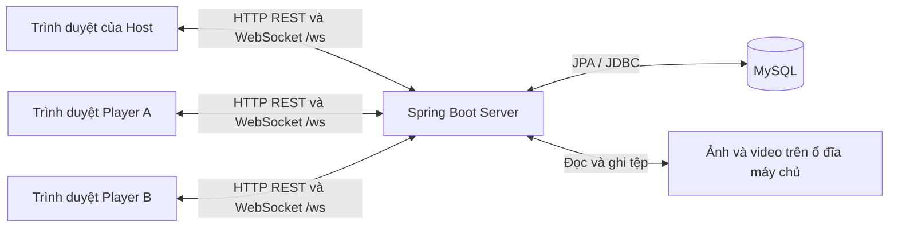

# Trò chơi nhiều chế độ qua mạng — tài liệu giới thiệu cho nhóm

> **Phạm vi của tài liệu:** Bản này diễn giải các luật chơi và lựa chọn kiến trúc mà nhóm đã chốt. Nguồn là các trao đổi về gameplay và báo cáo khảo sát code ngày 09/10/2026. Nhóm vừa tiếp tục sửa project sau thời điểm đó; trước khi dùng bản này để khẳng định một tính năng **đã chạy**, cần đối chiếu source và demo mới nhất. Các ví dụ bên dưới là ví dụ minh họa luật, không phải kết quả thử nghiệm.

## 1. Project của chúng ta là gì?

Đây là trò chơi thi đấu cá nhân nhiều người qua mạng nội bộ. Một người tạo phòng (**Host**), chọn các màn chơi và bộ câu hỏi. Những người còn lại vào phòng bằng trình duyệt trên máy tính hoặc điện thoại cùng mạng Wi-Fi. Tất cả cùng thấy một câu tại cùng giai đoạn, gửi đáp án của riêng mình và cạnh tranh trên **một bảng xếp hạng xuyên suốt trận**.

Trận có thể chỉ chọn một chế độ hoặc chọn tối đa bảy chế độ, không bắt buộc phải chơi đủ. Quiz bốn lựa chọn là một chế độ trong số đó. Mỗi màn có một bộ câu hỏi đúng loại, số câu và thời gian trả lời do Host cấu hình; tổng số câu của trận tối đa 50. Mục tiêu là giải trí: ở luật mới người chơi bắt đầu từ 0 điểm, điểm không xuống dưới 0 và không bị loại chỉ vì trả lời sai.

Về công nghệ, project dùng **Web Client → REST/WebSocket → một Spring Boot Server → một MySQL Database**. Server chạy trên một máy. Khi demo trên LAN, các Client truy cập địa chỉ IP nội bộ của máy đó; không có Cloud hoặc nhiều Server. Việc có thể truy cập qua cùng Wi-Fi là mục tiêu thiết kế; demo đa thiết bị chỉ được gọi là đã kiểm chứng khi nhóm thực sự chạy trên các máy khác nhau.

## 2. Ai làm gì trong trò chơi?

| Vai trò | Việc có thể làm |
|---|---|
| Người tạo bộ câu | Tạo câu hỏi thuộc một chế độ, đặt đáp án hợp lệ và chọn PUBLIC hoặc PRIVATE. Video bài hát do người tạo cắt sẵn rồi upload; ảnh/video được Server lưu local. |
| Host | Tạo Room, chọn thứ tự các chế độ, một bộ câu cho từng màn, số câu và thời gian; quản lý phòng, bắt đầu hoặc hủy trận theo quyền Room. Host có thể tham gia với tư cách Player hoặc quan sát nếu quyền và bộ câu cho phép. |
| Player | Vào phòng, bấm sẵn sàng ở phần giới thiệu màn, xem câu, trả lời và xem điểm của mình cùng bảng xếp hạng. Mỗi người có một Answer riêng; không phải cả phòng cùng nộp một đáp án. |
| Host spectator | Quản lý Room và xem trận nhưng không phải một Player cần trả lời hoặc bấm Tiếp tục để mở màn sớm. |

Trong thư viện bộ câu, **Của tôi** gồm các bộ PUBLIC và PRIVATE do mình tạo. **Chung** gồm mọi bộ PUBLIC, kể cả PUBLIC của mình. PRIVATE của người khác không hiện trong danh sách khám phá. Một bộ PRIVATE được Host có quyền đưa vào Room vẫn có thể được những Player được mời chơi; quyền chọn/sửa bộ câu và quyền tham gia trận là hai chuyện khác nhau. Theo policy bảo toàn từ Quiz cũ, tác giả của bộ được chọn không tham gia trận với vai trò Player, nhưng có thể Host spectator. Nhóm nên kiểm tra lại chính sách này trên bản code mới nhất khi demo nhiều bộ.

Khi Start, Server chụp **snapshot** của cấu hình và nội dung dùng cho trận. Nhờ vậy tác giả sửa bộ câu sau đó không làm câu đang chơi hoặc lịch sử trận đã kết thúc thay đổi.

### 2.1. Phân biệt quyền quản lý và vai trò tham gia

Hệ thống xét hai thông tin riêng: **ai là Host của Room** và **người đó tham gia với tư cách PLAYER hay SPECTATOR**. Host có thể vừa quản lý vừa chơi, hoặc chỉ quản lý và quan sát. Thành viên khác cũng có thể chọn chơi hoặc quan sát khi vào phòng. Quyền Host chỉ áp dụng trong phòng/trận của mình, không phải quyền quản trị toàn bộ hệ thống.

| Thao tác | Host | Player là thành viên thường | Điều kiện và giới hạn |
|---|---|---|---|
| Tạo phòng mới | Có; người tạo trở thành Host. | Có thể tạo phòng riêng và trở thành Host ở phòng đó. | Cần đăng nhập, cấu hình và bộ câu hợp lệ. |
| Sửa tên phòng, số chỗ, chế độ, thứ tự màn, bộ câu, số câu và thời gian | Có. | Không được sửa phòng của Host khác. | Chỉ khi Room ở `DRAFT` hoặc `WAITING`; Server kiểm tra phiên bản cấu hình để tránh ghi đè thay đổi mới. |
| Mở phòng để mời người khác, đóng phòng | Có. | Không. | Mở từ `DRAFT`; đóng khi `DRAFT`/`WAITING`. Đóng Room trước trận khác với hủy Game đang chạy. |
| Vào phòng bằng mã | Host đã là thành viên khi tạo phòng. | Có. | Phòng phải `WAITING`, mã đúng, còn chỗ và vai trò hợp lệ; không thêm người mới khi trận đã chạy. |
| Đổi vai trò chơi/quan sát của bản thân | Có. | Có. | Thực hiện khi phòng chờ; vai trò PLAYER phải thỏa giới hạn chỗ và quy tắc tác giả bộ câu. |
| Rời phòng chờ | Không dùng thao tác Leave; Host có thể đóng phòng. | Có. | Chỉ khi `WAITING`; Host nhận lỗi `HOST_CANNOT_LEAVE` nếu cố tự rời. |
| Mời thành viên khác ra khỏi phòng | Có. | Không. | Chỉ khi `WAITING`, không được mời chính Host ra. Đây là loại khỏi danh sách hiện tại, không phải cơ chế cấm tài khoản vĩnh viễn. |
| Bắt đầu trận | Có. | Không. | Room phải `WAITING`, có ít nhất 3 Player, đủ câu và quyền dùng bộ câu; Server kiểm tra lại toàn bộ điều kiện. Host spectator không được tính vào số Player. |
| Bấm Tiếp tục ở giới thiệu màn | Có nếu Host là PLAYER. | Có. | Chỉ trong phase `INTRO`, trước deadline; SPECTATOR không có quyền và không nằm trong tập cần bấm. |
| Gửi đáp án | Có nếu Host là PLAYER. | Có. | Chỉ câu đang mở, trước deadline; tối đa một Answer hợp lệ mỗi câu, không nộp thay người khác. |
| Dùng Spin/Hope Star | Có nếu Host là PLAYER. | Có. | Chỉ Quiz, trong phase quyết định và còn tài nguyên; tuân theo luật kết hợp effect. |
| Xem diễn biến, kết quả và bảng xếp hạng | Có. | Có. | Là thành viên của trận; SPECTATOR cũng được xem dữ liệu mà Server cho phép. |
| Hủy trận đang diễn ra | Có. | Không. | Chỉ Host của Game đang `ACTIVE`; kết thúc theo trạng thái hủy. |
| Tự sửa điểm, chọn effect Spin, đổi deadline hoặc ép chuyển câu | Không có quyền này. | Không có quyền này. | Server tính điểm, chọn effect và tự điều khiển tiến trình theo luật; Host chơi cũng chịu cùng luật với Player khác. |

**SPECTATOR** được theo dõi phòng/trận nhưng không trả lời, không có điểm thi đấu và không dùng Spin/Star. Nếu SPECTATOR đồng thời là Host thì vẫn giữ quyền quản lý của Host, gồm quyền Start và hủy trận đúng trạng thái. Việc có thể xem trận không đồng nghĩa được xem đáp án đúng trước khi công bố.

### 2.2. Host có được dùng hoặc sửa mọi bộ câu không?

Không. **Quyền quản lý Room và quyền sở hữu bộ câu là độc lập.** Bất kỳ tài khoản nào cũng có thể tạo bộ câu của mình; tác giả mới được sửa/xóa bộ đó. Host được chọn bộ PUBLIC hoặc bộ PRIVATE do chính mình sở hữu, nhưng việc chọn PUBLIC của người khác không cấp quyền sửa bộ ấy. Player được mời vào trận dùng bộ PRIVATE có thể nhận nội dung cần chơi theo snapshot, không được vì vậy mà khám phá hoặc sửa bộ gốc.

Tác giả của **bất kỳ bộ câu được chọn trong trận** không được tham gia trận đó với vai trò PLAYER; chỉ được quan sát. Ví dụ Host chọn bộ Đố mẹo do mình tạo thì phải làm Host spectator; nếu một thành viên khác là tác giả của bộ Quiz cũng được chọn, thành viên đó cũng phải quan sát. Quy tắc áp dụng cho toàn trận nhiều chế độ, không chỉ lúc chơi màn chứa bộ của tác giả.

### 2.3. Quyền được kiểm tra ở đâu?

Giao diện hiển thị nút theo vai trò để dễ dùng, nhưng **Server mới là nơi thực thi quyền**. Mỗi yêu cầu được xét theo tài khoản đã xác thực, Room/Game đích, tư cách thành viên, vai trò tham gia, quyền bộ câu và trạng thái hiện tại. Player tự gửi request Start/hủy trận hoặc SPECTATOR tự gửi Answer vẫn bị từ chối dù đã sửa JavaScript để hiện nút.

Ví dụ Host có quyền sửa cấu hình lúc chờ, nhưng khi Start thành công thì cấu hình trận đã được chụp snapshot và không sửa giữa trận. Host có quyền bắt đầu trận, nhưng nếu chỉ có hai Player thì Server vẫn từ chối. **Có quyền thực hiện thao tác** và **đang đủ điều kiện thực hiện thao tác** là hai kiểm tra cùng phải vượt qua.

## 3. Bảy chế độ chơi

| Chế độ | Trên màn hình | Người chơi trả lời như thế nào? | Ví dụ minh họa |
|---|---|---|---|
| **Quiz** | Câu hỏi và bốn lựa chọn A/B/C/D. Trước câu có thời gian chọn chiến thuật. | Chọn một đáp án; có thể dùng Spin hoặc Hope Star theo tài nguyên còn lại. | “Thủ đô Việt Nam là đâu?” → chọn Hà Nội. |
| **Đoán tên bài hát** | Đoạn video ngắn có hình và âm thanh do tác giả đưa lên. | Gõ tên bài hát; có thể chấp nhận các tên gọi khác đã được tác giả khai báo. | Xem/nghe một đoạn và nhập tên bài hát. |
| **Vua Tiếng Việt** | Những chữ hoặc mảnh chữ bị xáo trộn. | Sắp chúng thành một từ hoặc cụm từ có nghĩa rồi gửi kết quả. | Ghép các mảnh thành “đậu phộng”. |
| **Đố mẹo** | Một câu đố bằng chữ. | Gõ lời giải. | “Cái gì càng lấy đi càng lớn?” → “cái hố”, nếu được đặt là đáp án. |
| **Truy tìm dấu vết** | Câu đố và các gợi ý xuất hiện lần lượt theo thời gian chung. | Đọc các dấu vết đã mở và gõ đáp án; không phải chờ đủ gợi ý mới được trả lời. | Đoán một địa danh từ các gợi ý được công bố dần. |
| **Đuổi hình bắt chữ** | Một hình ảnh gợi một từ hoặc cụm từ. | Quan sát hình rồi nhập chữ. | Hình gợi thành ngữ; đáp án là thành ngữ, không nhất thiết là tên đồ vật trong ảnh. |
| **Sắp xếp trình tự** | Một số mục đang ở sai thứ tự. | Sắp **toàn bộ** các mục đúng thứ tự và nộp. | Sắp các bước của một quá trình theo thứ tự xảy ra. |

Với đáp án nhập chữ, hệ thống so khớp **có dấu tiếng Việt**, không phân biệt chữ hoa/thường, bỏ khoảng trắng đầu/cuối và gộp nhiều khoảng trắng liên tiếp. Không tự bỏ dấu hoặc đoán “gần đúng”. Tác giả có thể định nghĩa nhiều đáp án hợp lệ, chẳng hạn tên gọi vùng miền. Các chế độ sắp xếp phải gửi đủ phần tử, không có phần tử lạ hoặc trùng; chế độ Trình tự chỉ đúng khi cả thứ tự đúng.

## 4. Từ lúc tạo phòng đến khi hết trận

1. Người dùng đăng ký/đăng nhập. Người tạo chuẩn bị bộ câu hỏi theo từng chế độ, chọn PUBLIC hoặc PRIVATE.
2. Host tạo Room, chọn một đến bảy chế độ khác nhau theo thứ tự, một bộ câu đúng loại cho mỗi màn, số câu và thời gian trả lời từng màn. Player khác tham gia Room.
3. Host bấm Start. Server kiểm tra người chơi, quyền dùng bộ câu và nội dung, tạo Game cùng snapshot. Mọi người cùng vào màn giới thiệu của chế độ đầu tiên.
4. Màn giới thiệu tối đa **10 giây**. Nếu mọi Player bấm **Tiếp tục**, Server mở màn sớm; Host spectator không giữ cả phòng chờ. Nếu còn Player chưa bấm, Server tự mở khi hết giờ. Giới thiệu chỉ lặp lại lúc đổi chế độ, không lặp giữa các câu của cùng màn.
5. **Riêng Quiz:** trước mỗi câu có **7 giây** để chọn Spin, Hope Star hoặc chơi thường. Sau đó Server mở câu hỏi cho cả phòng. Các chế độ còn lại vào câu hỏi theo flow của màn mà không có Spin/Star.
6. Mỗi Player gửi tối đa một Answer hợp lệ cho câu. Server đóng câu khi điều kiện mọi người cần chờ đã trả lời, hoặc hết thời gian trả lời của màn. Server chấm và công bố đáp án, biến động điểm và bảng xếp hạng trong giai đoạn kết quả chung khoảng **1,5 giây**.
7. Server tự mở câu kế tiếp, màn giới thiệu chế độ kế tiếp hoặc kết quả cuối trận. Không cần Host bấm chuyển câu. Hủy trận là thao tác quyền Host; lịch sử trận đã lưu vẫn có thể xem theo chức năng hiện có.

**Ví dụ:** Room chọn Quiz 5 câu rồi Đố mẹo 3 câu. Cả phòng xem giới thiệu Quiz; trước từng câu Quiz có 7 giây quyết định chiến thuật. Hết câu thứ năm, cả phòng xem giới thiệu Đố mẹo tối đa 10 giây. Ba câu Đố mẹo dùng cùng tổng điểm đã có từ Quiz. Hết câu thứ ba, Server kết thúc và xếp hạng toàn trận.

## 5. Điểm và bảng xếp hạng

### 5.1. Sáu chế độ ngoài Quiz

Trả lời **đúng: +10**. Riêng **câu cuối của mỗi màn không phải Quiz**, đúng được **+20**. Trả lời sai hoặc không trả lời: **+0**, không bị trừ điểm. Câu cuối Quiz không có thưởng nhân đôi. Các màn cộng vào cùng một tổng điểm.

Ví dụ màn Đố mẹo có ba câu: đúng câu đầu được 10 điểm, sai câu thứ hai được 0, đúng câu thứ ba được 20. Tổng màn đó thêm **30 điểm**.

### 5.2. Quiz, Spin và Hope Star

Quiz thông thường đúng **+10**, sai **−4**, không trả lời **−1** trước khi xét effect. Spin quay ngẫu nhiên một effect theo trọng số của luật Quiz; người chơi không được quay lại chỉ vì không thích effect. Số lượt Spin mỗi người là `floor(số câu Quiz trong toàn trận / 10)` và chỉ tiêu tại Quiz: 9 câu Quiz có 0 lượt, 10 câu có 1 lượt, 20 câu có 2 lượt. Nếu trận có Quiz, mỗi người tối đa một Hope Star; trận không chọn Quiz thì không cấp cả Spin lẫn Star.

Star dùng riêng hoặc thêm sau Spin khi effect cho phép. Nếu đã dùng Star riêng trước, không Spin tiếp trong cùng câu; HARDSHIP không được cộng Star. Bảng điểm chốt của từng cách chơi:

| Cách chơi Quiz | Đúng | Sai | Không trả lời |
|---|---:|---:|---:|
| Thường | +10 | −4 | −1 |
| Star riêng | +25 | −14 | −7 |
| BONUS | +15 | −4 | −1 |
| BONUS + Star | +30 | −4 | −1 |
| SAFE | +8 | −2 | 0 |
| SAFE + Star | +20 | −2 | 0 |
| BREAKTHROUGH | +18 | −7 | −3 |
| BREAKTHROUGH + Star | +30 | −12 | −6 |
| SPEED | +22 | −10 | −4 |
| SPEED + Star | +35 | −16 | −8 |
| DECISIVE | +28 | −15 | −7 |
| DECISIVE + Star | +40 | −22 | −10 |
| HARDSHIP | +8 | −6 | −2 |

Spin có sáu effect BONUS/SAFE/BREAKTHROUGH/SPEED/DECISIVE/HARDSHIP với trọng số lần lượt **25/20/25/15/10/5**; đây là xác suất tương đối, không phải sáu nút để người chơi tự chọn.

**Streak:** năm câu Quiz đúng liên tiếp cấp Momentum; năm câu Quiz sai liên tiếp cấp Recovery. Đúng cắt chuỗi sai, sai cắt chuỗi đúng, không trả lời cắt cả hai. Momentum cộng thêm **+3** vào lần đúng phù hợp tiếp theo; Recovery giảm một khoản phạt gốc âm bằng `min(basePenalty + 3, 0)` và bị tiêu dù khoản phạt sau giảm bằng 0. Nếu base penalty là 0 hoặc đáp án đúng thì Recovery được giữ. Effect vừa được cấp không tác động ngược chính câu tạo streak; effect không chồng vô hạn.

Điểm của trận nhiều chế độ **không bao giờ âm**. Ví dụ đang 0 điểm và Quiz thường sai (phạt −4), điểm vẫn 0; thông báo cho Player phải thể hiện biến động thực tế là **0**, không nói đã mất 4 điểm. Người chơi không bị loại. Trận Quiz phiên bản cũ trong History có thể đã bắt đầu 20 điểm và loại người âm điểm; đó là luật của bản cũ, không dùng để giải thích trận nhiều chế độ mới.

### 5.3. Nếu bằng điểm thì ai xếp trên?

Server xếp theo **tổng điểm cao hơn**. Nếu bằng điểm, so **tổng thời gian trả lời những câu ĐÚNG**: ai ít thời gian hơn đứng trên. Câu sai, câu bỏ trống, thời gian chọn chiến thuật, màn giới thiệu và chờ kết quả không cộng vào chỉ số này. Nếu điểm và thời gian đúng đều bằng nhau thì đồng hạng. Thời gian tính trên Server từ lúc mở câu đến lúc Server nhận Answer hợp lệ; Client không tự khai thời gian để được xếp cao hơn.

Ví dụ A và B cùng 40 điểm. A có tổng thời gian của các câu đúng 28 giây, B là 34 giây: A xếp trên. Nếu cả hai đều 28 giây theo độ chính xác hệ thống dùng, họ đồng hạng.

## 6. Kiến trúc client–server của hệ thống

### 6.1. Hệ thống được bố trí như thế nào?

Project dùng **kiến trúc client–server tập trung**: nhiều trình duyệt kết nối đến một ứng dụng Spring Boot, ứng dụng đó xử lý luật chơi và truy cập MySQL. Frontend là HTML/CSS/JavaScript trong `src/main/resources/static`, được chính Spring Boot phục vụ. Người chơi mở website để tải giao diện; JavaScript chạy trên thiết bị của từng người, còn Java chạy trên máy chủ.

Các Client trao đổi thông qua Server. Ví dụ A nộp đáp án, Server nhận và xử lý, sau đó gửi kết quả cho các thành viên của trận. **Host là quyền của một tài khoản trong Room; Server là chương trình chạy trên máy chủ.** Host cũng dùng trình duyệt như Player. Máy chạy Server có thể đồng thời mở trình duyệt để làm Host, nhưng hai vai trò này vẫn khác nhau; đóng tab Host không đồng nghĩa với dừng chương trình Server.

Khi demo LAN, ví dụ máy chủ có IP `192.168.1.10` và port `8080`, thiết bị khác mở `http://192.168.1.10:8080`. Đây là địa chỉ minh họa, phải thay bằng IP thực tế. Cấu hình hiện tại mặc định lắng nghe `127.0.0.1`, nên để thiết bị khác truy cập cần đặt `SERVER_ADDRESS` thành địa chỉ LAN hoặc `0.0.0.0`, thêm origin truy cập tương ứng vào `ALLOWED_ORIGINS` và cho phép kết nối đến port đó qua firewall. `localhost` trên điện thoại chỉ chính điện thoại, không chỉ máy chủ.

### 6.2. Trách nhiệm của từng thành phần

| Web Client trên máy từng người | Spring Boot Server trên máy chủ |
|---|---|
| Hiển thị đăng nhập, thư viện bộ câu, Room, màn giới thiệu, câu hỏi, lựa chọn/ô nhập/sắp xếp, media, đồng hồ, điểm và bảng xếp hạng. | Xác thực tài khoản và quyền; quản lý Room, danh sách Player, trận, thứ tự màn và snapshot câu hỏi. |
| Gửi thao tác tạo phòng, chọn bộ, Start, Continue, Spin/Star, Answer, reconnect; hiển thị thông báo Server trả về. | Gán deadline chung, kiểm tra Answer đến kịp không, tính effect và điểm, xếp hạng, ghi MySQL rồi công bố kết quả. |
| Phát video tại vị trí phù hợp với thời điểm câu đã mở; hiển thị clue chỉ sau khi Server công bố. | Quyết định clue nào đã được mở, tài nguyên nào còn, yêu cầu nào trùng, Answer nào được nhận. |

MySQL giữ dữ liệu cần lưu như tài khoản, bộ câu, Room, snapshot của trận, Answer và kết quả. Các tệp ảnh/video nằm trong thư mục local của máy chủ; dữ liệu câu hỏi lưu tham chiếu đến media để Client tải. Client không kết nối trực tiếp đến MySQL.

Quy tắc dễ nhớ khi bảo vệ: **Client trình bày, Server quyết định**. Client gửi “tôi chọn đáp án B”, Server kiểm tra và quyết định có nhận hay không. Client không được gửi “tôi đúng, hãy cộng 10 điểm” để hệ thống tin theo. Đồng hồ trên giao diện chỉ giúp người chơi theo dõi; deadline và thời gian trả lời hợp lệ do Server xác định.

### 6.3. Vì sao dùng cả REST và WebSocket?

| Kênh giao tiếp | Cách hoạt động | Ví dụ trong project |
|---|---|---|
| **REST qua HTTP** | Client gửi một request, Server xử lý và trả một response; phù hợp thao tác quản lý và đọc dữ liệu. | Đăng nhập, đọc/tạo/sửa bộ câu, tạo/sửa/mở/đóng Room, xem History. Ví dụ `GET /api/quizzes`, `POST /api/rooms`. |
| **WebSocket tại `/ws`** | Sau khi thiết lập kết nối, cả hai phía có thể gửi thông điệp trên kết nối đang mở; phù hợp các thay đổi liên tục của phòng và trận. | Client gửi `JOIN_ROOM`, `START_GAME`, `CONTINUE`, `ANSWER`, Spin/Star hoặc `RECONNECT`; Server trả ACK/lỗi và phát sự kiện cập nhật phòng, giai đoạn, gợi ý, kết quả. |
| **HTTP tải media** | Client tải nội dung tệp từ endpoint của Server để hiển thị hoặc phát. | Ảnh Đuổi hình bắt chữ, video Đoán tên bài hát; upload dùng HTTP multipart. |

REST và WebSocket đều dùng chung hệ thống xác thực và luật trên Server. Một số thao tác có cả endpoint REST và command WebSocket, chẳng hạn Start/hủy trận; đây là các cổng vào cùng phần xử lý nghiệp vụ. Frontend hiện gửi Start qua WebSocket. HTTP dùng `fetch` và WebSocket dùng API `WebSocket` của trình duyệt; request và thông điệp được trao đổi dưới dạng JSON, riêng tệp media được truyền bằng HTTP.

ACK xác nhận **một yêu cầu cụ thể** đã được Server chấp nhận; sự kiện cập nhật giúp **các thành viên liên quan** biết trạng thái mới. ACK của `ANSWER` không có nghĩa Client được biết ngay đáp án đúng: hệ thống nhận và lưu đáp án trước, chấm/công bố khi câu đóng. Dùng WebSocket giúp Server chủ động gửi thay đổi, các trình duyệt không phải liên tục hỏi “đã chuyển câu chưa?”.

### 6.4. Bên trong Server có những phần nào?

Ứng dụng Spring Boot được tổ chức theo feature, bên trong có các lớp phụ trách tiếp nhận, nghiệp vụ và lưu trữ:

| Thành phần | Trách nhiệm | Điểm bắt đầu đọc code |
|---|---|---|
| Controller và WebSocket adapter | Nhận HTTP/JSON hoặc thông điệp WebSocket, đọc yêu cầu và chuyển đến phần xử lý. | `RoomController`, `GameController`, `GameCommandAdapter`. |
| Xác thực và phân quyền | Xác định tài khoản từ session, kiểm tra thành viên, Host, Player và quyền với bộ câu. | `auth`, `PermissionPolicy`, `QuestionBankAccessPolicy`. |
| Service và lifecycle | Quản lý Room; tạo snapshot; điều khiển các phase giới thiệu, quyết định, mở câu, kết quả và kết thúc. | `RoomService`, `GameLifecycle`, `GameTransactions`. |
| Queue và timer | Tuần tự hóa công việc thuộc một Game, gắn thời điểm ingress và đưa timeout vào luồng xử lý. | `GameRuntime`, `SessionQueue`, `PhaseTimer`. |
| Engine | So khớp đáp án, áp dụng luật điểm và xếp hạng. | `TextAnswerEvaluator`, `MultimodeScoreEngine`, `RankingEngine`. |
| Entity và Repository | Ánh xạ dữ liệu và đọc/ghi MySQL bằng Spring Data JPA. | Các package `entity`, `repository`. |

Các thành phần này nằm trong **một ứng dụng Server**, không phải mỗi feature chạy trên một máy riêng. Queue giữ thứ tự xử lý trong từng Game; transaction giữ các thay đổi dữ liệu liên quan được ghi nhất quán. Hai cơ chế có nhiệm vụ khác nhau: queue xử lý tranh chấp thao tác, transaction xử lý tính nhất quán khi lưu.

### 6.5. Ví dụ một đáp án đi qua hệ thống

1. Player chọn/gõ/sắp xếp đáp án rồi bấm Gửi. Client tạo command `ANSWER` với `requestId`, Game đích, chỉ số câu và nội dung đáp án.
2. WebSocket adapter xác định người gửi từ phiên đăng nhập. Server kiểm tra kết nối, thành viên và đưa command vào queue của Game; thời điểm ingress do Server ghi nhận.
3. Phần nghiệp vụ kiểm tra người đó là Player, trận/câu đang cho trả lời, request đến trước deadline, đáp án đúng định dạng và chưa có Answer hợp lệ cho câu này.
4. Server lưu Answer trong transaction và trả ACK nếu được chấp nhận. Client cập nhật trạng thái đã gửi. Yêu cầu không hợp lệ nhận lỗi để giao diện báo cho người chơi.
5. Khi đủ điều kiện đóng câu hoặc hết giờ, Server chấm các Answer, tính biến động điểm và xếp hạng; lưu kết quả thành công rồi phát sự kiện kết quả.
6. Các Client nhận dữ liệu mới và cập nhật giao diện. Chuyển câu/màn tiếp theo do lifecycle và timer của Server điều khiển.

Nếu Client mất ACK và gửi lại cùng `requestId` với cùng nội dung, cơ chế replay của Game giúp trả lại ACK đã xử lý trong phạm vi cache còn lưu. Answer và luật “mỗi người một đáp án hợp lệ cho mỗi câu” vẫn được Server kiểm tra; retry không tạo thêm điểm. Chi tiết tranh chấp và timeout được giải thích tiếp ở mục 7.

### 6.6. Đồng bộ và lưu trữ khác nhau thế nào?

Server giữ queue, timer, thông tin kết nối và cache phục vụ trận đang chạy trong bộ nhớ; MySQL giữ dữ liệu cần lưu lâu dài. Client nhận snapshot có trạng thái trận, `revision`, thời gian Server và deadline để dựng màn hình. `revision` giúp Client nhận biết bản cập nhật mới và tránh dùng trạng thái cũ ghi đè trạng thái mới.

Khi reconnect, Client xin snapshot hiện tại rồi tiếp tục nhận sự kiện; không tự khôi phục trận bằng dữ liệu còn trên màn hình. Phục hồi kết nối của một Client khác với khởi động lại Server: code hiện tại có cleanup các trận bị bỏ dở lúc Server khởi động, không tự chạy tiếp trận cũ từ timer đã mất. Dữ liệu đã lưu và History phục vụ việc xem lại theo trạng thái lưu trong MySQL.

## 7. Vì sao nhiều người vẫn thấy cùng một trận?

Mỗi Player có một tab trình duyệt và kết nối mạng riêng. Tất cả gửi về **cùng một Game trên Server**. Server đặt mốc mở và đóng câu chung, nhận các yêu cầu, tuần tự hóa thao tác thuộc một trận, chấm điểm một lần, lưu thành công rồi phát trạng thái mới. Hai Game khác nhau có thể tiến triển đồng thời mà không cần một hàng đợi duy nhất cho toàn bộ hệ thống.

Ví dụ ở sát deadline, A và B cùng bấm Gửi: Server xét thời điểm ingress chính thức so với deadline và thứ tự xử lý của trận; request `time < deadline` hợp lệ, `time >= deadline` bị từ chối. Một Answer đã nhận không bị chấm hai lần chỉ vì Client gửi lại sau khi mất ACK. `requestId` giúp nhận diện lần thử lại và trả lại phản hồi thích hợp. Timer cũ của câu trước không được đóng hoặc chấm câu mới.

Đây là lý do project có cơ chế **đồng thời, timeout, lỗi và phục hồi kết nối**, chứ không chỉ là trang hiển thị câu hỏi. Những bảo đảm cụ thể sau khi đổi sang bảy chế độ cần được nhóm kiểm tra lại bằng test và source mới nhất trước khi tuyên bố đã nghiệm thu.

## 8. Mất mạng và quay lại

Server **không tạm dừng trận** theo một Client. Nếu câu kéo dài 20 giây, một người rớt mạng ở giây thứ 5 và trở lại sau 10 giây, họ còn khoảng 5 giây. Nếu lúc trở lại phòng đã ở câu khác, họ nhận câu hiện tại, không nhận lại 20 giây của câu đã bỏ lỡ. Answer đã được Server xác nhận vẫn được lưu; điểm và tài nguyên Spin/Star không tự reset.

Đóng câu sớm V2 xét theo từng đợt mất kết nối: **câu đầu của đợt vẫn chờ**, kể cả Player offline trước lúc câu mở. Nếu họ còn offline khi **câu kế tiếp** mở thì không giữ phòng chờ ở câu đó. Reconnect kết thúc đợt; mất kết nối lại tạo đợt mới. Tập chờ của câu đang mở không thay đổi; Player ngoài tập vẫn nộp được nếu Answer vào Game queue trước Close và deadline. Câu đã đóng không được chơi lại, reconnect không thêm thời gian. Host spectator không thuộc tập chờ; điểm/tài nguyên/lịch sử được giữ. Tập chờ rỗng vẫn chờ deadline. Tất cả mọi người tiếp tục theo một nhịp chung.

Ở màn giới thiệu, người trở lại lúc giây thứ 8 của khoảng 10 giây chỉ còn khoảng 2 giây. Với câu video 25 giây, quay lại tại giây thứ 15 thì còn khoảng 10 giây; Client phát từ vị trí phù hợp, không bắt đầu video từ đầu để được nghe thêm. Nếu trình duyệt chặn phát âm thanh tự động, giao diện cần nút phát/bật âm thanh dự phòng; deadline không đổi. Nếu file ảnh/video trên Server tải lỗi, người chơi thấy thông báo lỗi nhưng vẫn có thể đoán; câu không bị bỏ riêng cho họ.

## 9. Nếu muốn đọc code, bắt đầu ở đâu?

Trong báo cáo khảo sát trước lần mở rộng, source được chia theo feature `auth`, `user`, `quiz`, `room`, `game`, `realtime`, cùng frontend tĩnh dưới `src/main/resources/static/client`. Tên base package và application class có thể đã được đổi khi nhóm đặt lại tên project; dùng **tên hiện tại trong IDE** làm chuẩn. Trình tự đọc gợi ý:

| Nơi tìm | Câu hỏi nên trả lời khi đọc |
|---|---|
| `auth`, `user` | Server biết người gửi yêu cầu là ai? Đăng nhập, session, CSRF và quyền được kiểm tra ở đâu? |
| `quiz` và phần nội dung các mode | Bộ câu, câu hỏi, đáp án đúng và quyền PUBLIC/PRIVATE được tạo, lưu, đọc thế nào? |
| `room` | Host cấu hình màn, người chơi vào phòng và Start tranh chấp với Join/Leave ra sao? |
| `game` | Snapshot, phase, chấm điểm, xếp hạng, kết thúc và History được xử lý ở đâu? |
| `realtime` | WebSocket nhận command, đóng gói sự kiện, queue, timer, replay và reconnect làm gì? |
| `static/client` | Giao diện chọn màn, nhận event và vẽ câu hỏi/bảng điểm ở đâu? |

Một luồng đáng học nhất để bảo vệ: **Player gửi Answer → Server gắn thời điểm nhận → đưa vào queue của Game → kiểm tra phase/deadline → chấm bằng engine → lưu transaction → phát kết quả → các Client cập nhật UI**. Sau đó thử theo cùng luồng khi Player mất mạng đúng lúc gửi, để hiểu vì sao cần requestId, replay và snapshot.

## 10. Kịch bản cho cả nhóm tập trình bày

Host tạo Room gồm Quiz và hai chế độ khác, ba Player vào từ các trình duyệt khác nhau. Host giải thích cấu hình từng màn; một thành viên nói rõ REST dùng khi tạo phòng, WebSocket dùng khi trận chuyển giai đoạn. Ở Quiz, một Player dùng Spin, người khác chơi thường; nhóm quan sát điểm thay đổi. Sang chế độ nhập chữ, cả phòng cùng thấy câu và Server chấm từng người. Một Player thử ngắt kết nối rồi vào lại giữa câu để chỉ ra timer không được cấp lại. Cuối trận, xem bảng xếp hạng và History. Chỉ mô tả đây là **demo LAN nhiều máy đã chạy** nếu nhóm thực sự dùng các thiết bị khác nhau và ghi nhận kết quả.

### Những điều cần đối chiếu trước khi dùng bản này để bảo vệ

- Kiểm tra bảy chế độ nào đã hoàn thành cả editor, gameplay, reconnect và History trên bản source hiện tại; đánh dấu phần chưa hoàn thành trong bản trình bày.
- Kiểm tra tên package/class sau lần đổi tên project, công thức điểm và thời gian trên ScoreEngine/RankingEngine, thời gian phase trong cấu hình thực tế.
- Chỉ nêu số test, số liệu thực nghiệm và demo nhiều máy khi có log/CSV hoặc biên bản chạy đúng phiên bản. Số liệu loopback của Quiz cũ không đại diện cho bản bảy chế độ.
- Đối chiếu riêng tài liệu Topics/Instruction của thầy khi nhóm viết báo cáo nộp môn; bản này là **tài liệu giải thích project cho đồng đội**, không thay báo cáo môn hoặc bằng chứng thực nghiệm.
