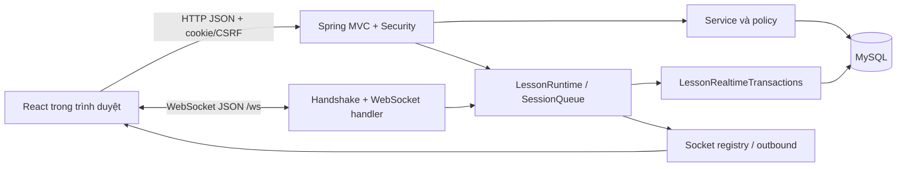

# ClassQuest — tài liệu tham khảo kỹ thuật cho báo cáo Lập trình mạng

Tài liệu này mô tả **implementation hiện có**, không phải bản báo cáo cuối kỳ. Đường dẫn dưới đây tính từ gốc repository. Các phát biểu về hành vi dựa trên source hoặc test được dẫn ngay tại mục liên quan. **Có trong source** khác với **đã chạy test** và khác với **đã đo hiệu năng**. Trong lần khảo sát này, bộ test Java được yêu cầu chạy nhưng Maven không tải được dependency do môi trường chặn truy cập Maven Central; vì vậy không có test Java nào được xác nhận chạy thành công trong lần khảo sát này.

## 1. Bài toán, mục tiêu và phạm vi

ClassQuest hỗ trợ lớp học tổ chức buổi học có trò chơi và điểm: quản trị viên quản lý cấu trúc học vụ, tài khoản giảng viên; giảng viên quản lý lớp, ngân hàng câu hỏi, buổi học, trò chơi; sinh viên xin tham gia lớp, dự buổi, trả lời câu hỏi, xem điểm và bảng xếp hạng. Bài toán mạng cốt lõi là nhiều trình duyệt cùng nhìn và tác động lên **một trạng thái buổi học**, trong khi thời hạn trả lời và điểm số phải do server quyết định. Vai trò thể hiện qua [UserRole.java](src/main/java/vn/edu/multigame/user/enums/UserRole.java), tuyến giao diện qua [app.tsx](frontend/src/app.tsx), quyền API qua [SecurityConfiguration.java](src/main/java/vn/edu/multigame/auth/security/SecurityConfiguration.java).

Mỗi buổi có ba vị trí trò chơi: vị trí 1 là `LUCKY_WHEEL`; vị trí 2–3 chọn trong `QUIZ`, `ASSIGNMENT`, `FILL_BLANK`, không lặp mode trong cùng buổi theo ràng buộc schema. `QUIZ` và `FILL_BLANK` là trả lời từng câu có đồng hồ server; `ASSIGNMENT` nhận nhiều lần nộp, chấm và chốt điểm bởi giảng viên; vòng quay có chọn người, quay, chấm và kết thúc. Xem [LessonMode.java](src/main/java/vn/edu/multigame/lesson/domain/LessonMode.java), [V17](src/main/resources/db/migration/V17__lessons_and_game_slots.sql), [LessonRealtimeTransactions.java](src/main/java/vn/edu/multigame/lesson/service/LessonRealtimeTransactions.java), [WheelService.java](src/main/java/vn/edu/multigame/lesson/service/WheelService.java).

Phạm vi triển khai là một Spring Boot server phục vụ React client và MySQL, cấu hình mặc định chỉ bind `127.0.0.1:8080`. Để máy khác cùng LAN/Wi-Fi truy cập phải cấu hình `SERVER_ADDRESS` và origin phù hợp (`ALLOWED_ORIGINS`), đồng thời các máy client truy cập cùng địa chỉ server; đây là **khả năng cấu hình**, không phải bằng chứng đã đo trên LAN. Client dùng đường dẫn cùng origin (`/api/...`, `/ws`), Vite chỉ phục vụ lúc phát triển; Maven đóng gói frontend vào tài nguyên static. Xem [application.yml](src/main/resources/application.yml), [application-mysql.yml](src/main/resources/application-mysql.yml), [pom.xml](pom.xml), [api.ts](frontend/src/lib/api.ts), [realtime.ts](frontend/src/lib/realtime.ts), [run.cmd](run.cmd).

Migration [V29](src/main/resources/db/migration/V29__remove_multigame_legacy.sql) xóa các bảng gameplay MultiGame cũ. Package, artifact và một số tên `multigame` còn tồn tại vì lịch sử project; không được suy từ các tên này ra cơ chế game hiện hành.

## 2. Kiến trúc và ranh giới trách nhiệm



Client hiển thị trang, giữ bản snapshot để render, tạo `requestId`, gửi lệnh, ước tính đồng hồ đếm ngược từ `serverTimeMs`, và khóa thao tác khi snapshot/kết nối chưa tươi. Client không tự chấm câu trả lời. Server xác thực, kiểm tra vai trò và membership, kiểm tra trạng thái và deadline, chấm điểm, lưu kết quả, rồi gửi ACK/event. [useTeachingSnapshot](frontend/src/features/teaching/teaching-shared.tsx) chỉ nhận snapshot mới hơn theo `lesson.revision` rồi `serverTimeMs`; [Objective](frontend/src/features/student/objective-game.tsx) hiển thị phản hồi dựa vào kết quả server.

MySQL giữ dữ liệu học vụ, thành viên lớp, kế hoạch buổi, nội dung trò chơi, trạng thái window, câu trả lời, điểm, receipt lệnh. `LessonRuntime` giữ actor/queue và `PhaseWindow` trong bộ nhớ để điều phối, nhưng nạp lại window từ DB và phục hồi các lesson đang chạy khi ứng dụng sẵn sàng. Do đó runtime trong RAM **không phải** nguồn lưu trữ duy nhất. [LessonRuntime.java](src/main/java/vn/edu/multigame/realtime/session/LessonRuntime.java), [LessonRealtimeStore.java](src/main/java/vn/edu/multigame/lesson/repository/LessonRealtimeStore.java).

`pom.xml` dùng Java 21, Spring Boot Web/WebSocket/Security/JPA/Validation, JDBC driver MySQL và Flyway; frontend là React 19, React Router, Vite, TypeScript. Profile mặc định là `mysql`; `application-web-only.yml` phục vụ một phạm vi runtime khác, vì vậy các kết luận gameplay trong tài liệu áp dụng cho profile `mysql`. Flyway bật `validate-on-migrate`, `clean-disabled`; JPA `ddl-auto: validate`. Pool Hikari cấu hình tối đa 5 kết nối, cần chú ý khi diễn giải khả năng xử lý đồng thời; chưa có số liệu tải chứng minh mức thông lượng. [pom.xml](pom.xml), [frontend/package.json](frontend/package.json), [application.yml](src/main/resources/application.yml), [application-mysql.yml](src/main/resources/application-mysql.yml).

## 3. Giao tiếp mạng: REST và WebSocket

### 3.1. Xác thực và kết nối

REST sử dụng JSON qua HTTP với cookie phiên `JSESSIONID`; frontend gọi `fetch` cùng origin, lấy CSRF token từ `GET /api/auth/csrf` trước các phương thức ghi và gửi trong header do server trả về. `POST /api/auth/login` tạo/lưu security context và đăng ký HTTP session; `GET /api/auth/me`, `POST /api/auth/keepalive`, `POST /api/auth/logout` quản lý vòng đời. [AuthController.java](src/main/java/vn/edu/multigame/auth/controller/AuthController.java), [api.ts](frontend/src/lib/api.ts), [session.ts](frontend/src/lib/session.ts).

WebSocket native tại `/ws` (`/ws/admin` là kênh quản trị chỉ đọc). Handshake kiểm tra `Origin` trong allowlist, không nhận query parameter, yêu cầu tài khoản hoạt động, hồ sơ hoàn chỉnh và HTTP session còn hợp lệ; admin endpoint kiểm tra thêm vai trò. Sau khi nối, handler đăng ký socket, kiểm tra phiên một lần nữa và gửi `AUTH_READY`. Mỗi text message lại kiểm tra socket hiện hành, tài khoản và session; binary message bị đóng. [WebSocketConfiguration.java](src/main/java/vn/edu/multigame/realtime/websocket/WebSocketConfiguration.java), [AuthenticatedHandshakeInterceptor.java](src/main/java/vn/edu/multigame/realtime/websocket/AuthenticatedHandshakeInterceptor.java), [AuthenticatedWebSocketHandler.java](src/main/java/vn/edu/multigame/realtime/websocket/AuthenticatedWebSocketHandler.java).

Các tác vụ quản lý danh mục, lớp, nội dung, truy vấn snapshot và bảng xếp hạng đi qua REST. Lệnh trong buổi học cần ACK và phát tán cập nhật realtime đi qua WebSocket; một số REST transition cũ (`start`, `start game`, `attend`, `participate`, sửa/cấu hình buổi) cũng được đưa vào `LessonRuntime.serial`, nên chia kênh theo hành vi client chứ không coi REST luôn đứng ngoài actor. Vòng quay sử dụng REST `POST /api/teaching/lessons/{lesson}/wheel/{action}` và đi qua `runtime.serial`. [LessonController.java](src/main/java/vn/edu/multigame/lesson/controller/LessonController.java), [WheelController.java](src/main/java/vn/edu/multigame/lesson/controller/WheelController.java).

### 3.2. Nhóm REST tiêu biểu

| Nhóm | Method và endpoint có thật | Input/response, quyền và ý nghĩa |
|---|---|---|
| Auth | `POST /api/auth/login`; `GET /api/auth/me` | Login nhận `LoginRequest`, trả `UserResponse`; `me` trả người dùng của phiên hợp lệ. Login là public, `me` cần xác thực. [Controller](src/main/java/vn/edu/multigame/auth/controller/AuthController.java) |
| Lớp | `POST /api/student/classes/join`; `POST /api/teaching/classes/{classId}/members/{student}/approve` | Join nhận `Join(requestId, code)` trả `ClassMembershipView`; approve nhận `Decision(requestId, revision)` trả cùng dạng. Role sinh viên/giảng viên và policy lớp được kiểm tra. [Controller](src/main/java/vn/edu/multigame/room/controller/ClassMembershipController.java), [DTO](src/main/java/vn/edu/multigame/room/dto/request/ClassMembershipRequests.java) |
| Buổi học | `POST /api/teaching/classes/{classId}/lessons`; `POST /api/teaching/lessons/{id}/start`; `POST /api/student/lessons/{id}/attend` | Tạo nhận `Plan` và trả `LessonView` (201); start nhận `Transition(revision)`, attend không có body và trả `LessonView`. [Controller](src/main/java/vn/edu/multigame/lesson/controller/LessonController.java), [DTO](src/main/java/vn/edu/multigame/lesson/dto/LessonRequests.java) |
| Snapshot | `GET /api/student/lessons/{id}/snapshot`; `GET /api/teaching/lessons/{id}/snapshot` | Trả `LessonRealtimeView`; student có `Cache-Control: no-store`, quyền và nội dung hiển thị qua `snapshot(caller,id)`. [Student](src/main/java/vn/edu/multigame/lesson/controller/StudentLessonController.java), [Teaching](src/main/java/vn/edu/multigame/lesson/controller/TeachingSnapshotController.java) |
| Nội dung/game | `POST`/`PUT /api/teaching/lessons/{lesson}/games/{position}/content`; `POST /api/teaching/lessons/{lesson}/wheel/{action}` | Giảng viên chọn/sửa nội dung hoặc điều khiển vòng quay; kết quả là view/state từ server. [Content](src/main/java/vn/edu/multigame/lesson/controller/GameContentController.java), [Wheel](src/main/java/vn/edu/multigame/lesson/controller/WheelController.java) |
| Điểm/xếp hạng | `GET /api/learning/classes/{course}/leaderboard`; `GET /api/learning/leaderboard?subjectId=...&academicYearId=...` | Trả `ClassView`/`GlobalView` cho người dùng đã xác thực theo policy trong service. [LearningBoardController.java](src/main/java/vn/edu/multigame/leaderboard/controller/LearningBoardController.java) |
| Bài tập | `GET /api/student/lessons/{lesson}/games/{position}/submissions` hoặc route teaching cùng hậu tố | Đọc lịch sử nộp bài; lệnh nộp/chấm/chốt realtime thuộc WebSocket. [AssignmentController.java](src/main/java/vn/edu/multigame/lesson/controller/AssignmentController.java) |

Đây là các ví dụ để thuyết trình, không phải toàn bộ API. Các endpoint teaching/student còn có kiểm tra nội dung lớp tại service, ngoài role trong [SecurityConfiguration.java](src/main/java/vn/edu/multigame/auth/security/SecurityConfiguration.java).

### 3.3. Message WebSocket thực tế

`LessonCommandParser` chấp nhận JSON object đúng các trường `v`, `kind`, `requestId`, `type`, `target`, `payload`; `v=1`, `kind="COMMAND"`, `requestId` theo mẫu UUID chữ thường, `target.kind="LESSON"` và `target.id` dương. Parser kiểm tra tập field payload theo từng type, từ chối field thừa/trùng và dữ liệu JSON theo sau. Mẫu **lấy từ test parser** (test dùng lesson id 3, request ID cố định):

```json
{"v":1,"kind":"COMMAND","requestId":"00000000-0000-0000-0000-000000000001","type":"SUBMIT_LESSON_ACTION","target":{"kind":"LESSON","id":3},"payload":{"token":1,"value":"A"}}
```

Lệnh khác được parser khai báo gồm `SUBSCRIBE_LESSON`, `RECONNECT_LESSON`, `UNSUBSCRIBE_LESSON`, `ATTEND_LESSON`, `PARTICIPATE_LESSON_GAME`, `START_LESSON`, `START_LESSON_GAME`, `OPEN_LESSON_WINDOW`, `CLOSE_LESSON_WINDOW`, `CANCEL_LESSON_WINDOW`, `SET_ASSIGNMENT_DEADLINE`, `GRADE_ASSIGNMENT`, `FINALIZE_ASSIGNMENT`. Các lệnh `SUBMIT_LESSON_ACTION` không có field client chọn `score`, `correctAnswer`, `receivedAtMs` hoặc `deadlineAtMs`. [LessonCommandParser.java](src/main/java/vn/edu/multigame/realtime/websocket/LessonCommandParser.java), [LessonCommandParserTest.java](src/test/java/vn/edu/multigame/realtime/websocket/LessonCommandParserTest.java).

`AUTH_READY` là event gồm `kind`, `type`, `serverTimeMs`, `payload(userId, username, connectionGeneration)`. Lệnh hợp lệ trả `ACK` gồm `v`, `kind`, `requestId`, `type`, `target`, `sequence`, `receivedAtMs`, `replay`, `payload` là snapshot. Lỗi command trả `ERROR` gồm `v`, `kind`, `code`, có thêm `requestId` và `target` nếu parse được lệnh; error không nhất thiết có `type`/`message`. Broadcast `LESSON_UPDATED` có `eventId`, `target`, `payload` snapshot; `LESSON_DELETED`/`LESSON_ACCESS_REVOKED` thông báo thay đổi quyền/vòng đời. [AuthReady.java](src/main/java/vn/edu/multigame/realtime/message/event/AuthReady.java), [LessonCommandAdapter.java](src/main/java/vn/edu/multigame/realtime/websocket/LessonCommandAdapter.java), [LessonRuntime.java](src/main/java/vn/edu/multigame/realtime/session/LessonRuntime.java).

Không có tên giao thức ứng dụng riêng được khai báo trong code: mô tả chính xác là HTTP/REST JSON và WebSocket JSON phiên bản message `v=1`. `requestId` tương quan lệnh–ACK và là khóa chống thực thi lặp; `sequence` được server cấp lúc nhận vào queue của lesson. `eventId` trong broadcast là UUID mới, không phải sequence đảm bảo mọi client đều nhận đủ event.

### 3.4. Hai luồng cần giải thích khi bảo vệ

**Tham gia lớp/buổi:** sinh viên gửi mã lớp và `requestId` qua `POST /api/student/classes/join`; `ClassMembershipService.join` khóa tài khoản, kiểm tra mã/lần gọi lặp, ghi membership/action trong transaction và trả view. Giảng viên duyệt qua endpoint members; trạng thái approved là điều kiện truy cập buổi. Khi buổi đang chạy, sinh viên gửi `ATTEND_LESSON` (hoặc REST `/attend`), `LessonRuntime` chuyển việc vào actor, `LessonRealtimeTransactions`/`LessonService.attend` kiểm tra membership và lưu attendance; server trả snapshot/ACK và broadcast. Xem [ClassMembershipService.java](src/main/java/vn/edu/multigame/room/service/ClassMembershipService.java), [LessonService.java](src/main/java/vn/edu/multigame/lesson/service/LessonService.java), [LessonRuntime.java](src/main/java/vn/edu/multigame/realtime/session/LessonRuntime.java).

**Một câu Quiz/Điền từ:** giảng viên gửi `START_LESSON_GAME` hoặc REST start game → service đổi trạng thái → actor `sync`/`resumeObjective` mở window câu 1 và arm timer. Student nhận snapshot/window (trong đó chỉ có câu hỏi được phép xem), gửi `SUBMIT_LESSON_ACTION(token,value)` → parser → actor đánh dấu thời điểm ingress → transaction khóa/kiểm tra phiên, tư cách, token và deadline → server so đáp án/chấm điểm, ghi answer/input/receipt/score → ACK và `LESSON_UPDATED`. Timer đóng window, tự mở câu kế tiếp hoặc kết thúc trò và cập nhật điểm vắng. Các bước này nằm ở [LessonRuntime.java](src/main/java/vn/edu/multigame/realtime/session/LessonRuntime.java), [LessonRealtimeTransactions.java](src/main/java/vn/edu/multigame/lesson/service/LessonRealtimeTransactions.java), [QuizPlayStore.java](src/main/java/vn/edu/multigame/lesson/repository/QuizPlayStore.java).

## 4. Đồng thời, thứ tự và deadline

`SessionQueue` tạo actor logic theo `lessonId`, mỗi actor có queue FIFO và `sequence`; monitor của actor dùng cho admission, timer và dispatch. Shared `ThreadPoolExecutor` có 4 worker, work queue 512, tối đa 512 session, giới hạn 64 command chờ/lesson, batch 32 công việc trước khi nhường worker. **Trong cùng lesson chỉ một handler chạy tại một thời điểm**; hai lesson có thể chạy song song trên các worker khác nhau. `LessonRuntime` đồng bộ việc tạo/tìm node và đưa cả lệnh WebSocket lẫn transition REST tương ứng qua actor. [SessionQueue.java](src/main/java/vn/edu/multigame/realtime/session/SessionQueue.java), [LessonRuntime.java](src/main/java/vn/edu/multigame/realtime/session/LessonRuntime.java).

Điểm admission là lúc `submit` thành công và ghi `Ingress(sequence, monotonic time, epoch time)`, **không** phải thời điểm client tự khai. `PhaseWindow.accepts` dùng khoảng `[openedAtMs, deadlineMs)` theo đồng hồ monotonic. Nếu lệnh đến trước hạn nhưng chờ trong queue qua hạn, nó vẫn được xét theo thời gian nhận của server; lệnh đến đúng bằng hạn bị từ chối. Scheduler chỉ đưa timeout thành một công việc trong cùng queue, dành slot timer riêng, so `token`/generation để timer cũ không đóng window mới, và kiểm tra lại khi bị đánh thức sớm. Tình huống hai sinh viên cùng gửi câu trả lời trong lúc timeout: các ingress được đánh thứ tự; mỗi handler chạy tuần tự; mỗi lệnh còn phải qua kiểm tra window/token, `phase.accepts` và DB uniqueness. Kết quả không do thứ tự gói tin tại client quyết định. [Ingress.java](src/main/java/vn/edu/multigame/realtime/session/Ingress.java), [PhaseWindow.java](src/main/java/vn/edu/multigame/realtime/timer/PhaseWindow.java), [SessionQueueTest.java](src/test/java/vn/edu/multigame/realtime/session/SessionQueueTest.java).

Actor **không thay thế transaction/DB lock**. `execute`, `expire`, `resumeObjective`, `openFirstWindow` có transaction `READ_COMMITTED`, timeout 5 s; tài khoản liên quan được khóa theo thứ tự tăng bằng `TreeSet` thông qua `AccountAccessPolicy.lock`, sau đó đọc lại tình trạng; `store.lesson(id,true)` khóa hàng lesson. Đáp án có khóa chính `(game_id, question_index, student_id)`, input có unique `(game_id, window_token, submission_key)` và `(student_id, request_id)`, receipt có PK `(actor_id,request_id)`. Khi nộp lại cùng `requestId` và fingerprint, trả `replay=true` cùng sequence/timestamp cũ và snapshot mới; tái dùng ID với nội dung khác trả `REQUEST_ID_REUSED`; khác ID nhưng cùng câu bị `ALREADY_SUBMITTED`/ràng buộc DB ngăn điểm trùng. [LessonRealtimeTransactions.java](src/main/java/vn/edu/multigame/lesson/service/LessonRealtimeTransactions.java), [V19](src/main/resources/db/migration/V19__lesson_realtime.sql), [V21](src/main/resources/db/migration/V21__lesson_quiz_play.sql).

Giới hạn cần nói rõ: FIFO là **theo ingress của từng actor lesson trong một tiến trình**, không là thứ tự toàn cục nhiều server. REST membership, admin sanction và một số cập nhật khác đi qua transaction/lock riêng; không thể kết luận mọi thao tác hệ thống đều nối vào cùng queue. Khi pool/queue quá tải, server từ chối với `RUNTIME_BUSY`; timer đã dành slot không bị bỏ chỉ vì flood command. Callback lỗi bất ngờ làm actor bị fence, không tự retry thao tác có thể đã tác động một phần. `SessionQueueTest` kiểm tra các trường hợp này ở mức queue, chưa phải benchmark. [SessionQueue.java](src/main/java/vn/edu/multigame/realtime/session/SessionQueue.java), [LessonCommandAdapter.java](src/main/java/vn/edu/multigame/realtime/websocket/LessonCommandAdapter.java).

## 5. Server authoritative và chấm điểm

`LessonService.start`/`startGame` quyết định trạng thái buổi và vị trí game; `LessonRealtimeTransactions.openFirstWindow`/`openWindowAt` tạo token và deadline từ clock server; `expire` đóng window, mở câu tiếp theo hoặc hoàn tất trò. `snapshot` lọc nội dung theo quyền và mức tham gia; sinh viên chỉ nhận câu hỏi đang mở và kết quả của mình, không được tự gửi điểm/đáp án đúng. [LessonService.java](src/main/java/vn/edu/multigame/lesson/service/LessonService.java), [LessonRealtimeTransactions.java](src/main/java/vn/edu/multigame/lesson/service/LessonRealtimeTransactions.java), [StudentQuestion.java](src/main/java/vn/edu/multigame/questionbank/dto/response/StudentQuestion.java).

Với Quiz, server chỉ nhận `A`–`D`, so với `correctAnswer` trong nội dung đã chọn. Với Điền từ, `FillBlankMatcher` so với các `acceptedAnswers`, theo policy `EXACT` hoặc không phân biệt hoa thường; không tự bỏ khoảng trắng/dấu. Hai mode dùng `QuizScoring.score(correct,total,budget) = budget × correct / total`, làm tròn 2 chữ số `HALF_UP` và không vượt budget; `total` là số câu **được sử dụng**, có thể khác số câu gốc của ngân hàng. Điểm trò và tổng buổi được ghi ở server. Đây là công thức ClassQuest hiện tại, không dùng công thức MultiGame trước đây. [QuizScoring.java](src/main/java/vn/edu/multigame/lesson/service/QuizScoring.java), [FillBlankMatcher.java](src/main/java/vn/edu/multigame/lesson/service/FillBlankMatcher.java), [GameSettingsService.java](src/main/java/vn/edu/multigame/lesson/service/GameSettingsService.java), [QuizPlayStore.java](src/main/java/vn/edu/multigame/lesson/repository/QuizPlayStore.java).

Assignment cho phép nhiều input trong window (mỗi lần có `requestId` riêng), giảng viên chấm **bản nộp mới nhất** và chỉ finalize khi window đã đóng, tất cả bản mới nhất có điểm hoặc không nộp; code kiểm tra `submissionId` để tránh chấm bản cũ. Vòng quay dùng `SecureRandom` chọn người/cell và `WheelService.act` ghi receipt/state trong DB; người được chọn do giảng viên chấm, không phải điểm client tự nhập. [LessonRealtimeTransactions.java](src/main/java/vn/edu/multigame/lesson/service/LessonRealtimeTransactions.java), [WheelService.java](src/main/java/vn/edu/multigame/lesson/service/WheelService.java), [AssignmentStore.java](src/main/java/vn/edu/multigame/lesson/repository/AssignmentStore.java).

## 6. Kết nối, mất kết nối, reconnect và đồng bộ

`AuthenticatedSocketRegistry` ánh xạ socket–HTTP session–user, chỉ giữ **một socket hiện hành mỗi user**. Kết nối mới thay generation, gửi `SESSION_REPLACED` rồi đóng socket cũ mã 4002; lệnh và outbound gửi từ socket cũ bị `requireCurrent` chặn. Revoke/logout đóng socket mã 4001. `SocketOutbound` tuần tự hóa ghi cho mỗi socket, có FIFO tối đa 1024 message/262144 byte, watchdog gửi 5 s; lỗi gửi đóng socket, không rollback hoặc gửi lại transaction đã commit. [AuthenticatedSocketRegistry.java](src/main/java/vn/edu/multigame/realtime/connection/AuthenticatedSocketRegistry.java), [SocketOutbound.java](src/main/java/vn/edu/multigame/realtime/connection/SocketOutbound.java).

`RealtimeClient` giữ kết nối ở cấp phiên ứng dụng, reconnect bằng backoff tối đa 15 s sau close thông thường; mã 4002 chuyển sang trạng thái `replaced`, 4001/1008 làm refresh/logout. Khi nhận `AUTH_READY`, client gửi `RECONNECT_LESSON` cho các lesson đang theo dõi; ACK mang snapshot hiện tại, rồi server đăng ký subscription. UI tắt nút khi mất kết nối/chưa có snapshot mới; yêu cầu chờ ACK tối đa 15 s, sau đó báo người dùng đọc lại trạng thái, **không tự replay thao tác ghi**. [realtime.ts](frontend/src/lib/realtime.ts), [teaching-shared.tsx](frontend/src/features/teaching/teaching-shared.tsx), [api.ts](frontend/src/lib/api.ts).

Server cũng có `GET .../snapshot` để đọc lại, phát `LESSON_UPDATED` theo từng subscription và kiểm tra quyền ngay trước khi gửi; quyền bị thu hồi có thể phát `LESSON_ACCESS_REVOKED`. Runtime khôi phục các lesson `RUNNING` sau khởi động bằng window bền vững; token cũ/timer cũ không được dùng để đóng phase mới. Test integration [LessonRealtimeChecks.java](src/test/java/vn/edu/multigame/realtime/session/LessonRealtimeChecks.java) chứa các kịch bản reconnect, replay và phục hồi actor; **test tồn tại trong source nhưng chưa được chạy trong lần khảo sát này**. Chưa thấy cơ chế replay toàn bộ event bị lỡ theo `eventId` hay bằng chứng phục hồi sau cụm nhiều server.

## 7. Xử lý lỗi và độ tin cậy

| Tình huống | Phát hiện / phản hồi hiện có | Giới hạn cần nêu |
|---|---|---|
| JSON thiếu/sai/thừa field, token không hợp lệ | Parser báo `INVALID_MESSAGE`; adapter gửi `ERROR` với `code` và `requestId` nếu parse được. [Parser](src/main/java/vn/edu/multigame/realtime/websocket/LessonCommandParser.java), [Adapter](src/main/java/vn/edu/multigame/realtime/websocket/LessonCommandAdapter.java) | Message không nhận diện là lesson có thể khiến socket đóng `UNSUPPORTED_MESSAGE`. |
| Chưa đăng nhập, phiên hết hạn, sai role/origin | Spring Security, handshake và kiểm tra từng message từ chối; close 4001 cho phiên hết hạn, 403 HTTP tại handshake origin không hợp lệ. [Security](src/main/java/vn/edu/multigame/auth/security/SecurityConfiguration.java), [Handshake](src/main/java/vn/edu/multigame/realtime/websocket/AuthenticatedHandshakeInterceptor.java) | Cần phân biệt lỗi HTTP với close status WebSocket. |
| Sai trạng thái game, trễ hạn, token cũ | Transaction kiểm tra `RUNNING`, tham gia, `OPEN`, token và `phase.accepts`; trả code như `GAME_NOT_RUNNING`, `WINDOW_CLOSED`, `STALE_WINDOW`; DB transaction rollback khi exception. [Transactions](src/main/java/vn/edu/multigame/lesson/service/LessonRealtimeTransactions.java) | Không suy ra mọi code lỗi đều có thông điệp tiếng Việt trong WebSocket. |
| Gửi lặp / cùng câu | Receipt + fingerprint, kiểm tra answered/submitted và unique DB; cùng ID được ACK replay, khác nội dung bị conflict. [Transactions](src/main/java/vn/edu/multigame/lesson/service/LessonRealtimeTransactions.java), [V19](src/main/resources/db/migration/V19__lesson_realtime.sql) | REST write nói chung không tự retry; không khẳng định mọi endpoint có idempotency. |
| DB tạm thời lỗi, queue bận, socket gửi lỗi | Timer/refresh có nhánh `TransientDataAccessException` defer 250 ms; command thất bại báo lỗi; queue đầy là `RUNTIME_BUSY`; outbound quá tải/timeout đóng 1011. [Runtime](src/main/java/vn/edu/multigame/realtime/session/LessonRuntime.java), [Adapter](src/main/java/vn/edu/multigame/realtime/websocket/LessonCommandAdapter.java), [Outbound](src/main/java/vn/edu/multigame/realtime/connection/SocketOutbound.java) | Không có bằng chứng mọi lỗi DB đều được retry an toàn; callback lỗi bất ngờ bị fence. |
| Server unavailable | Frontend `api` chuyển lỗi fetch thành `OFFLINE`, WebSocket thử nối lại; UI yêu cầu đọc snapshot. [api.ts](frontend/src/lib/api.ts), [realtime.ts](frontend/src/lib/realtime.ts) | Chưa có đo thời gian phục hồi hoặc đảm bảo không mất event. |

REST exception handler nằm tại [LessonExceptionHandler.java](src/main/java/vn/edu/multigame/lesson/controller/LessonExceptionHandler.java), [RoomExceptionHandler.java](src/main/java/vn/edu/multigame/room/controller/RoomExceptionHandler.java), [AuthExceptionHandler.java](src/main/java/vn/edu/multigame/auth/controller/AuthExceptionHandler.java). Nên mở các file này khi cần ghi chính xác HTTP status/body cho từng lỗi.

## 8. Thiết kế dữ liệu và transaction

Chuỗi học vụ: `app_user` → `teaching_assignment`/`class_membership` → `course_class` → `subject_offering` → `academic_subject`, `academic_semester`, `academic_year`. Mỗi class có `class_room`; sinh viên vào lớp bằng join code và trạng thái membership. Mỗi `lesson` thuộc một `course_class`; có `lesson_game`, `lesson_attendance`, `lesson_game_participant`, `lesson_game_score`, `lesson_score`. Nội dung dùng `quiz`/`question` và `lesson_game_content`; realtime dùng `lesson_action_window`, `lesson_action_input`, `lesson_command_receipt`, `lesson_quiz_question`, `lesson_quiz_answer`; assignment và wheel có bảng riêng. [V15](src/main/resources/db/migration/V15__academic_structure.sql), [V16](src/main/resources/db/migration/V16__class_rooms_and_memberships.sql), [V17](src/main/resources/db/migration/V17__lessons_and_game_slots.sql), [V18](src/main/resources/db/migration/V18__learning_bank_and_game_content.sql), [V19](src/main/resources/db/migration/V19__lesson_realtime.sql), [V20](src/main/resources/db/migration/V20__class_wheel.sql), [V21](src/main/resources/db/migration/V21__lesson_quiz_play.sql), [V23](src/main/resources/db/migration/V23__assignment_grading.sql).

Các ràng buộc đáng dẫn: unique `(lesson_id,position)` và `(lesson_id,mode)`; attendance `(lesson_id,student_id)`; participant `(game_id,student_id)`; score FK tới participant; receipt PK `(actor_id,request_id)`; quiz answer PK `(game_id,question_index,student_id)`. Migration V31 bổ sung FK ghép bảo đảm window/input thuộc đúng lesson của game và grade thuộc đúng game/student của submission; migration V28 thay đổi quy tắc soft delete/lesson number nên không lấy V17 riêng làm schema cuối. Các trigger kiểm soát quota, chuyển trạng thái và điểm budget; khi bảo vệ cần mở **migration cuối cùng của từng trigger** thay vì trích định nghĩa cũ. [V28](src/main/resources/db/migration/V28__lesson_management.sql), [V31](src/main/resources/db/migration/V31__classquest_integrity_and_storage.sql).

`LessonRealtimeTransactions.execute` ghi thay đổi và receipt trong cùng transaction; `expire` đóng window và chuyển câu trong transaction riêng; account locks, lesson row lock, unique/FK và kiểm tra trạng thái phối hợp bảo vệ tính toàn vẹn. [LessonStore.java](src/main/java/vn/edu/multigame/lesson/repository/LessonStore.java), [LessonRealtimeStore.java](src/main/java/vn/edu/multigame/lesson/repository/LessonRealtimeStore.java). Migration có lịch sử V1–V32 và V29 dọn bảng legacy; **chưa chạy Flyway trên DB trong khảo sát này**, nên đây là thiết kế từ migration/source, không phải kiểm kê schema sản xuất.

## 9. Bản đồ module để tra cứu source

| Thành phần | Trách nhiệm / quan hệ chính |
|---|---|
| [SecurityConfiguration](src/main/java/vn/edu/multigame/auth/security/SecurityConfiguration.java), [AuthSessionRegistry](src/main/java/vn/edu/multigame/auth/security/AuthSessionRegistry.java) | Role, CSRF, HTTP session; được handshake, handler và REST sử dụng. |
| [AuthenticatedWebSocketHandler](src/main/java/vn/edu/multigame/realtime/websocket/AuthenticatedWebSocketHandler.java), [LessonCommandParser](src/main/java/vn/edu/multigame/realtime/websocket/LessonCommandParser.java), [LessonCommandAdapter](src/main/java/vn/edu/multigame/realtime/websocket/LessonCommandAdapter.java) | Nhận socket, parse chặt command, đưa vào runtime, tạo ACK/ERROR. |
| [AuthenticatedSocketRegistry](src/main/java/vn/edu/multigame/realtime/connection/AuthenticatedSocketRegistry.java), [SocketOutbound](src/main/java/vn/edu/multigame/realtime/connection/SocketOutbound.java) | Session replacement, subscription, kiểm quyền trước send, FIFO và timeout outbound. |
| [SessionQueue](src/main/java/vn/edu/multigame/realtime/session/SessionQueue.java), [LessonRuntime](src/main/java/vn/edu/multigame/realtime/session/LessonRuntime.java), [PhaseWindow](src/main/java/vn/edu/multigame/realtime/timer/PhaseWindow.java) | Admission, thứ tự, timer, đồng bộ trạng thái RAM–DB và broadcast. |
| [LessonRealtimeTransactions](src/main/java/vn/edu/multigame/lesson/service/LessonRealtimeTransactions.java), [LessonRealtimeStore](src/main/java/vn/edu/multigame/lesson/repository/LessonRealtimeStore.java) | Authoritative command, snapshot, receipt, window/input bền vững. |
| [LessonService](src/main/java/vn/edu/multigame/lesson/service/LessonService.java), [LessonStore](src/main/java/vn/edu/multigame/lesson/repository/LessonStore.java) | Vòng đời lesson/game, attendance, tổng điểm, khóa hàng lesson. |
| [QuizScoring](src/main/java/vn/edu/multigame/lesson/service/QuizScoring.java), [FillBlankMatcher](src/main/java/vn/edu/multigame/lesson/service/FillBlankMatcher.java), [QuizPlayStore](src/main/java/vn/edu/multigame/lesson/repository/QuizPlayStore.java) | Chấm objective, so đáp án, lưu answer/score. |
| [WheelService](src/main/java/vn/edu/multigame/lesson/service/WheelService.java), [AssignmentStore](src/main/java/vn/edu/multigame/lesson/repository/AssignmentStore.java) | Luồng wheel và lịch sử/chấm assignment. |
| [ClassMembershipService](src/main/java/vn/edu/multigame/room/service/ClassMembershipService.java), [ClassRoomStore](src/main/java/vn/edu/multigame/room/repository/ClassRoomStore.java) | Join/duyệt/loại thành viên, receipt và quyền vào lớp. |
| [RealtimeClient](frontend/src/lib/realtime.ts), [useTeachingSnapshot](frontend/src/features/teaching/teaching-shared.tsx), [api](frontend/src/lib/api.ts) | Gửi/nhận message, reconnect, cập nhật snapshot, REST/CSRF. |

## 10. Kiểm thử và đánh giá

**Test hiện có trong source, chưa được xác nhận chạy trong lần khảo sát này:**

| Nhóm | Kịch bản và expected result đọc từ test | File |
|---|---|---|
| Unit protocol | Đúng command được parse; extra field, token sai, JSON trùng key/lệnh lạ bị từ chối. | [LessonCommandParserTest.java](src/test/java/vn/edu/multigame/realtime/websocket/LessonCommandParserTest.java) |
| Unit concurrency/timer | Cùng lesson giữ thứ tự và không chạy hai handler; khác lesson có thể tiến hành; deadline `-1/0/+1`; timer cũ, wakeup sớm, queue đầy, retry, shutdown. Dùng clock/latch giả, không chứng minh thông lượng thực. | [SessionQueueTest.java](src/test/java/vn/edu/multigame/realtime/session/SessionQueueTest.java), [ScheduledTimerSchedulerTest.java](src/test/java/vn/edu/multigame/realtime/timer/ScheduledTimerSchedulerTest.java), [LessonRuntimeTest.java](src/test/java/vn/edu/multigame/realtime/session/LessonRuntimeTest.java) |
| Unit chấm điểm | Tỷ lệ điểm, `HALF_UP`, không bonus tốc độ; so `EXACT`/không phân biệt hoa thường, giữ dấu/khoảng trắng. | [QuizScoringTest.java](src/test/java/vn/edu/multigame/lesson/service/QuizScoringTest.java), [FillBlankMatcherTest.java](src/test/java/vn/edu/multigame/lesson/service/FillBlankMatcherTest.java) |
| Socket/unit client | Thay socket, outbound, reconnect/state client và API client. | [AuthenticatedSocketRegistryTest.java](src/test/java/vn/edu/multigame/realtime/connection/AuthenticatedSocketRegistryTest.java), [SocketOutboundTest.java](src/test/java/vn/edu/multigame/realtime/connection/SocketOutboundTest.java), [realtime.test.ts](frontend/src/lib/realtime.test.ts), [api.test.ts](frontend/src/lib/api.test.ts) |
| Integration MySQL/HTTP/WS | Baseline tạo schema mới trong MySQL có datadir thuộc workspace `.cache`; chạy migration, HTTP, các luồng lớp/buổi, quiz, fill blank, assignment, wheel, replay, reconnect, deadline, concurrent cancel/submit, phục hồi actor. Không được chạy trên DB chính. | [BaselineMySqlIT.java](src/test/java/vn/edu/multigame/system/controller/BaselineMySqlIT.java), [LessonRealtimeChecks.java](src/test/java/vn/edu/multigame/realtime/session/LessonRealtimeChecks.java), [LessonLifecycleChecks.java](src/test/java/vn/edu/multigame/lesson/controller/LessonLifecycleChecks.java) |
| Frontend UI/E2E | Test component Vitest và các script e2e quản trị/giảng dạy/buổi học có trong repo. Chưa xác minh chúng chạy trong lần khảo sát. | [frontend/src](frontend/src), [frontend/e2e](frontend/e2e), [package.json](frontend/package.json) |

Lệnh đã thực sự thử: `mvn -q '-Dantrun.skip=true' '-Dtest=SessionQueueTest,LessonCommandParserTest,QuizScoringTest,FillBlankMatcherTest' test`. **Kết quả: thất bại trước pha test**, vì môi trường không tải được Spring Boot/MySQL/Flyway artifacts từ Maven Central (`Permission denied: getsockopt`). Số test pass của lần chạy này = **0 test được thực thi**, không phải các case đều fail. Không chạy `BaselineMySqlIT` vì đây là integration test cần MySQL cô lập và có tạo/xóa schema; không có bằng chứng kết quả thực thi từ lần này. Không có kết quả đo latency, response time, synchronization delay, throughput, message rate hay error rate đáng tin để đưa vào báo cáo.

Nếu nhóm cần mục *Testing & Evaluation* có số liệu: chạy baseline trên MySQL cô lập đúng guard của test, ghi commit/profile/cấu hình máy, số client đồng thời, phân phối độ trễ (ít nhất median/p95), thời điểm gửi/nhận/ACK, tỷ lệ lỗi, nhiều lần lặp và dữ liệu thô. Đo trước/sau chỉ khi có baseline so sánh tương ứng; không dùng số từ test assertion làm số liệu hiệu năng.

## 11. Đóng góp kỹ thuật có thể chứng minh

1. **Điều phối lesson bằng actor per lesson trên worker pool hữu hạn**, ghi ingress tại server và nhập timeout vào cùng queue. Bằng chứng implementation: [SessionQueue.java](src/main/java/vn/edu/multigame/realtime/session/SessionQueue.java), [LessonRuntime.java](src/main/java/vn/edu/multigame/realtime/session/LessonRuntime.java); test source: [SessionQueueTest.java](src/test/java/vn/edu/multigame/realtime/session/SessionQueueTest.java).
2. **Trạng thái game authoritative và bền vững**: window/token, input/answer, score, receipt ở MySQL; transaction, khóa và constraint phối hợp với actor; có phục hồi lesson đang chạy. [LessonRealtimeTransactions.java](src/main/java/vn/edu/multigame/lesson/service/LessonRealtimeTransactions.java), [V19](src/main/resources/db/migration/V19__lesson_realtime.sql), [V21](src/main/resources/db/migration/V21__lesson_quiz_play.sql), [LessonRuntime.java](src/main/java/vn/edu/multigame/realtime/session/LessonRuntime.java).
3. **Replay an toàn theo `requestId` và fingerprint** cho command lesson; snapshot phục hồi sau reconnect, thay socket cũ theo generation và chặn outbound khi quyền thay đổi. [CommandFingerprint.java](src/main/java/vn/edu/multigame/realtime/idempotency/CommandFingerprint.java), [AuthenticatedSocketRegistry.java](src/main/java/vn/edu/multigame/realtime/connection/AuthenticatedSocketRegistry.java), [realtime.ts](frontend/src/lib/realtime.ts).
4. **Chấm Quiz/Điền từ tại server, theo ngân sách trò và đáp án nguồn**, cùng các mode Assignment/Wheel có cơ chế khác biệt rõ. [QuizScoring.java](src/main/java/vn/edu/multigame/lesson/service/QuizScoring.java), [FillBlankMatcher.java](src/main/java/vn/edu/multigame/lesson/service/FillBlankMatcher.java), [WheelService.java](src/main/java/vn/edu/multigame/lesson/service/WheelService.java).

Đây là các **cơ chế đã triển khai và có test source liên quan**, chưa phải các cải tiến hiệu năng được đo hoặc chứng minh tốt hơn một hệ thống đối chứng. Đổi màu/giao diện/animation không được tính làm đóng góp kỹ thuật chính.

## 12. Giới hạn và phần nhóm cần bổ sung

**Đã xác nhận từ source:** runtime dùng bản đồ actor trong một JVM và pool hữu hạn; mặc định server bind loopback; WebSocket event không có cơ chế client yêu cầu replay lịch sử event; frontend đọc snapshot khi reconnect và không tự retry write; MySQL là dependency của profile gameplay; baseline integration test yêu cầu instance MySQL cô lập trong workspace. [LessonRuntime.java](src/main/java/vn/edu/multigame/realtime/session/LessonRuntime.java), [application.yml](src/main/resources/application.yml), [realtime.ts](frontend/src/lib/realtime.ts), [BaselineMySqlIT.java](src/test/java/vn/edu/multigame/system/controller/BaselineMySqlIT.java).

**Chưa xác minh/đánh giá:** tải bao nhiêu client LAN/Wi-Fi là ổn; latency và delay đồng bộ; mất gói/dao động mạng; kết quả trên nhiều server hay qua proxy/TLS; phục hồi sau mất điện/DB lỗi kéo dài; test suite pass trên đúng môi trường triển khai. Đây là danh sách thí nghiệm và phạm vi còn thiếu, không phải khẳng định hệ thống chắc chắn hỏng ở các tình huống đó.

Nguồn chính để nhóm viết báo cáo là source liên kết trong từng mục, [pom.xml](pom.xml), [package.json](frontend/package.json), [cấu hình](src/main/resources/application.yml), [migration](src/main/resources/db/migration), [test Java](src/test/java), [test frontend](frontend/src). Khi trích vào báo cáo, ghi rõ bản commit, môi trường chạy và kết quả đo thật; README chỉ nên dùng để đối chiếu cách sử dụng, không thay cho bằng chứng implementation.
