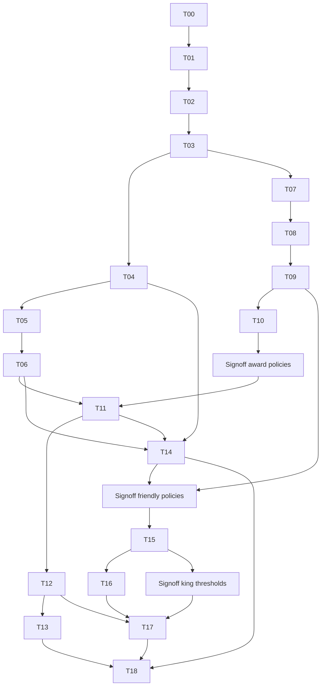

# T00 — Khảo sát và kế hoạch triển khai MultiGame V3.4

Ngày khảo sát: **16/10/2026, Asia/Bangkok (UTC+07)**. Repository `D:\BTL_LTM`, branch `main`, HEAD `85a03e2` (`sua loi mot so thu`). Đây là **artifact kế hoạch**, không phải xác nhận triển khai V3.4.

Nguồn yêu cầu đã đọc:

- `TASKS_MULTIGAME_UI_V34.md`, gồm T00–T18 và ghi chú occupancy tại T09.
- `THIET_KE_NANG_CAP_MULTIGAME_V3_4_ADMIN_ACCEPTANCE_FINAL_REVIEW.md`, đặc biệt §1, §5–12, §16, §18.4–18.15. Tên có hậu tố `(1)` trong tài liệu task không tồn tại; sử dụng file thật này.
- Source, migrations, tests và build config trên working tree; `docs/vietnamese-ui-review.md` chỉ là bằng chứng lịch sử, không thay kết quả chạy lần này.
- Chỉ dẫn AGENTS.md người dùng đưa trong chat: trả lời bằng tiếng Việt. Không tìm thấy file `AGENTS.md` trong danh sách file repo khảo sát.

**Phạm vi đã thực hiện:** đọc/khảo sát, kiểm tra toolchain/git, chạy baseline Java không DB, tạo hai file Markdown trong `docs/implementation`. Không sửa implementation/config production/migration; không kết nối hoặc ghi DB; không chạy app profile mysql, seed, browser smoke ghi fixture, migration, commit/push. `docs` đã có Markdown và assets nên thêm một thư mục kế hoạch có nội dung là phù hợp; không tạo thư mục source rỗng.

## 1. Kết quả hiện trạng và giới hạn bằng chứng

| Hạng mục | Kết quả xác minh |
|---|---|
| Git lúc bắt đầu | `git status --short` và `git status --porcelain=v1`: **output rỗng**, working tree sạch |
| Toolchain | Oracle Java/Javac **21.0.9**, Maven **3.9.12**, Python **3.12.10**, Windows 11 amd64 |
| Node/npm | `Get-Command java,javac,mvn,node,npm` chỉ tìm được Java/Javac/Maven; Node/npm không có trên PATH kiểm tra. Frontend không cần Node |
| Build | `pom.xml`: Spring Boot **3.5.16**, Java 21; Web, WebSocket, Security, JPA, Validation, MySQL, Flyway core/mysql, starter-test |
| Maven wrapper | `mvnw`, `mvnw.cmd`, `.mvn/wrapper/maven-wrapper.properties`: Maven 3.9.12, checksum phân phối có sẵn; chưa chạy wrapper tải mạng |
| Cache | `.mvn/maven.config`: `-Dmaven.repo.local=.cache/maven`; baseline dùng `-o` thành công |
| Java runtime baseline | **315 tests PASS**, 0 failure/error/skip, 23 test classes; gồm 4 test `SystemWebTest` với `@ActiveProfiles("web-only")` |
| Compile/package | Maven test lifecycle thành công; compiler báo **Nothing to compile — all classes are up to date**. Không tuyên bố clean compile, JAR package hay production startup đã kiểm chứng |
| MySQL IT/migration | **NOT RUN trong T00** để không ghi DB/chạy Flyway. Không xác minh schema đang deploy, version MySQL, credentials hay trạng thái DB |
| Browser/LAN | **NOT RUN trong T00**; không có kết luận UI runtime, 7 mode runtime, race ADMIN, nhiều browser hoặc thiết bị LAN PASS |
| Quyền thay đổi | Chỉ T00 được giao. T01–T18 dưới đây là kế hoạch, cần người dùng giao từng task; duyệt kế hoạch không đồng nghĩa duyệt mọi policy/migration/deploy |

Lệnh đã chạy (không chạy Failsafe):

```powershell
mvn -o -B --no-transfer-progress test '-DargLine=-Djava.io.tmpdir=D:/BTL_LTM/target' '-Dsurefire.reportNameSuffix=T00'
```

Log: `target/t00-unit-baseline.log`, kết thúc `2026-10-16T18:46:43+07:00`, thời gian Maven 24.729 s, exit 0. Báo cáo riêng lượt này: `target/surefire-reports/*-T00.xml`/`.txt`. `target` bị git ignore; không dùng kết quả Failsafe cũ làm bằng chứng lần này. Thư mục tạm test video nằm trong `target`; các file build/report là output kiểm tra, không phải sửa source.

Profiles thật:

- Spring default **mysql**: import tùy chọn `config/application-local.properties`, JPA `ddl-auto=validate`, SQL init `never`, Flyway bật, clean disabled, validate-on-migrate. **Không khởi động mặc định chỉ để xem UI trong T00** vì có migration và `GameStartupCleanup` ngắt ACTIVE games cũ.
- `web-only`: loại DataSource/JPA/Flyway auto-config. Auth/game/room persistence beans có `@Profile("mysql")` không hoạt động. Readiness DB trả 503 là đúng; status `NOT_IMPLEMENTED` trong profile này không chứng minh gameplay mysql chưa có.
- Maven profile **mysql-smoke**: Failsafe `integration-test` + `verify`, dùng các `*IT`. Không có profile frontend/Node, không có H2/Testcontainers trong pom. Các fixture IT nhắm DB `quizz_task2_test`; migration test có thao tác dựng DB/schema. Không coi tên “smoke” là chỉ đọc.
- Bind mặc định `127.0.0.1:8080`; cookie HTTP-only/SameSite lax, idle 30 phút, origin allowlist tường minh. LAN demo sau này cần cấu hình bind/origin hợp lệ, không nới CORS wildcard hoặc bỏ CSRF. Không in nội dung file secret/config cục bộ.

## 2. Cây source thực tế

```text
src/main/java/vn/edu/multigame/
  MultigameApplication.java
  auth/          18 Java: controller,dto/request,dto/response,security,service
  user/           2 Java: entity/UserAccount,repository/UserRepository
  room/          25 Java: controller,dto,entity,enums,repository,service
  game/          56 Java: controller,dto,engine,entity,enums,repository,runtime,service
  realtime/      37 Java: connection,idempotency,message/{command,common,event},session,timer,websocket
  questionbank/  30 Java: controller,dto,entity,enums,model,repository,service
  quiz/           1 Java: enums/Option.java (compatibility owner, chưa cần chuyển)
  common/         4 Java: config,util
  system/         7 Java: controller,dto/response,service
src/main/resources/
  application.yml, application-mysql.yml, application-web-only.yml
  db/migration/V1__...sql ... V7__...sql
  static/
    index.html, app.js, styles.css
    client/{account,api,arrangement,clues,core,dom,game-state,game,
            history,question-banks,rooms,transport,video}.js
src/test/
  java/vn/edu/multigame/  (mirror feature ownership; danh sách tại §10)
  resources/quiz/{song-av,song-av2,song-silent}.mp4
scripts/
  build-client.py, test-client.ps1, test-*.py, browser-cdp.py,
  start-local.ps1, prepare-*-database.sql, run-experiment.ps1, ...
docs/
  vietnamese-ui-review.md, assets/gameplay-2026-10-07/*
```

Tổng **181 Java production files** (180 trong 9 feature + application). Không có `src/main/resources/templates`, `src/main/webapp`, Thymeleaf dependency hay HTML entry riêng cho login/lobby/room/admin. Java đã theo feature; không cần đổi base package hoặc gom lại các layer toàn cục.

### 2.1. Migrations versioned hiện có — chỉ review

| Version/file | Nội dung thật và điều cần giữ |
|---|---|
| V1 `quiz_domain` | `app_user`, quiz/question, room/room_member, game_session/game_member/player_session/game_question/answer, user_active_game; FK không cascade, CHECK, immutable snapshot triggers; MySQL 8.0.16+ được yêu cầu trong SQL |
| V2 `require_answer_effect_snapshots` | Scored answer phải có before/after effects; `ACCEPTED_UNSCORED` không bị giả outcome |
| V3 `decision_seven_seconds` | Default decision 7000ms cho room, không sửa immutable game config |
| V4 `multimode_data_foundation` | schema/rules V2, game_stage, typed payload/answer_kind, correct-answer timing, constraints/triggers version/identity/content |
| V5 `room_stage_plans` | Room config_version/plan_revision; append-only room_stage; snapshot Start tách khỏi chỉnh plan |
| V6 `vietnamese_arrangement_aliases` | Mở rộng validation payload/aliases Vua Tiếng Việt, giữ V1/old payload |
| V7 `released_clues` | Cursor released_hint_count, không lộ hints chưa phát |

Không có migration ADMIN/award/friendly. Không sửa V1–V7 hoặc Flyway checksum. `user_active_game.user_id` là PK, `(game_session_id,user_id)` FK tới game_member và `(game_session_id,game_status)` FK tới game_session ACTIVE; phải xóa occupancy X trước khi đổi X FINISHED. `room_member` unique `(room_id,user_id)` được game_member FK tham chiếu, vì thế **không xóa vật lý row membership** để kick.

## 3. Frontend architecture và risk thật

| File hiện có | Lines / bytes | Trách nhiệm/risk |
|---|---:|---|
| `index.html` | 16 / 620 | Shell tiếng Việt, `#sidebar`, `#connection-banner`, `#view`; một `<script type="module" src="/app.js">`, `/styles.css`; color-scheme hiện light |
| `app.js` | 48 / 6,635 | App lifecycle, auth/session state, hash router, shell DOM, WS dispatch, rooms/games Map và controller references; dồn trách nhiệm dù ít dòng |
| `client/game.js` | 231 / 23,574 | Lớn nhất JS: snapshot/reconnect/ACK, pending retry, timer 100ms, draft, toast/result presentation, 7 mode/render, scoreboard/result helpers; History import ngược các helpers từ đây |
| `client/rooms.js` | 110 / 19,727 | List/delete, create/edit stage plans, join, waiting roster/Host controls/subscription/start; lobby và room trộn |
| `client/question-banks.js` | 124 / 16,659 | List/detail/editor + media uploads; ngoài 9 owner gợi ý của T01 nhưng là feature thật phải giữ |
| `client/core.js` | 92 / 13,127 | Failure/messages, uuid/envelope, modes, auth/quiz/room validation, startIssue/latestRoom; tên core đang chứa nghiệp vụ nhiều owner |
| `styles.css` | 34 / 16,102 | CSS dồn dòng, toàn app/forms/layout/game/media/arrangement/responsive/animation cùng file; không thể dùng số dòng thấp làm lý do không tách |
| `client/arrangement.js` | 70 / 7,536 | Editor ngân hàng + input game + đáp án history, Pointer/keyboard helpers |
| `client/account.js` | 35 / 4,103 | Login/register **và** home dashboard; route thành công hiện `home` |
| `client/history.js` | 20 / 3,998 | List/detail, dùng helpers live game, clues/video/arrangement |
| `client/video.js` | 38 / 3,719 | Player/history video, dispose và sync theo Server clock |
| `client/transport.js` | 43 / 3,278 | Transport WS duy nhất, pending request map, generation, timeouts/close codes |
| `client/game-state.js` | 35 / 3,111 | Pure snapshot/receipt/permissions/countdown/envelope game |
| `client/dom.js` | 34 / 2,490 | Safe DOM tạo text, action/busy/forms/links dùng nhiều feature |
| `client/clues.js` | 25 / 1,737 | Editor/readClues + render released clues |
| `client/api.js` | 24 / 1,388 | HTTP duy nhất, token/epoch CSRF, same-origin cookie, finite timeout |

**Luồng hiện tại:**

```text
index.html → app.js → Api + Transport + các page exports
location.hash/hashchange → App.render → dispose gameController → page → #view
Transport.onmessage → AUTH_READY / SESSION_REPLACED / ACK-ERROR pending map
                    → App.event(ROOM_UPDATED/ROOM_ACCESS_REVOKED/GAME_STARTED)
                    → gameController.receive → acceptSnapshot/applyReceipt → render
```

- Routes hiện có: `#/login`, `#/register`, `#/home`, `#/quizzes`, `#/quizzes/new`, `#/quiz/{id}[/edit]`, `#/rooms`, `#/rooms/new`, `#/join`, `#/room/{id}[/edit]`, `#/game/{id}`, `#/history`, `#/history/{id}`; query page/scope/mode/quiz được router đọc. Chưa có path router/lobby route riêng hoặc `/admin` forward.
- Native ES modules; import tuyệt đối `/client/*.js` từ app và import tương đối giữa modules. Không CDN/framework/bundler bắt buộc; `scripts/build-client.py` chỉ validate imports/UTF-8 và copy sang target/client (không phải resource serving path của Spring).
- Không thấy global business state kiểu `window.game`/`window.socket`; state qua **App object được truyền trực tiếp**, closure modules và `gamePresentation` Map. Có `window.hashchange`, `window.confirm`, `location`, `performance`, `globalThis.crypto`; không coi browser globals này là duplicate game manager. `app.user/rooms/games/activeRoomId/gameController/roomController` là coupling cần khoanh owner, không tạo state store thứ hai.
- `clear()` đóng transport và dispose game, xóa maps; `gamePage.dispose()` clearInterval và video dispose. Router đặt `roomController=null`, không có dispose/unsubscribe room rõ ràng. Server subscription giữ trong binding tối đa 32 rooms, xóa khi revoked/closed; **chưa có command UNSUBSCRIBE_ROOM**. T01 chỉ dọn lifecycle client; không âm thầm thêm WS command hoặc reconnect manager. Nếu cần unsubscribe server thì đề xuất contract riêng.
- `App.renderVersion` loại response cũ, game controller có disposed guard; cần bảo toàn khi tách. `activeRoomId`/GAME_STARTED dispatch khi rời route phải regression, không tự gắn “đã lỗi runtime” từ review.
- API có CSRF refresh/epoch, retry giữ requestId do feature giữ payload. Transport không auto-resubmit Answer và không tự reconnect sau `SESSION_REPLACED`; App chỉ gọi kết nối khi cần/explicit. Giữ một socket và một ACK pending map.
- Spring phục vụ từ `classpath:/static` ra `/`, **không có prefix `/static`**. `SecurityConfiguration.java:45` allow GET `/`, `/index.html`, `/styles.css`, `/app.js`, `/client/*.js`; `anyRequest().denyAll()`. Đổi nested `/js/**`/`/styles/**` phải cập nhật allowlist resource tường minh và test **cả mysql lẫn web-only**, không permit `/api/**` rộng.

## 4. Current structure → Proposed structure, có mapping và số lượng

Đề xuất T01 tối thiểu: giữ HTML/app entry và ES modules; chuyển **13 module client hiện có**, tách các ranh giới có bằng chứng. Không chuyển file Java cũ. CSS tách cơ học tại T01, đổi token/dark theme tại T02.

```text
CURRENT                                    PROPOSED (T01; chỉ tạo khi có file)
static/index.html                         → static/index.html (giữ)
static/app.js                             → static/app.js (composition/shell DOM)
static/client/*.js                        → static/js/
                                              core/{api,transport,protocol,router}.js
                                              shared/{dom,mode-labels}.js
                                              features/
                                                auth/{page,validation}.js
                                                lobby/{home,rooms}.js
                                                room/{page,editor,validation,state}.js
                                                game/{page,state,arrangement,clues,video}.js
                                                results/{view,history}.js
                                                questionbank/{page,validation,
                                                              arrangement-editor,clue-editor}.js
static/styles.css                        → static/styles.css (import entry giữ URL)
                                              styles/{tokens,base}.css
                                              styles/components/primitives.css
                                              styles/features/{pages,game}.css

T02+ chỉ tách thêm components/features khi có nội dung và ranh giới rõ.
Không tạo directory components/features rỗng tại T01.
T07+ features/admin/*.js; T12+ profile,leaderboard; T15/16+ friendly — tạo đúng task.

java/vn/edu/multigame/{auth,user,room,game,realtime,questionbank,quiz,common,system}
                                         → giữ mọi path hiện có
                                         + admin/...         tại T07–T09
                                         + achievements/...  tại T11/T13/T17
                                         + leaderboard/...   tại T12
                                         + friendly/...      tại T15
```

T01 gợi ý 26 JS files sau tách: 13 module chuyển/đổi tên + 12 module extract + app entry hiện có; **12 JS file mới** là kế hoạch, không phải quota buộc phải tạo. Nếu không cần tách một helper nhỏ thành file, giảm số extract và cập nhật mapping tại T01. Chỉ 6 feature hiện có được tạo tại T01; không dựng sẵn 4 feature tương lai. CSS tạo 5 file có nội dung và giữ styles.css import entry, **0 file CSS cần chuyển nguyên file**. Tổng existing-file moves dự kiến: **13 frontend JS + 0 Java + 0 HTML + 0 SQL = 13**; số moves đã thực hiện trong T00: **0**.

### 4.1. Mapping từng file frontend

Tất cả đường đích dưới `src/main/resources/static/`; “extract” là chuyển hàm có sẵn, không thêm hành vi.

| Source | Đích chính / extracts | Điều kiện bảo toàn |
|---|---|---|
| `index.html` | Giữ | IDs và app/styles entry; dark metadata chỉ T02 |
| `app.js` | Giữ composition/shell; extract `js/core/router.js` | Router core chỉ parse/navigate/lifecycle orchestration, **không DOM**; shell DOM ở app, không nhét view vào core |
| `client/api.js` | `js/core/api.js` | CSRF/token epoch/status/error contract không đổi |
| `client/transport.js` | `js/core/transport.js` | Một WS, callbacks và pending map; không thêm handler thứ hai |
| `client/core.js` | `js/core/protocol.js`; extract `js/shared/mode-labels.js`, `features/auth/validation.js`, `features/questionbank/validation.js`, `features/room/validation.js`, `features/room/state.js` | protocol = uuid, envelope, Failure/messages; ownerQuestions về questionbank validation; latestRoom về room state; no DOM/game rule trong core |
| `client/dom.js` | `js/shared/dom.js` | Dùng >=2 feature, textContent/text node an toàn, action/busy semantics |
| `client/account.js` | `js/features/auth/page.js`; extract `features/lobby/home.js` | Login/register và dashboard tách; vẫn route home trước T07 |
| `client/rooms.js` | `js/features/room/page.js`; extract `features/lobby/rooms.js`, `features/room/editor.js` | waiting/join ở room; list/delete card ở lobby; giữ requestId/revision/StartIssue |
| `client/game-state.js` | `js/features/game/state.js` | Pure receipt/snapshot/countdown và quyền UI giữ nguyên |
| `client/game.js` | `js/features/game/page.js`; extract `features/results/view.js` | Page giữ controller và renderer nhánh 7 mode hiện có; helpers standings/finalSummary/resultPanel/gameTitle/image cho game/history đưa vào view không phụ thuộc live controller |
| `client/history.js` | `js/features/results/history.js` | History import results view, không import controller game |
| `client/question-banks.js` | `js/features/questionbank/page.js` | Không refactor sâu editor ngoài ranh giới đã có chỉ để đổi folder |
| `client/arrangement.js` | `js/features/game/arrangement.js`; extract `features/questionbank/arrangement-editor.js` | Input/keyboard/pointer + helpers history dùng game module; editor/read về questionbank; không clone permutation logic |
| `client/clues.js` | `js/features/game/clues.js`; extract `features/questionbank/clue-editor.js` | releasedClues cho game/history, editor/read thuộc questionbank |
| `client/video.js` | `js/features/game/video.js` | Game/history dùng chung, cleanup media hiện có |
| `styles.css` | Giữ entry; extract `styles/tokens.css`, `styles/base.css`, `styles/components/primitives.css`, `styles/features/pages.css`, `styles/features/game.css` | Giữ thứ tự cascade và selector trước khi redesign; tách nhỏ tiếp chỉ khi cần |

Chưa cần 7 renderer files chỉ để đủ tên mode: arrangement/video/clues đã có ranh giới; Quiz/text/image có thể giữ trong game/page cho T01. T05 chỉ tách tiếp khi renderer đủ lớn và tránh đưa transport vào renderer.

### 4.2. Mapping server chính — tất cả giữ path, mở rộng đúng owner ở task sau

Prefix `src/main/java/vn/edu/multigame/`:

| File hiện có → path đề xuất | Thay đổi tối thiểu tương lai / owner |
|---|---|
| `auth/security/AuthPrincipal.java` → giữ | Role từ DB, session epoch, không role Client |
| `auth/security/SecurityConfiguration.java` → giữ | T01 static allowlist; T07 admin guard/route; không bỏ CSRF |
| `auth/security/AuthSessionRegistry.java` → giữ | T09 cutoff/epoch + targeted revoke, không copy registry |
| `auth/service/AuthService.java`, `auth/controller/AuthController.java`, `auth/dto/response/UserResponse.java` → giữ | Active ban/role/session issue fence; response role an toàn |
| `user/entity/UserAccount.java`, `user/repository/UserRepository.java` → giữ | Role, auth generation/epoch, User-row fence |
| `room/entity/RoomMember.java`, `room/repository/RoomMemberRepository.java` → giữ | T08 generation + CAS; không delete FK row |
| `room/service/RoomService.java`, `room/controller/RoomController.java` → giữ | T08 narrow detach; T09 orphan-close riêng quyền; JOIN/REJOIN shared User fence |
| `game/service/GameTransactions.java` → giữ | OPEN participation snapshot, score theo snapshot, restriction transaction/commit guard, occupancy CAS; tách policy service nếu cần, không tách @Transactional bừa |
| `game/service/GameLifecycle.java`, `game/runtime/QuestionCloseGate.java` → giữ | Hai tập riêng, freeze current phase; không sửa engine/AFK rule |
| `game/service/GameProjection.java`, `GameHistoryService.java`, `game/dto/response/GameSnapshot.java` → giữ | Access vs history vs award data phân biệt, DTO additive khi task cho phép |
| `game/entity/Answer.java`, `PlayerSession.java`, `GameSession.java`, `GameQuestion.java`, `UserActiveGame.java` và repositories → giữ | Không copy lịch sử; thêm gameType/participation metadata đúng migration |
| `game/engine/{ScoreEngine,MultimodeScoreEngine,RankingEngine,...}.java` → giữ nguyên | Không thêm award/ban/friendly scoring engine |
| `realtime/session/{GameRuntime,GameOperations,RoomOperations,RoomBoundary,SessionQueue}.java` → giữ | Admin command port dùng queue; không queue Game thứ hai |
| `realtime/connection/{SocketOutbound,AuthenticatedSocketRegistry}.java` → giữ | Internal scoped envelope/send fence; giữ 1 FIFO/writer/socket |
| `realtime/websocket/{AuthenticatedHandshakeInterceptor,AuthenticatedWebSocketHandler,WaitingRoomAdapter,GameCommandAdapter,GameCommandParser,WaitingRoomCommandParser}.java` → giữ | Guard handshake/ingress/replay/reconnect; không tin userId payload |
| `questionbank/service/QuestionBankService.java`, `questionbank/repository/QuestionRepository.java` → giữ | Guard media game scope sau Kick/Ban; giữ quyền tác giả/history |
| `system/*`, `common/*`, `quiz/enums/Option.java` → giữ | Không đổi owner compatibility không cần thiết |

`CodebaseStructureTest.java:10` hiện whitelist feature chỉ có 9 owner cũ; T07/T11/T12/T15 phải **mở rộng whitelist đúng feature mới** và test mirror paths, không tắt architecture test để qua build.

### 4.3. Kiểm soát risk khi thực hiện T01/T02

| Risk | Biện pháp / bằng chứng cần có |
|---|---|
| Nested imports/resource 403/404 | Cập nhật mọi import trong app/modules và scripts tests hardcode `/client`; build-client validate toàn graph; `SystemWebTest` kiểm tra mọi JS/CSS entry phụ thuộc và deep link mysql/web-only |
| Đổi CSS cascade | Extract giữ thứ tự trước; compare login/room/game/history tại 360px/desktop; không gộp redesign với T01 |
| History kéo live game/timer | results/view pure về side effect, không import page controller; test import history không mở socket/timer |
| Leak controller/reconnect/listener | Owner mount/dispose rõ; Game dispose clear timer/media, room response guards; giữ App callbacks duy nhất; vòng login→room→game→result→room 3 lần |
| API/WS drift | Không đổi IDs, envelope/type/payload/deadline/revision/ACK lúc tách; regression snapshot/replay/CSRF/replacement |
| Test scripts đường dẫn cũ | Cập nhật cùng commit T01; không giữ 13 facade `/client` lâu dài chỉ để che test lỗi, vì sẽ nhân file thừa |
| Reformat gây diff khổng lồ | Tách theo chức năng trước; tránh đổi text/CSS/global state cùng lúc. Chia review theo imports → extracts → verify |

## 5. Server hiện có: transaction, queue và contract inventory

### 5.1. Pipeline/phase thật

```text
REST Start / WS START_GAME
  → RoomOperations → RoomBoundary (serialize Room + fingerprint/receipt)
  → GameTransactions.start [TX READ_COMMITTED, timeout 5s]
      Room lock → selected Quiz locks tăng ID → roster User locks tăng ID
      snapshot Game/Stage/Question/GameMember/PlayerSession + occupancy
  → TX COMMIT → GameRuntime.install → SessionQueue register → GameLifecycle.boot

Game command + server monotonic ingress time → SessionQueue theo Game/generation
  → validateIdentity (khi thực thi) → replay cache → lifecycle → transaction proxy
  → TX COMMIT → update runtime projection → ACK/event → outbound FIFO

V2: INTRO → (QUIZ: DECISION 7s) → QUESTION_OPEN → QUESTION_CLOSED
    → SCORING → RESULT (presentation 1500ms) → câu/màn sau hoặc FINISHED
```

- `SessionQueue` (realtime/session): 4 workers dùng chung, 512 sessions, 64 pending commands/Game, batch 32; command/timer/control ingress có sequence, generation chống stale; retention terminal 600000ms. `GameRuntime.Reservation` là **semaphore slot runtime cho actor**, **không phải reservation giao hữu hai tài khoản**.
- `GameTransactions.java:27` class-level TX READ_COMMITTED 5s. `locked():462` đọc Game, lock Room, refresh Game `PESSIMISTIC_WRITE`; `finish():415` lock Users tăng ID. Base lock thực tế: **Room → Game → Users(sorted)**; Start còn khóa Quiz trước Users. Ban tương lai không được đảo bằng User→Room/Game.
- `acceptTyped():282` lock Game/Room, check OPEN/index/PLAYING và server elapsed, type payload, unique Answer, save `ACCEPTED_UNSCORED`, bump revision; chưa khóa User kiểm tra ban tại commit. Spin/Star commit trong DECISION, resource sống ở PlayerSession.
- `transition():305` commit OPEN→CLOSED rồi CLOSED→SCORING riêng. `GameLifecycle.closed():204` gọi từng transaction proxy. `score():337` idempotent bằng `q.scoredAtMs`; tính mọi kết quả trước mutate, update Answer/outcome/score/effects và q.RESULT trong một TX. **SCORING_STARTED event không chứng minh scoring đã commit**.
- Score lấy **players hiện `PLAYING` lúc score**, không có persisted scoringSet at OPEN. Offline không đổi PLAYING nên vẫn chấm NO_ANSWER hiện tại; chưa thể bảo toàn đầy đủ nghĩa vụ khi thêm admin filtering.
- `GameLifecycle.open():100` tạo gate từ PLAYING rồi lọc `firstOfflineQuestion`: episode offline đầu vẫn chờ, câu sau không chờ; không sửa gate giữa câu. `QuestionCloseGate` chỉ tập eligiblePlayers/answered/closed, không persistence/scoring. Nếu gate rỗng thì `allAnswered=false`, vẫn đợi deadline. V2 Early Close enqueue riêng để Answer đã ingress có vị trí trước close.
- `finish()` xóa occupancy theo **gameId X**, giữ các player/answer/final ranks và room membership, Room→WAITING. V2 chỉ COMPLETED khi hết câu; V1 có ONE_SURVIVOR/ALL_ELIMINATED. Startup cleanup **interrupts** abandoned ACTIVE, không resume gameplay sau restart.
- `RoomService.join():131` reuse row qua `RoomMember.rejoin():66`; row ID/joinedAt không thay được generation. `leave/remove` chỉ WAITING; **không dùng endpoint leave thường để detach ACTIVE kick**.
- `AuthPrincipal.java:28` luôn ROLE_USER; UserAccount không có role/ban/authEpoch. `AuthSessionRegistry` Binding chỉ HttpSession/userId, revoke **theo sessionId**, không account cutoff/session epoch. HTTP idle timeout không được kéo dài nhờ WS traffic.
- `AuthenticatedSocketRegistry` một active binding/user, nhiều HTTP sessions có thể tồn tại; socket replacement generation tăng trong memory, khác auth generation bền vững. Hiện fan-out dựa room subscription + GameMember + user/session validation, chưa restriction marker/intent.
- `SocketOutbound` pending `ArrayDeque<TextMessage>`, một writer/socket, max 262144 bytes/1024 messages, watchdog 5s, virtual-thread executor; không I/O dưới queue lock. Guard current-generation ở registry trước enqueue, **chưa scope/permission recheck khi writer send**.
- Có kết quả trong Game và `LEADERBOARD_UPDATED` **trong trận**, History và final winner; **chưa có award/cup ledger, account achievement stats, global leaderboard, friendly invitation/reservation/gameType, ADMIN role/API/audit/ban** trong Java hoặc V1–V7. `hasOfficialWinner` hiện có còn xét endReason V1, không được dùng làm `eligibleForOfficialAwards`.

### 5.2. REST và static contract hiện có

Mọi response nhạy cảm dùng DTO và no-store theo controllers, quyền còn kiểm tra service; route mới bên dưới §8 là **đề xuất**, chưa tồn tại.

| Owner / route thật | Request / response / điều kiện chính |
|---|---|
| GET `/`, `/index.html`, `/app.js`, `/styles.css`, `/client/*.js` | Public static shell/modules; không `/templates`, không `/static/...` URL |
| GET `/api/system/status`, `/api/system/ready` | Public health/readiness; web-only DB NOT_CONFIGURED, ready 503 |
| GET `/api/auth/csrf` | Public; token/headerName/parameterName; mutating requests vẫn CSRF |
| POST `/api/auth/register` | username/password/displayName; không chọn role; trả UserResponse |
| POST `/api/auth/login` | username/password → session fixation strategy + CSRF/session context, UserResponse; hiện không role redirect |
| GET `/api/auth/me`, POST `/api/auth/logout` | Require session; me id/username/displayName, logout revoke current session + clear cookie/CSRF |
| `/api/quizzes` GET/POST | page/size/scope VISIBLE, MINE, SHARED/mode; create QuestionBank request → owner response |
| `/api/quizzes/{id}` GET/PUT/DELETE | Owner vs metadata access; update revision, DELETE query revision; 7 mode typed question payload |
| POST `/api/quizzes/{id}/images`, `/api/quizzes/images/drafts`; GET `/api/quizzes/images/drafts/{hash}`, `/{id}/images/{hash}` | Multipart image / guarded bytes; released member/game scope khi không owner, optional gameSessionId |
| POST `/api/quizzes/{id}/videos`, `/api/quizzes/videos/drafts`; GET `/api/quizzes/videos/drafts/{hash}`, `/{id}/videos/{hash}` | Multipart MP4 / guarded resource, content hash, optional gameSessionId; range/media access cũng cần admin fence sau này |
| `/api/rooms` GET/POST | Joined list; create `{requestId,config}` → RoomResponse |
| GET `/api/rooms/{id}`, `/api/rooms/by-code/{code}` | Joined snapshot vs WAITING preview; code 12 ký tự, không full roster qua preview |
| PUT `/api/rooms/{id}` | `{requestId,revision,config}` Host mutable room, plan version |
| POST `/api/rooms/{id}/open`, `/close`; DELETE `/{id}` | `{requestId,revision}`; open DRAFT, close idle; DELETE soft close Host hoặc leave member, giữ FK/History |
| POST `/api/rooms/{roomId}/start` | `{requestId,revision,questionCount}` → StartGameResponse gameSessionId/room/serverTimeMs; NORMAL vẫn >=3 PLAYER, author không chơi pack mình |
| GET `/api/games/{gameId}/snapshot` | Runtime hoặc DB FINISHED fallback; current membership theo GameMember, self-only decision/answer |
| POST `/api/games/{gameId}/cancel` | `{requestId}` qua Game queue, Host/session validated; result giữ endReason CANCELLED |
| GET `/api/games/history[/{gameId}]` | Paging own retained GameMember, FINISHED required; timeline chỉ câu opened, đáp án chỉ khi scored |

`GameSnapshot`: gameSessionId/roomId/schemaVersion, status/phase/questionIndex/count/revision, serverTime/deadline/remaining/runtimeState/cleanupPending, endReason/winners, config/v2Config, stages/current stage/readyPlayers, public members/question/results và **player riêng của người nhận**. ACK không lộ đúng/sai trước scoring. `GameProjection.publicPayload` cắt correct/acceptedAnswers/correctOrder và hints unreleased; ban/kick guard phải áp dụng cả media API (`QuestionBankService.java:112,130`), không chỉ snapshot text.

### 5.3. WebSocket inventory hiện có

Endpoint **`/ws`**, origin allowlist + authenticated HTTP session; không query params; text/binary limit 8192 bytes; binary/unsupported bị từ chối. Không STOMP/SockJS.

```json
{"v":1,"kind":"COMMAND","requestId":"uuid-lowercase","type":"ANSWER","target":{"kind":"GAME","id":123},"questionIndex":1,"payload":{"option":"A"}}
```

| Target/type | Payload/index thật |
|---|---|
| ROOM JOIN_ROOM | `{roomCode,participation}`; questionIndex null |
| ROOM LEAVE_ROOM, SUBSCRIBE_ROOM | `{}`; questionIndex null |
| ROOM REMOVE_MEMBER | `{userId}`; questionIndex null, Host WAITING |
| ROOM START_GAME | `{revision,questionCount}`; questionIndex null |
| GAME ANSWER | **một** trong `{option:A..D}`, `{text}`, `{itemIds:[...]}`; questionIndex 1..50 |
| GAME USE_SPIN, USE_STAR, CONTINUE | `{}`; questionIndex 1..50 |
| GAME CANCEL_GAME | `{}`; questionIndex null |
| GAME RECONNECT | `{}`; command questionIndex null, ACK chứa snapshot/generation |

Parser strict fields/trailing tokens/duplicate detection, requestId UUID lowercase, target ID positive; không tự thêm field vào contract v1 trong T01.

- ACK: requestId/type/target/questionIndex/status ACCEPTED/revision/serverTimeMs/payload; game receipt trả selected/submitted answer và resource self; CANCEL trả finalSnapshot; CONTINUE stage/ready; RECONNECT connectionGeneration/snapshot. ERROR có code/retryable/time và target/request khi parse được.
- Events: `AUTH_READY`, `SESSION_REPLACED`, `ROOM_UPDATED`, `ROOM_ACCESS_REVOKED`, `GAME_STARTED`, `INTRO_STARTED`, `INTRO_UPDATED`, `DECISION_STARTED`, `QUESTION_START`, `CLUES_RELEASED`, `QUESTION_CLOSED`, `SCORING_STARTED`, `QUESTION_RESULT`, `PLAYER_ELIMINATED`, `LEADERBOARD_UPDATED`, `GAME_END`, `GAME_UNAVAILABLE`. Game/room event có eventId/revision/serverTimeMs/target và public/self projection đúng recipient.
- Close codes: 4001 session expired/revoked, 4002 replacement, 1008 unsupported/policy, 1011 auth/send unavailable/timeout; giữ semantics khi thêm ban reason. Không mượn SESSION_REPLACED cho BAN.
- RoomBoundary receipts memory TTL 10 phút; GameReplayCache bounded, actor retention. **Không đủ làm ledger idempotency ban/award qua restart**; cần durable key ở task tương ứng.

## 6. Bốn blocker ADMIN §18.14 và phương án tối thiểu

“Khả thi có điều kiện” dưới đây là kết luận **review tĩnh**, không runtime PASS. Hiện cả bốn còn gap trước khi demo ADMIN.

| Blocker | Bằng chứng source | Thiết kế nhỏ nhất / task | Gate & điều kiện đóng blocker |
|---|---|---|---|
| B1 Kick + occupancy + membership | `GameTransactions.start:63/121`, `finish:415`, `locked:462`; `UserActiveGameRepository` chỉ query game, chưa CAS delete; `RoomService.leave:149` chỉ WAITING; RoomMember reuse row không generation | T08 admin queue port → TX Room→Game→Users → validate active non-Host PLAYER → persist restriction + CAS occupancy X + generation-safe detach + room revision/audit cùng TX; nếu split side effect thì durable status/reconcile, chỉ KICK_APPLIED khi nhất quán | Duyệt P-ADMIN-KICK; barrier Kick X↔START Y cả hai thứ tự; X còn marker, Y không double-book, old finish X không xóa Y; Answer/PlayerSession/GameMember giữ nguyên |
| B2 Question boundary / CLOSED≠SCORED | OPEN chỉ timestamp; score:337 lọc current PLAYING; close:204 ba TX; effect state ở PlayerSession, không durable per-decision action trước OPEN | T08 participation rows chụp OPEN; score đọc frozen rows+accepted Answers; giữ gate N; guard hành động tách khỏi chấm. Lưu decision effect evidence tối thiểu nếu câu chưa OPEN bị loại rồi state reset | AC-40 + AC-41 ở T09; test trước OPEN, giữa OPEN, sau CLOSE, trước score commit, retry. Không lấy gate làm scoring source, không giả ELIMINATED |
| B3 Award eligibility + commit | Không có awardDecision/ledger/ban fence; `GameSnapshot.hasOfficialWinner()` và History official chỉ nghĩa winner cũ | T10 design; T11 decision PENDING→terminal immutable + unique award, eligible snapshot/eligible-only CORRECT + ordered User locks, original rank giữ nguyên; không viết engine mới | P-AWARD/P-ADMIN-AWARD ký trước code; tests 20–22,30,33–37; award/ban cả hai commit order, NOT_QUALIFIED immutable |
| B4 Ban Host / orphan WAITING | Game tự timer; finish Room WAITING; close/delete service chỉ Host idle; Auth hiện chưa ban; không admin narrow close | T09 ban không cancel Game/transfer Host; admin close-orphan sau Room lock + Host User fence, require WAITING & no ACTIVE Game & Host ban hiệu lực, revision/idempotent audit; notify membership-safe, không logout người khác | P-HOST ký; tests 15/15a + START↔orphan close↔UNBAN race; Room ACTIVE không bị đóng, Room khác/history không đổi |

**B1 lưu ý occupancy:** conditional delete dạng `DELETE user_active_game WHERE user_id=U AND game_session_id=X` trong cùng TX restriction; không delete bằng userId đơn độc. `finish(X)` hiện query game-scoped nên có nền giữ Y; test vẫn phải chứng minh sau khi thêm Kick. Thu hồi membership là đổi JOINED→LEFT, không xóa row làm gãy game_member FK.

**B2 lưu ý Spin/Star:** resource/effect đã commit DECISION nhưng câu chưa OPEN không có Answer/outcome để giữ bằng chứng trong timeline. `PlayerSession.currentSpin/starSelected` sẽ bị reset ở phase sau. Cần audit/action evidence theo Game/User/questionIndex (chỉ effect/resource trước-sau tối thiểu, không duplicate scoring ledger); chỉ giữ PlayerSession hiện thời là chưa đủ cho History lâu dài. Không refund, không tạo NO_ANSWER giả để lưu effect.

**Các gap an ninh bổ sung:** cần account request filter/guard bao phủ cả API questionbank/media, handshake và queued command validate; active snapshot và DB fallback phải đọc restriction **hoặc pending target intent**, replay ACK chứa snapshot cũng phải guard trước cấp lại. Không chỉ thêm check tại controller. ADMIN không tự có Room member/PLAYER; không dùng ADMIN role để bypass mọi policy.

### 6.1. AC-40 — scoringSet khác Early Close set

**Thiết kế đề xuất:** `game_question_participation(game_question_id,player_session_id)` unique, FK tới question/player cùng Game, snapshot lý do/version + decision/effect reference nếu cần; immutable sau OPEN. OPEN trong `GameTransactions.open/openMultimode` ghi đủ rows cho PLAYER đủ quyền trước commit. Không tạo Answer NO_ANSWER lúc OPEN. `score()` đọc participation rows và Answer đã commit, tạo outcome thiếu đúng một lần, giữ `q.scoredAtMs`/Answer unique fence. Không lọc account-ban/current restricted ở score của câu đã OPEN.

- `GameLifecycle` nhận scoring identities đã commit; tạo waitSet riêng bằng rule AFK hiện có. Restriction giữa OPEN không xóa N khỏi hai tập đã chụp; N+1 loại restriction. INTRO/decision participants phase hiện tại được freeze riêng, không dùng `players.keySet()` động để gây auto-ready sau Kick.
- Persistence/restart: participation rows + score marker tồn tại trong DB. Startup hiện kết thúc game SERVER_INTERRUPTED, **không mặc nhiên resume hoặc chấm tiếp mọi câu sau crash**; không thay chính sách restart thành resume trong task ADMIN. Reconcile restriction/occupancy vẫn làm đúng target; nếu có retry scorer trong runtime, dùng snapshot đó. Test restart bảo đảm không sinh outcome cho câu chưa OPEN và không cấp thưởng interrupted.
- AC-40a: đưa B offline qua ít nhất một câu rồi mở N để B ngoài waitSet nhưng trong participation. A/C answer → Early Close, B NO_ANSWER/penalty đúng mode. `GameAfkV2IT.secondQuestionClosesEarly...` đã có assertion tương tự **trong source**, chưa chạy IT lần này.
- AC-40b: barrier trước/ sau OPEN commit cho D/E. Trước OPEN: không participation/outcome; sau OPEN: participation/outcome một lần, action mới bị chặn, N+1 không có. Test gate N không shrink và no auto-ready.

### 6.2. AC-41 — shared commit fence BAN ↔ OPEN / ANSWER

**Phương án chọn để review chi tiết tại T09:**

```text
START/NORMAL: Room → Quiz IDs(sorted) → User IDs(sorted)
JOIN/REJOIN:  Room → selected Quiz IDs(sorted nếu cần) → target User
GAME OPEN:   Room → Game → roster Users(sorted) → read sanctions + target intents → participation → COMMIT
ANSWER/SPIN/STAR/CONTINUE: Room → Game → relevant User → read guards → mutate → COMMIT
KICK/effect: Room → Game → target Users(sorted) → restriction/occupancy/membership → COMMIT
BAN/UNBAN:   target User only → sanction+version+audit+target snapshot+cutoff+intent → COMMIT
             [thả User lock rồi mới enqueue Room/Game effects]
AWARD:       Room → Game/decision → roster Users(sorted) → decision+ledger → COMMIT
```

Ban không được lock Room/Game/Quiz hoặc chờ queue trong User transaction. Đọc target occupancy/membership/reservation từ committed DB sau khi nắm User fence; JOIN/START/ACCEPT phải cùng nắm User fence để không lọt target giữa snapshot và ban commit. Login/session issuance cũng cần chung User fence. Các thao tác rời/cleanup phải có CAS generation và không tạo lượt mới sau khi ban snapshot bỏ lỡ.

Ở READ_COMMITTED, read sanction/intent **sau khi đã lấy User lock**, không query sớm rồi dùng snapshot cũ. OPEN giữ User locks tới COMMIT nên BAN hoặc OPEN thắng thật theo commit, không theo query time. Answer cũng giữ lock tới commit để BAN trước ⇒ rollback/reject; Answer trước ⇒ preserve dù ACK trễ. Recheck guard/intent cho action deferred retry, không chỉ ingress.

Durable intent giữ `actionId,banVersion,targetGameId,userId,targetRoomId,memberId,membershipGeneration,authCutoff,reservationId/version` chụp trong action; không quét current target khi replay. UNBAN/expiry không xóa target X hoặc hồi sinh session trước ban.

**Tests barrier:** pause ejection sau BAN COMMIT; OPEN chạy và assert U không participation N/outcome N. Đảo OPEN COMMIT trước BAN ⇒ U còn outcome N kể cả NO_ANSWER. Thêm race OPEN đã đọc trước ban nhưng chưa commit: User lock phải khiến một TX chờ, không cho stale read thắng sai. Chạy tương tự Answer↔BAN, crash/retry. Hook `TransactionSynchronization.afterCommit` hoặc transaction latch qua test bean dùng để quan sát COMMIT thật, không lấy Mockito method-entry/ACK hoặc sleep làm mốc.

### 6.3. AC-42 — membership generation và reservation identity

- T08 migration thêm `room_member.membership_generation BIGINT NOT NULL` (backfill generation hợp lệ cho row cũ), JOIN mới generation đầu, **REJOIN cùng row tăng g2**, overflow rejected; JOIN lặp cùng tư cách không tự tạo lượt mới. Bảo vệ transition bằng Room + User fence. Target intent lưu **row ID + generation**, không lấy joinedAt timestamp làm ID lượt.
- Cleanup CAS `WHERE id=M AND room_id=R AND user_id=U AND membership_generation=g1 AND status='JOINED'`; 0 affected khi khác thế hệ là **no-op thành công**, không tra cứu lại g2 để xóa. Repeated action không tăng generation/room revision vô nghĩa; snapshot thông báo chỉ sau commit.
- T09 chuẩn bị nullable reservation-target fields/typed port cho effect intent, **không dựng friendly để test**. T15 tạo reservation ID bất biến cho mỗi ACCEPT, expected state/version và hai user occupancy claims; cleanup r1 chỉ đụng r1. Nếu pending invitation cần cancel, chụp invitation IDs, không cancel mọi lời mời hiện tại lúc retry.
- Restart reconciler chỉ replay action-scoped target; tests assert DB generations, restriction X, session mới, occupancy Y, effect status, reservation r2 và cả slot đối thủ. Không chỉ kiểm tra view UI.

### 6.4. Test 31 occupancy setup — điều kiện bắt buộc T09

Chuỗi chữ “pause ejection/revocation rồi START Y” **không tự tạo slot trống**. Fixture phải tách effect có thể retry:

1. Dựng X với U và membership g1, auth session cũ S1; BAN version V commit, lưu target intent X/g1/S1-cutoff (r1 chỉ khi T15 đã có).
2. Có thể pause **physical socket close**/final effect acknowledgement hoặc một lần replay cleanup; security guard theo committed sanction/epoch/intent phải có hiệu lực ngay, S1 mất quyền dù chưa đóng vật lý.
3. Trước START Y: **release/reconcile hợp lệ occupancy X bằng CAS** và detach/transition membership g1 bằng đường được phép. Nếu còn r1 thì release chính xác hai reservation claims trước ACCEPT mới. Có thể cho lần áp dụng effect đầu hoàn thành phần release rồi pause việc mark-complete để replay sau; không ép xóa DB bằng tay hoặc bypass user_active_game.
4. UNBAN V+1, login tạo S2 đời mới; JOIN hợp lệ (cùng R muốn rejoin thì R phải WAITING, có thể kết thúc X theo lifecycle trước; hoặc một Room khác hợp lệ), tạo g2; START Y đủ NORMAL >=3 players. T15 mới ACCEPT r2 hai users. Assert preconditions trong DB trước bước tiếp.
5. Replay **đúng intent V** với X/g1/r1/cutoff cũ, restart rồi reconcile lại: occupancy Y, S2, membership g2, reservation r2 giữ nguyên; X vẫn cấm reconnect, S1 không hồi sinh.

Nếu cố tình giữ occupancy X chưa giải phóng thì START Y phải trả **USER_ACTIVE_GAME**: **expected negative case, không FAIL implementation**. Generation/reservationId chỉ chống cleanup nhầm, không giải phóng slot. Không dựng case rejoin cùng Room ACTIVE trái `RoomService.join` WAITING chỉ để chứng minh AC-42. Hai fixture tách: (a) X→Y mới sau release hợp lệ; (b) cùng row R g1→g2 sau khi R hợp lệ cho JOIN.

### 6.5. Session generation, outbound fence và recovery

- Thêm auth epoch/cutoff bền vững dưới User lock; session Binding/principal ghi epoch lúc login, mọi REST/WS kiểm tra current epoch + ban. Ban tăng revocation epoch ngay; UNBAN không làm epoch cũ hợp lệ. Đăng ký session trong login phải chống race ban giữa authentication và sessions.register, có thể kiểm tra lại và invalidate nếu fence đã đổi. Không dùng socket generation trong memory thay cho auth epoch.
- Physical revoke lấy snapshot session IDs/generation đã tồn tại hoặc `issueGeneration<=cutoff`; retry action V không revoke-all user hiện tại. Audit không lưu raw session ID/password/token. Registry memory mất khi restart thì HTTP sessions cũ không phục hồi quyền; durable epoch/intent đảm bảo semantics, không đòi persist cookie registry mới.
- Internal outbound envelope tối thiểu: serialized payload + scope(GAME/ROOM/AUTH/ADMIN) + target ID + recipient + socket/auth generation + permission version/permit. Wire v1 giữ nguyên. Recipient-selection và writer đều check; drop denied frame chỉ giảm retained bytes, giữ thứ tự frame được phép, watchdog/limit vẫn đúng. Guard cả ACK RECONNECT/snapshot và game media, không chỉ EVENT.
- **Điểm còn phải chứng minh:** check-before-send đơn thuần vẫn có race check→ban commit→send start. T08/T09 cần một **send-start permit/fence** tuyến tính hóa cùng ban/restriction commit; ban thắng thì revoke permit pending, writer thắng thì frame được coi đã bắt đầu gửi trước fence. Không giữ Game worker/User DB lock trong network send; không giữ monitor dài suốt I/O. Test barrier đúng tại send-start, không tuyên bố “zero frame sau commit” chỉ vì check sát send. Bytes đã bắt đầu gửi trước fence không thể thu hồi; kiểm tra semantics này tại design gate.
- Có thể dùng per-user admission fence/token + after-commit publication bắt buộc hoàn thành trước nhận send-start mới; phải phân tích khoảng commit→cache publication, fail closed khi fence pending. Nếu chưa chứng minh atomic ordering với DB commit, đây vẫn **blocker kỹ thuật**, không được thay bằng cache stale hoặc purge-only.
- Reconciler bền vững theo action/effect/target/version; không cần Kafka/Redis/worker framework mới. DB fail thì guarded data fail closed; game worker không chờ socket. Giữ chính sách startup SERVER_INTERRUPTED; recovery admin/award không biến thành resume gameplay.

## 7. Inventory mức chốt V3.4 và approval gates

### 7.1. ĐÃ CHỐT / invariant phải giữ

| ID | Quyết định / tham chiếu | Hệ quả |
|---|---|---|
| C01 | Server-authoritative (§1.3,10.1) | Server sở hữu question/answer/deadline/score/rank/reward/state |
| C02 | Giữ 7 mode, Quiz Spin/Star/effects/streak/penalties, sàn V2 0; ngoài Quiz thưởng câu cuối theo snapshot (§1.3,9.2,16) | Không đổi ScoreEngine/RankingEngine/normalize/timer để thêm thưởng/giao hữu |
| C03 | Friendly không là mode thứ 8; A/B mỗi bên chọn 1, Server mode thứ 3 khác (§9.1/16) | Đúng 3 mode, shared V2 engine, tổng điểm liên tục, không best-of-three/reset giữa màn |
| C04 | Friendly vui, thống kê WIN/DRAW/LOSS riêng, không cúp/official wins/rank/win-rate (§1.3,9.1/9.2) | Không giảm điều kiện NORMAL >=3 PLAYER thành 2 |
| C05 | Cúp/danh hiệu/profile/BXH là hướng phát triển đã đồng ý (§16) | Hướng có, **không đồng nghĩa ngưỡng đã duyệt**; reward cosmetic, không tăng gameplay power |
| C06 | Thẻ Ông vua thách đấu là ý tưởng thành tích lâu dài giao hữu (§9.8) | Ngưỡng/ngoại lệ/cấp một lần vẫn thuộc đề xuất cần ký |
| C07 | Chuyên gia đa tài là milestone cho **mọi người đạt chuẩn**, không chọn một người cao nhất (phần nền V3, §6.4) | Ngưỡng >=3 mode/>=2 correct/50% chưa chốt |
| C08 | Chơi tiếp cùng Room; Game độc lập, V2 score đầu 0; không rebuild lifecycle (§8/16) | Giữ membership WAITING/Start mới, không mang score/answer/resource qua Game |
| C09 | One server + one MySQL + LAN; giữ queue/reconnect/AFK/Early Close/idempotency/CSRF/FIFO (§1.3) | Không ép Redis/Kafka/cloud/multi-instance/framework mới |
| C10 | V1 chỉ History, không tự tính/thưởng/chấm lại (§1.3,5.1,16) | schemaVersion đã có; gameType chưa có; không backfill awards cũ mặc nhiên |
| C11 | Ý tưởng ADMIN kick Game, temp/indefinite ban/unban/audit; ADMIN khác Host (§18.1/16) | Có yêu cầu mới, chưa có code |
| C12 | Login chung, Server role điều hướng ADMIN `/admin` (§18.2/16) | Không `/admin/login`, Client role không đáng tin |
| C13 | Kết quả/history không bị xóa khi đóng Room; không logout/ban cả room (§8.5) | Không cascade mất lịch sử/thành tích; summary phòng không cộng thêm cúp |
| C14 | Thành tích bền theo User ID; privacy/unique/committed source (§7,10,11) | Không thưởng từ localStorage/animation/reconnect/result page |
| C15 | V3.4 AC-40/41/42 là yêu cầu an toàn khi áp dụng policy ADMIN đề xuất | Hai tập độc lập, pending intent tại OPEN, generation/ID cleanup; không coi fields đã tồn tại |
| C16 | Modern Gaming Dashboard dark/responsive/animation nhẹ (TASKS phần đầu) | Thực hiện T02+; T01 không redesign, không đổi framework/build step |

### 7.2. Toàn bộ dòng §16 chưa là luật đã duyệt (và phần đề xuất ngoài §16)

Không gộp “đã chốt ý tưởng” với thông số trong cùng một dòng. Các giá trị dưới đây **không được hardcode production từ T00**.

| Gate | KHUYẾN NGHỊ / quyết định cần duyệt | § / task bị chặn |
|---|---|---|
| P-AWARD-BASE | NORMAL + V2 + FINISHED + COMPLETED là bộ lọc; roster đầu >=3 PLAYER, >=10 câu configured **và thực diễn ra**, dữ liệu finalized, >=1 CORRECT **trong eligible group** | §1.4/5.2/16; T10→T11 |
| P-AWARD-TIE | Mọi đồng hạng thắng +1 cúp; eligible officialGamesCount +1, cup recipients officialWinsCount +1; trận không qualified không tăng cả tử/mẫu | §5.3; T10/11/12 |
| P-ADMIN-AWARD | Kick/Ban loại khỏi awards Game X, eligible còn >=2, eligible-only CORRECT; winner và competitive badges tính lại trong eligible, giữ final rank/score, không hồi tố sau award commit; xử lý ban sau Game result nhưng trước award, pending intent qua UNBAN | §18.6/18.10/16; T10/11/13 |
| P-FAST | Tay nhanh **theo mode**, >=5 correct, accuracy >=60%, mean correct time nhỏ nhất, đồng chỉ số đồng nhận | §1.4/6.1/6.3/16; T11 |
| P-PERFECT | Bách phát 100% câu có quyền chơi, >=10 câu; mẫu số gồm NO_ANSWER, không đoán từ score | §6.1–6.5/16; T11 |
| P-MULTITALENT | >=3 mode, mỗi mode >=2 đúng và >=50% participation; mọi người đạt nhận | §6.4/16; T13 |
| P-COMEBACK | >=2 stage; cuối duy nhất sau stage 1 → đầu duy nhất cuối trận, không đồng hạng; xác nhận có thể dựng boundary từ Answer history | §6.4; T13 optional |
| P-LEADERBOARD | Cúp giảm → win rate giảm → accuracy giảm → đồng hạng; ID/tên chỉ ổn định display, zero games “Chưa xếp hạng”; public fields và own profile scope | §7.1–7.4; T12 |
| P-KICK | Non-Host PLAYER Game ACTIVE; không spectator/Host/ADMIN; release occupancy X ngay khi applied + detach generation; giữ wait/ready N, scoring câu đã OPEN, loại phase/câu sau; scope cấm xem gameplay X nhưng giữ History sau FINISHED | §18.3/18.4/16; T08 (AC-40 là invariant kỹ thuật) |
| P-BAN | Temp/indefinite/unban transition matrix, duration validation/range/reason; TEMP mới **thay** expiry từ ServerNow, không cộng dồn; indefinite→temp 409; expectedVersion/no-op/idempotency/replay/audit retention; revoke pre-ban sessions và không hồi sinh X | §18.5/18.7/16; T09 |
| P-HOST | Ban Host không cancel/transfer Game; narrow ADMIN close-orphan **WAITING + Host ban**, không đóng Host chỉ offline; UI return lobby, giữ data và không logout người khác | §18.5.2/16; T09 |
| P-ADMIN-OPS | ADMIN provision một account qua secret env an toàn/idempotent, không public role; ADMIN không chơi/Host mặc định; không self/other ADMIN sanction trong MVP; GET data/audit pagination và thao tác confirm | §18.2/18.3; T07 design/triển khai khi task được giao, không cần password trong chat/repo |
| P-FRIENDLY | 5 câu/mode (Quiz 5 ⇒ Spin 0; muốn Quiz 10 cần duyệt config), TTL invite 60s/preparing 180s; time limit theo backend; random thứ 3 trong nguồn trung lập đủ câu, cả hai READY, policy WAITING-room membership trước ACCEPT (reject/yêu cầu leave, không tự detach) | §1.4/9.4/9.5/9.6/16; T15 |
| P-RESERVATION | Atomic reserve **cả hai** là safety bắt buộc; chính sách pending invites không reserve, max pending/rate-limit/availability, cancel competing invites, terminal state/TTL và cleanup/recovery chọn thiết kế cụ thể | §9.6; T15. Không coi con số rate limit chưa có là đã chốt |
| P-FORFEIT | Có hỗ trợ sau Start hay để sau MVP; WIN/LOSS riêng endReason, disconnect không forfeit, FORFEIT không tích badge; rematch cả hai đồng ý | §9.7/16; T15/16/17 |
| P-KING | >=5 WIN COMPLETED trước >=3 distinct opponent User IDs, một lần/giữ vĩnh viễn; DRAW/LOSS/CANCELLED/INTERRUPTED/FORFEIT không tiến độ; admin-intervened không farm COMPLETED WIN | §9.8/18.6/16; T17 |
| P-ROOM-SUMMARY | Đương nhiệm/phiên Room từ NORMAL V2 COMPLETED, đồng vô địch, không cộng cúp thêm; query từ games, chưa cần bảng tổng hợp mới | §3.2/8.4; T14 optional chỉ khi giao và duyệt |
| P-PROFILE-EXTRA | Chọn title hiển thị cạnh tên, 7 badge chuyên mode, push toàn BXH, room summary chi tiết | §6.6/7.1/7.4/8.4; SAU MVP, không kéo vào T00–T12 mặc định |

Hai chỗ tài liệu dễ hiểu nhầm: §16 gọi bộ lọc NORMAL V2 COMPLETED là khuyến nghị dù §5 nói “phải”; áp dụng phần bảo vệ V1/interrupted như invariant, nhưng **policy cụ thể vẫn ký ở T10**. §16 gọi Đa tài >=3 mode là khuyến nghị, còn phần nền chốt **mọi người đủ chuẩn**: giữ tính milestone, không mặc nhiên duyệt ngưỡng.

### 7.3. Bảng approval/blocker vận hành

| Trạng thái tại T00 | Việc được làm tiếp khi được giao task | Chỗ phải dừng phần phụ thuộc |
|---|---|---|
| T00 được phép tạo artifact | Hai file docs và audit baseline không DB | Dừng cuối T00, không tự chạy T01 |
| T01–T06 chỉ kế hoạch | Refactor/UI theo contract thật, không policy mới | Static allowlist/test import phải cùng scope T01; nếu route/API mới cần design cụ thể |
| T07 thiếu role/schema/route | Design bootstrap từ env, role từ DB, `/admin` shell + API guards | Chốt operational approach P-ADMIN-OPS trước provisioning thật; không xin secret lưu repo |
| T08 policy + B1/B2/send fence chưa chứng minh | Thực hiện sau P-KICK và review lock/CAS/scoring snapshot | Không tuyên bố X→Y hoặc outbound secure khi thiếu test |
| T09 cần P-BAN/P-HOST và shared fence | AC-41/42, auth epoch, durable action target và reconcile | Test 31 phải có occupancy setup đúng; phần reservation r2 pending T15 |
| T10 gate thiết kế không cấp thưởng | Xin duyệt bảng P-AWARD, P-FAST/P-PERFECT/P-LEADERBOARD bằng giá trị cụ thể | T11 không bắt đầu code ngưỡng khi chưa duyệt |
| T13 optional | Chỉ titles đã duyệt và dữ liệu stage boundary đủ | Không tự thêm bộ 7 mode badges |
| T15/T17 policy pending | Chốt friendly config/membership/reserve/FORFEIT/king thresholds | Thiếu neutral packs đủ câu là content blocker T15 demo; không đổi author policy để lách |
| T18 môi trường chưa kiểm chứng | Chạy DB tests trên DB test được phép và LAN thiết bị thật | Không chạy scripts prepare/reset hay production migration theo T00; không ghi LAN PASS từ localhost |

Các approval chưa có trong hội thoại: mọi P-* phía trên. T00 chỉ đưa bảng quyết định, **không tự chọn mặc định là người dùng đồng ý**. Technical AC không cần bỏ đi vì chưa ký policy; nó là điều kiện bắt buộc nếu policy đó được triển khai.

## 8. Dự kiến DB migrations, API/events và refactor tối thiểu

**Cập nhật tại T10 (17/10/2026):** Bảng dưới là ước lượng lúc audit T00. T09 thực tế đã dùng V10/V11 cho sanctions/outbox lock order; award foundation tiếp theo dự kiến **V12** nếu vẫn trống khi T11 được giao. Không tái sử dụng tên/version V11 award hoặc V12 friendly dự kiến cũ. Mapping/schema/transaction/API hiện hành nằm trong [thiết kế T10](T10_AWARD_POLICY_AND_TRANSACTION_DESIGN.md); policy vẫn chờ [phiếu A01–A17](T10_AWARD_POLICY_SIGNOFF.md). T15 phải chọn version sau migration thật mới nhất, không tạo cột game_type trùng.

Tên/version dưới đây **dự kiến** sau V7, đánh số lại sau kiểm tra head từng task. Không tạo SQL hoặc chạy DB trong T00.

| Task / migration dự kiến | Additive schema tối thiểu / constraints | API/event mới đề xuất, không phải contract có sẵn |
|---|---|---|
| T07 / V8 role | app_user role default USER, validation/authority; bootstrap idempotent từ env, không plaintext migration | UserResponse role; GET `/api/admin/games`, `/users`, `/rooms/orphan` (tab chỉ có data thật), `/admin` exact shell route; guard 401/403; không cần WS admin mới nếu REST đủ |
| T08 / V9 restrictions & question participation | Unique `(game,user)` restriction; room_member generation; participation unique `(question,player)`; durable admin_action requestId+fingerprint/audit; decision evidence nhỏ nếu thiếu History DECISION | POST `/api/admin/games/{id}/kick` `{requestId,targetUserId,reason}` → applied/pending/rejected + actionId; additive notice `GAME_ACCESS_REVOKED` hoặc error `GAME_KICKED` cần finalize contract. Internal outbound envelope không đổi wire v1 |
| T09 / V10 sanctions & targeted effects | Account sanction kind/until/version (1 effective row/user), authEpoch/cutoff; action_effect_intent unique(action,effect,target identity), captured game/member generation/session cutoff; nullable reservation target extension, index pending effects; không duplicate audit table T08 | POST temp-ban/ban/unban `{requestId,expectedVersion,minutes?,reason}`; GET state/audit; close-orphan with revision/requestId; ACCOUNT_* errors, notice không fake ACK trước commit |
| T10 | **Không migration execution** | Review contract `RESULT_READY/AWARDS_PENDING/AWARDS_DECIDED/NOT_QUALIFIED` + policy version, eligibility reasons |
| T11 / V11 result award foundation | game_session game_type default NORMAL cho data cũ (không suy diễn qua roster); award_decision unique Game + frozen eligibility/reasons/policyVersion; award ledger unique(Game,User,type,modeKey) và metrics; no stat projection trước khi cần | GET `/api/games/{id}/awards` theo quyền History, optional `AWARDS_DECIDED` invalidation sau commit; ceremony dùng REST recovery. Không tận dụng winners như cup recipients |
| T12 | Ưu tiên aggregate/query từ ledger, index + pagination, không migration stats table nếu chưa cần | GET own/public-safe `/api/players/{id}/profile`, `/api/leaderboard`; snapshot committed; optional invalidation, không push full bảng mỗi Answer |
| T13 | Chỉ thêm index/type/rule metadata nếu ledger T11 đã đủ | Dùng award/profile API; không bảng copy score từng màn; comeback dựng last question scoreAfter/correct-time tại stage 1 nếu đủ |
| T14 | Không cần migration/API mới cho play-again hiện có | Room WAITING + START + History cũ; summary nếu duyệt thì read-only query |
| T15 / V12 friendly foundation | Invitation id/version/state/TTL/requestId; reservation ID bất biến, participant claims unique user, expiry; unique result(Game,User), opponentId/endReason/intervention; gameType đã có từ T11 (nếu nhánh độc lập phải đưa foundation vào T15, không tạo cột trùng) | REST invite/list/accept/reject/cancel/select-mode/ready/rematch + snapshot; events invitation/preparation changed tối thiểu có ID/version; Start dùng engine hiện tại với explicit FRIENDLY, không nới NORMAL. Exact names cần chốt ở T15 |
| T16 | Không DB | UI từ API/events T15 thật, chỉ thêm transport dispatch khi có contract |
| T17 / V13 khi cần | Account badge unique(User,type), earnedAt/evidence/ruleVersion; reuse achievements ledger kiểu account milestone riêng với per-Game awards; không index NULL gây duplicate | Badge/progress qua profile/friendly snapshot, event chỉ sau commit |
| T18 | Không “cleanup migration” tự phát | Security/compatibility/LAN evidence; deploy/migrate thật ngoài quyền T00 |

**DB detail cần design review trước code:** MySQL UNIQUE cho nullable mode không chặn duplicate NULL; dùng non-null `modeKey=GLOBAL`/generated equivalent. Participation composite FK phải ràng buộc question/player cùng Game, không chỉ FK ID riêng lẻ. gameType phải immutable snapshot cho game mới; trigger thay đổi ở migration mới sau review, không sửa V4. V1 không backfill awards; chỉ có NORMAL discriminator cho lịch sử tương thích.

**Award transaction đề xuất:** trong `finish()` tạo durable pending decision cho Game mới phù hợp (hoặc reconciliation scan FINISHED chưa decision với cutoff/version deployment rõ), rồi award finalizer lock Room/Game/decision + Users sorted, kiểm tra target intents/sanction/eligibility, tính eligible CORRECT/winners/badges từ committed Answer, insert ledger + freeze decision trong **cùng TX**. Crash trước commit rollback hết, retry đánh giá lại; sau commit đọc decision immutable, không cấp lại dù UNBAN. Không đồng nhất gameResultCommit với awardDecisionCommit. Ưu tiên query ledger cho stats; nếu materialize thì update trong TX đó và test đồng thời.

**Reservation đề xuất:** không đổi `user_active_game` sang chứa PREPARING vì FK đòi ACTIVE GameMember. Thêm `friendly_reservation_participant` unique user, cùng User locks sorted với NORMAL START/ban. NORMAL START phải check cả reservation claims; ACCEPT check user_active_game + reservation và ban; Friendly START atomically tạo Game+user_active_game và chuyển/release claims dưới cùng User fence. Cleanup từng reservationId/version, cả hai users; không xóa claim mới theo userId. Không cấp tài nguyên giữa màn, không tự gán tác giả thành PLAYER.

**Minimum refactor bắt buộc:** frontend owner mapping T01; server bổ sung nhỏ guard/policy service + admin queue port, participation persistence/score input, generation-safe detach/CAS, User commit fence/session epoch, outbound envelope/send permit, award finalizer độc lập và friendly admission branch. Không đổi engine, không đổi queue topology, không chuyển Java packages hàng loạt. `GameTransactions` 470 dòng và `GameLifecycle` ~300 dòng đã tách persistence/lifecycle; không tạo `GameManager.java` thay cả hai. Guard orchestration không được cài DB/network/clock vào engine.

## 9. Dependency map T01–T18 và thứ tự giao việc

Mermaid dưới đây biểu diễn dependencies, **không phải lệnh tự thực hiện song song**. T00 và từng gate policy là đầu vào bắt buộc của task tương ứng.



T13 là optional; khi bỏ T13 thì bỏ edge T13→T18, không khóa T18 vô hạn. T14 có thể khảo sát UX sớm sau T04/T06; phần assertion awards bền phải đợi T11. T15 cần T09 **schema/guard/intent extension đã có**, T09 không chờ implementation friendly: dependency một chiều, integration reservation tests hoãn tới T15. Thứ tự mặc định dễ review khi được giao lần lượt: **T01→02→03→04→05→06→07→08→09→10→(signoff)11→12→13 nếu chọn→14→(signoff)15→16→(signoff)17→18**.

| Task | Dependency/gate | Deliverable & tests cần ở task đó |
|---|---|---|
| T01 | T00, scope frontend | Mapping/imports/static allowlist/README ownership, no behavior change; baseline 315 + build-client + browser import/route/lifecycle smoke trên test env |
| T02 | T01 | Tokens/base/components dark, keyboard/360px/reduced-motion/escape; no API/DB |
| T03 | T01/02 | Auth+lobby thật, loading/error, role chưa có thì không fake; CSRF/session and register/login negative tests |
| T04 | T03 | Waiting/Host/player/spectator/editor; RoomNetworkIT/StartAuth + 2–3 clients roster/reconnect |
| T05 | T04 | 7 mode render/media/draft/submit/ACK/server timer; all scoring/reconnect/AFK/FIFO regressions + browser mode suites |
| T06 | T05 | Result/history data thật, cancellation/interruption/V1; GameHistoryCancelIT/GamePresentationIT, no fake cups |
| T07 | T03 + P-ADMIN-OPS | Role/bootstrap/login shared/admin read APIs; role escalation/CSRF/401/403/deep-link, no self grant, CodebaseStructure whitelist |
| T08 | T07 + P-KICK + B1/B2 design | Migration participation/generation/restriction/audit; tests §18.12 4–11,26–29,38, AC-40. Test 37 award crash thuộc T11, ở T08 chỉ chuẩn bị hook/contract; không tạo award sớm |
| T09 | T08 + P-BAN/P-HOST | Ban/intents/session epoch/commit fence, orphan close; tests 12–19,30–32,39, AC-41 + AC-42 membership. 15a/reservation/r2 và phần mixed cleanup pending T15 |
| T10 | T09 + current schema contracts | **Design/signoff**, tables/transaction/API/tests, không cấp thưởng; gate policies §7 |
| T11 | T10 approved + T06 | Award ledger/finalizer/ceremony; §14.1 và §18.12 20–22,33–37, award↔ban cả commit order, crash/idempotency/V1/friendly exclude |
| T12 | T11 + P-LEADERBOARD | Profile/global board API+UI, pagination/ties/zero/privacy/committed snapshot; projections consistent |
| T13 | T12 + P-MULTITALENT/P-COMEBACK | Optional advanced titles, participation denominator offline, stage-boundary history evidence |
| T14 | T04/T06; T11 cho award assertion | Same-room 2–3 games, plan change/author check/START replay, no resource carryover; không lifecycle rewrite |
| T15 | T09 + T14 + P-FRIENDLY/RESERVATION/FORFEIT; ledger foundation T11 trong order mặc định | Atomic two-user reserve, shared V2; §14.3 + §18.12 15a,23, AC-42b/c; race ACCEPT↔START/BAN/ACCEPT, expiry/restart/neutral sources |
| T16 | T15 + T02 | Friendly UI from contracts, mode conflict/stale invite/reconnect/READY/cancel/total-score tie |
| T17 | T15/T16 + T12 + P-KING | One-time cosmetic badge, threshold/distinct IDs/forfeit/admin exclude, durable progress+earnedAt replay safe |
| T18 | Các task được chọn và gate đã ký | Complete compile/unit/IT/schema/browser/security/races/LAN demo; báo pending/skip có lý do, không gọi localhost là LAN |

## 10. Danh sách test baseline và kế hoạch verification

### 10.1. Thực chạy T00 — toàn bộ 23 classes, 315 tests

| Class | Tests PASS |
|---|---:|
| auth.security.AuthSessionRegistryTest | 2 |
| auth.security.PermissionPolicyTest | 28 |
| common.config.CodebaseStructureTest | 3 |
| common.config.WebAccessPropertiesTest | 10 |
| game.dto.GameplayRulesSnapshotTest | 16 |
| game.dto.MultimodeRulesSnapshotTest | 3 |
| game.engine.ArrangementEvaluatorTest | 5 |
| game.engine.MultimodeScoreEngineTest | 56 |
| game.engine.RankingEngineTest | 6 |
| game.engine.ScoreEngineTest | 113 |
| game.engine.TextAnswerEvaluatorTest | 3 |
| game.service.SpinSelectorTest | 3 |
| questionbank.model.ClueTimelineTest | 3 |
| questionbank.service.Mp4MetadataTest | 4 |
| questionbank.service.QuestionBankAccessPolicyTest | 3 |
| realtime.connection.AuthenticatedSocketRegistryTest | 9 |
| realtime.connection.SocketOutboundTest | 6 |
| realtime.idempotency.GameReplayCacheTest | 4 |
| realtime.session.RoomBoundaryTest | 5 |
| realtime.session.SessionQueueTest | 22 |
| realtime.timer.ScheduledTimerSchedulerTest | 1 |
| realtime.websocket.GameCommandParserTest | 6 |
| system.controller.SystemWebTest (web-only) | 4 |
| **Tổng** | **315** |

Không class nào ở bảng này chứng minh admin/friendly/award runtime đã có. `CodebaseStructureTest` xác nhận boundaries hiện tại; `SystemWebTest` chứng minh serving hiện tại trên web-only và CORS, chưa test mysql role/resource nested tương lai.

### 10.2. Toàn bộ baseline MySQL IT tìm thấy — 24 classes, NOT RUN T00

| Nhóm | Classes source có thật |
|---|---|
| Auth | `AuthNetworkIT`, `AuthorizationRepositoryIT` |
| Room | `RoomNetworkIT` |
| Schema | `MySqlSchemaIT`, `MultimodeMigrationIT` |
| Gameplay cốt lõi | `GameLifecycleIT`, `GameIsolationIT`, `GameStartAuthorizationIT`, `GameCommandNetworkIT`, `GameReconnectNetworkIT`, `GameHistoryCancelIT`, `GamePresentationIT`, `GameSlowSocketIT`, `GameAfkV2IT` |
| Multimode | `MultimodeLifecycleIT`, `MultimodeIntegrationIT`, `MultimodeRoomStartIT`, `ArrangementLifecycleIT`, `ImageWordLifecycleIT`, `SongLifecycleIT`, `CluesLifecycleIT` |
| Questionbank/system | `QuestionBankNetworkIT`, `SampleDataIT`, `MySqlSmokeIT` |

Fixture/support files không tính là test classes: `GameLifecycleFixture`, `GameNetworkFixture`, `GameSnapshotAssertions`, `ExperimentServer`. Chưa đếm test invocations IT bằng annotation vì parameterization/inheritance làm sai; chỉ báo số class. `MultimodeRoomStartIT` hiện assert Flyway max version **7**, phải cập nhật expectation khi migration mới được giao; migration tests cũng cần đường upgrade V7→new và giữ V1/V2 snapshots/triggers.

### 10.3. Frontend/build scripts baseline — NOT RUN T00

- `scripts/build-client.py`: module resolution/UTF-8/copy; có thể chạy ở T01, không cần Node.
- `scripts/test-client.py` / `test-client.ps1`: browser module assertions; mặc định PowerShell **không UnitOnly** sẽ thêm `--smoke` tạo fixture. Không chạy trong T00.
- `test-game-client.py`, `test-multimode-client.py`, `test-multimode-protocol.py`, `test-seven-modes-client.py`.
- `test-arrangement-client.py`, `test-vietnamese-draft-client.py`, `test-image-word-client.py`, `test-song-client.py`, `test-clues-client.py`.
- `test-room-delete-client.py`, `test-catalogue-filter.py`.
- `browser-cdp.py` là helper; các tests có đường import `/client/...` cần map theo T01. `prepare-*-database.sql`, import-demo/sample seeder/experiment runner có ghi dữ liệu, không dùng làm read-only audit.

Không tái dùng tuyên bố PASS của `docs/vietnamese-ui-review.md` hoặc `experiments/results` làm test mới. Browser fixture mô phỏng transport phải được ghi là fixture test, không là Server/WebSocket/LAN integration.

### 10.4. Test mới cần thiết theo risk

| Test đề xuất | Assertion tối thiểu / task |
|---|---|
| AdminRoleNetworkIT | Shared login role, 401/403, public registration cannot ADMIN, provision idempotent/no reset, no implicit Host/PLAYER — T07 |
| GameKickBoundaryIT | Kick/Answer/Close/scoring order, accepted unscored retained, DECISION no outcome, frozen gate/INTRO, occupancy CAS and old finish X vs Y — T08 |
| QuestionParticipationIT | AC-40a/b independent scoring/wait set, AFK first/subsequent episode, same outcomes/no scoring duplicates — T08 |
| ScopedSocketOutboundTest/IT | Backpressure/FIFO/watchdog/replacement plus pending frame X denied/frame Y allowed; send-start barrier before/after commit, no Game-worker network block — T08/09 |
| BanOpenFenceIT/BanAnswerFenceIT | AC-41 both COMMIT orders; pending intent with ejection delayed/UNBAN, read-before-lock stale gap, rollback/retry/ACK late — T09 |
| BanSessionGenerationIT | Multiple HTTP sessions (current policy one active socket/user), revoked old epoch, new login after unban survives old effect; session creation race — T09 |
| StaleEffectCleanupIT | Test31 lawful occupancy setup, AC-42 g1→g2 row reuse, old cleanup no-op, crash/reconcile/no retarget — T09; reservation/mixed extension T15 |
| OrphanRoomAdminIT | Host ban ACTIVE continues, idle orphan close narrow scope/version, UNBAN/START race, no logout others — T09 |
| AwardFinalizationIT | Unique/idempotency/eligible-only CORRECT, rank vs cup rank, ties/denominators, ban vs award ordered User fence, NOT_QUALIFIED immutable, crash before/after decision — T11 |
| ProfileLeaderboardIT | Committed query/paging/tie/zero/private fields, no friendly in official totals — T12 |
| FriendlyReservationIT | ACCEPT both-or-neither, races with NORMAL START/BAN/another ACCEPT, r1 cleanup vs r2, both slots and expiry/restart — T15 |
| FriendlyLifecycleIT | 3 distinct neutral modes, shared total/rules/resources, no official cups, admin interruption no completed badge win, disconnect not forfeit — T15 |
| KingAchievementIT | Configured approved thresholds, distinct opponent IDs, one-time earnedAt, no forfeit/admin farm, reconnect/replay no duplicate — T17 |

Dùng deterministic scheduler/clock đã có và latch/barrier quanh lock/commit; không `Thread.sleep` làm bằng chứng duy nhất. Assert DB + domain snapshot + ACK/errors + outbound + history, giữ nguyên source engine test. Race tests phải cover **hai thứ tự commit**; test34 eligible competitive badges phải tính người kế tiếp, không chỉ bỏ winner cũ.

## 11. Điều kiện hoàn tất T00 và handoff

- Đã có cây thật + frontend entry/imports/global state/navigation/WS/static serving, mapping từng file chính và **13 move dự kiến, 0 move đã làm**.
- Đã có contract inventory hiện có và schema/API/events **dự kiến** phân biệt rõ.
- Đã có baseline runtime 315 Java tests và danh sách IT/browser chưa chạy, không tuyên bố ADMIN/LAN runtime PASS.
- Đã review 4 blocker §18.14, AC-40/41/42 với class/method/TX, persistence/restart, lock/fence, barrier tests, pass criteria; test31 setup tách release slot hợp lệ và stale cleanup.
- Đã tách ĐÃ CHỐT, KHUYẾN NGHỊ, safety invariants và SAU MVP; gate trước T08/09/11/13/15/17, task dependencies và migrations dự kiến.
- Không sửa production source/config/SQL/DB, không commit/push, không tự chuyển T01. Checklist đi kèm: `MULTIGAME_IMPLEMENTATION_CHECKLIST.md`.

Giới hạn còn lại cần giữ khi giao việc: tính đúng đắn lock/commit/send-start mới chỉ là thiết kế, chưa có race test; schema deployed không được kiểm tra; neutral content/giao hữu chưa chuẩn bị; chưa browser smoke/LAN. Đó là công việc của task triển khai tương ứng, không phải lý do sửa implementation trong T00.

### 11.1. Kiểm tra working tree cuối lượt

`git status --short --untracked-files=all` ghi nhận hai artifact kế hoạch mới và một file untracked `1.txt` xuất hiện trong lúc làm việc (2 bytes, thời điểm tạo 18:52:17 UTC+07). Agent không tạo/sửa/xóa `1.txt`; giữ nguyên thay đổi ngoài phạm vi. `git diff --stat` rỗng cho tracked files; chưa có tracked implementation/config/migration nào bị sửa. Kiểm tra whitespace cho cả artifact mới được chạy riêng vì `git diff --check` mặc định không bao gồm untracked files.
