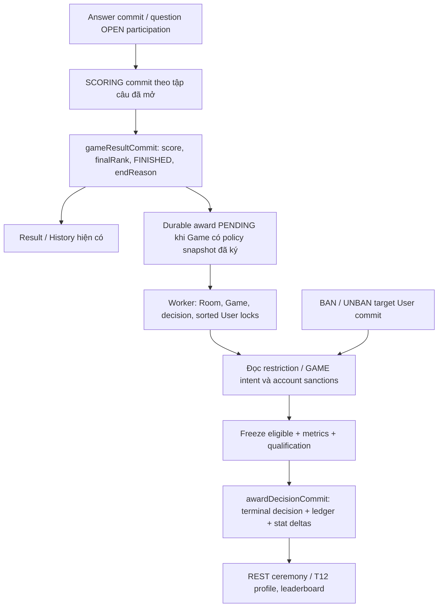

# T10 — Thiết kế award decision, eligibility và transaction

**Cập nhật signoff:** người dùng đã duyệt A01–A13, A16–A17 theo [phiếu AWARD_V1](T10_AWARD_POLICY_SIGNOFF.md) và giao T11. A14–A15 hoãn T12; T13/T17 ngoài phạm vi. Phần dưới lưu thiết kế/bằng chứng ở thời điểm T10 trước signoff; trạng thái triển khai hiện tại xem báo cáo T11.

Ngày 17/10/2026. **Hoàn tất thiết kế; signoff policy còn chờ người dùng. Không triển khai T11.**

T10 chỉ thêm tài liệu và cập nhật checklist. Không sửa source, build config, migration versioned, DB hoặc gameplay; không khởi động app để audit vì startup hiện có side effect `SERVER_INTERRUPTED`. Không cấp thưởng test/production. Đọc DB test bằng JDBC read-only, không chạy DML/DDL. Không commit/push. Thay đổi T00–T09 và `1.txt` được giữ theo manifest trước T10.

Tham chiếu: [V3.4](../../THIET_KE_NANG_CAP_MULTIGAME_V3_4_ADMIN_ACCEPTANCE_FINAL_REVIEW.md) §5–7, §10–11, §18.6/18.10; [gate T00](MULTIGAME_IMPLEMENTATION_PLAN.md), [T08](T08_KICK_REPORT.md), [T09](T09_ACCOUNT_SANCTIONS_REPORT.md). [Phiếu signoff A01–A17](T10_AWARD_POLICY_SIGNOFF.md) là danh sách cần chốt; mọi ngưỡng trong phiếu **chưa được duyệt**, không phải default runtime.

## 1. Bằng chứng source và DB thật

| Nguồn hiện có | Ý nghĩa dùng trong thiết kế |
|---|---|
| `game/entity/GameSession.java`, V4 | `schema_version`, `rules_version`, `status`, `end_reason`, `question_count`, `finished_at_ms`, `revision`; V1 config và V2 config riêng. **Chưa có game_type, award policy snapshot, award decision** |
| `game/entity/GameMember.java`, V9 | Roster chụp tại START: user, participation PLAYER/SPECTATOR, role HOST/MEMBER, membership generation. Không đọc roster hiện tại của Room để xét người đã dự trận |
| `game/entity/PlayerSession.java` | Unique(Game,User); score, `final_rank`, V2 `total_correct_answer_time_ms`. Spectator không có PlayerSession; ban/kick giữ row này |
| `game/entity/GameQuestion.java`, `GameStage.java` | Câu/stage snapshot riêng Game; opened/scored timestamps, mode, stage order. `uq_stage_mode(Game,mode)` hiện cấm lặp mode trong Game |
| `game/repository/QuestionParticipationStore.java`, V9 | PK(question,playerSession), tập quyền trả lời chụp OPEN, độc lập Early Close waitSet; AFK vẫn có nghĩa vụ chấm. DECISION Spin/Star evidence riêng, không là Answer đúng |
| `game/entity/Answer.java`, V1/V4 | Unique(playerSession,question); ACCEPTED_UNSCORED khác CORRECT/WRONG/NO_ANSWER; `scored_at_ms`, `answer_time_ms`, `score_after`, result snapshot và mode |
| `game/service/GameTransactions.java:score/finish/locked` | `READ_COMMITTED`, timeout 5s. Score đọc participation; score cuối + finalRank + FINISHED/endReason + release occupancy + Room WAITING commit trong cùng TX. `locked` lấy Room rồi Game; `finish` khóa Users tăng dần |
| `game/service/GameLifecycle.java:scoreClosedQuestion/attempt/emit` | Gọi transaction proxy trước, sau proxy return mới emit QUESTION_RESULT/LEADERBOARD_UPDATED/GAME_END. Game worker retire ở terminal; chưa có award finalizer |
| `game/engine/RankingEngine.java` | Comparator score DESC, time ASC, competition ranks (1,1,3); ID chỉ ổn định hiển thị tie. V2 caller truyền **correct time**, V1 truyền **total time** |
| `game/service/GameProjection.java`, `dto/response/GameSnapshot.java` | `winners/hasOfficialWinner` là kết quả gameplay, bao gồm V1 ONE_SURVIVOR/ALL_ELIMINATED; **không phải cờ đủ chuẩn/cup recipients** |
| `game/service/GameHistoryService.java`, `controller/GameHistoryController.java` | FINISHED + quyền GameMember retained; đọc DB repeatable-read, không đòi Room còn JOINED hoặc socket Game X được phép. History của người đã unban vẫn có thể xem dù X cấm live reconnect |
| `game/service/GameAccessPolicy.java` | `restrictedUsers` union `game_participation_restriction` và **mọi** intent GAME trong `account_effect_intent`, không lọc chỉ PENDING; intent DONE vẫn là restriction sau UNBAN/expiry |
| `admin/service/AdminKickTransactions.java`, `AdminKickService.java` | Kick qua GameRuntime authoritative queue, Room→Game→sorted Users; marker/audit/release/detach atomic. Kick mới sau FINISHED bị từ chối, receipt cũ chỉ replay |
| `admin/service/AdminSanctionTransactions.java` | Ban chỉ khóa target User; snapshot chỉ Game **ACTIVE**, membership generation/session cutoff/reservation extension; không lấy Game/Room lock hoặc chờ worker trong TX này |
| `auth/service/AccountAccessPolicy.java` | Đọc DB ban/version/epoch/deleted; `lock` trả state dưới User FOR UPDATE. `requireAvailable` ném lỗi cho banned user, **không dùng hàm đó để abort toàn bộ award chỉ vì một Player bị ban** |
| `admin/service/BanEffectReconciler.java` | Deferred cleanup theo captured target; không biến effect DONE thành hết restriction. Award không gọi/reuse ejection để xét eligibility |
| `static/js/features/results/awards.js` | Chỉ có seam 3 state, chưa caller/API/mutation. Game page đang adopt payload Game EVENT như GameSnapshot; không được nhét payload award tùy ý vào event này |
| `auth/security/SecurityConfiguration.java` | Allowlist endpoint cụ thể, cuối cùng denyAll; GET awards mới cần allowlist và guard tương đương History. ADMIN không tự bypass GameMember bằng endpoint người chơi |

### Audit DB read-only ngày 17/10/2026

Đã chạy helper tạm [T10SchemaAudit.java](../../target/T10SchemaAudit.java) bằng JDK source-file mode, JDBC driver cache sẵn; URL cố định **quizz_task2_test**, có guard DATABASE(), `setReadOnly(true)`, REPEATABLE_READ, kết thúc rollback. Credentials đọc nội bộ từ env/config local đã có, không in ra. Log truy vấn và kết quả: [t10-db-audit.txt](../../target/t10-db-audit.txt). Không truy cập DB vận hành.

- MySQL **8.0.45**; thời điểm đọc `2026-10-17 06:58:08.679 UTC`.
- Flyway V1–V11 success; 21 bảng, **không có bảng award/achievement/profile leaderboard/friendly**, không có cột game_type.
- Các unique/PK nêu trên tồn tại thật, gồm answer(playerSession,question), participation(question,playerSession), GameMember/GamePlayer(Game,User), restriction(Game,User), intent(action,type,targetKey).
- V1 FINISHED: 2 COMPLETED, 5 CANCELLED. V2 FINISHED: **72 COMPLETED, 22 CANCELLED, 7 SERVER_INTERRUPTED**. Đây là dữ liệu fixture/test lưu lại, không phải thống kê vận hành hay số Game qualified.
- V2 COMPLETED có **1.219 participation rows**, missing outcomes=0, ACCEPTED_UNSCORED=0; 693 CORRECT, 408 NO_ANSWER (còn lại WRONG). V2 CANCELLED có 15 accepted-unscored và 36 participation chưa có Answer; SERVER_INTERRUPTED có 18 participation chưa có Answer. Không được coi các trường hợp sau là dữ liệu hoàn tất để thưởng.
- 716 CORRECT V2 trên cả các endReason/7 mode có timing mismatch=0 và unscored=0: `answer_time_ms = received_at_ms - game_question.opened_at_ms`. Source GameLifecycle tạo elapsed từ monotonic ingress, rồi quy đổi epoch Server; dùng thời gian đã commit, không tin Client/animation/video duration.
- Game **4265**: V2 COMPLETED, 16 configured/snapshot/opened/scored, 3 PLAYER. Game **4268**: CANCELLED, 1 OPEN, 0 scored, 1 accepted-unscored. Game **4264**: SERVER_INTERRUPTED, 1 OPEN, 0 scored. Game **4262**: COMPLETED 2 câu, 3 PLAYER, nhưng user 17850 chỉ 1 outcome/1 CORRECT và 1 ban target; N+1 không có NO_ANSWER giả. Cùng user ở Y=4263 có score/rank/outcome riêng, ban target X không biến thành target Y.

Audit này chứng minh **nguồn dữ liệu và khác biệt kết quả**, không chứng minh award runtime PASS: chưa có implementation. Chưa gặp V1 ONE_SURVIVOR/ALL_ELIMINATED trong snapshot DB này; sự tồn tại hai endReason được chứng minh từ enum/code/check constraint, cần giữ fixture V1 khi T11 test.

## 2. Result, eligibility và award là ba lớp riêng



| Game/source class | Kết quả vẫn giữ | Xử lý award đề xuất ở T11 |
|---|---|---|
| V1, mọi endReason (kể cả COMPLETED/ONE_SURVIVOR/ALL_ELIMINATED) | Contract History V1, elimination, total-time ranking cũ | Không retro-award; API báo không áp dụng version |
| V2 NORMAL ACTIVE | Engine/timer/queue hiện có | Không finalizer, GET result/awards trả RESULT_NOT_READY |
| V2 NORMAL FINISHED+COMPLETED, có signed policy snapshot | Final score/rank đã commit | Đánh giá qualified bằng policy được ký + completeness proof, không mặc nhiên cấp cúp |
| V2 CANCELLED/SERVER_INTERRUPTED, có policy snapshot | Giữ cả ACCEPTED_UNSCORED/partial timeline và lý do thật | Decision NOT_QUALIFIED/NOT_COMPLETED, ledger rỗng, stat deltas=0; không chấm bù để đạt award |
| V2 FRIENDLY_1V1 tương lai | Giữ V2 gameplay và History theo T15 | Không official CUP/counters; friendly record/badge theo T15/T17 riêng |
| Game cũ hoặc START khi awards chưa active (`award_policy_snapshot=NULL`) | History như hiện tại | Không tạo obligation/reward qua scan; `availability=NO_POLICY_SNAPSHOT`, không gắn PENDING vô hạn và không đoán nguyên nhân thiếu snapshot chỉ từ timestamp |
| FINISHED nhưng thiếu outcomes/rank/participation proof | Không sửa History để ép đủ | Technical failure/PENDING cần reconcile/diagnostic; không terminal NOT_QUALIFIED vì lỗi transient, không thưởng bằng dữ liệu thiếu |

`finalRank/historyRank` là giá trị đã lưu trên toàn roster. `awardRank` là phép dùng lại RankingEngine trên **eligible entries với score/correctTime gốc** khi A08 được duyệt; không write ngược vào PlayerSession. Ví dụ người final rank 1 bị loại, final rank 2 được award rank 1; UI giải thích hai số này. Không lấy `min(finalRank)` hoặc ID để phá tie thành một người.

### Eligibility và metrics có thể kiểm toán

Đặt R = GameMember PLAYER ban đầu đối chiếu PlayerSession; E = các thành viên R còn eligible tại thời điểm chốt theo policy đã ký. R không phụ thuộc Room hiện tại, online/offline, browser, hay occupancy đã chuyển sang Y.

Đối với mỗi Player/mode:

- D = số `game_question_participation` của Player ở mode đó, với câu đã OPEN trong Game; bao gồm AFK/NO_ANSWER.
- C = số outcome CORRECT có participation tương ứng và `scored_at_ms` đã commit.
- T = tổng `answer_time_ms` **chỉ các CORRECT**. Accuracy=C/D; mean correct time=T/C; zero denominator không chia.
- `eligibleCorrectCount = SUM(C của người trong E)`; correct của R\E không dùng để thỏa qualification.
- Không suy CORRECT từ scoreDelta/score vì Spin/Star, streak, floor0, thưởng cuối mode khác nhau.

SQL nguồn cho metric, **chỉ là thiết kế read query** (`:gameId` là bind parameter):

```sql
SELECT p.user_id, q.mode, COUNT(*) AS participated_count,
       SUM(CASE WHEN a.answer_status='CORRECT' THEN 1 ELSE 0 END) AS correct_count,
       SUM(CASE WHEN a.answer_status='CORRECT' THEN a.answer_time_ms ELSE 0 END) AS correct_time_ms,
       SUM(CASE WHEN a.id IS NULL OR a.answer_status='ACCEPTED_UNSCORED'
                     OR a.scored_at_ms IS NULL THEN 1 ELSE 0 END) AS unfinished_count
FROM game_question_participation qp
JOIN player_session p ON p.game_session_id=qp.game_session_id AND p.id=qp.player_session_id
JOIN game_question q ON q.game_session_id=qp.game_session_id AND q.id=qp.game_question_id
LEFT JOIN answer a ON a.game_session_id=qp.game_session_id
                 AND a.player_session_id=qp.player_session_id AND a.game_question_id=qp.game_question_id
WHERE qp.game_session_id=:gameId
GROUP BY p.user_id,q.mode;
```

Trước qualification của COMPLETED, kiểm tra: schema/rules supported; configured count=question snapshot count=opened count=scored count; mọi câu OPEN có participation_captured; mỗi participation có đúng một final outcome; không có accepted-unscored/outcome ngoài participation; mọi PLAYER có finalRank hợp lệ; correct-time totals và final result đối chiếu nguồn outcomes. Không đòi `rosterPlayers * questionCount` outcomes: người đã bị loại trước OPEN không có nghĩa vụ câu đó. Nếu mismatch, PENDING technical error, giữ kết quả gốc và yêu cầu kiểm tra; không sửa dữ liệu trong award finalizer.

Tay nhanh so phân số T/C chính xác bằng cross multiplication với kiểm soát overflow/BigInteger; accuracy cũng dùng tỷ số nguyên. Làm tròn chỉ khi hiển thị. Bách phát dùng C=D và D đạt ngưỡng được ký. Mode hiện unique trong Game; không thay constraint đó. Nếu T13 được chọn, stage-1 rank có thể tái dựng từ last scored Answer `score_after` và `result_snapshot.totalCorrectAnswerTimeMs` trước ranh stage đầu, dùng comparator hiện có; phải test tái dựng trước khi hứa Lội ngược dòng, không tạo stage-history copy ngay T10.

## 3. Kế hoạch migration và schema tối thiểu

**Không tạo/chạy migration tại T10.** Version hiện tại là V11; T00 từng dự kiến tên V11 award khi chưa có T09. T11 phải kiểm tra lại latest version rồi dùng **V12__award_decision_foundation.sql** nếu V12 vẫn trống. Không sửa V1–V11/checksum, không migrate cùng JAR vào DB vận hành khi chưa được giao.

### 3.1. Metadata trên Game, không dựng lại result

Hai cột đề xuất trên `game_session`:

| Cột | Kiểu / invariant |
|---|---|
| `game_type` | VARCHAR(24) ascii_bin NOT NULL DEFAULT 'NORMAL', CHECK NORMAL/FRIENDLY_1V1; mọi luồng hiện có là NORMAL, T15 mới set FRIENDLY tường minh. Không suy game type qua số Player |
| `award_policy_snapshot` | JSON NULL; NULL cho toàn bộ Game cũ và khi award chưa được bật. Khi có, immutable object chứa policyId/version, canonical config + hash, approval reference và các giá trị/flags **đã ký**. Không điền 10/3/5 theo đoán |

Snapshot policy gắn **lúc START của NORMAL V2/rules version được policy hỗ trợ**, giữ nguyên suốt Game, kể cả config runtime đổi khi chờ finalizer. V1/FRIENDLY không gắn official award policy. Không nhét field mới vào `v2_config_snapshot`: JSON schema hiện `additionalProperties=false` và là luật gameplay. Mở rộng trigger `trg_game_snapshot_immutable` bằng additive migration để bảo vệ cả hai field mới, giữ nguyên toàn bộ kiểm tra snapshot cũ. Policy hash tính từ canonical config payload (không hash vòng chính field hash); không đổi ID mà tái dùng nội dung khác. Policy thiếu/chưa được ký → không enable awards, không tự điền default.

### 3.2. Ba bảng mới dự kiến, không bảng totals song song

| Bảng / key | Cột tối thiểu và ràng buộc |
|---|---|
| `game_award_decision` | **PK `game_session_id`** và FK Game; `state` PENDING/DECIDED/NOT_QUALIFIED; `revision` (0 lúc pending, 1 khi terminal), `policy_version`, `policy_hash`, `evidence_version`, `result_revision`, `created_at_ms`, nullable `eligibility_evaluated_at_ms/decided_at_ms`, `reason_codes` JSON, `initial_player_count/eligible_player_count/configured_count/opened_count/scored_count/eligible_correct_count`, retry `attempts/retry_after_ms/last_error_code`. Index(state,retry_after_ms,game_session_id). Terminal có timestamp/evidence, pending không giả terminal |
| `game_award_participant` | **PK(Game,User)**, FK decision(Game), FK player_session(Game,User) dùng unique hiện có. Chỉ PLAYER ban đầu; `eligible`, private evidence/reasons (restriction/intent references, banVersion và evaluation state), `history_rank`, nullable `award_rank`, `official_game_delta/official_win_delta` 0/1, D/C/T tổng và `mode_metrics` JSON. CHECK winDelta≤gameDelta, C≤D, metrics không âm. Không copy raw Answer/đề/đáp án |
| `achievement_award` | id BIGINT PK, Game/User, `award_type`, **`mode_key VARCHAR(24) NOT NULL`**, value=1 cho mỗi lần CUP/title, earned_at_ms; FK(Game,User)→participant. **UNIQUE(Game,User,awardType,modeKey)**, index(User,awardType,earned_at_ms,id). `mode_key='ALL'` cho CUP/PERFECT; mode thật cho FAST. CHECK type/mode shape theo scope đã duyệt |

Không dùng mode nullable trong unique: MySQL cho nhiều NULL, sẽ lọt duplicate CUP. Không đưa policyVersion vào unique decision/award: đổi policy không cho cấp lại cùng Game. Không FK tới RoomMember/current occupancy; việc Room đóng hoặc membership đổi không xóa thành tích. Giữ FK nguồn Game/Player/decision/participant không cascade delete; không thêm FK sang actor ADMIN hay outbox target để tạo lock ngầm ngược thứ tự (bài học V11).

Migration plan phải có CHECK cho state/timestamp/delta/type/mode shape, trigger bảo vệ identity/policy và UPDATE terminal decision (OLD.state khác PENDING thì từ chối thay đổi). Participant/ledger là insert-only của finalizer, UPDATE bị từ chối; INSERT child sau terminal bị chặn theo parent state. Quy trình ghi luôn insert children khi parent PENDING, rồi đổi terminal cuối cùng trong cùng TX. Không có đường DELETE trong nghiệp vụ award và không cascade; cleanup fixture chỉ trên DB/schema test có guard, retention/migration vận hành phải là scope được giao riêng. App repository vẫn dùng CAS/unique, không dựa riêng vào trigger để giải quyết concurrent finalization.

Freeze Game-level reason + eligibility/metrics của mọi PLAYER trong cùng award TX, kể cả NOT_QUALIFIED: mỗi participant delta=0 và ledger rỗng. Retry chỉ đọc lại terminal. Policy snapshot trên Game là nguồn rule; decision lưu version/hash và participant evidence là bằng chứng xét thưởng, không là bản score engine thứ hai.

**Không tạo `UserAchievementStats` MVP**: officialGamesCount=sum(participant.official_game_delta), officialWinsCount=sum(winDelta), cups=sum(CUP value), titles=count theo type/mode, chỉ join terminal decision. Accuracy lấy C/D của **qualified + eligible** theo A09/A14. Không đếm mọi PlayerSession/FINISHED/History winner. Không cộng số trận bằng cách đếm tất cả ledger rows (một người có thể nhận nhiều title).

Profile/BXH T12 đọc nhiều truy vấn trong REPEATABLE_READ read-only hoặc một query committed nhất quán để không thấy cups mới nhưng games cũ. Nếu sau này cần projection materialized, update cùng award TX bằng delta duy nhất và thêm rebuild/consistency tests; không tạo trước khi chứng minh nhu cầu. Badge one-time toàn tài khoản ở T17 cần unique theo (User,badgeType) riêng, không ép vào unique theo Game của CUP.

### 3.3. Cutover và seed PENDING không có khoảng mất obligation

Theo A16 đề nghị new-games-only: migration thêm cột nhưng **không** điền policy cho lịch sử. Game mới START sau khi approved policy active mới có snapshot; policy không được thay giữa trận.

T11 thêm hook nhỏ trong `GameTransactions.finish()` để **insert decision PENDING bằng unique Game trong chính result TX**, nếu Game mang snapshot policy. Đây chỉ là durable obligation, chưa qualification/cúp. Cùng TX score cuối và result thì lỗi seed rollback cùng result; lifecycle retry existing transaction, không emit kết quả/cúp trước commit. `cancel/interrupt/cleanupAbandoned` cũng đi qua finish, seed terminal cần xét NOT_COMPLETED; không làm mất policy obligation sau restart.

Reconciler dự phòng query FINISHED có policy snapshot, không có decision rồi insert seed theo PK và recheck dưới Room/Game lock; **không** scan toàn bộ FINISHED cũ để tự retro-award. Policy payload không parse được/hash sai/version không hỗ trợ giữ pending với diagnostic, không gán policy mới cho Game cũ. Không cần thêm bảng policy hay delivery-outbox ở MVP khi rule snapshot đã bền và event là invalidation tùy chọn.

## 4. Transaction, fence và reconciliation

### 4.1. Thứ tự thật cần giữ

```text
Game result:
  GameRuntime queue Answer/Close/Score
    -> GameTransactions proxy: Room -> Game -> sorted roster Users (finish)
    -> score/finalRank/status/endReason + PENDING seed -> gameResultCommit
    -> publish result/GAME_END; chỉ đánh thức award worker, không wait worker

Award first finalization:
  bounded worker -> RoomBoundary.read(room) [không mở TX trước boundary]
    -> AwardTransactions proxy READ_COMMITTED, timeout bounded
       Room -> Game -> decision -> original PLAYER Users sorted by ID
       -> fresh sanctions + GAME marker/intent -> frozen E/metrics/qualification
       -> participant deltas + ledger + terminal decision -> awardDecisionCommit
    -> optional enqueue notification, không network I/O trong TX

BAN/UNBAN:
  target User -> version/audit/epoch + captured intents -> COMMIT -> deferred effects
  không chờ Room/Game/award worker khi giữ User lock
```

Award chỉ chạy trên FINISHED DB state, không dùng `GameRuntime.administrative()` của T08/T09 cho việc thưởng: terminal actor có thể đã retire/unavailable/không installed. DB Room/Game locks và việc Kick mới sau FINISHED bị từ chối giữ đúng queue order. Room WAITING/CLOSED hoặc Game Y đã ACTIVE không cản X được finalize; finalizer không set Room WAITING lại, không gọi finish(X), không đổi occupancy/membership. Giữ Room lock ngắn để cùng order với START/close; timeout/retry thay vì giữ lâu và làm chậm Game Y.

Sau đủ User locks, đọc sanction trực tiếp từ DB trong cùng connection/TX (`AccountAccessPolicy.lock` hoặc fresh query), không dùng entity cache/ban projection đọc trước lock. Không ném lỗi cho toàn Game khi một Player bị ban: ghi Player đó không eligible theo policy. Đọc restrictions bằng union hiện có; không dùng memory send-start fence làm nguồn award, không chỉ nhìn `account_effect_intent.state='PENDING'`. Sau UNBAN, intent GAME đã DONE vẫn cấm award X theo A04/A10.

FK cũng lấy parent locks: tất cả rows được ghi sau khi đã khóa Game và các Player Users; không UPDATE/lock actor ADMIN bất kỳ, không FK ngược sang RoomMember/Room hiện tại khi đang giữ Users. Migration/IT T11 phải audit lock graph như T09 V11. Không transaction nào giữ User rồi gọi RoomBoundary hoặc đợi Game future.

### 4.2. Thuật toán finalizer

1. Discovery lấy ID PENDING tới hạn hoặc FINISHED có policy thiếu seed, bounded batch. Không giữ TX/row lock khi đợi admission/boundary.
2. Lấy Room, Game và decision FOR UPDATE theo thứ tự trên; nếu terminal thì return frozen data, **không đọc sanction mới để tính lại**. Chỉ retry metadata cho PENDING.
3. Xác nhận Game FINISHED và snapshot policy hợp lệ. Khóa original Player Users tăng dần; sau lock lấy fresh ban state và Game restriction/intent. Lấy evaluation time theo A17; User lock không làm TEMP ngừng hết hạn. Nếu trước commit evaluation đi qua biên expiry thì rollback/retry theo định nghĩa thời gian được ký, không tự sửa terminal sau commit.
4. Nếu endReason không COMPLETED/type/version không thuộc scope, freeze NOT_QUALIFIED đúng reason; nếu COMPLETED thì kiểm chứng completeness từ §2. Technical inconsistency/DB unavailable không quyết định qualification bằng dữ liệu thiếu.
5. Tính E, D/C/T, eligible-only CORRECT, các ngưỡng **từ signed snapshot**. Nếu qualified thì dùng lại RankingEngine trên E, chọn đồng thắng và các title đã bật. Tính private evidence, user-facing reasons, deltas; không query public DTO `hasOfficialWinner` làm qualification.
6. Insert participant snapshot, ledger và chuyển decision bằng conditional `WHERE state='PENDING' AND revision=0`, revision=1. Unique rows là hàng rào cuối. Không dùng `INSERT IGNORE` để nuốt mismatch; duplicate terminal phải đọc đối chiếu Game/policy/evidence hoặc rollback, không tiếp tục increment counters.
7. Commit mọi thứ cùng TX. Exception/timeout/deadlock rollback cả eligibility/ledger/deltas/state. Nếu commit outcome không rõ, mở TX mới đọc unique decision; terminal thì dùng lại, còn pending thì retry có backoff. Không tin lỗi ACK là proof rollback.
8. Sau commit chỉ báo dữ liệu đã lưu. Không chờ socket hoặc animation. Scheduler/startup tiếp tục tìm pending; không thay `GameStartupCleanup` thành resume gameplay.

Triển khai worker nhỏ theo Spring/JDK hiện có, bounded batch/concurrency, retry backoff; không Kafka/Redis/new Game queue. Liveness không phụ thuộc event GAME_END: event mất thì DB discovery vẫn chạy. Reconciler khởi động **sau GameStartupCleanup.ready()**, để ACTIVE sau crash thành SERVER_INTERRUPTED đúng policy cũ; các FINISHED+PENDING trước crash vẫn được hoàn tất. Startup/GET không đổi NOT_QUALIFIED thành DECIDED sau UNBAN.

### 4.3. Ma trận commit order phải kiểm thử

| Trình tự đã commit | Hành vi award theo policy đề nghị |
|---|---|
| Kick trước result/award | Marker X đã có; accepted Answer/current NO_ANSWER vẫn giữ điểm; target không thuộc E, người eligible được xét lại |
| Result trước request Kick mới | Kick GAME_NOT_ACTIVE; không dựng marker terminal mới. Ban vẫn có thể commit trên User |
| BAN khi X ACTIVE → UNBAN → award X | Target intent X còn (PENDING hoặc DONE): vẫn excluded; không phụ thuộc ejection có chạy hay chưa |
| Result X → BAN → award X khi ban còn hiệu lực | T09 không capture target X vì X đã FINISHED; fresh User ban check vẫn excluded |
| Result X → BAN → UNBAN/expiry → award X, không có X-target trước đó | X không bị permanent restriction tự bịa; đánh giá account hiện hành lúc decision theo A04/A05/A17 |
| BAN giữ User trước, award giữ Room/Game rồi chờ User | BAN không đợi Room/Game/FK ngược; commit được; award đọc ban **sau** lock. Eligible-only correct/winners đúng |
| Award giữ đủ Users trước, BAN chờ User | Award commit thắng, frozen decision giữ nguyên sau ban; ledger/counters không bị thu hồi |
| NOT_QUALIFIED đã commit → UNBAN / policy mới / restart | Return nguyên decision/reasons/deltas=0; không đổi policy để thử lại |
| X pending effects, user đã chơi Y hợp lệ | X award chỉ dùng X roster/targets; không detach g2, revoke session mới hoặc xóa user_active_game=Y |

Timestamps receipt/ACK/UI không chứng minh order; test dùng barrier tại transaction synchronization và DB commit + read từ connection khác. A17 là gate riêng cho TEMP expiry trong lúc chờ/giữ lock; không tuyên bố có timestamp COMMIT vật lý từ `System.currentTimeMillis()` trong TX.

## 5. API, UI và events dự kiến

### API T11

**GET `/api/games/{gameId}/awards`** (đề xuất, chưa tồn tại): session/account guard hiện có, quyền retained GameMember như History, Cache-Control no-store, service read-only REPEATABLE_READ. Không gọi guard live X để chặn lịch sử của người đã UNBAN; account đang ban/epoch cũ vẫn bị T09 chặn. Người ngoài/ADMIN qua endpoint người chơi không tự được xem private Game. Không cho Client POST/PUT/DELETE award/finalize/cupDelta.

| Trường hợp | Response dự kiến |
|---|---|
| Chưa login / epoch cũ / account đang ban | 401 hoặc 403 theo error contract T09 hiện có |
| Game không có / user không là retained member | 404 GAME_NOT_FOUND / 403 FORBIDDEN, không lộ exam |
| ACTIVE | 409 RESULT_NOT_READY; không trả eligible đang đoán |
| FINISHED nhưng V1/no policy/FRIENDLY | 200, resultState=RESULT_READY, awardState=null, availability=UNSUPPORTED_SCHEMA/NO_POLICY_SNAPSHOT/EXCLUDED_GAME_TYPE, decisionRecorded=false. NULL snapshot không phân biệt legacy với disabled nếu không có bằng chứng khác; đây không phải terminal decision giả |
| FINISHED có policy, pending hoặc seed cần reconcile | 200 AWARDS_PENDING, frozen eligibility/award list chưa có; GET không insert/trigger finalize. Missing seed là nghĩa vụ của worker, không của người mở trang |
| Terminal DECIDED / NOT_QUALIFIED | 200 AWARDS_DECIDED / AWARDS_NOT_QUALIFIED, frozen snapshot/reasons/awards và revision |
| DB lỗi / pending diagnostic | 503 SERVICE_UNAVAILABLE cho lỗi đọc; pending đã đọc được vẫn báo pending, không báo “không đủ chuẩn” thay lỗi kỹ thuật |

Shape minh họa, không phải response đang triển khai (các placeholder không phải giá trị policy):

```text
gameSessionId, resultState, availability,
awardState, decisionRecorded, decisionRevision,
policyVersion, eligibilityEvaluatedAtMs, decidedAtMs, serverTimeMs,
qualification { qualified, reasonCodes, initialPlayerCount, eligiblePlayerCount,
                configuredCount, openedCount, scoredCount, eligibleCorrectCount },
participants [{ userId, displayNameSnapshot, historyRank, awardRank,
                eligible, publicReasonCodes, officialGameDelta, officialWinDelta }],
awards [{ awardId, userId, type, modeKey, value, earnedAtMs, measuredMetrics }]
```

PENDING không trả participant eligibility/rank/deltas như đã chốt; terminal mới trả dữ liệu frozen. Ordinary response không chứa private ban reason, admin actor, banVersion/epoch/cutoff, intent IDs, raw session, password hay câu/hint chưa công bố. Internal evidence không serialize thẳng entity. Hiện thời timestamp `decidedAtMs` là Server time trong decision TX, không dùng nó thay DB commit order.

T12 giữ metrics/deltas này để query GET own/public profile và leaderboard có paging/tie theo A14–A15; **chưa tạo endpoints/UI đó tại T10**. Nếu thêm read-only ADMIN diagnostics ở T11/T18 thì endpoint `/api/admin/games/{id}/awards` phải explicit ADMIN/session guard và DTO tối thiểu; không tự cho ADMIN nút cấp/sửa cúp.

**GET `/api/awards/policy`** dự kiến ở T11: authenticated, read-only, allowlist cụ thể; trả availability (DISABLED/ACTIVE), policy ID/version và public qualification thresholds/title flags đã ký, serverTimeMs. Không có policy đã ký thì không trả ngưỡng mặc định. Room editor/Waiting dùng summary này để cảnh báo trước START khi kế hoạch ngắn/chưa đủ roster theo ngưỡng hiện hành; chỉ là preview, không hứa qualified vì eligibility/correct còn phụ thuộc dữ liệu Game và award transaction. START vẫn phải chụp policy thực sự active lúc commit; Client không được gửi policy/threshold để Server tin dùng. Policy thay đổi thì preview tải lại, không đổi snapshot của Game đã START.

### Kết nối frontend tối thiểu

- Result/History luôn hiển thị score/rank/endReason thật như T06. `winners` giữ nghĩa cũ; “+1 cúp” chỉ lấy `achievement_award` trong DECIDED. CANCELLED/interrupted không được gọi là thắng thưởng.
- `features/results/awards.js` hiện có seam; T11 nối GET với controller sở hữu AbortController/timeout polling bounded, dừng khi route dispose/terminal. Dùng core api/session/transport sẵn, không thêm reconnect handler hoặc game countdown mới.
- Sau GAME_END/reload/reconnect, GET đọc decision; PENDING rõ ràng, NOT_QUALIFIED có reason, legacy/no-policy có thông báo “chưa áp dụng xét thưởng”. Không block Back to Room/Host START Y khi X còn pending.
- MVP có thể dùng REST recovery/polling, **không bắt buộc event mới**. Nếu T11 chọn `AWARDS_DECIDED` invalidation, chỉ emit sau commit, payload Game ID + decision revision, Client refetch; không phát cúp từ event receipt.
- Source `GameEvent` chứa GameSnapshot và game page adopt mọi Game EVENT payload; invalidation mới cần type handler riêng trước `adopt`. Record mới cũng phải đi qua `AuthenticatedSocketRegistry.gameScope`/recipient selection/writer Game fence, không bị coi nhầm control frame và bypass T08/T09. Không gửi Game X cho user đã bị restricted, không push toàn leaderboard sau Answer. Người bị loại xem award X qua History/GET khi account được phép; không hồi sinh WS X để nhận ceremony.

## 6. Mapping file tối thiểu cho T11, không tạo tại T10

| Existing → planned change | Owner / lý do |
|---|---|
| GameSession/V12 trigger | Thêm game type + policy snapshot immutable; giữ engine config và data cũ |
| GameTransactions START/finish | Gắn approved snapshot lúc START, seed decision trong result TX. Không thêm award engine vào file này |
| `achievements/service/AwardTransactions.java` | Owner mới khi thực sự code: DB locks, decision finalization/ledger, không điều khiển Game |
| `achievements/service/AwardReconciler.java` | Bounded discovery/retry sau startup cleanup; không dùng Game worker để chờ DB award hoặc network |
| `achievements/model/ApprovedAwardPolicy.java`, `AwardEvaluator.java` | Rule thuần từ approved snapshot + committed facts; dùng lại RankingEngine, không tạo ScoreEngine thứ hai |
| `achievements/repository/AwardRepository.java` | Fresh facts, unique decision/ledger và read views; entity/dto/model tách đúng owner nếu cần, không đổ chung vào repository folder |
| `achievements/controller/GameAwardsController.java`, DTO | GET theo History guard; response an toàn, không mutation endpoint công khai |
| SecurityConfiguration + CodebaseStructureTest | Allowlist chính xác GET và owner `achievements` khi feature thật xuất hiện; không disable architecture test |
| results/awards.js + game/page.js + results/history.js | Nối API/owned lifecycle, state và ceremony; state không được tự cấp cúp |
| room/page.js + room/editor.js | Preview policy Server/cảnh báo trước START; không đổi author-pack/start policy hoặc xác nhận award sớm |
| Tests theo §7 | Tận dụng GameLifecycleFixture/NetworkFixture, fake clock/SQL barriers hiện có |

**0 file cần di chuyển**, 0 folder trống tại T10. T11 dự kiến 1 migration, 2 entity/transaction integration points, một owner achievements nhỏ; tách DTO/entity/service/repository khi có file thật, không tạo sẵn toàn cây. Leaderboard/Friendly/advanced titles là task riêng.

## 7. Test design và điều kiện đóng gate T11

Tất cả test award dưới đây **NOT IMPLEMENTED / NOT RUN tại T10**. Test data dùng ngưỡng của fixture policy được truyền vào evaluator, không encode 10/3/5 vào production. Sau signoff, thêm một contract test cho đúng policy đã ký.

| Test suite dự kiến / V3.4 | Setup và assertion bắt buộc |
|---|---|
| AwardPolicyTest | Biên min-1/min/min+1 cho câu configured/scored, roster/eligible/CORRECT; không suy từ Quiz bank; unknown/missing policy không bật thưởng |
| AwardMetricsIT | D bằng participation, AFK NO_ANSWER vào denominator; không có NO_ANSWER cho chưa OPEN; Spin/Star đã tiêu trước OPEN không thành correct/participation giả; T/D/C theo mode và server time |
| AwardRankingTest/IT | Ties score/time → đồng cúp nếu policy đã duyệt; ID không phá tie; restricted final rank 1, eligible final rank 2 trở thành award rank 1 nhưng DB finalRank không đổi; mọi đồng đạt title cùng nhận |
| EligibleAwardIT / §18.12 tests 20–21,33–34 | A duy nhất CORRECT bị loại, B/C không CORRECT → NOT_QUALIFIED NO_ELIGIBLE_CORRECT, mọi delta=0. Đủ eligible correct thì chọn cao nhất trong E, không chỉ drop global winner; một eligible dưới min không thưởng |
| AwardBanFenceIT / 22,35–36 | Barrier BAN giữ User trước, award giữ Room/Game rồi chờ; không deadlock bởi FK, fresh ban sau lock. Đảo award giữ Users trước, BAN chờ → award immutable. Pause sau result trước decision để ban FINISHED/no-X-intent vẫn được xét |
| AwardBanFenceIT thêm UNBAN/TEMP | ACTIVE X intent PENDING/DONE → UNBAN trước award vẫn excluded. FINISHED X ban rồi unban, không có X intent → theo current account/evaluation policy. TEMP expiry lúc chờ/giữ lock theo A17; không dùng ACK làm commit proof |
| AwardDecisionRecoveryIT / 37 | Crash result+PENDING trước award → restart hoàn tất; crash trước award commit → không ledger/delta; crash sau commit trước emit → retry đọc frozen, không duplicate; NOT_QUALIFIED sau UNBAN vẫn terminal |
| AwardDecisionRecoveryIT missing seed | Có signed Game snapshot/FINISHED không decision → repair một seed; Game cũ policy NULL không được seed/backfill; unknown policy/hash mismatch pending diagnostic, không lấy policy mới |
| AwardConcurrencyIT | Hai finalizer cùng Game chỉ 1 terminal/ledger; hai Games có chung user chạy song song không mất counters; duplicate request/event/reconnect/GET không ghi thêm; same unique type/mode ALL không lọt NULL duplicate |
| AwardExclusionIT | V1 COMPLETED/ONE_SURVIVOR/ALL_ELIMINATED, FRIENDLY, CANCELLED, SERVER_INTERRUPTED, short completed theo signed threshold không có official delta. Cancel/interrupted accepted-unscored không bị chấm bù; mismatch complete data stays pending |
| AwardHistoryIntegrityIT | So byte/field score/Answer/finalRank trước-sau decision, Kick/Ban, Room close, new Game Y và logout/login; history giữ score rank cũ, không detach/revoke/clear Y/g2/S2 |
| AwardApiIT | 401/403/account epoch, outsiders/ADMIN không bypass member trên player endpoint; GET read-only; POST finalize/cupDelta bị deny; pending không giả finalized data, DTO không leak exam/audit/session |
| AwardStatsSnapshotIT | Cups/games/wins/accuracy cùng committed revision; rollback không thấy nửa projection; zero games không chia 0; mỗi Game chỉ +1 denominator dù nhận nhiều danh hiệu |
| Browser ceremony/lifecycle | Pending→terminal, refresh/reconnect, duplicate/lost event, no-policy legacy, NOT_QUALIFIED reasons, cup recipients khác final rank; route disposal không leak timer/listener. Room Y/return không bị award pending block |
| Optional event/outbound regression / 38 | Typed invalidation được gameScope guard; queued X sau restriction không bắt đầu send, Y FIFO giữ; slow socket không chặn Game/award worker; không đưa award payload vào GameSnapshot adopter |
| T13/T15/T17 deferred | Multitalent/comeback theo signoff riêng; Friendly r1/r2/AC-42b/c và king badge 5 thắng/3 đối thủ chỉ khi T15/T17 có implementation và policy được duyệt |

Lệnh dự kiến ở T11: unit bằng `mvn -o -B --no-transfer-progress test`; MySQL IT bằng `mvn -o -B --no-transfer-progress -Pmysql-smoke verify` trên DB test và private migration schema, không chạy cùng test Server đang dùng DB đó. Browser smoke chạy JAR test/Chrome profile do runner sở hữu. Các lệnh này **chưa chạy lại ở T10** vì chỉ sửa docs.

Baseline kế thừa T09: 335 unit PASS; 208 IT phân biệt đạt qua full + focused reruns (lượt full trước có lỗi fixture Spin, đã sửa và chạy lại; cuối 30 Ban/Kick IT PASS), browser/restart/7-mode/auth/lifecycle theo báo cáo T09. Không ghi các test award mới hoặc toàn bộ Maven verify T10 là PASS. LAN nhiều thiết bị vật lý vẫn chưa xác minh.

## 8. Approval / blocker và task order

| Gate / blocker | Trạng thái hiện tại | Điều kiện bước tiếp |
|---|---|---|
| T10 design/source/DB inventory | Hoàn tất tài liệu; DB audit read-only thực tế | Review tài liệu này và phiếu A01–A17 |
| P-AWARD-BASE/TIE/ADMIN-AWARD | **CHƯA DUYỆT**, kể cả ngưỡng 10/3/2/1 và cấp sau Kick | Người dùng ký A01–A10; không dùng lệnh T09 làm consent award |
| Policy activation/TEMP evaluation | **CHƯA DUYỆT** A16–A17 | Chốt new-games-only và clock semantics trước implementation |
| P-FAST/P-PERFECT | **CHƯA DUYỆT** A11–A13 | Bật với giá trị rõ hoặc hoãn; cúp-only không tự mở title |
| P-LEADERBOARD/privacy | Chưa duyệt A14–A15 | Có thể chốt riêng tại T12; không public endpoint trước khi ký |
| ADMIN B3 award/ban/immutable decision | Có thiết kế, **chưa đóng blocker runtime** | T11 implementation + tests 20–22,33–37 + crash/locking PASS mới đánh dấu đóng |
| T09 AC-42 reservation/mixed | Vẫn PENDING T15/T18 | Không kéo Friendly vào T10 để tạo test r2 giả |

Order: T10 design → **signoff có ID/giá trị** → người dùng giao T11 cho scope đã ký → migration/schema/seed/finalizer/API/UI + tests → T12 sau policy BXH → T13 optional / T14 / T15 theo gate riêng. Không tự thực hiện T11 ở lượt T10.

Để hoàn thành gate có thể review, đã tạo phiếu signoff cụ thể trước khi yêu cầu phê duyệt. Việc dừng policy-dependent đến từ **lệnh T10 của người dùng**: “Nếu chưa được phê duyệt chính sách, dừng phần policy-dependent”; không phải một approval flow do agent tự thêm. Hiện chưa có chữ ký/câu trả lời xác nhận nên không có migration hay hằng số ngưỡng production nào được tạo.

## 9. Verification của lượt T10

Đối chiếu SHA-256 với `target/t10-before/manifest.json`: **0 thay đổi source/test/scripts/pom/migration/spec và `1.txt`**; chỉ sửa 2 tài liệu kế hoạch/checklist và thêm 2 tài liệu T10 này. Evidence collector/log/manifest nằm trong `target/`, không là code ứng dụng. [t10-verification.json](../../target/t10-verification.json) ghi inventory và kết quả kiểm tra link/UTF-8/whitespace.

`git diff --check` exit 0; có 18 cảnh báo line-ending ở các file đã dirty trước T10, không đổi line ending để dọn đẹp. Các link trong 4 tài liệu tồn tại. T10 **không chạy Java regression/browser/award runtime test và không chạy Flyway**; không báo baseline T09 hoặc review tĩnh là test runtime T10. Chỉ DB SELECT audit và kiểm tra tài liệu/workspace đã được thực hiện ở lượt này.
