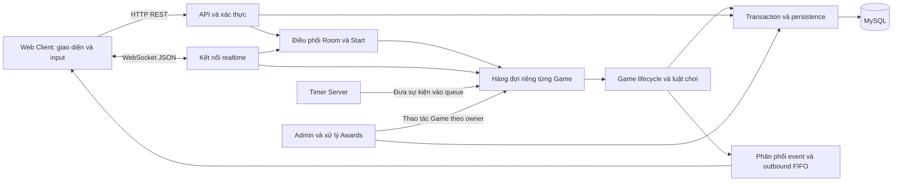
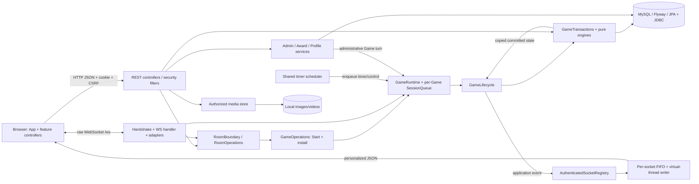
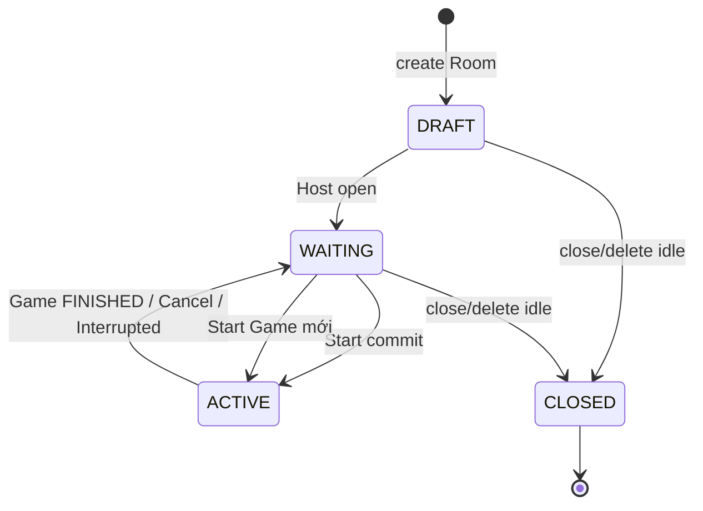
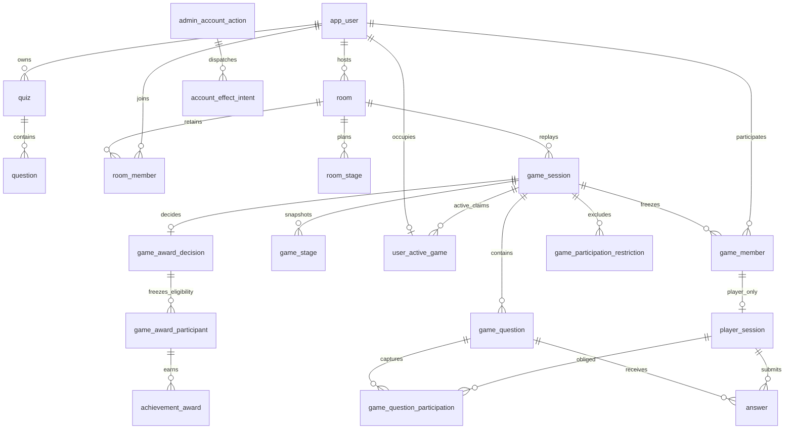

# MultiGame — Tài liệu nguồn phục vụ viết báo cáo BTL Lập trình mạng

Tài liệu này giúp người viết hiểu hệ thống, lựa chọn nội dung đưa vào báo cáo và tìm bằng chứng khi cần kiểm tra. Đây là nguồn thông tin có giải thích, chưa phải bản báo cáo cuối kỳ: người viết vẫn cần xác lập câu hỏi nghiên cứu, lựa chọn kết quả, bổ sung tài liệu tham khảo và tự xây dựng lập luận.

**Phạm vi bằng chứng:** source được khảo sát ngày 19/10/2026 tại revision `e0f00d8`. Kết quả T18 và benchmark trình bày bên dưới được đọc từ artifact lịch sử, không phải một lần chạy lại bản hiện tại. Chưa có bằng chứng demo LAN trên nhiều thiết bị vật lý. Dữ liệu trận mô phỏng phục vụ giao diện không được dùng như dữ liệu thực nghiệm. Lần biên soạn này chỉ tổ chức lại tài liệu, không sửa code, cấu hình, test hoặc database.

## Cách sử dụng tài liệu

Đọc phần I–IV để hình dung bài toán, chức năng, kiến trúc và giao tiếp. Phần V giải thích các cơ chế quan trọng nhất của môn Lập trình mạng. Phần VI–IX hỗ trợ chọn nội dung triển khai, đóng góp và đánh giá. Phần X giúp chuẩn bị demo và bảo vệ. Khi cần kiểm tra một nhận định hoặc trích số liệu, tra phụ lục tương ứng thay vì đọc toàn bộ source từ đầu.

| Nội dung cần viết | Phần nên đọc trước | Bằng chứng tra thêm |
|---|---|---|
| Bài toán, mục tiêu, phạm vi | I–II | Phụ lục A–B |
| Kiến trúc và thiết kế mạng | III–IV | Phụ lục B–C |
| Concurrency, đồng bộ và recovery | V | Phụ lục D |
| Triển khai, dữ liệu và bảo mật | VI | Phụ lục E |
| Điểm mạnh và đóng góp | VII | Phụ lục F |
| Kiểm thử, benchmark, đánh giá | VIII–IX | Phụ lục G–H |
| Demo và câu hỏi bảo vệ | X | Phụ lục H |
| Phân bổ thông tin vào bài báo cáo | Các phần đã chọn | Phụ lục I |

## Mục lục

1. [Phần I — Tổng quan đề tài](#phan-i)
2. [Phần II — Chức năng hệ thống](#phan-ii)
3. [Phần III — Kiến trúc hệ thống](#phan-iii)
4. [Phần IV — Thiết kế giao tiếp mạng](#phan-iv)
5. [Phần V — Xử lý đồng thời và quản lý trạng thái](#phan-v)
6. [Phần VI — Triển khai hệ thống](#phan-vi)
7. [Phần VII — Điểm mạnh và đóng góp kỹ thuật](#phan-vii)
8. [Phần VIII — Kiểm thử và thực nghiệm](#phan-viii)
9. [Phần IX — Đánh giá, hạn chế và hướng phát triển](#phan-ix)
10. [Phần X — Hướng dẫn demo và bảo vệ](#phan-x)
11. [Phụ lục — Bằng chứng kỹ thuật](#phu-luc)

<a id="phan-i"></a>

## PHẦN I — TỔNG QUAN ĐỀ TÀI

### 1. Bối cảnh và vấn đề cần giải quyết

MultiGame tổ chức trò chơi hỏi đáp cho nhiều người cùng tham gia qua mạng. Mỗi người dùng tương tác trên Client riêng, nhưng mọi người trong một trận cần cùng hiểu câu hỏi nào đang mở, còn bao nhiêu thời gian và kết quả nào đã được công bố. Server còn phải lưu lại quá trình chơi để người dùng xem lịch sử, thành tích và bảng xếp hạng.

Khó khăn xuất hiện khi các Client gửi yêu cầu đồng thời hoặc kết nối không ổn định. Một người có thể đã gửi Answer nhưng chưa thấy ACK, người khác đang mất mạng, trong khi Server phải đóng câu hỏi đúng quy tắc. Nếu mỗi Client tự quyết định thời gian và điểm, các màn hình có thể đi đến những kết quả khác nhau. Bài toán kỹ thuật vì vậy bao gồm cả xử lý trò chơi và duy trì một trạng thái chung đáng tin cậy.

### 2. Động lực xây dựng hệ thống

Đề tài tạo điều kiện áp dụng những nội dung cốt lõi của Lập trình mạng vào một ứng dụng có tương tác liên tục: kết nối full-duplex, giao thức message, xử lý nhiều Client, quản lý phiên, đồng bộ thời gian và phục hồi khi mất kết nối. Các thao tác CRUD cho tài khoản hoặc bộ câu hỏi là phần hỗ trợ; trọng tâm để phân tích nằm ở quá trình một trận đấu diễn ra giữa nhiều Client và Server.

Động lực này được rút ra từ các tình huống và cơ chế thực tế trong project. Chưa có khảo sát người dùng hoặc số liệu thị trường để khẳng định nhu cầu phổ biến của sản phẩm.

### 3. Mục tiêu của project

Hệ thống hướng tới việc tổ chức Room nhiều người chơi, hỗ trợ bảy chế độ chơi và để Server quyết định câu hỏi, thời hạn, tính hợp lệ của đáp án, điểm và thứ hạng. Một mục tiêu khác là bảo toàn dữ liệu khi gặp request trùng, mất ACK, reconnect hoặc thao tác quản trị xen vào trận đấu.

Người viết có thể trình bày ba nhóm mục tiêu: cung cấp chức năng multiplayer; duy trì tính đúng đắn của trạng thái khi có concurrency và lỗi kết nối; lưu kết quả, History và Awards nhất quán. Không chuyển các mục tiêu này thành tuyên bố về tải cao hoặc độ trễ thấp khi chưa có phép đo phù hợp.

### 4. Phạm vi và giới hạn

Kiến trúc hiện tại gồm một Spring Server và một MySQL database, phục vụ Web Client. Hệ thống có cấu hình để truy cập qua LAN, nhưng bằng chứng đã đọc chỉ xác nhận các lần kiểm tra trên cùng một máy, kể cả trường hợp dùng LAN origin. Chưa được viết rằng đã demo thành công bằng nhiều thiết bị vật lý.

Friendly 1v1 và các task T15–T17 nằm ngoài phạm vi hiện tại. Hệ thống cũng chưa có bằng chứng cho distributed cluster, high availability hoặc tiếp tục một Game đang ACTIVE sau Server restart. Khi khởi động lại, Server xử lý trận dang dở theo chính sách interruption, thay vì khôi phục để tiếp tục câu hỏi cũ.

### 5. Đối tượng sử dụng

Tài khoản có role USER hoặc ADMIN. Trong một Room hoặc Game, người dùng còn có vai trò Host/MEMBER và cách tham gia PLAYER/SPECTATOR. Đây là các phạm vi quyền khác nhau: Host có quyền quản lý Room nhưng không tự trở thành ADMIN; Spectator được xem nhưng không có quyền Answer. Tác giả bộ câu hỏi không được chơi chính bộ của mình, do đã biết đáp án.

### 6. Công nghệ triển khai

Backend dùng Java 21 và Spring Boot 3.5.16, với Spring Web, WebSocket, Security, Data JPA, Validation và JDBC cho một số thao tác dữ liệu. MySQL lưu thông tin nghiệp vụ; Flyway quản lý migration. Frontend dùng HTML, CSS và JavaScript ES modules, giao tiếp bằng fetch và WebSocket của browser; không cần một npm dev server để chạy Client production.

Maven wrapper cấu hình Maven 3.9.12. Artifact kiểm thử lịch sử ghi JDK 21.0.9 và MySQL từng được quan sát ở phiên bản 8.0.45. Đây là thông tin về môi trường đã lưu, không phải xác nhận version database đang chạy hôm nay. Chi tiết cấu hình và provenance nằm ở [phụ lục A](#phu-luc-a) và [phụ lục G](#phu-luc-g).

<a id="phan-ii"></a>

## PHẦN II — CHỨC NĂNG HỆ THỐNG

Các nhóm dưới đây được mô tả theo tương tác Client–Server để người viết thấy cả mục đích sử dụng lẫn ý nghĩa kỹ thuật. Đường dẫn API, class và test đầy đủ được đặt trong [phụ lục B](#phu-luc-b); các luật và điều kiện chính xác được giữ ở [phụ lục E](#phu-luc-e).

### 1. Tài khoản và xác thực

Người dùng đăng ký tài khoản rồi đăng nhập qua cùng một luồng xác thực. Client lấy CSRF token và gửi thông tin đăng nhập bằng HTTP. Server kiểm tra tài khoản, password và trạng thái hạn chế; sau khi xác thực thành công, Server lưu SecurityContext và quản lý phiên bằng HTTP session cookie. Client dùng phiên đó khi mở WebSocket.

Điểm cần phân tích là quyền sử dụng không chỉ được kiểm tra lúc login. Server còn kiểm tra session, account và connection khi tiếp nhận các thao tác sau đó. Logout thu hồi quyền của phiên và đóng các WebSocket liên quan. Các test auth và security lịch sử kiểm tra cả đường thành công và các trường hợp bị từ chối.

### 2. Lobby và quản lý Room

Lobby hỗ trợ người dùng tìm lại các Room đã tham gia, tạo Room hoặc xem preview từ mã phòng. Host gửi cấu hình qua REST; Server tạo Room ở trạng thái DRAFT và chỉ cho người khác tham gia sau khi Host mở thành WAITING. Người chơi join qua WebSocket với mã Room và hình thức tham gia.

Server kiểm tra trạng thái, quyền, giới hạn số người và revision trước khi thay đổi. Sau commit, các Client đã subscribe nhận cập nhật Room. Revision giúp ngăn một thao tác dựa trên dữ liệu cũ ghi đè trạng thái mới. Lobby hiện tại không nên được mô tả như một dịch vụ public matchmaking.

### 3. Quản lý Host, Player và Spectator

Host chọn bộ câu hỏi, cấu hình stage, mở Room, Start và có quyền Cancel Game theo điều kiện. Player gửi đáp án và sử dụng tài nguyên gameplay được cấp. Spectator theo dõi diễn biến, không được Answer, Spin hoặc Star.

Client có thể ẩn hoặc khóa nút theo vai trò để giúp người dùng thao tác, nhưng Server mới là nơi cưỡng chế quyền. Ví dụ, một Spectator tự tạo raw WS Answer vẫn bị từ chối. Start cần ít nhất ba PLAYER; Spectator không được tính vào số này, dù cũng có occupancy khi tham gia Game.

### 4. Quản lý bộ câu hỏi

Tác giả tạo và sửa bộ câu hỏi, đặt PUBLIC/PRIVATE, tải ảnh hoặc video phù hợp với mode. Client gửi dữ liệu cấu trúc bằng REST và media bằng upload; Server kiểm tra nội dung, ownership, revision và định dạng tài nguyên.

Khi Start, Server chụp nội dung và cấu hình dùng cho Game. Việc sửa hoặc soft delete bộ nguồn về sau không được làm thay đổi câu hỏi hay History của trận đã tạo. Người viết nên phân biệt bộ câu hỏi nguồn với snapshot dùng trong Game; đây là quyết định quan trọng về tính nhất quán dữ liệu.

### 5. Bảy chế độ chơi

Các mode thay đổi cách trình bày và kiểu đáp án, nhưng đều dùng chung nguyên tắc: Client gửi input, Server kiểm tra và chấm từ dữ liệu đã chụp.

| Mode | Tương tác chính | Server đánh giá |
|---|---|---|
| QUIZ | Chọn một trong A/B/C/D | So với correct option |
| RIDDLE | Nhập đáp án câu đố | So khớp text với aliases |
| VIETNAMESE_PUZZLE | Sắp xếp các mảnh chữ | Kiểm permutation ID, ghép text rồi so đáp án |
| CLUES | Theo dõi gợi ý xuất hiện theo thời gian, nhập text | Chỉ công bố hints đã đến hạn; so aliases |
| ORDERING | Sắp xếp các mục | Kiểm permutation và correct order |
| IMAGE_WORD | Xem ảnh, nhập đáp án | So aliases của câu hỏi |
| SONG | Nghe/xem video, nhập đáp án | So aliases; thời gian do Server quyết định |

Ảnh hoặc video không thay vai trò của Server trong chấm điểm. Tương tự, thao tác kéo hoặc chọn mảnh chỉ tạo một permutation gửi lên; Client không tự quyết định rằng cách sắp xếp đó là đúng. Các evaluator và mode lifecycle có test lịch sử; bảng trên không hàm ý media đã được benchmark trên mạng vật lý.

### 6. Game lifecycle, thời gian và chấm điểm

Host Start bằng request gắn với Room và revision hiện tại. Server kiểm tra roster, bộ câu hỏi, occupancy rồi tạo Game và snapshot trong transaction. Runtime chỉ được cài đặt sau khi transaction thành công.

Trong V2, mỗi stage bắt đầu bằng INTRO; Quiz có thêm DECISION cho Spin/Star trước khi mở câu hỏi. Sau thời gian Answer, hoặc khi thỏa Early Close, Server chuyển qua đóng câu, scoring và công bố result. Client nhận trạng thái, input acceptance và kết quả qua các message riêng. ACK Answer không có nghĩa Answer đúng.

V2 có điểm đầu 0, điểm sàn 0 và không loại Player do điểm âm. Legacy V1 giữ luật cũ riêng. Chi tiết ScoreEngine, RankingEngine và bảng điểm nằm ở phần VI và phụ lục E; không giản lược Quiz thành luật “đúng +10, sai 0”.

### 7. Đồng bộ WebSocket

Sau login, Client mở WebSocket để nhận trạng thái Room và Game, gửi command và nhận ACK/ERROR. Server gửi event tới các connection đủ quyền, thuộc membership phù hợp và đã subscribe Room. Mỗi Client chỉ nhận private player state của chính mình trong payload cá nhân hóa.

Đồng bộ ở đây là thống nhất trạng thái và kết quả do Server công bố. Nó không có nghĩa tất cả màn hình nhận event hoặc render cùng một thời điểm tuyệt đối. Test lịch sử kiểm tra contract và trạng thái; synchronization delay giữa nhiều thiết bị vẫn cần đo.

### 8. Disconnect/Reconnect

Mất WebSocket không tự làm người dùng rời Room hoặc xóa dữ liệu Answer đã commit. Khi kết nối lại bằng session hợp lệ, Client yêu cầu snapshot của Game hiện tại. Server trả phase, deadline còn lại, tài nguyên và input đã được nhận theo quyền của người dùng.

Reconnect không cấp thêm thời gian và không tự gửi lại một Answer với identity mới. Nếu ACK trước đó bị mất, Client cần phân biệt đọc trạng thái bằng reconnect với retry chính request cũ. Các test reconnect và AFK lịch sử kiểm tra những tình huống này dưới điều kiện có kiểm soát.

### 9. History và chơi tiếp trong cùng Room

Khi Game kết thúc, người từng tham gia có thể đọc History và timeline đã lưu. Client lấy dữ liệu bằng REST; Server kiểm tra retained Game membership và chỉ trả lịch sử phù hợp. Những dữ liệu này không phụ thuộc việc connection cũ còn tồn tại.

Room quay về WAITING và có thể tạo Game kế tiếp. Game mới có ID, snapshot, điểm và tài nguyên ban đầu riêng; receipt của Game cũ vẫn thuộc Game cũ. Test lịch sử kiểm tra ba Game liên tiếp trong cùng Room, thay đổi pack/roster và giữ History/Awards trước đó.

### 10. Quản trị ADMIN

ADMIN có thể đọc thông tin quản trị, Kick Player hợp lệ khỏi một Game, ban tạm thời, ban vô thời hạn, unban và đóng orphan Room trong điều kiện quy định. Client gửi các yêu cầu quản trị qua REST với CSRF; Server kiểm tra role, target và trạng thái, không dựa vào việc người dùng có nhìn thấy nút quản trị hay không.

Kick có phạm vi Game, trong khi Ban ảnh hưởng quyền tài khoản và phiên. Cả hai không được xóa tùy tiện điểm hoặc obligation của câu đã OPEN. Phần V giải thích cách xử lý khi các thao tác này xen vào Answer, scoring hoặc một Game mới.

### 11. Cups, Achievements, Profile và Leaderboard

Kết quả gameplay và quyết định thưởng được xử lý ở hai transaction khác nhau. Sau khi Game FINISHED, một nghĩa vụ xử lý award được lưu; bộ xử lý nền kiểm tra policy, eligibility và dữ kiện đã commit trước khi ghi ledger. Mở trang result hoặc refresh profile không phải hành động cấp thưởng.

Profile và global leaderboard đọc các facts thưởng chính thức. History rank không nhất thiết trùng award rank, vì người bị restriction có thể vẫn giữ kết quả lịch sử nhưng không được xét thưởng. Những ngưỡng CUP, PERFECT, FAST, MULTITALENT và COMEBACK được giữ nguyên ở phụ lục E, tránh thay đổi policy trong quá trình diễn giải.

### 12. Trạng thái triển khai và mức xác minh

| Nhóm | Mức bằng chứng hiện có | Điều không được suy ra |
|---|---|---|
| Auth, Room, gameplay, History/replay | Có implementation và test Java/network lịch sử | Không tự đồng nghĩa đã chạy lại HEAD hoặc LAN nhiều thiết bị |
| ADMIN, Awards, Profile/Leaderboard | Có implementation và test race/persistence/security lịch sử | Không suy từ kết quả FINISHED rằng ledger đã cấp cúp ngay |
| Frontend | Có code và browser checks lịch sử | Những thay đổi UI sau artifact cần smoke lại |
| Cấu hình LAN | Có bind/origin configuration và kiểm tra cùng máy | LAN vật lý chưa được xác minh |
| Friendly 1v1/T15–T17 | Ngoài phạm vi | Không liệt kê là chức năng hoàn thành |

Bảng này là bản tóm tắt trạng thái. Danh sách API, frontend owner, test class và source theo từng chức năng được giữ nguyên tại phụ lục B; định nghĩa các nhãn trạng thái ở phụ lục A.

<a id="phan-iii"></a>

## PHẦN III — KIẾN TRÚC HỆ THỐNG

Hệ thống sử dụng mô hình Client–Server: browser phụ trách nhập liệu và trình bày, Server điều phối nghiệp vụ và giữ quyền quyết định, database lưu dữ kiện cần bền vững. Một Room có thể phục vụ nhiều Game liên tiếp, nhưng mỗi Game có một trạng thái runtime riêng.



Sơ đồ thể hiện các đường xử lý chính. Nó không có nghĩa mọi REST request phải vào Game queue: việc đọc profile hoặc CRUD bộ câu hỏi có service riêng. Start cần điều phối theo Room; command gameplay được xử lý theo Game; tác động quản trị đi qua transaction và owner phù hợp.

### 1. Các thành phần và quan hệ

Client có một lớp gọi API, một transport WebSocket và một router, sau đó phân chia màn hình theo feature. Cách tổ chức này giúp các trang Room, Game hoặc History không tự tạo những nguồn trạng thái và connection độc lập. Khi đổi trang, controller cũ được dispose để callback đến muộn không cập nhật màn hình mới.

Ở Server, REST và WebSocket là hai cửa vào cùng các use case. Lớp adapter đọc message, xác thực và chuyển dữ liệu sang nghiệp vụ; lớp xử lý Game quyết định phase và deadline; engine tính toán theo luật; transaction ghi facts. Việc tách engine khỏi socket và database giúp kiểm thử luật độc lập với transport.

Database lưu account, nguồn câu hỏi, Room, snapshot Game, Answer, kết quả, restriction và ledger thưởng. Runtime giữ các cấu trúc cần cho điều phối đang diễn ra như queue, phase window và connection generation. Không coi trạng thái runtime trong memory là dữ liệu tự phục hồi sau restart.

### 2. Luồng dữ liệu tổng quát

Ví dụ với Answer, browser tạo command rồi gửi qua WebSocket. Server kiểm tra connection và message, đưa command vào queue của Game, kiểm quyền và thời hạn, sau đó lưu input trong transaction. Khi commit thành công, Client nhận ACK acceptance. Đến giai đoạn scoring, Server tính từ input đã lưu, commit result rồi phân phối event cho các Client đủ quyền.

Điểm mấu chốt của kiến trúc là tách **nhận yêu cầu**, **ghi thay đổi thành công** và **gửi thông báo**. Mạng gửi chậm hoặc ACK bị mất không được biến thành lý do tự cộng điểm lần nữa. Sơ đồ module, đường request, media và persistence chi tiết nằm ở phụ lục B–E.

<a id="phan-iv"></a>

## PHẦN IV — THIẾT KẾ GIAO TIẾP MẠNG

Phần này nên là nội dung chính của báo cáo Lập trình mạng. Người viết cần giải thích được Client biết trạng thái từ đâu, gửi yêu cầu gì, Server xác nhận lúc nào và cách một thay đổi được chuyển tới những người còn lại.

### 1. Kết nối Client và Server

Client trước hết truy cập ứng dụng bằng HTTP và đăng nhập để thiết lập session. Khi mở WebSocket, browser gửi cookie theo phiên đã có; Server kiểm Origin, principal, session và account. Kết nối chỉ được Client coi là sẵn sàng sau message AUTH_READY. WebSocket gameplay dùng endpoint `/ws`; `/ws/admin` có guard ADMIN và hiện là kênh read-only.

Project dùng raw WebSocket JSON, không dùng STOMP hoặc SockJS. Transport/HTTP Upgrade do Spring và container thực hiện. Phần do project xây dựng là contract message, xác thực, routing, ACK/retry, quản lý trạng thái và đồng thời.

### 2. REST và WebSocket phục vụ hai kiểu tương tác

REST phù hợp với thao tác có request/response rõ ràng như đăng nhập, quản lý bộ câu hỏi, cấu hình Room, đọc History và Profile. WebSocket giữ kết nối hai chiều để Player gửi command và Server chủ động phát diễn biến Game. Một số use case như Start hoặc Cancel có cả đường REST và WS; các đường này vẫn cần dùng chung quy tắc nghiệp vụ.

Việc dùng WebSocket không tự giải quyết ordering, duplicate hoặc quyền truy cập. Đó là trách nhiệm của application protocol và các cơ chế xử lý phía Server được giải thích ở phần V.

### 3. Message và ý nghĩa xác nhận

Một command mang version giao thức, loại message, requestId, tên thao tác, target Room/Game, question index và payload. RequestId giúp Client retry cùng một yêu cầu; target và index giúp Server xác định đúng đối tượng và câu hỏi. Identity của Player được lấy từ phiên đã xác thực, không phải một userId tùy khai trong Answer.

| Loại message | Ý nghĩa khi đọc luồng |
|---|---|
| COMMAND | Client yêu cầu Server thực hiện một thao tác |
| ACK | Server xác nhận yêu cầu được chấp nhận; với Answer, chưa công bố đúng/sai |
| ERROR | Server từ chối hoặc chưa xử lý được; có code và thông tin retryable theo contract |
| EVENT | Server công bố thay đổi trạng thái hoặc kết quả cho các Client liên quan |

Ví dụ, sau ANSWER, ACK chỉ cho biết input đã được nhận thành công. Người chơi chỉ biết correctness và score delta khi Server hoàn tất scoring và gửi QUESTION_RESULT. Danh sách field, JSON hợp lệ và toàn bộ message inventory nằm ở [phụ lục C](#phu-luc-c), không cần chép toàn bộ vào thân báo cáo.

### 4. Gửi dữ liệu đúng Client

Server quản lý socket theo session, User và connection generation. Khi có event Game, Server chọn các connection đã subscribe đúng Room, kiểm retained membership và restriction, rồi tạo snapshot cá nhân hóa. Nội dung chung là diễn biến Game; private player state chỉ thuộc người nhận tương ứng.

Đây là phân phối một sự kiện tới nhiều Client ở tầng ứng dụng. Không có bằng chứng project dùng IP multicast. Mỗi socket có outbound FIFO, nhưng các socket chạy độc lập; bảo đảm thứ tự trên một connection không đồng nghĩa mọi Client nhận cùng lúc.

### 5. Các luồng quan trọng

**Login và mở realtime connection:** Client lấy CSRF token, POST login; Server xác thực, đổi session ID và lưu context; browser mở `/ws`; handshake kiểm quyền; Server gửi AUTH_READY. Khi logout, phiên mất quyền trước khi physical socket close hoàn tất. Sequence đầy đủ ở phụ lục C.

**Tạo và join Room:** Host tạo DRAFT bằng REST, mở thành WAITING; Player xem preview từ code rồi gửi JOIN_ROOM; Server serialize thao tác theo Room, kiểm điều kiện và commit membership; Client nhận ACK và subscribers nhận ROOM_UPDATED. Client không tự thêm roster rồi coi đó là dữ kiện đã được Server lưu.

**Start:** Host gửi requestId, revision và questionCount; Server kiểm roster/source/occupancy, reserve runtime capacity và commit snapshot; chỉ sau đó mới install runtime và mở phase đầu tiên. Nếu commit thành công nhưng install thất bại, Server dùng compensation để interrupt trận, thay vì retry Start mù.

**Mở câu hỏi, nhận Answer và công bố kết quả:** luồng dưới thể hiện vì sao ACK và result phải tách nhau.

```mermaid
sequenceDiagram
  participant C as Client
  participant S as Server / Game queue
  participant D as Database
  S->>D: OPEN và chụp tập phải được scoring
  D-->>S: Commit
  S-->>C: QUESTION_START và deadline
  C->>S: ANSWER(requestId, questionIndex, input)
  S->>S: Gán ingress timestamp; kiểm quyền và deadline
  S->>D: Lưu Answer hợp lệ
  D-->>S: Commit acceptance
  S-->>C: ACK
  S->>S: Timeout hoặc Early Close
  S->>D: Chuyển pha và scoring
  D-->>S: Commit result
  S-->>C: QUESTION_RESULT / cập nhật thứ hạng
```

**Reconnect:** socket mới được xác thực và có generation mới; Client gửi RECONNECT cho Game; Server lấy snapshot tại một actor turn nhất quán, subscribe và gửi ACK kèm trạng thái hiện tại. Deadline và input đã nhận không bị reset. Kết nối mới không làm một Answer chưa đến Server tự trở thành accepted.

**Quản trị, award và chơi tiếp:** Kick được đưa vào cùng sequencer của Game; Ban commit trạng thái tài khoản và các target intent trước khi xử lý effects nền. Result commit tạo nghĩa vụ award, sau đó một transaction khác quyết định ledger. Khi chơi tiếp, Room tạo Game ID mới; event/receipt của trận cũ không được áp vào trận mới. Các sequence và điều kiện chi tiết đều được giữ ở phụ lục C–F.

<a id="phan-v"></a>

## PHẦN V — XỬ LÝ ĐỒNG THỜI VÀ QUẢN LÝ TRẠNG THÁI

Concurrency không chỉ là việc mở nhiều thread. Điều quan trọng là xác định thao tác nào được xem là xảy ra trước, state nào được bảo vệ và điều gì còn đúng khi một thread, connection hoặc transaction gặp lỗi. Các mục dưới dùng tình huống cụ thể để giải thích cơ chế; source/method và tên test chi tiết ở [phụ lục D](#phu-luc-d).

### 1. Game Queue: nhiều yêu cầu, một thứ tự xử lý cho mỗi Game

Nếu ba Player gửi Answer gần nhau, nhiều request handler có thể chạy đồng thời. Cho phép tất cả trực tiếp thay đổi cùng Game state sẽ gây nguy cơ đọc trạng thái cũ hoặc chuyển pha chồng nhau. Project đưa công việc vào queue riêng của Game và chỉ cho một handler của Game đó chạy tại một thời điểm.

Queue của các Game dùng chung pool bốn worker. Một Game không giữ hẳn một thread cho từng Player; khi xử lý hết batch, nó nhường cơ hội cho Game khác. Thứ tự trong cùng Game được quyết định bởi queue admission. Cơ chế này tạo một nơi điều phối chung cho command, timer và control work.

Các test lịch sử kiểm tra không có hai handler chạy cùng actor, admission order được giữ và Game khác tiến triển khi còn worker rảnh. Giới hạn là các worker vẫn có thể phải chờ database; bốn worker không phải bằng chứng hệ thống xử lý mọi tải mà không chậm.

### 2. Concurrent Answer: mỗi Player chỉ có một input hợp lệ cho một câu

Một Player có thể bấm gửi hai lần hoặc hai request khác UUID cùng tới Server. Chỉ khóa nút ở Client không đủ, vì raw message vẫn có thể được tạo ngoài giao diện.

Server xử lý theo queue, kiểm quyền, câu hiện tại và trạng thái đã Answer. Ở database còn có unique constraint cho cặp PlayerSession–GameQuestion. Vì vậy, cùng một câu không được sinh hai accepted input của một Player, kể cả khi các request có identity khác nhau.

Network tests lịch sử kiểm tra hai UUID cạnh tranh và chỉ một Answer được chấp nhận. Đây là bảo đảm về input đã được Server nhận, không phải bảo đảm browser luôn nhận được ACK ngay lập tức. ACK loss cần thêm cơ chế retry ở mục 6.

### 3. Answer/Timeout race và Server-authoritative timestamp

Tình huống điển hình là Answer đã được đưa vào queue trước deadline nhưng worker bận, còn timer callback đã xuất hiện. Nếu timer thread tự đóng câu trực tiếp, nó có thể vượt qua Answer đang chờ. Nếu tin thời gian do Client gửi, người chơi có thể khai một thời điểm có lợi cho mình.

Project gán timestamp từ monotonic clock của Server ngay lúc admission, đồng thời tăng sequence và enqueue dưới cùng monitor của Game. Timer cũng vào queue, không tự scoring trên scheduler thread. Khi kiểm Answer, Server dùng khoảng thời gian nửa mở: nhận từ lúc OPEN đến **trước** deadline; đúng deadline là quá hạn.

Nhờ đó, thời điểm worker xử lý muộn không tự làm Answer predeadline mất quyền; clock epoch thay đổi không làm deadline kéo dài. Test lịch sử kiểm deadline−1, đúng deadline, deadline+1 và worker bị chặn. Giới hạn quan trọng: admission không phải thời điểm người dùng bấm nút hay thời điểm byte đầu tới card mạng; việc parse/auth/chờ admission diễn ra trước đó.

### 4. Early Close và ba tập người chơi khác nhau

Khi mọi người cần chờ đã trả lời, Server có thể đóng câu sớm. Tuy nhiên, người offline, người bị Kick và người đang có obligation scoring không phải lúc nào cũng thuộc cùng một tập. Nếu dùng danh sách socket online để chấm điểm, input hoặc NO_ANSWER hợp lệ có thể bị mất.

Project phân biệt tập Player phải được scoring đã chụp khi OPEN, tập cần chờ để Early Close và tập ready ở INTRO. Disconnect không tự xóa obligation đã chụp. V2 theo dõi offline episode để quyết định việc chờ ở các câu tiếp theo; wait-set hiện tại không bị sửa tùy tiện khi một connection vừa biến mất.

Early Close được enqueue thành một control work riêng sau khi accepted Answer đã commit. Khi work đó chạy, Server kiểm lại gate và chỉ đóng một lần. Wait-set rỗng không tự tạo Early Close; deadline vẫn được dùng. AFK/Kick tests lịch sử kiểm những tình huống này. Chính sách này cần được trình bày như luật V2 hiện tại, không suy sang mọi hệ thống game hoặc legacy V1.

### 5. Timer và retry không được vượt thứ tự Game

Timer callback cũ có thể tới sau khi Game đã sang câu khác hoặc phase khác. Project gắn timer với Game/session generation, question, phase và token; callback không khớp window hiện tại trở thành no-op. Scheduler chỉ đánh thức, còn Game queue quyết định chuyển trạng thái.

Khi gặp một số lỗi transaction transient, Server retry có giới hạn với backoff 100ms rồi 300ms. Actor được pause, continuation giữ vị trí trước các ingress đến sau và worker được trả về pool trong thời gian đợi. Không chấm lại một result chỉ vì publication sau commit bị lỗi.

Queue/lifecycle tests lịch sử kiểm stale timer, retry rollback và lỗi sau commit. Các retry này không biến database outage thành hoạt động bình thường vô hạn; hết khả năng tiếp tục, Game có thể trở UNAVAILABLE và được interruption/cleanup theo chính sách.

### 6. Idempotency: retry một thao tác mà không tạo effect mới

Giả sử Server đã lưu Answer nhưng ACK không tới Client. Gửi lại một request hoàn toàn mới có thể chỉ nhận ALREADY_ANSWERED; Client vẫn khó biết acceptance gốc. Project cho phép retry cùng requestId và cùng nội dung để nhận lại committed ACK.

Server tạo fingerprint từ command theo dạng canonical JSON, rồi lưu receipt sau khi effect đã commit. Cùng ID và payload thì replay receipt; cùng ID nhưng payload khác bị từ chối. Việc reserve receipt trước effect còn giúp từ chối request khi hết capacity, trước khi tạo một effect không có chỗ lưu acceptance. Với Spin retry sau rollback, draw đã chọn được giữ lại thay vì quay ngẫu nhiên lần nữa.

Test lịch sử kiểm lost acceptance, duplicate request, mismatch payload và rollback. Receipt không được vượt quyền: identity/access vẫn được kiểm lại trước replay. Cache gameplay nằm trong memory, có budgets và retention; không gọi nó là durable exactly-once delivery qua mọi lần restart.

### 7. FIFO outbound và Client nhận chậm

Nếu Game worker trực tiếp chờ socket send của một Client chậm, các Player khác có thể bị chậm theo. Nếu nhiều thread cùng ghi một socket, thứ tự ACK và event cũng khó kiểm soát.

Mỗi socket có FIFO và tối đa một active writer. Game worker enqueue message; writer thực hiện network I/O ngoài queue lock và có watchdog. Bounded buffer ngăn giữ dữ liệu chưa gửi vô hạn; vượt giới hạn hoặc send timeout dẫn tới detach/close connection đó.

Outbound và slow-socket tests lịch sử kiểm các trường hợp gửi bị kẹt nhưng command/timer/Client khác còn tiến triển trong điều kiện thử. FIFO là bảo đảm trên từng socket, không phải đồng bộ arrival giữa mọi Client. Authentication và database vẫn có đường blocking, nên không mô tả toàn hệ thống là nonblocking.

### 8. Disconnect/Reconnect: phục hồi cách nhìn, không khởi tạo lại Game

Mất kết nối chỉ cho biết kênh realtime không còn hoạt động. Nó khác LEAVE_ROOM và Cancel. Server giữ membership, accepted input và các facts đã commit; Client mới kết nối lại cần đọc trạng thái hiện tại, không suy đoán từ màn hình trước khi offline.

Yêu cầu RECONNECT được xử lý tại actor boundary cùng với command và timer. Server chụp snapshot phù hợp với User rồi enqueue response, nhờ vậy Client không nhận một trạng thái tự ghép từ nhiều thời điểm khác nhau. Deadline gốc, Spin/Star đã dùng và Answer đã accepted được giữ.

Reconnect tests lịch sử kiểm mất kết nối trước/sau Answer, resource và kết quả. Nếu Game đã FINISHED và actor hết retention, final snapshot có thể đọc từ database. Nếu Server restart khi Game còn ACTIVE, cơ chế hiện tại là interruption, không resume live Game.

### 9. Session generation: connection cũ không điều khiển state mới

Một User có thể mở tab mới trước khi tab cũ đóng hẳn. Nếu chỉ xử lý sự kiện close theo User ID, close muộn của tab cũ có thể vô tình gỡ connection mới.

Registry gắn binding với generation và kiểm socket hiện tại trước command/send. Khi có socket mới, binding cũ bị thay; detach dùng đúng binding, nên stale close không được xóa connection mới. Client cũ nhận SESSION_REPLACED và không được tự reconnect để tranh connection.

Unit/network tests lịch sử kiểm queued command cũ và stale close. Giới hạn là transaction đã bắt đầu hợp lệ trước replacement có thể hoàn tất; replacement không phải cơ chế hủy mọi công việc đang chạy. Connection mới phải nhìn thấy facts đó qua snapshot.

### 10. ADMIN Kick/Ban dưới concurrency

Kick có thể đến sau khi câu đã OPEN hoặc Answer đã được nhận nhưng chưa scoring. Xóa Player khỏi mọi tập ngay lúc đó có thể làm mất dữ kiện. Project đưa Kick vào cùng Game sequencer, ghi restriction/audit và release đúng occupancy/membership trong transaction; frozen obligation của câu đang OPEN vẫn được xử lý, còn các câu sau loại target theo restriction.

Ban có phạm vi tài khoản rộng hơn. Giữ User lock rồi chờ Room/Game dễ tạo vòng chờ với thao tác OPEN đang giữ aggregate và cần User. Project commit ban state, version, auth epoch và các target intent trước, rồi xử lý effects sau qua owner phù hợp. Các intent gắn Game ID và membership generation cũ để cleanup muộn không làm hại Game mới.

Kick/Ban tests lịch sử dùng barrier hoặc committed observations cho các thứ tự OPEN/Answer/Score/ban khác nhau. Outbound fence chặn frame chưa bắt đầu gửi sau khi mất quyền; frame đã in-flight trước fence không thể bị thu hồi byte đã gửi. Không đồng nhất việc authority có hiệu lực tại commit với việc mọi socket vật lý đóng xong ngay lúc HTTP response trả về.

### 11. Transaction và database consistency

Queue giải quyết thứ tự runtime trong một process, nhưng không đủ bảo vệ mọi thao tác dữ liệu: admin, award và read service còn có transaction riêng. Database vì vậy giữ unique constraints, locks, revision và các bất biến snapshot/ledger.

Project commit Answer trước ACK, commit result trước event và commit award participant/ledger/terminal như một khối. Các boundary này giúp rollback không để lộ trạng thái nửa chừng. Award finalizer đọc dữ kiện đã commit, có idempotency và eligibility checks; UI hoặc reconnect không tự tạo cúp.

Migration, schema, scoring rollback và award tests lịch sử hỗ trợ các bất biến này. Lock order/outbox được thiết kế để tránh những vòng chờ cụ thể đã kiểm tra, nhưng chưa có cơ sở nói mọi deadlock ở mọi workload đều bất khả thi. Các giới hạn pool, retry và transaction timeout vẫn phải được ghi nhận khi đánh giá.

<a id="phan-vi"></a>

## PHẦN VI — TRIỂN KHAI HỆ THỐNG

Phần này nối các cơ chế vừa giải thích với cách tổ chức code và dữ liệu. Trong thân báo cáo chỉ nên chọn những thành phần chịu trách nhiệm chính; bảng đầy đủ class, method, migration và constraints thuộc [phụ lục A](#phu-luc-a) và [phụ lục E](#phu-luc-e).

### 1. Backend và frontend được chia theo trách nhiệm

Backend chia các nhóm auth/user, room, questionbank, game, realtime, admin, achievements và leaderboard. Frontend chia core transport/API/router và feature theo màn hình. Việc phân chia này giúp một thay đổi UI không tự thay luật, và một handler WebSocket không đồng thời gánh parsing, scoring và database logic.

| Thành phần quan trọng | Vai trò cần hiểu khi đọc source |
|---|---|
| GameRuntime và SessionQueue | Nối command/timer/presence với một thứ tự xử lý riêng của Game |
| GameLifecycle | Điều phối phase, deadline, Early Close và các bước transaction |
| GameTransactions | Kiểm bất biến và ghi snapshot, Answer, result, terminal state |
| GameProjection | Tạo public/private payload, không công bố đáp án trước scoring |
| ScoreEngine và RankingEngine | Tính điểm và thứ hạng từ dữ liệu luật/input xác định |
| AuthenticatedSocketRegistry và SocketOutbound | Quản lý connection, routing, generation và FIFO writer |
| Admin services và Award services | Quản trị/eligibility/ledger theo transaction và owner phù hợp |

Tên class giúp định vị code sau khi đã hiểu trách nhiệm; không cần liệt kê toàn bộ repository để giải thích kiến trúc.

### 2. Game lifecycle và luật điểm

Room đi qua DRAFT, WAITING, ACTIVE và CLOSED. Game có trạng thái ACTIVE/FINISHED; phase diễn tả chi tiết tiến trình. Cần phân biệt Room có thể quay về WAITING để Start lần nữa với Game đã FINISHED không được mở lại thành cùng trận cũ.

ScoreEngine dùng bảng luật có version và xử lý Spin, Star, momentum/recovery và streak. Với V2 Quiz, điểm sàn là 0 và thời gian dùng tie-break chỉ cộng từ câu đúng. Sáu mode ngoài Quiz cho đúng +10, riêng câu cuối stage đúng +20 thay cho +10; sai hoặc không trả lời +0. Không áp dụng phép nhân đôi final cho Quiz.

RankingEngine xếp score giảm dần, sau đó correct-answer time tăng dần ở V2 và dùng competition rank, chẳng hạn 1,1,3. User ID chỉ ổn định thứ tự hiển thị khi hòa, không phá đồng hạng. Bảng điểm Spin/Star, streak thresholds và khác biệt V1/V2 được giữ nguyên ở phụ lục E; khi viết báo cáo nên trích đúng bảng thay vì diễn giải gần đúng.

### 3. Database và snapshot

Các nhóm dữ liệu chính gồm account; bộ câu hỏi nguồn; Room/membership/stage plan; Game snapshot và player state; Answer/result; restriction/audit; award decision/participant/ledger. Các quan hệ này giúp giữ trace ngay cả khi bộ nguồn hoặc roster Room về sau thay đổi.

Flyway quản lý V1–V13; JPA dùng validate schema thay vì tự sinh schema production. Unique active Room và occupancy chống tạo trạng thái hoạt động trùng; unique Answer chống input trùng; immutable snapshot/award guards bảo vệ dữ liệu quá khứ. Outbox target sau V11 có những quan hệ logic cố ý không giữ FK để tránh đảo lock order. ERD và DDL chi tiết ở phụ lục E.

### 4. Security và Awards

Security kết hợp HTTP session, BCrypt, CSRF, Origin allowlist, role checks và object-level permission. WebSocket còn kiểm current generation và send-start fences. Điểm cần làm rõ là Server thực thi các quyền này dù Client bỏ qua UI.

Award policy được chụp theo Game. Finalizer kiểm NORMAL V2, COMPLETED và các ngưỡng qualification/eligibility trước khi ghi ledger. Profile/global leaderboard tổng hợp facts chính thức đã quyết định, không cộng dở từ result còn PENDING. Việc tách result và award cho phép retry xử lý thưởng mà không tính lại gameplay, đồng thời giữ rõ hai mốc commit khác nhau.

<a id="phan-vii"></a>

## PHẦN VII — ĐIỂM MẠNH VÀ ĐÓNG GÓP KỸ THUẬT

Để viết phần đóng góp, cần phân biệt ba mức: một chức năng hữu ích, một ưu điểm có implementation hỗ trợ và một cơ chế kỹ thuật có vấn đề, giải pháp, invariant cùng test. Việc dùng WebSocket, có bảy mode hoặc có dashboard không tự trở thành novelty học thuật. Bằng chứng so baseline cũng cần nêu rõ baseline đã thay đổi điều gì.

### 1. Authoritative queue và deadline ordering

**Bài toán:** Answer và timeout tới từ các thread khác nhau. Một cách xử lý trực tiếp từng callback có thể đóng câu trước Answer đã được admission; dùng Client clock lại mở khả năng khai gian thời gian.

**Giải pháp và điểm cải tiến:** per-Game queue gắn timestamp/sequence atomically khi admission, đưa timer cùng vào thứ tự đó và chỉ chuyển phase theo window/token hợp lệ. Điều được cải thiện là tính xác định của thứ tự nghiệp vụ và khả năng kiểm tra deadline độc lập với thời điểm worker rảnh.

**Mức chứng minh:** có implementation và race tests lịch sử cho các boundary deadline, worker chậm, timer cũ. Chưa có baseline riêng đo overhead hoặc performance của cơ chế queue; vì vậy nên trình bày đây là đóng góp implementation về correctness, không phải thuật toán scheduling mới.

### 2. Retry/idempotency, reconnect và outbound FIFO

**Bài toán:** ACK mất, state Client cũ, socket bị thay hoặc gửi chậm đều có thể làm người dùng không biết kết quả thao tác. Chỉ bảo vệ database khỏi duplicate không đủ giúp Client lấy lại acceptance ban đầu; chỉ subscribe Room cũng không đủ khôi phục private Game state.

**Giải pháp và điểm cải tiến:** committed receipt cho retry, full authorized snapshot tại actor boundary, connection generation và một FIFO writer mỗi socket. Chúng xử lý các khía cạnh khác nhau của cùng vòng đời request–commit–delivery.

**Mức chứng minh:** có command/reconnect/outbound tests và baseline ablation lịch sử. Trong các scenario recovery đã đo, proposed khôi phục thành công 30/30 trial mỗi scenario, baseline 0/30. Nhưng baseline cố ý bỏ receipt/full snapshot; cả hai phía vẫn có duplicate guards. Không kết luận proposed luôn nhanh hơn hoặc đây là số đo final hiện tại.

### 3. ADMIN authority dưới concurrency

**Bài toán:** cấm một Player đúng lúc OPEN, Answer hoặc scoring đang chạy có thể gây mất nghĩa vụ chấm, gửi lộ state hoặc cleanup nhầm Game mới. Cách xóa ngay mọi dữ liệu Player hay khóa nhiều aggregate theo thứ tự tùy ý không bảo toàn các bất biến này.

**Giải pháp và điểm cải tiến:** tách scoringSet với earlyCloseWaitSet; Kick vào Game sequencer; Ban commit User state cùng durable target intents rồi reconcile theo owner; cleanup theo captured identity/generation; fence trước outbound send-start. Authority không phải chờ UI hay worker ejection hoàn thành mới có hiệu lực.

**Mức chứng minh:** các test Kick/Ban, rollback, old generation và blocked writer lịch sử kiểm tra những race cụ thể. Chưa có comparative security benchmark hoặc throughput study; không khẳng định bảo mật tuyệt đối hay không thể deadlock trong mọi tình huống.

### 4. Transactional Award consistency

**Bài toán:** Game đã kết thúc nhưng quá trình cấp thưởng có thể rollback, Server có thể restart, hoặc ban/expiry thay eligibility. Cấp thưởng trực tiếp từ một lần Client mở result sẽ phụ thuộc delivery và dễ tạo duplicate.

**Giải pháp và điểm cải tiến:** lưu nghĩa vụ PENDING cùng result, dùng policy snapshot, kiểm committed facts/eligible set và ghi participant, ledger, terminal decision trong transaction riêng. Retry không được thay lại score/history hoặc sinh thêm cúp.

**Mức chứng minh:** có tests rollback, concurrent finalizer, ban–award ordering, expiry boundary và persistence/restart evidence lịch sử. Chưa có benchmark về award lag hay finalizer throughput; đóng góp phù hợp là tính nhất quán và khả năng retry quyết định thưởng.

### 5. Same-room replay và Game isolation

**Bài toán:** chơi lại trong một Room dễ mang điểm, tài nguyên hoặc receipt của trận trước sang trận sau; cleanup muộn cũng có thể tác động claim mới.

**Giải pháp và điểm cải tiến:** Room được tái sử dụng nhưng mỗi Start tạo Game ID và snapshot/state mới; receipt và occupancy release gắn đúng Game; membership generation bảo vệ cleanup. Lịch sử và awards cũ không phải dữ liệu sẽ reset khi chơi tiếp.

**Mức chứng minh:** có regression scenario ba Game liên tiếp và concurrent Start tests lịch sử. Chưa có baseline độc lập hoặc soak test nhiều giờ để kết luận về tải dài hạn.

**Lựa chọn cho thân báo cáo:** nên tập trung bốn đóng góp đầu vì thể hiện rõ Network Programming, concurrency và consistency. Same-room replay có thể dùng làm tình huống minh họa bổ trợ cho isolation. Ma trận source/test/metric của từng ứng viên nằm ở [phụ lục F](#phu-luc-f). So sánh với literature vẫn cần tài liệu tham khảo thật, chưa có cơ sở gọi các cơ chế này là phát minh thuật toán.

<a id="phan-viii"></a>

## PHẦN VIII — KIỂM THỬ VÀ THỰC NGHIỆM

Phải đọc kết quả cùng điều kiện tạo ra nó. Java test executions, browser checks và benchmark samples là ba loại đơn vị khác nhau; không cộng chúng thành một số “tổng test”. Phần này giải thích các kết quả quan trọng, còn danh sách từng class và raw-derived tables được giữ ở [phụ lục G](#phu-luc-g).

### 1. Môi trường và mục tiêu

XML T18 ghi Windows 11 amd64 và Oracle JDK 21.0.9. Artifact benchmark lịch sử ghi CPU i5-13500HX, 20 logical processors, RAM capacity 16886128640 bytes và MySQL 8.0.45. RAM capacity không phải RAM usage lúc đo. Các thông tin này thuộc những lượt đã lưu, không được tự gán thành cấu hình mọi lần chạy.

Các Game integration fixtures dùng MySQL thật và HTTP/WS thật tới embedded Server, nhưng nhiều race/deadline test điều khiển Clock/Scheduler hoặc dùng spy để tạo lỗi. Chúng kiểm correctness dưới điều kiện kiểm soát, không phải phép đo jitter vật lý. Browser evidence dùng Chrome và nhiều isolated contexts trên một máy. LAN nhiều thiết bị và Firefox/Safari chưa được xác minh.

Mục tiêu kiểm thử gồm đúng luật, chống duplicate, deadline ordering, reconnect, phân quyền, race quản trị, consistency của History/Award và isolation giữa Game. Mục tiêu benchmark lịch sử hẹp hơn: so sánh recovery khi giữ hoặc bỏ receipt/full snapshot và quan sát response/service time trên loopback.

### 2. Kết quả Java tests lịch sử

Chỉ chọn XML có suffix `-T18-verified.xml`, không cộng các lần chạy có suffix khác hoặc báo cáo alias.

| Nhóm | Số suite | PASS | FAIL | SKIP |
|---|---:|---:|---:|---:|
| Surefire T18 | 29 | 354 | 0 | 0 |
| Failsafe T18 | 37 | 244 | 0 | 0 |
| Tổng hai nhóm trên | 66 | 598 | 0 | 0 |

Bảng cho biết 598 executions đã thành công trong tập artifact lịch sử được chọn. Parameterized invocations cũng được tính là executions; đây không phải 598 method độc nhất hoặc 598 Player. Kết quả hỗ trợ các invariant đã được test, nhưng không chứng minh mọi input đều đúng hay HEAD vừa được chạy lại. FAIL ở bảng này gộp failures/errors, cả hai đều bằng 0 trong lượt chọn.

### 3. Browser checks và phạm vi xác minh giao diện

Các JSON lịch sử lưu checks theo nhóm auth/lobby, waiting Room, gameplay, results, admin, profile và replay. Chẳng hạn seven-mode artifact có 93 JS checks được gắn nhãn unit và 7 smoke flows; same-room artifact có 8 checks; final security có 7 checks. Một số nhóm còn lưu số layout hoặc componentChecks riêng.

Những con số này chứng minh các kịch bản mà harness đã kiểm tra, không phải JUnit executions. JSON có status PASS nhưng không có trường fail/skip riêng thì không tự điền thêm số 0. Bảng chi tiết được giữ nguyên trong phụ lục G, cùng giới hạn rằng browser chạy trên một máy và một số file UI hiện tại đã thay đổi sau artifact.

### 4. Phương pháp đo và metric

Client response time được đo bằng Python monotonic performance counter từ trước send tới response tương ứng. Server service time dùng Java monotonic timestamp từ entry của runtime tới future completion, bao gồm queue wait và xử lý/DB liên quan. Đây không phải hai phép đo cùng một phạm vi và cũng không phải one-way network latency.

Reconnect có hai metric: thời gian tới snapshot response và thời gian từ socket-open tới snapshot được áp vào model của experimental Client. Metric thứ hai không bao gồm browser paint hay thời gian UI/media hoàn toàn sẵn sàng. Percentile dùng nearest-rank với mẫu đã sắp xếp. Công thức, source instrumentation, sample matching và checksum provenance nằm ở phụ lục G.

### 5. Baseline/proposed về recovery

Baseline lịch sử là một **ablation test-only**: xóa committed receipt và reconnect bằng Room subscription thay vì full Game snapshot. Nó vẫn giữ queue, scoring và duplicate constraints. Vì vậy, so sánh này chỉ đánh giá tác dụng của những cơ chế bị bỏ đi, không đại diện cho một sản phẩm đối thủ hay toàn bộ final system.

Lượt 10/10/2026 có kết quả:

| Scenario | Baseline success/attempts | Proposed success/attempts | Mismatch baseline/proposed |
|---|---:|---:|---:|
| lost_answer_ack | 0/30 | 30/30 | 0/0 |
| lost_spin_ack | 0/30 | 30/30 | 0/0 |
| reconnect_after_answer | 0/30 | 30/30 | 30/0 |
| reconnect_decision | 0/30 | 30/30 | 30/0 |
| retry_finished | 0/30 | 30/30 | 0/0 |

Bảng thể hiện khả năng lấy lại acceptance gốc ở các lost/retry scenario và phục hồi state không mismatch ở reconnect. Proposed đạt 30/30 trong mỗi scenario đã đo; baseline không khôi phục theo tiêu chí đó. Có thể kết luận receipt/full snapshot hữu ích trong workload ablation này. Không thể kết luận baseline đã cộng điểm trùng: hai phía đều ghi 0 duplicate side effects và 0 durable invariant violations trên 16 Game checks mỗi phía trong lượt 10/10. Đây cũng không phải phép thử packet loss bằng thiết bị mạng.

### 6. Benchmark độ trễ và nhận xét

Lượt 10/10 đo loopback một Room, ba rounds mỗi mức load:

| Mode | Clients | Client/server matched samples | Server p50/p95 ms | Client p50/p95 ms |
|---|---:|---:|---|---|
| baseline | 3 | 18/18 | 26.509/59.833 | 29.149/62.901 |
| proposed | 3 | 18/18 | 30.141/63.381 | 32.739/71.558 |
| baseline | 4 | 24/24 | 41.610/77.502 | 44.444/81.629 |
| proposed | 4 | 24/24 | 40.677/80.265 | 42.718/83.513 |

Bảng cho thấy response/service time trong workload và môi trường đo cụ thể. Proposed không có độ trễ thấp hơn một cách nhất quán: ở 3 Client, cả p50/p95 trên hai phạm vi đều cao hơn baseline; ở 4 Client, server p50 thấp hơn nhưng p95 và client response không thấp hơn. Có thể dùng bảng để thảo luận đánh đổi và dao động, không dùng để tuyên bố “proposed luôn nhanh hơn”.

Lượt 06/10 có các mức 3, 5, 10 và 20 Client, cũng chỉ một Room. Những bảng đó được giữ ở phụ lục G, tách khỏi lượt 10/10; không cộng mẫu hai cấu hình. Đáng chú ý, ở 20 Client, proposed server p95 là 451.814ms so với baseline 285.865ms. Các số này không xác định capacity tối đa hay nguyên nhân nghẽn của final system, vì chưa có profiling để quy nguyên nhân và code đo thuộc snapshot lịch sử khác.

### 7. Ý nghĩa và giới hạn thực nghiệm

Kết quả mạnh nhất hiện có là correctness của những kịch bản được kiểm và reliability gain trong ablation có phạm vi rõ. T18 còn ghi physicalLanDemo=false; số lượng Client contexts không phải số máy vật lý. Sáu trận dữ liệu mô phỏng tạo để xem giao diện không được đưa vào các bảng test hoặc benchmark này.

Chưa có final-HEAD benchmark nhiều Room, sustained load, CPU/RAM usage, message rate, generic unexpected error rate hoặc inter-client synchronization delay đã xác minh. Benchmark cũ có sample và rounds hữu hạn, chạy baseline rồi proposed, không có cơ sở để bỏ qua warmup/background-load bias hoặc đưa confidence interval tùy tạo. Hướng dẫn xác minh bổ sung nằm ở phụ lục G và I.

<a id="phan-ix"></a>

## PHẦN IX — ĐÁNH GIÁ, HẠN CHẾ VÀ HƯỚNG PHÁT TRIỂN

### 1. Những mục tiêu đã có bằng chứng

Implementation hiện tại bao phủ quá trình multiplayer từ account, Room và Start đến gameplay, History, Awards và replay. Các test lịch sử còn đi sâu vào duplicate, reconnect, deadline và admin/award races. Điều này cho phép người viết đánh giá hệ thống vượt ra ngoài CRUD, miễn là luôn nêu đúng phạm vi và thời điểm của bằng chứng.

### 2. Các ưu điểm đã được hỗ trợ

Ưu điểm nổi bật là Server giữ quyền quyết định và có thứ tự xử lý Game rõ ràng; snapshot bảo vệ nội dung đã chơi; retry/reconnect tách acceptance khỏi state hiện tại; outbound xử lý Client chậm; transaction/ledger giữ lịch sử và thưởng nhất quán. Mỗi ưu điểm đều có cơ chế và test tương ứng ở phụ lục, thay vì chỉ dựa vào tên feature hoặc hình ảnh giao diện.

### 3. Giới hạn thực tế

Kiến trúc single-process phụ thuộc runtime queues và session registry trong memory. Server restart không tiếp tục live Game. Receipt memory có retention/budgets, database access có thể blocking worker, media nằm trên filesystem local và cần backup đồng bộ với database.

Giới hạn triển khai khác với giới hạn bằng chứng: project có code LAN configuration nhưng chưa có physical LAN evidence; có nhiều test nhưng chưa chạy lại HEAD trong đợt khảo sát; có benchmark lịch sử nhưng chưa benchmark bản final. Không đánh đồng ba trường hợp này thành “chức năng chưa làm”.

### 4. Các vấn đề chưa kiểm chứng

Cần xác minh môi trường demo thực tế, nhiều thiết bị LAN, cross-browser, độ trễ đồng bộ, tải nhiều Room và tiêu thụ tài nguyên. Cũng chưa có external security audit, deployment TLS evidence hoặc literature comparison đủ để tuyên bố novelty học thuật. Các vị trí như DB wait, fan-out và leaderboard query là ứng viên cần profile, chưa được khẳng định là nguyên nhân của một số p95 cụ thể.

### 5. Hướng phát triển

Ưu tiên tiếp theo phù hợp là tái lập test/benchmark trên môi trường độc lập, đo final version và thực hiện LAN demo thật. Sau khi có số đo, mới cân nhắc tối ưu pooling, backpressure hoặc các query. Nếu muốn high availability hay resume live Game sau restart, cần thiết kế thêm ownership, durable state và recovery semantics; đây là hướng kiến trúc tương lai.

Việc bổ sung observability, đánh giá bảo mật deployment và kiểm thử backup/restore cũng xuất phát trực tiếp từ các khoảng trống hiện có. Friendly 1v1 không phải hạng mục bắt buộc còn nợ của phạm vi này.

<a id="phan-x"></a>

## PHẦN X — HƯỚNG DẪN DEMO VÀ BẢO VỆ

Demo nên chứng minh được các quy tắc vừa phân tích, thay vì chỉ cho xem các trang đã có dữ liệu. Bản runbook đầy đủ, điều kiện cấu hình và Q&A có source nằm ở [phụ lục H](#phu-luc-h).

### 1. Chạy Server, Client và kết nối LAN

Chuẩn bị JDK 21, MySQL và file cấu hình kết nối cục bộ theo hướng dẫn project. Từ root, chạy `.\mvnw.cmd spring-boot:run` hoặc chạy JAR đã build; browser mở ứng dụng ở port cấu hình, mặc định 8080. Frontend được phục vụ cùng Spring Server, không cần npm server riêng. Không công bố credentials, password hash, session cookie hay CSRF token trong báo cáo/video demo.

Khởi động mysql profile có thể chạy Flyway và cleanup ACTIVE Game cũ, nên chỉ dùng môi trường demo được phép. Profile web-only không chứng minh gameplay/database hoạt động.

Để Client máy khác kết nối LAN, Server cần bind địa chỉ phù hợp, ví dụ cấu hình `SERVER_ADDRESS=0.0.0.0`, và allowlist đúng origin `http://<IPv4-LAN>:8080`. Firewall cần cho phép cổng ứng dụng theo môi trường. Browser Client không cần truy cập trực tiếp MySQL. Những bước này là hướng dẫn cấu hình; chỉ sau khi thực hiện trên nhiều máy mới được ghi kết quả LAN demo.

### 2. Kịch bản với ba Player

Chuẩn bị ba session Player độc lập. Nếu Host là một trong ba Player, dùng pack do tài khoản khác tạo; nếu Host cũng là tác giả nguồn, Host cần tham gia SPECTATOR và phải có ba Player khác. Nhiều tab dùng cùng account không thay cho ba Player, vì connection mới có thể replace socket cũ của chính User đó.

| Bước demo | Điều muốn chứng minh | Dấu hiệu cần quan sát |
|---|---|---|
| Login, tạo/open Room, join từ các Client | Kết nối và membership phía Server | Roster/revision cập nhật trên các session |
| Start plan, cùng nhận câu hỏi | Server điều phối phase | Cùng Game/câu/Server deadline, không tự Start riêng ở Client |
| Ba Player trả lời gần nhau | Concurrent ingress và server scoring | ACK acceptance rồi result; mỗi Player có một input |
| Một Player offline rồi reconnect | State recovery | Giữ Game, resources/input đã nhận; không cộng thêm thời gian |
| Retry đúng request sau uncertain ACK | Idempotency | Không sinh Answer hoặc score mới |
| ADMIN Kick/Ban tài khoản test | Quyền Server | Raw request/reconnect bị chặn phù hợp, các Player khác còn tiếp tục |
| Xem History/Awards rồi chơi tiếp | Persistence và Game isolation | Ledger không tăng do refresh; Game mới có state mới, History cũ giữ |

Bảng là kế hoạch quan sát, không phải biên bản demo đã hoàn thành. Những race như sát deadline hoặc interleaving transaction khó chứng minh chỉ bằng thao tác tay; nên dùng test barrier/controlled-clock evidence để giải thích. Demo thủ công thể hiện hành vi, còn test kiểm tra bất biến ở các thứ tự cụ thể.

### 3. Những câu hỏi kỹ thuật nên chuẩn bị

**Vì sao dùng cả REST và WebSocket?** REST phục vụ tác vụ request/response và đọc lại dữ liệu; WebSocket cho phép Server chủ động phát diễn biến và nhận gameplay command trên kết nối giữ lâu. Dùng chung nghiệp vụ giúp không tạo hai bộ luật khác nhau cho cùng thao tác.

**Nhiều Client cùng Answer thì ai được xử lý trước?** Server quyết định thứ tự admission trong queue của Game, không theo thời gian Client tự khai. Mỗi Game chỉ có một serial handler; Game khác dùng chung worker pool.

**Client gửi Answer trước khi hết giờ nhưng ACK muộn thì sao?** Timestamp được gán ở admission. Kiểm deadline dùng timestamp đó và phase/window hợp lệ, không lấy lúc worker gửi ACK làm thời gian trả lời. Nếu request chưa vào admission trước deadline thì không thể dùng Client timestamp để xin thêm thời gian.

**Tại sao ACK không chứa đáp án đúng?** Acceptance chỉ xác nhận input đã commit. Công bố correctness trước scoring sẽ làm lộ thông tin khi người khác còn Answer; result được Server phát sau commit scoring.

**Mất kết nối khác rời Room thế nào?** Disconnect làm mất channel/presence, không tự xóa membership và accepted facts. Leave là command có điều kiện; Cancel là quyết định kết thúc của Host. Reconnect chỉ phục hồi trạng thái được phép, không reset Game.

**Làm sao chứng minh ADMIN có quyền thật?** Không chỉ nhìn nút UI: kiểm các request HTTP/WS bị từ chối theo role/account/Game restriction, và giải thích outbound fence cùng session epoch. Authority được thực thi phía Server.

**Tại sao result đã có mà cúp chưa hiện?** Result và award là hai commit khác nhau. Award có thể PENDING trước khi finalizer kiểm eligibility và ghi ledger; refresh UI không phải trigger cấp cúp.

**Đóng góp có phải thuật toán mới không?** Bằng chứng hiện tại phù hợp với các đóng góp implementation về ordering, recovery và consistency. Có một baseline ablation lịch sử cho receipt/snapshot, nhưng chưa có literature comparison để khẳng định novelty học thuật.

**Đã chứng minh chạy tốt trên LAN hoặc nhanh hơn chưa?** Chưa có physical LAN evidence và chưa có benchmark final đủ để nói proposed luôn nhanh hơn. Có correctness tests và loopback measurements lịch sử với các giới hạn đã nêu. Trả lời đúng phạm vi là một phần của đánh giá kỹ thuật.

### 4. Chọn thông tin cho thân bài và phụ lục

Thân báo cáo nên giữ bài toán, một sơ đồ kiến trúc, các sequence quan trọng, ba đến bốn đóng góp và một số bảng kết quả có giải thích. Phụ lục chứa message inventory đầy đủ, bảng điểm, toàn bộ test class, constraints, source locations và CSV provenance. Ma trận ở phụ lục I giúp đối chiếu từng mục của technical paper với dữ liệu đã có và phần còn thiếu; chưa có bibliography học thuật được bổ sung trong tài liệu này.

<a id="phu-luc"></a>

## PHỤ LỤC — BẰNG CHỨNG KỸ THUẬT

Phần này giữ các dữ kiện, bảng số liệu và đường dẫn để đối chiếu khi cần. Không cần đọc tuần tự toàn bộ phụ lục để hiểu nội dung chính. Các mã S01–S25 chỉ là chỉ mục tra source ở phụ lục, không phải tên thành phần hệ thống.

<a id="phu-luc-a"></a>

### A. Nguồn, quy ước và chỉ mục source

#### A.1. Quy ước, provenance và source index

##### A.1.1. Nhãn trạng thái

| Nhãn | Cách hiểu trong tài liệu |
|---|---|
| IMPLEMENTED | Đã đọc implementation hiện tại và xác định được đường thực thi; không tự đồng nghĩa runtime PASS. |
| VERIFIED | Có kết quả chạy thành công lưu lại và test/implementation tương ứng. Ghi rõ **bằng chứng lịch sử**, không phải chạy lại tại HEAD trong đợt này. |
| PARTIAL | Có một phần cơ chế/bằng chứng nhưng không đủ cho toàn bộ tuyên bố. |
| NOT_VERIFIED | Không có đủ kết quả xác minh cho điều kiện đang xét. |
| OUT_OF_SCOPE | Friendly 1v1 và T15–T17 theo yêu cầu hiện tại; không coi là task FAIL hoặc chức năng còn nợ. |
| NEEDS_MEASUREMENT | Cần phép đo thực tế; không điền số minh họa. |
| NEEDS_REFERENCES | Chưa có tài liệu tham khảo học thuật/chuẩn đã kiểm chứng để viết Related Work. |
| NOT_AVAILABLE | Không tìm được baseline/dữ liệu phù hợp với phép so sánh cụ thể. |

Một tính năng có thể là **IMPLEMENTED; VERIFIED lịch sử**, nhưng **NOT_VERIFIED trên nhiều thiết bị LAN**. Không gộp các phạm vi này.

##### A.1.2. Nguồn, phiên bản và các tài liệu đã bị loại khỏi working tree

| Nguồn | Cách truy xuất và giá trị |
|---|---|
| Implementation hiện tại | `src/main/java/vn/edu/multigame/`, `src/main/resources/static/`, `pom.xml`, `src/main/resources/db/migration/`. Căn cứ chính cho chức năng hiện tại. |
| Test hiện tại | `src/test/java/vn/edu/multigame/`. Có test code chỉ chứng minh đã định nghĩa kịch bản; kết quả phải đối chiếu XML/JSON. |
| Lượt kiểm thử T18 lưu lại | `target/t18-verification.json`; chỉ dùng `target/surefire-reports/*-T18-verified.xml` và `target/failsafe-reports/*-T18-verified.xml` để đếm. `target` bị Git ignore, cần giữ bản bằng chứng nếu nộp báo cáo. |
| V3.4 và TASKS | Không còn trong working tree. Đã đọc trực tiếp bằng `git show 85a03e2:THIET_KE_NANG_CAP_MULTIGAME_V3_4_ADMIN_ACCEPTANCE_FINAL_REVIEW.md` và `git show 85a03e2:TASKS_MULTIGAME_UI_V34.md`. Là thiết kế/kế hoạch, không phải kết quả thực thi. |
| Plan/checklist và signoff | Có trong Git tại `f518a20:docs/implementation/`. Đã đọc `MULTIGAME_IMPLEMENTATION_PLAN.md`, `T10_AWARD_POLICY_SIGNOFF.md`, `T13_ADVANCED_ACHIEVEMENTS_SIGNOFF.md`. Signoff giải thích AWARD_V1/V2; implementation quyết định nội dung thật. |
| Benchmark lịch sử | `f518a20:experiments/results/2026-10-06-loopback/` và `f518a20:experiments/results/2026-10-10-multimode-loopback/`. Không còn file trực tiếp ở working tree; đọc bằng Git, không restore ra đĩa trong nhiệm vụ này. |
| Hướng dẫn vận hành | `HUONG_DAN_CHAY.md`; kiểm tra lại với configuration. `src/main/resources/static/README.md` có mô tả theo từng task cũ, trong đó câu “chưa có ADMIN” đã lỗi thời so với source hiện tại. Không sử dụng câu đó làm kết luận. |

`git diff f518a20 HEAD -- src/main src/test pom.xml` cho thấy thay đổi trong 8 file JS/CSS liên quan giao diện profile/leaderboard/awards/lobby; không có Java/test Java/migration/pom khác biệt trong phép so sánh này. Điều đó hỗ trợ đối chiếu backend, **không thay thế một lần chạy lại HEAD** và không xác định tuyệt đối revision tạo mọi artifact T18. File `target/t18-runtime-progress.json` còn ghi RUNNING; dùng bản tổng kết `target/t18-verification.json` ghi PASS, không lấy progress làm kết quả cuối.

**Dữ liệu mô phỏng đã tạo ở tác vụ trước không phải experiment.** Sáu trận/360 câu trả lời trong `target/demo-matches-report.json` chỉ phục vụ xem giao diện; không đại diện cho 3 Client chơi qua mạng, độ trễ, tính công bằng hoặc sức chịu tải. Đợt khảo sát này không tạo thêm dữ liệu.

##### A.1.3. Chỉ mục source dùng xuyên suốt

Các mã Sxx dưới đây là đường dẫn đầy đủ rút gọn cho bảng/luồng phía sau; method được ghi tại từng nhận định.

| Mã | Đường dẫn từ root và trách nhiệm |
|---|---|
| S01 | `src/main/java/vn/edu/multigame/auth/controller/AuthController.java`; `auth/service/AuthService.java`: đăng ký/đăng nhập/đăng xuất, active-account checks. |
| S02 | `src/main/java/vn/edu/multigame/auth/security/SecurityConfiguration.java`, `AuthConfiguration.java`, `AuthSessionRegistry.java`, `AccountRequestFilter.java`: HTTP security, CSRF/session. |
| S03 | `src/main/java/vn/edu/multigame/realtime/websocket/WebSocketConfiguration.java`, `AuthenticatedHandshakeInterceptor.java`, `AuthenticatedWebSocketHandler.java`: `/ws`, `/ws/admin`, handshake và frame dispatch. |
| S04 | `src/main/java/vn/edu/multigame/realtime/websocket/WaitingRoomCommandParser.java`, `WaitingRoomAdapter.java`, `GameCommandParser.java`, `GameCommandAdapter.java`: strict JSON và adapter nghiệp vụ. |
| S05 | `src/main/java/vn/edu/multigame/realtime/session/RoomBoundary.java`, `RoomOperations.java`; `room/service/RoomService.java`: serialized Room operations và transaction. |
| S06 | `src/main/java/vn/edu/multigame/realtime/session/GameOperations.java`, `GameRuntime.java`: Start, runtime reservation, actor/queue wiring và reconnect. |
| S07 | `src/main/java/vn/edu/multigame/realtime/session/SessionQueue.java`, `Ingress.java`: thứ tự authoritative của command/timer/control. |
| S08 | `src/main/java/vn/edu/multigame/game/service/GameLifecycle.java`: phase orchestration, deadlines, Early Close, presence, retry. |
| S09 | `src/main/java/vn/edu/multigame/game/service/GameTransactions.java`: Start snapshot, nhận Answer, chuyển phase, scoring, finish/cleanup. |
| S10 | `src/main/java/vn/edu/multigame/game/runtime/QuestionCloseGate.java`, `PhaseWindow.java`; `realtime/timer/ServerClock.java`, `PhaseTimer.java`, `ScheduledTimerScheduler.java`. |
| S11 | `src/main/java/vn/edu/multigame/realtime/connection/AuthenticatedSocketRegistry.java`, `SocketOutbound.java`: connection generation, subscriptions, personalized fan-out, FIFO writer. |
| S12 | `src/main/java/vn/edu/multigame/realtime/idempotency/CommandFingerprint.java`, `GameReplayCache.java`: fingerprint và committed ACK receipt. |
| S13 | `src/main/java/vn/edu/multigame/game/service/GameProjection.java`; `game/dto/response/GameSnapshot.java`: public/private projection, che đáp án trước scoring. |
| S14 | `src/main/java/vn/edu/multigame/game/engine/ScoreEngine.java`, `MultimodeScoreEngine.java`, `RankingEngine.java`, `TextAnswerEvaluator.java`, `ArrangementEvaluator.java`; `game/dto/GameplayRulesSnapshot.java`, `MultimodeRulesSnapshot.java`. |
| S15 | `src/main/java/vn/edu/multigame/game/service/GameHistoryService.java`, `GameStartupCleanup.java`: committed history và bù trừ ACTIVE cũ. |
| S16 | `src/main/java/vn/edu/multigame/admin/service/AdminKickService.java`, `AdminKickTransactions.java`; `game/service/GameAccessPolicy.java`: Kick theo Game và send-start fence. |
| S17 | `src/main/java/vn/edu/multigame/admin/service/AdminSanctionTransactions.java`, `BanEffectReconciler.java`, `BanEffectTransactions.java`, `OrphanCloseTransactions.java`; `auth/service/AccountAccessPolicy.java`: ban/epoch/outbox. |
| S18 | `src/main/java/vn/edu/multigame/achievements/service/AwardTransactions.java`, `AwardReconciler.java`, `AwardReadService.java`; `achievements/repository/AwardRepository.java`, `StageRankEvidenceRepository.java`. |
| S19 | `src/main/java/vn/edu/multigame/achievements/model/ApprovedAwardPolicy.java`, `AwardEvaluator.java`, `AdvancedAwardEvaluator.java`: immutable policy và pure evaluator. |
| S20 | `src/main/java/vn/edu/multigame/achievements/service/ProfileReadService.java`, `achievements/repository/ProfileRepository.java`; `leaderboard/service/LeaderboardReadService.java`, `leaderboard/repository/LeaderboardRepository.java`. |
| S21 | `src/main/java/vn/edu/multigame/questionbank/service/QuestionBankService.java`, `QuestionBankAccessPolicy.java`, `QuestionImageStore.java`, `QuestionVideoStore.java`, `Mp4Metadata.java`; `questionbank/model/ClueTimeline.java`. |
| S22 | `src/main/resources/static/app.js`; `js/core/{api,protocol,transport,router}.js`: App, HTTP wrapper, raw WebSocket, hash router. |
| S23 | `src/main/resources/static/js/features/{auth,lobby,room,game,results,admin,profile,leaderboard,questionbank}/`: page/controller/view/state theo feature. Ký hiệu `{...}` trong tài liệu là nhóm đường dẫn, không phải tên file thật. |
| S24 | `src/main/resources/db/migration/V1__quiz_domain.sql` đến `V13__advanced_achievement_evidence.sql`: schema/constraint/trigger, xem phụ lục E.2. |
| S25 | `src/main/java/vn/edu/multigame/realtime/message/{command,common,event}/`: wire records; các `controller/*Controller.java` trong từng feature: route REST. |

Trong các nhóm S02–S21 có nhiều file, prefix package chung là `src/main/java/vn/edu/multigame/`; không nhầm file runtime `realtime/session/GameRuntime.java` với `game/runtime/` chứa value/guard.


##### A.1.4. Định vị nhanh các cơ chế trọng tâm

Số dòng tham khảo dưới đây ứng với source HEAD khảo sát; method/class là định danh chính nếu code thay đổi.

| Cơ chế/method | Đường dẫn và dòng |
|---|---|
| `SessionQueue.admit` | `src/main/java/vn/edu/multigame/realtime/session/SessionQueue.java:103` |
| `SessionQueue.timerIngress` | `src/main/java/vn/edu/multigame/realtime/session/SessionQueue.java:198` |
| `SessionQueue.drain` | `src/main/java/vn/edu/multigame/realtime/session/SessionQueue.java:224` |
| `GameLifecycle.answerTyped` | `src/main/java/vn/edu/multigame/game/service/GameLifecycle.java:184` |
| `GameLifecycle.queueEarlyClose` | `src/main/java/vn/edu/multigame/game/service/GameLifecycle.java:200` |
| `GameTransactions.startMultimodeSnapshot` | `src/main/java/vn/edu/multigame/game/service/GameTransactions.java:129` |
| `GameTransactions.acceptTyped` | `src/main/java/vn/edu/multigame/game/service/GameTransactions.java:313` |
| `GameTransactions.score` | `src/main/java/vn/edu/multigame/game/service/GameTransactions.java:375` |
| `SocketOutbound.drain` | `src/main/java/vn/edu/multigame/realtime/connection/SocketOutbound.java:68` |
| `GameAccessPolicy.beginSend` | `src/main/java/vn/edu/multigame/game/service/GameAccessPolicy.java:50` |
| `AdminSanctionTransactions.apply` | `src/main/java/vn/edu/multigame/admin/service/AdminSanctionTransactions.java:28` |
| `AwardTransactions.finalizeGame` | `src/main/java/vn/edu/multigame/achievements/service/AwardTransactions.java:33` |

<a id="phu-luc-b"></a>

### B. Danh mục chức năng và kiến trúc chi tiết

#### B.1. Thông số project

| Nội dung | Thông tin được chứng minh |
|---|---|
| Tên | Maven name **MultiGame**, artifact `multigame`, version dự án `0.0.1-SNAPSHOT`; Spring application name `multigame`. `pom.xml`, `application.yml`. |
| Bài toán | Nhiều người cùng tham gia Room, nhận câu/pha thời gian chung, gửi đáp án riêng, Server chốt điểm/thứ hạng và lưu lịch sử. Đây là mô tả từ luồng S05–S15, không phải số liệu khảo sát nhu cầu người dùng. |
| Mục tiêu kỹ thuật | Tổ chức multiplayer nhất quán dưới Answer đồng thời, timeout, duplicate command, mất ACK, reconnect và thao tác quản trị. Căn cứ S07–S12, S16–S18 và các test phụ lục G.1. |
| Người sử dụng | USER tạo nội dung/Room/chơi/xem; ADMIN quản trị. Host/MEMBER và PLAYER/SPECTATOR là vai trò theo Room/Game, không phải bốn account roles. |
| Phạm vi | Một Spring Server, một MySQL, Web Client; raw WebSocket và REST; 7 mode, Room nhiều Game kế tiếp; không có distributed cluster. |
| Client | HTML/CSS + JavaScript ES modules, WebSocket/fetch của browser; không thấy framework React/Vue hoặc npm dependency trong implementation. S22–S23. |
| Server | Java 21, Spring Boot **3.5.16**, Spring Web/WebSocket/Security/Data JPA/Validation, JDBC ở các query/ledger đặc thù. `pom.xml`. |
| Database | MySQL Connector/J, Flyway core/mysql; schema dùng InnoDB, utf8mb4, JSON/check/trigger. MySQL tối thiểu **8.0.16+** được ghi ở V1; version từng quan sát **8.0.45** ở artifact cũ, không suy ra version DB đang chạy hôm nay. |
| Build/runtime | Maven wrapper **3.9.12**, wrapper metadata **3.3.4**; JDK **21.0.9** xuất hiện trong XML T18. Không coi `java.version=21` là patch version bắt buộc. |
| Thành phần phụ | Media ảnh/video lưu filesystem local, tham chiếu SHA-256 trong dữ liệu; không thấy object storage/CDN bên ngoài. S21, `application.yml`. |
| Ngoài phạm vi | Friendly 1v1, challenge title/flow/reservation thuộc T15–T17. `game_type` và `SanctionReservationPort` là metadata/extension point, không chứng minh một dịch vụ Friendly hoạt động. |

**Vì sao là Network Programming:** có kết nối full-duplex giữ lâu, session/connection lifecycle, application protocol có ACK/error/retry, routing event theo membership, authoritative ingress/timer ordering, xử lý Client chậm và connection cũ. CRUD chỉ là một phần cho tài khoản/nội dung/phòng; điểm cần bảo vệ nằm ở S03–S12, S16–S18. Không tự tuyên bố TCP socket viết tay: transport được Spring/container triển khai, logic đồng thời và protocol ứng dụng nằm trong project.

#### B.2. Function inventory

Trạng thái “V” trong bảng nghĩa **IMPLEMENTED + VERIFIED lịch sử T18**, đối chiếu Java XML hoặc browser JSON tương ứng tại phụ lục G.1. Frontend có code là một bằng chứng riêng; browser PASS lịch sử không đảm bảo 8 file UI thay đổi sau đó đã được kiểm tra lại đầy đủ.

| Chức năng | Vai trò | Mục đích/interaction | Backend | Frontend | API/WS | Trạng thái | Bằng chứng kiểm thử |
|---|---|---|---|---|---|---|---|
| Register | Anonymous | Tạo USER, kiểm tra username/password, không nhận quyền ADMIN từ Client | S01 `register` | `features/auth/page.js`, `validation.js` | POST `/api/auth/register`, CSRF | V | `AuthNetworkIT`, `AdminSecurityIT` |
| Login/me/logout | Anonymous/đã login | Session cookie, đổi session ID, lấy danh tính; logout thu hồi WS liên quan | S01–S02 | auth page, S22 Api/App | `/api/auth/{csrf,login,me,logout}` | V | `AuthNetworkIT`, security browser JSON |
| Account roles | USER/ADMIN | Role từ DB, shared login, admin route được guard Server | S01 `requireAdmin`, S02 | `app.js`, admin page | `/admin`, `/api/admin/**`, `/ws/admin` | V | `AuthPrincipalRoleTest`, `AdminSecurityIT` |
| Host/Player/Spectator | Thành viên | Host quản lý Room/Cancel; Spectator xem, không Answer/Spin/Star | S05, S08–S09 | room/game pages | DTO membership và guards từng command | V | `PermissionPolicyTest`, `GameCommandNetworkIT` |
| Lobby/My Rooms | USER | Xem dữ liệu từ API, vào phòng đã tham gia; không phải public matchmaking | S05 list/preview | `lobby/home.js`, `rooms.js` | GET `/api/rooms`, `/api/rooms/by-code/{code}` | V | `RoomNetworkIT`, T03 browser |
| Tạo/sửa/open/close Room | Host | Cấu hình, revision control, mở mời tham gia; đóng phòng idle | S05 | room editor/page/view | POST/PUT `/api/rooms`; `/{id}/open`, `/{id}/close` | V | `RoomNetworkIT` |
| Join/leave/remove member | USER/Host | Join bằng code và participation; Host loại thành viên ở WAITING | S04–S05 | `room/page.js` | WS `JOIN_ROOM`, `LEAVE_ROOM`, `REMOVE_MEMBER` | V | `RoomNetworkIT`, T04 network browser |
| Subscribe Waiting Room | Thành viên | Nhận committed roster/state, nhận thu hồi quyền khi rời | S04, S11 | room controller | WS `SUBSCRIBE_ROOM`; `ROOM_UPDATED`, `ROOM_ACCESS_REVOKED` | V | `RoomNetworkIT`, `AuthNetworkIT` |
| Remove khỏi My Rooms | Host/member | DELETE idle Room: Host đóng/detach roster, member chỉ rời; giữ FK History | S05 `delete` | lobby rooms | DELETE `/api/rooms/{id}` | V | `GameHistoryCancelIT` |
| Question pack CRUD | Tác giả | Soạn nội dung, sửa theo revision, soft delete; mode không đổi sau tạo | S21 | questionbank page/validation | GET/POST/PUT/DELETE `/api/quizzes...` | V | `QuestionBankNetworkIT` |
| PUBLIC/PRIVATE | Tác giả/USER | Người khác chỉ thấy metadata PUBLIC theo quyền; nội dung/đáp án owner có guard | S21 policy/service | catalogue/editor | `/api/quizzes`, `/{id}` | V | `QuestionBankAccessPolicyTest`, negative HTTP tests |
| 7 gameplay mode | PLAYER | Quiz, Riddle, Vietnamese puzzle, Clues, Ordering, Image word, Song | S08–S09, S14, S21 | game answer/arrangement/clues/video views | `ANSWER` payload đúng mode | V | Mode lifecycle IT + seven-mode smoke |
| Multi-stage plan | Host | 1–7 mode không lặp, tổng 1–50 câu, source pack đúng mode | S05 plan, S09 start | room editor | Room config `stages` và Start | V | `MultimodeRoomStartIT`, `MultimodeLifecycleIT` |
| Upload/read ảnh | Tác giả/người đủ quyền | Ảnh local canonical PNG, hash integrity, dùng ở pack/Game/History theo guard | S21 image store | questionbank/game/results | `/api/quizzes/.../images/...` và draft routes | V | `QuestionBankNetworkIT`, `ImageWordLifecycleIT` |
| Upload/read video | Tác giả/người đủ quyền | Validate MP4, stream HTTP Range, đồng bộ playback từ Server opening | S21 video store/metadata | `game/video.js` | `/api/quizzes/.../videos/...` và draft routes | V | `SongLifecycleIT`, `Mp4MetadataTest` |
| Start | Host | Atomic roster/content/config snapshot, occupancy, cài runtime sau commit | S06, S09 | room controller | REST `POST /api/rooms/{id}/start` hoặc WS `START_GAME` | V | `GameLifecycleIT`, `GameStartAuthorizationIT` |
| Intro/Continue | PLAYER | Ready trước màn; timeout chung vẫn mở nếu chưa đủ ready | S08 `continueStage` | game page/view | `CONTINUE`, `INTRO_STARTED/UPDATED` | V | `MultimodeLifecycleIT` |
| Answer/ACK | PLAYER | Chốt 1 input/câu, ACK acceptance chưa phải đúng/sai | S04, S08–S09 | game page/answers/state | `ANSWER` → ACK/ERROR | V | `GameCommandNetworkIT` |
| Spin/Hope Star | PLAYER Quiz | Dùng tài nguyên trong DECISION; effect draw phía Server | S08–S09, `SpinSelector` | game views | `USE_SPIN`, `USE_STAR` | V | `SpinSelectorTest`, `ScoreEngineTest`, command IT |
| Timer/Early Close | Server | Đóng theo monotonic deadline hoặc tập đợi đã Answer đủ | S07–S10 | game countdown chỉ hiển thị | `QUESTION_START/CLOSED`, phase deadline | V | `SessionQueueTest`, `GameAfkV2IT` |
| Scoring/ranking | Server | Chấm từ source snapshot/outcome, cập nhật điểm/thứ hạng | S09, S14 | results/game view | `SCORING_STARTED`, `QUESTION_RESULT`, `LEADERBOARD_UPDATED` | V | score/rank unit và lifecycle IT |
| Realtime fan-out | Thành viên | Cùng Room nhận event, private player payload cá nhân | S11, S13 | S22 transport/App | Raw JSON WS `/ws` | V | `GameReconnectNetworkIT`, `GameSlowSocketIT` |
| Disconnect/reconnect | Thành viên | Giữ membership/input/tài nguyên; lấy snapshot hiện tại, không reset giờ | S06, S08, S11 | transport/game page | `AUTH_READY`, `RECONNECT` | V | `GameReconnectNetworkIT`, AFK IT |
| Cancel/Finish | Host/Server | Cancel không tự chấm pending input, finish lưu trace và trả Room WAITING | S08–S09 | game/results navigation | WS `CANCEL_GAME`, REST `/api/games/{id}/cancel`, `GAME_END` | V | `GameHistoryCancelIT` |
| History | GameMember | Xem Game FINISHED/timeline đã commit, kể cả Room/source pack thay đổi | S15 | `results/history.js`, `timeline.js` | GET `/api/games/history`, `/{gameId}` | V | `GameHistoryCancelIT` |
| Same-room replay | Host/members | Start Game mới trong Room WAITING, state riêng, History cũ giữ | S05–S06, S09 | results navigation/room | Start mới với request ID/revision mới | V | `SameRoomReplayIT`, T14 browser |
| ADMIN read/monitor | ADMIN | Danh sách users/games/players/orphan Room; không tự tham gia mọi Game | admin read service/controller | admin page | GET `/api/admin/{users,games,...}` | V | `AdminSecurityIT`, T07 browser |
| ADMIN Kick | ADMIN | Chặn Game X, giữ score/history/câu đã OPEN; giải phóng đúng occupancy/membership | S16 | admin page | POST `/api/admin/games/{id}/kick`, `GAME_ACCESS_REVOKED` | V | `GameKickIT`, T08 browser |
| Ban/temp/unban | ADMIN | Account restriction/version/epoch, tác động phiên và Game qua durable intent | S17 | `admin/sanctions.js` | POST `/api/admin/users/{id}/{temporary-ban,ban,unban}` | V | `AccountBanIT`, T09 browser |
| Đóng orphan Room | ADMIN | Chỉ WAITING không Game ACTIVE, Host không khả dụng, có audit | S17 orphan service | admin page | POST `/api/admin/rooms/{id}/close-orphan` | V | `AccountBanIT` |
| Cups/awards | Server/eligible users | Quyết định thưởng riêng sau result commit, đọc ledger/policy | S18–S19 | results awards, shared achievement UI | GET `/api/games/{id}/awards`, `/api/awards/policy` | V | `AwardDecisionIT`, `AdvancedAchievementsIT` |
| Profile/global leaderboard | USER | Đọc facts thưởng chính thức, private own awards/public limited profile | S20 | profile/leaderboard pages | `/api/profiles/me`, `/me/awards`, `/{userId}`, `/api/leaderboard` | V backend; UI hiện tại cần smoke lại | `ProfileLeaderboardIT`, T12 browser |
| Status/readiness | Client/vận hành | Phân biệt web alive với DB ready | `system/controller/SystemController.java`, probes | App health UI | `/api/system/status`, `/ready` | V | `SystemWebTest`, `MySqlSmokeIT` |
| Bootstrap sample/admin | Vận hành | Sample profile opt-in, admin provision CLI; không tự cấp role khi register | `SampleDataSeeder`, `AdminProvisionCommand`, `AdminProvisionService` | Không có form nâng quyền USER | CLI `scripts/provision-admin.ps1` | IMPLEMENTED; validation test lịch sử | `SampleDataIT`, `AdminProvisionValidationTest` |
| Friendly 1v1/T15–T17 | — | Không đưa vào danh sách chức năng hoàn thành | Extension metadata không đủ chứng minh flow | — | Không có public Friendly flow đã xác minh | OUT_OF_SCOPE | `target/t18-verification.json`, yêu cầu hiện tại |

#### B.3. Kiến trúc, package và request path



Sơ đồ biểu diễn các đường chính, không hàm ý mọi REST request đi qua Game queue. CRUD pack/profile read dùng service riêng; Start qua Room boundary; Cancel/game command vào actor; Admin Ban dùng target User transaction rồi reconciler tác động aggregate đúng owner. Nguồn S01–S23.

##### B.3.1. Trách nhiệm, module và request path

| Module/layer | Trách nhiệm và lớp quan trọng | Dependency cần nêu |
|---|---|---|
| `auth`, `user` | Login/session, role, ban/epoch checks, `UserAccount` | Guards gọi DB/current state, không tin role field do Client khai. |
| `questionbank` | Source packs/media/visibility/revision | Room/Start kiểm tra source; source không phải state đang chơi. |
| `room` | Room + reusable membership + stage plan | `RoomService` transactional; `RoomOperations`/`RoomBoundary` serialize request cùng Room. |
| `realtime/websocket`, `message` | Parse envelope, xác thực connection, map vào use case | Không đặt ScoreEngine trong handler WS. |
| `realtime/session` | Admission, Game actor identity, reservation, shared worker pool | Runtime bridge đến `GameLifecycle`, không dùng thread/socket riêng cho từng Player. |
| `realtime/timer`, `game/runtime` | Monotonic clock, timer identity, phase window, close gate | Scheduler chỉ enqueue; game worker quyết định business transition. |
| `game/service`, `engine` | Lifecycle; transaction; projection; history; pure scoring/evaluation/rank | Engine không đọc socket/clock/DB; transaction tạo facts rồi mới publish. |
| `admin` | Read/role checks, Kick, sanctions/outbox/orphan close | Kick vào actor; Ban không giữ User lock rồi chờ Room/Game. |
| `achievements`, `leaderboard` | Immutable award policy/ledger, profile/global ranking | Dựa vào committed facts, không tự viết lại score/history. |
| `common`, `system` | Normalize/validation/config, health probes | Tiện ích và readiness, không phải business runtime. |
| Client `core`/`features`/`shared` | Một Api/Transport/Router; page controller/view; common DOM helpers | `App.disposePage()` và renderVersion loại response trang cũ; không LEAVE_ROOM chỉ vì đổi route. |

Ví dụ đường Answer: `Transport.send` → `/ws` → `AuthenticatedWebSocketHandler.handleTextMessage` → `WaitingRoomAdapter.text` → `GameCommandAdapter.text` → `GameRuntime.command` → `SessionQueue.submit` → `GameLifecycle.actionTyped/answerTyped` → `GameTransactions.acceptTyped` → commit → ACK; kết quả đúng/sai đi theo Close/Scoring riêng (S04, S06–S14).

##### B.3.2. Server authority

Client chỉ gửi lựa chọn/input và request identity. Server chọn source snapshot, gán ingress timestamp, kiểm phase/deadline/membership/ban, chọn Spin, chấm đáp án, tính delta/rank, lưu result/award. `GameCommandParser` không có field `score`, `elapsedClientMs` hay Client-declared userId cho Answer; identity lấy từ principal (S03–S04). S13 chỉ đưa đáp án đúng/aliases vào projection sau khi câu đã scored. Countdown/playback của Client là trình bày, không có quyền mở/đóng/chấm câu.

<a id="phu-luc-c"></a>

### C. Protocol và các luồng giao tiếp

#### C.1. Wire contract, message inventory và sequence

##### C.1.1. Thiết lập kết nối và phân chia transport

- HTTP phục vụ static assets, auth/session/CSRF, pack CRUD/media, Room create/config/open/close, Start/Cancel REST, snapshot/history/profile/leaderboard/admin (S01–S05, S15–S25).
- `Transport.open()` tạo `ws://<origin>/ws` hoặc `wss://` khi trang HTTPS, không dùng STOMP/SockJS. `WebSocketConfiguration` đăng ký `/ws` và `/ws/admin`. Kênh admin yêu cầu ADMIN, hiện read-only: text frame nhận `1008 READ_ONLY_ADMIN` (S03, S22).
- Handshake yêu cầu Origin nằm trong allowlist, không có query string, authenticated principal và HTTP session còn hợp lệ. Không dùng token trong URL. WS dùng cookie session của login; handshake xong vẫn kiểm tra lại để chặn race với logout (S03).
- `AUTH_READY` mang user identity/connection generation. Client chỉ coi transport ready sau event này. Text/binary size limit đặt 8192 byte trong handler; binary và message không hỗ trợ bị từ chối (S03).
- CORS cho credentials và Origin cụ thể; port mặc định 8080, bind mặc định loopback. LAN phải cấu hình `SERVER_ADDRESS`, `ALLOWED_ORIGINS`; có code hỗ trợ không đồng nghĩa đã thử LAN vật lý.

##### C.1.2. Wire contract

Envelope command có đúng trường: `v`, `kind`, `requestId`, `type`, `target`, `questionIndex`, `payload`. `v=1`, `kind=COMMAND`, UUID lowercase chuẩn, target ID dương; parser phát hiện duplicate JSON keys/trailing tokens/unknown fields. Game index 1–50; Cancel/Reconnect dùng null theo contract. S04; `GameCommandParserTest`; helper `GameNetworkFixture.envelope()`.

Ví dụ dưới đây là **instance minh họa từ contract/test helper**, không phải packet capture, ID/UUID chỉ là placeholder hợp lệ về cấu trúc; phải thay bằng ID/revision runtime. Không thêm field ngoài DTO.

```json
{"v":1,"kind":"COMMAND","requestId":"00000000-0000-4000-8000-000000000001","type":"START_GAME","target":{"kind":"ROOM","id":1},"questionIndex":null,"payload":{"revision":0,"questionCount":20}}
```

```json
{"v":1,"kind":"COMMAND","requestId":"00000000-0000-4000-8000-000000000002","type":"ANSWER","target":{"kind":"GAME","id":1},"questionIndex":1,"payload":{"option":"A"}}
```

```json
{"v":1,"kind":"COMMAND","requestId":"00000000-0000-4000-8000-000000000003","type":"RECONNECT","target":{"kind":"GAME","id":1},"questionIndex":null,"payload":{}}
```

Answer mode khác thay payload bằng **một** trong `{"text":"bàn"}` hoặc `{"itemIds":["p1","p2"]}`; item IDs phải là permutation thực của câu. `GameCommandParser.read`, `TypedAnswer`, `GameTransactions.acceptTyped`; test `GameCommandNetworkIT`, arrangement lifecycle IT. Không gửi đồng thời option/text/itemIds.

| Message shape | Trường thực tế | Ý nghĩa/nguồn |
|---|---|---|
| Game ACK | `v,kind,requestId,type,target,questionIndex,status,revision,serverTimeMs,payload` | `realtime/message/common/GameAck.java`; ACCEPTED chỉ xác nhận effect commit. |
| Answer/resource ACK payload | `selectedOption,alreadyAnswered,spinEffect,starSelected,remainingSpins,starAvailable,remainingSpinPool,submittedAnswer` | Không có correct answer/outcome/scoreDelta. `GameRuntime.command` xây ACK. |
| Continue ACK payload | `stageIndex,readyPlayers` | `GameAck.ContinuePayload`. |
| Cancel ACK payload | `finalSnapshot` | `GameAck.CancelPayload`. |
| Reconnect ACK | Các trường ACK, thêm `connectionGeneration`; payload `GameSnapshot` | `ReconnectAck.java`, `GameCommandAdapter.reconnect`. |
| Game EVENT | `v,kind,type,target,questionIndex,eventId,revision,serverTimeMs,payload` | `GameEvent.java`; payload là snapshot cá nhân hóa. |
| Game ERROR | `v,kind,requestId,target,questionIndex,code,message,retryable,serverTimeMs` | `GameWireError.java`; lỗi malformed có thể thiếu context request/target. |
| Room ACK/EVENT/ERROR | Records `RoomAck`, `RoomEvent`, `RoomWireError` | Shape Room không đồng nhất hoàn toàn Game: không tự thêm `questionIndex` vào Room ACK/EVENT. |

Phân biệt 4 số thứ tự/phiên bản: `requestId` nhận diện retry của một effect; `eventId` nhận diện event; `revision` chống snapshot cũ; `connectionGeneration` chặn socket bị thay. `Ingress.sequence` là thứ tự nội bộ queue, không phải một field Client tự gửi (S07, S11–S12, S25).

##### C.1.3. Command/event inventory

| Command/Event | Hướng | Điều kiện | Payload/nội dung chính | Handler/source |
|---|---|---|---|---|
| `AUTH_READY` | S → C | Auth/session valid, socket registered/current | user + connectionGeneration | S03 afterConnectionEstablished; `AuthReady` |
| `SESSION_REPLACED` | S → socket cũ | User mở socket mới | generation cũ/mới; sau đó close 4002 | S11 add; `SessionReplaced` |
| `JOIN_ROOM` | C → S | WAITING, room code, account/participation hợp lệ | roomCode, participation | S04 Waiting adapter → S05 join |
| `LEAVE_ROOM` | C → S | WAITING, member không phải Host | payload rỗng | S04 → S05 leave |
| `REMOVE_MEMBER` | Host → S | Host, WAITING, target khác Host | userId | S04 → S05 remove |
| `SUBSCRIBE_ROOM` | C → S | Membership/current auth; capacity | payload rỗng | S04, S11 subscribe |
| `ROOM_UPDATED` / `ROOM_ACCESS_REVOKED` | S → subscribers | Snapshot committed; member còn/mất quyền | RoomResponse hoặc reason | S11 roomChanged |
| `START_GAME` | Host → S | WAITING/revision/roster/source hợp lệ | revision, questionCount | S04 → S06 start |
| `GAME_STARTED` | S → C | Start commit + runtime boot | snapshot | S08 boot, S11 gameChanged |
| `INTRO_STARTED/UPDATED` | S → C | V2 đầu stage/ready commit | stage, readyPlayers, deadline | S08 open/continueStage |
| `CONTINUE` | Player → S | INTRO, participant, chưa ready, trước deadline | `{}` | S04/S08 |
| `DECISION_STARTED` | S → C | Quiz mở phase resource | deadline + own resources | S08 open |
| `USE_SPIN` / `USE_STAR` | Player → S | Quiz DECISION, resource/rule hợp lệ | `{}` | S08 actionTyped → S09 |
| `QUESTION_START` | S → C | QUESTION_OPEN commit | public question, own state, deadline | S08 open, S13 |
| `CLUES_RELEASED` | S → C | Hint offset đã tới, chưa close | phần hints được phép | S08 revealHints → S09 releaseHints |
| `ANSWER` | Player → S | Đúng question, half-open deadline, chưa Answer | option/text/itemIds | S04/S08/S09 |
| `QUESTION_CLOSED` / `SCORING_STARTED` | S → C | Transition commit | snapshot không công bố correctness sớm | S08 closed/startScoring |
| `QUESTION_RESULT` / `LEADERBOARD_UPDATED` | S → C | score transaction commit | outcome/delta/effects/rank | S08 scoreClosedQuestion, S13 |
| `PLAYER_ELIMINATED` | S → C | Legacy V1 loại người sau điểm âm | trace | S08; không mô tả thành luật V2 |
| `RECONNECT` | C → S | Auth/current generation/retained GameMember và không restricted | `{}` → full authorized snapshot | S06 reconnect, S04 Game adapter |
| `CANCEL_GAME` | Host → S | Game ACTIVE/ready | `{}` → finalSnapshot ACK | S08 cancel |
| `GAME_END` | S → C | Terminal result/cancel/interruption commit | endReason/final snapshot; Room update theo sau | S08/S11 |
| `GAME_UNAVAILABLE` | S → C | Runtime/DB không thể tiếp tục | runtimeState, cleanupPending | S08 unavailable |
| `GAME_ACCESS_REVOKED` | S → target | Kick đã commit | reason `GAME_KICKED`, không private moderation reason | S16/S11 gameRestricted |

Đây là fan-out/multicast **ở tầng ứng dụng**: registry lặp các bindings subscribed Room rồi kiểm membership/account/restriction, tạo payload riêng cho từng User. Không có bằng chứng sử dụng IP multicast hoặc gửi raw public snapshot tới mọi socket. FIFO áp dụng theo socket, không đảm bảo tất cả Client nhận cùng millisecond (S11).

##### C.1.4. Các luồng giao tiếp

**Luồng 1 — Login/session/WebSocket** (S01–S03, S22; `AuthNetworkIT`).

```mermaid
sequenceDiagram
  participant C as Browser
  participant A as Auth REST / Security
  participant D as MySQL
  participant W as WS handler / registry
  C->>A: GET /api/auth/csrf
  A-->>C: CsrfResponse + session cookie
  C->>A: POST /api/auth/login + CSRF + credentials
  A->>D: Load account / BCrypt / current ban-epoch
  D-->>A: Account
  A->>A: rotate session ID; save context; register session
  A-->>C: UserResponse
  C->>W: Upgrade /ws + cookie + Origin
  W->>A: revalidate account/session/current socket
  W-->>C: AUTH_READY(connectionGeneration)
```

Logout: REST revoke session authority ngay, emit `AuthSessionRevoked`, registry detach/close transport bất đồng bộ, invalidate session sau close/timeout. Không chờ send mạng trong business lock (S02/S11).

**Luồng 2 — Create/open/join Room** (S04–S05/S11; `RoomNetworkIT`).

1. Host POST `/api/rooms` với `requestId` + config; RoomBoundary scope create theo User → transaction tạo DRAFT và Host membership.
2. Host POST `/{id}/open` với revision → khóa Room/validate sources → commit WAITING.
3. Player GET `/api/rooms/by-code/{code}` để lấy preview/ID; gửi `JOIN_ROOM` tới `/ws`.
4. Adapter xác thực connection, RoomOperations vào boundary, service kiểm code/capacity/author participation/account rồi commit membership/revision.
5. Adapter gửi ACK và subscribe socket; `RoomChanged` phát `ROOM_UPDATED` cho subscribers. Retry receipt vẫn kiểm quyền hiện tại, không làm người LEFT nhận snapshot cũ vô điều kiện.

**Luồng 3 — Start Game** (S06/S09; `GameLifecycleIT.concurrentStartSameRoomDifferentRequestsCommitsOneAndRetryReturnsOriginalGame`).

```mermaid
sequenceDiagram
  participant H as Host
  participant R as RoomBoundary / GameOperations
  participant T as GameTransactions
  participant D as MySQL
  participant G as GameRuntime
  participant C as Room subscribers
  H->>R: START_GAME(requestId, revision, questionCount)
  R->>R: auth/Host/receipt; reserve runtime capacity
  R->>T: start(...)
  T->>D: lock Room / packs / Users; validate; snapshot + occupancy
  D-->>T: COMMIT
  T-->>R: Started(committed copies)
  R->>G: install after commit
  G->>G: register SessionQueue; boot phase
  R-->>H: Start ACK/response
  G-->>C: GAME_STARTED + INTRO_STARTED / DECISION_STARTED
```

Không suy ra một tổng thứ tự ACK giữa mọi socket: boot được enqueue, các luồng thực thi/outbound độc lập. Cam kết chính là **không publish GAME_STARTED từ một Start đã rollback**. Nếu commit thành công nhưng install thất bại, thực hiện bù trừ `SERVER_INTERRUPTED`; không tự Start lần hai.

**Luồng 4 — Question → Answer → scoring** (S07–S14; command/lifecycle/presentation IT).

```mermaid
sequenceDiagram
  participant Q as Game queue / Lifecycle
  participant D as MySQL
  participant C as Players
  participant O as Outbound FIFO
  Q->>D: OPEN + capture question participation
  D-->>Q: commit + PhaseWindow
  Q->>O: QUESTION_START personalized
  O-->>C: public question + deadline
  C->>Q: ANSWER via WS; timestamp at queue admission
  Q->>D: validate + accept Answer
  D-->>Q: commit ACCEPTED_UNSCORED
  Q->>O: ACK acceptance
  Q->>Q: timeout or queued Early Close
  Q->>D: QUESTION_CLOSED then SCORING commits
  Q->>D: calculate all captured participants + score commit
  D-->>Q: committed outcomes
  Q->>O: QUESTION_RESULT + LEADERBOARD_UPDATED
  O-->>C: correctness / deltas / ranking
```

Client countdown về 0 không tạo một Close command. Answer đúng deadline bị từ chối ngay cả timer chưa được worker chạy. Answer có ingress trước deadline không mất quyền chỉ vì DB/worker xử lý muộn (phụ lục D.1).

**Luồng 5 — Disconnect/reconnect** (S06/S08/S11; `GameReconnectNetworkIT`).

1. Socket close → detach có kiểm binding; presence false được đưa vào Game queue; không xóa Room/GameMember/Answer.
2. Browser mở `/ws` mới bằng session hợp lệ → `AUTH_READY` thế hệ mới; thế hệ trước không được gửi/nhận thêm effect mới.
3. Client gửi `RECONNECT` tới **Game ID**, không chỉ SUBSCRIBE_ROOM.
4. Runtime đọc snapshot trong cùng actor turn với command/timer; callback subscribe + enqueue Reconnect ACK tại vị trí nhất quán đó.
5. Payload phục hồi current phase, question, resources, own accepted input, deadline/remaining và kết quả đã công bố; không cộng thêm thời gian.
6. FINISHED actor hết TTL có thể đọc final snapshot từ DB. ACTIVE không có actor không được dựng lại để tiếp tục giả tạo.

**Luồng 6 — ADMIN Kick/Ban** (S16–S17; `GameKickIT`, `AccountBanIT`).

- Kick: ADMIN HTTP + CSRF → validate role/session → durable receipt lookup → `GameRuntime.administrative` cùng sequencer Answer/Close → Room/Game/Users transaction → restriction/audit + scoped occupancy release/detach → commit → lifecycle refresh giữ window/gate cũ → `GAME_ACCESS_REVOKED`, Room update. Outbound chưa bắt đầu bị fence; điểm và obligations đã chụp không bị xóa.
- Ban: ADMIN HTTP → target User lock, expectedVersion/receipt check → ban state + authEpoch + audit + immutable target intents + fences → **commit và trả response** → `BanEffectReconciler` xử lý SESSIONS/GAME/MEMBERSHIP theo owner. Quyền bị chặn bởi account/intent đã commit ngay cả khi worker ejection chưa chạy. Unban không hồi sinh session cũ hoặc gỡ restriction Game X đã chụp.

**Luồng 7 — Result/Award** (S09/S18–S20; `AwardDecisionIT`).

`score final question → transaction FINISHED + pending award obligation → COMMIT result → GAME_END`; độc lập với `reconciler discovers PENDING → Room boundary → finalizeGame lock Room/Game/decision/Users → verify facts/eligibility/policy → participant + ledger + DECIDED/NOT_QUALIFIED → COMMIT`. Client đọc awards/profile sau đó. Mở trang result, reconnect, nhận GAME_END hay việc hiển thị cúp không phải trigger tự cấp thưởng.

**Luồng 8 — Same-room replay** (S05/S06/S09; `SameRoomReplayIT`).

`Game X FINISHED → Room WAITING + occupancy release → Host/Player quay lại Room → chỉnh pack/roster nếu cần → Start request mới/revision hiện tại → Game Y ID/snapshot/player state mới`. Receipt cũ nhắm X vẫn thuộc X; không biến thành Start Y. Game X history/awards và former GameMember access được giữ.

<a id="phu-luc-d"></a>

### D. Concurrency, connection và recovery

#### D.1. Queue, timestamp, race, idempotency và outbound

##### D.1.1. Thread/queue/worker thật

| Thành phần | Implementation/default đọc được | Phạm vi bảo đảm và giới hạn |
|---|---|---|
| HTTP/WS container threads | Spring Web + embedded container; handler xác thực/parse rồi gọi service/enqueue | Không thấy cấu hình project cố định số Tomcat request threads; không tự đưa con số mặc định framework vào kết quả. |
| Game shared pool | S06 tạo `SessionQueue(clock,scheduler,4,512,64,32)`; S07 `ThreadPoolExecutor`, 4 daemon `game-worker-*`, pool queue `ArrayBlockingQueue(maxSessions)` | Tối đa 1 drain/actor, không phải 1 thread/Client; các Game có thể chia 4 worker. 512 slots là admission cap, **không phải tải đã benchmark**. |
| Per-Game queue | `ArrayDeque<Work>`, monitor trên state; command pending cap 64; drain batch 32 | FIFO theo admission; trusted control/presence và reserved timer không bị drop bởi command cap. Vì control không tính cap 64, không gọi toàn bộ per-Game work queue là hard cap 64. |
| Timer | S10 `ScheduledThreadPoolExecutor(1)`, daemon `game-timer`, remove-on-cancel | Callback enqueue, không chấm điểm; scheduler wakeup không có nghĩa deadline chính xác tới nanosecond. |
| Room serialization | S05 fair `ReentrantLock`, tryLock 5s, semaphore admission 65/scope, max 512 scopes/1024 receipts, TTL 600s | Chỉ một process; không distributed lock. Boundary không được bao bởi DB transaction. |
| Socket writers | S11 executor per virtual thread `socket-writer-*`, một active writer/socket | Tách blocking send khỏi Game worker; vẫn có auth/DB check và serialize fan-out ở các đường gửi. |
| Send watchdog | S11 shared scheduled thread `socket-send-watchdog`, 5s/send | Close slow/broken socket, không rollback game commit. |
| Ban effect workers | S17 virtual thread executor, semaphore 16, poll fixedDelay 1s | Durable pending + retry; không phải synchronous hoàn tất tất cả effects trong HTTP response. |
| Award workers | S18 virtual thread executor, semaphore 4, poll fixedDelay 1s | Duplicate finalization bị guards/DB serialize; không cấp thưởng trong Game worker. |
| Session/security maintenance | S02 scheduled idle expiry 1s; access/runtime cleanup có lịch 60s | Giá trị scheduler riêng cho Spring `@Scheduled` không được cấu hình rõ trong project; không gán số thread tùy đoán. |
| JDBC pool | `application-mysql.yml`: Hikari maximum 5, acquisition 5s, JDBC connect/socket 3s | DB wait có thể giữ Game worker; không gọi toàn hệ thống nonblocking. |

##### D.1.2. Authoritative ordering và Answer/Close race

**Vấn đề:** Answer và timeout tới từ thread khác nhau. Nếu thread timer chấm inline, nó có thể vượt Answer đã nhận nhưng đang chờ worker; nếu tin Client timestamp thì Client có thể khai gian.

**Giải pháp S07 `admit`/`timerIngress`:** cùng monitor per-Game thực hiện lấy `ServerClock.sample()`, tăng sequence và append work. Việc chờ monitor/parse/auth trước đó **chưa được tính ingress**. `Ingress.receivedAtMs` dùng monotonic Server time. Timer cũng append qua cùng queue, không có nhánh bypass để sửa Game từ scheduler.

S10 `PhaseWindow.accepts(t)` dùng khoảng **`openedAt <= t < deadline`**. S08 `answerTyped` kiểm phase/index/gate và ingress time; tính `elapsed = ingressMono - openedMono`, chuyển sang persisted epoch bằng `openedEpoch + elapsed`. Không đọc Client clock. Cửa sổ mới lấy giờ lúc transaction mở phase, sau thời gian đợi lock; không lấy thời điểm request Start hoặc timer được tạo trước đó.

```text
under game-state monitor:
    require current SessionKey and admission capacity
    sample ServerClock
    assign sequence
    append(command, monotonic receipt, epoch receipt)
serial handler:
    revalidate identity/access
    reject if wrong question/phase OR receipt outside [open,deadline)
    commit accepted input
    return acceptance ACK
```

**Test:** `SessionQueueTest.preDeadlineAnswerCannotBeOvertakenWhileProcessorBlocked`, `deadlineMinusOneExactlyAndPlusOneEvenWithoutTimer`, `earlySchedulerWakeupReschedulesAndEpochJumpsCannotChangeDeadline`, `newDeadlineStartsWhenHandlerActuallyOpensNotFromCommandReceipt`; `GameLifecycleIT.queuedAnswerAtDeadlineMinusOneScoresEvenWhenProcessorRunsAfterCloseIngress`; `GameCommandNetworkIT.actualWsIngressEnforcesStrictDecisionAndAnswerDeadlinesWithoutWaitingForTimer`. Có XML T18 PASS.

**Giới hạn:** ordering là admission tại process, không phải thứ tự con người bấm nút hay NIC nhận TCP byte. Database slow/queue wait vẫn làm ACK muộn; không có SLA real-time cứng.

##### D.1.3. Shared Game state và nhiều Game

- S07 mỗi state có cờ `running`, `owner`, monitor; `drain` chạy tối đa batch rồi yield. `requireOwner` bảo vệ arm/defer/retire; callback bất ngờ thất bại fence queue, không retry mù callback có thể đã side effect.
- S08 business state thuộc actor, View immutable copy trong `volatile`, close gate/ready/presence chỉ worker sửa. View publication không thay DB transaction guard.
- DB constraints và lock vẫn cần: code khác như admin/award có thể đọc/ghi aggregate; hàng đợi trong memory không đủ thay unique index/transaction.
- `SessionKey(gameSessionId,generation)` và phase timer `(question,phase,token,deadline,generation)` loại timer/key cũ. S06 runtime reservations 512 và receipt budgets hạn chế admission.
- Test `sameSessionNeverRunsTwoHandlersAndPreservesAdmissionOrder`, `slowSessionADoesNotBlockSessionBWithFreeWorker`, `finiteBatchYieldsWorkerToAnotherReadySession`, `GameIsolationIT`. Điều kiện “with free worker” phải giữ khi viết nhận xét; cả 4 worker đều kẹt DB thì Game khác vẫn bị ảnh hưởng.

##### D.1.4. Early Close, AFK và scoringSet

Ba tập khác nhau, không được viết gộp:

1. **Phase participants/scoringSet:** S09 OPEN chụp người PLAYING, account không ban và không có Game restriction/pending Game intent. `game_question_participation` lưu obligation. Scoring đọc tập đã chụp từ `QuestionParticipationStore`, không đọc danh sách socket đang online.
2. **earlyCloseWaitSet:** S08/S10 lấy participants và áp chính sách offline episode. Người offline lần đầu vẫn giữ trong tập đợi câu đầu của episode; câu sau có thể bỏ khỏi tập đợi nhưng vẫn có obligation scoring/NO_ANSWER nếu hợp lệ khi OPEN.
3. **ready set INTRO:** những Player tiếp tục màn; spectator không tính. Disconnect/Kick không tự cho ready hoặc sửa frozen wait-set đang chạy.

`QuestionCloseGate.recordValidAnswer` chỉ sau accept commit. V2 `queueEarlyClose` enqueue một control work, ghi nhớ gate instance, kiểm allAnswered lại lúc chạy. Nhờ vậy Answer đã admission phía trước còn được xử lý; Answer sau Close không reopen câu dù trước deadline cũ. Tập đợi rỗng không tự allAnswered, vẫn dùng deadline. Scoring có thể tạo NO_ANSWER cho offline user không thuộc wait-set.

**Test:** `GameAfkV2IT` 14 executions (có parameterized): first offline question timeout; reconnect sau đó không tự thêm lại vào wait-set câu đã mở; empty next wait-set dùng deadline; stale timer vô hại; answer sau Close bị từ chối. `GameKickIT.kickOpenKeepsFrozenWaitSetAndNoAnswerThenExcludesNextQuestionAndBlocksAllIngress`; `AccountBanIT.banBeforeOpenCommitSeesDurableIntentDespitePausedEjectionAndUnban`. XML T18 PASS. Đây là chính sách V2, không gán nguyên xi cho legacy V1.

##### D.1.5. Idempotency và duplicate

| Race/failure | Giải pháp thật | Test/bằng chứng | Giới hạn |
|---|---|---|---|
| Hai request cùng UUID/cùng payload | S12 canonical JSON (sort object keys, giữ array order) → SHA-256; lookup theo User + requestId trong cache từng Game; replay ACK gốc | `GameReplayCacheTest`, `concurrentSameIdAndDifferentIdAnswerReplayBeforeClosePhaseAndMismatch` | Memory receipt có TTL theo actor; không phải durable exactly-once transport. |
| UUID trùng/payload khác | Fingerprint mismatch → `INVALID_REQUEST_ID` | Parser/cache/network tests | Chỉ rejection contract, không điều tra gian lận. |
| Hai UUID khác cho cùng Answer | Phase/player checks + unique `(player_session_id,game_question_id)` | `twoDifferentIdsRaceForOneAnswerAndExactlyOneIsAccepted` | Reject không có nghĩa gói mạng bị mất. |
| Rollback accept/resource | Reserve receipt slot trước effect, `commit(ack)` chỉ sau transaction thành công; rollback release slot | `answerRollbackDoesNotCacheBeforeCommitAndRetryAfterScoringReturnsAcceptanceOnly`, Spin rollback tests | ACK replay chỉ acceptance ban đầu, không phải snapshot mới. |
| Retry Spin sau rollback | Chọn effect một lần trước transaction retry; captured draw dùng lại | `spinRollbackRetriesCapturedDrawThenConcurrentRetryReceivesSameCommittedAck` | SecureRandom không seed bằng workload seed benchmark. |
| Replay sau logout/ban/replacement | Revalidate identity + membership/access **trước** cache lookup | `queuedCachedReplayRechecksAuthenticationAfterLogout`, reconnect/ban IT | Receipt không mở rộng quyền hiện tại. |
| Flood receipts | User 192, Game 8192, server budget 65536; từ chối trước effect khi hết | S12; cache/admission tests | Đây là giới hạn code, không là tải tối đa đã đo. |
| Duplicate Start | S05 Room receipt + revision, serialized Start + DB active-room unique + occupancy | `GameLifecycleIT`, `SameRoomReplayIT` | Room receipt giữ memory có retention 600s, không một transaction log mạng vĩnh viễn. |
| Duplicate Kick/Ban/Award | Durable action unique/admin request fingerprint, ban expectedVersion; award decision PK/terminal/ledger unique | S16–S19, migration và concurrency IT | Không suy rộng thành exactly-once delivery tới browser. |

##### D.1.6. Retry, DB lock order và deadlock

S08 `attempt` chỉ retry transient data-access/cannot-create-transaction, tối đa 3 attempts với backoff **100ms, 300ms**. S07 `defer` pause actor và đưa continuation đầu queue sau delay; worker được trả pool, không `Thread.sleep` trong game loop. Later ingress không vượt retry đang dang dở. Business reject không được retry như lỗi DB. Lỗi publish sau commit không được chấm lại. `GameStartupCleanup` có backoff dùng sleep trên startup/request thread, cần phân biệt với actor.

Transaction lock order chủ đạo: **Room → Game → selected packs/Users theo use case, User IDs tăng dần**, đặc biệt Start khóa Room rồi packs theo ID rồi Users; score/admin/award đi theo aggregate owner trước Users. Không nên viết một thứ tự toàn cục packs áp dụng cho mọi method nếu method không dùng packs.

Ban cố ý chỉ giữ target User, không chờ Room/Game worker; viết outbox immutable target rồi release transaction. V11 bỏ FK từ outbox target đến Room/Game/membership vì chính kiểm FK có thể lấy parent lock, gây chu trình `User → Game` đối nghịch `Game → User`. Reconciler sau đó vào đúng Room boundary/Game queue (S17, `V11__sanction_outbox_lock_order.sql`).

Test `AccountBanIT.banHoldsUserButNeverWaitsForRoomAndOpenWaitsUntilBanCommit`, `banIntentInsertNeverTakesRoomGameForeignKeyLockWhileOpenOwnsGameAndWaitsForUser`; award/user fence tests. Đây là bằng chứng cho race được test, không chứng minh toàn bộ chương trình không thể deadlock ở mọi tải.

##### D.1.7. Ordered outbound và slow socket

S11 `SocketOutbound.send` append envelope vào FIFO dưới monitor; `start` chỉ cài một writer; `drain` poll FIFO rồi gọi `socket.sendMessage` **ngoài monitor queue**. Giới hạn giữ **262144 byte, 1024 message**, watchdog **5000ms**; overflow/timeout đóng socket. Writer là virtual thread riêng, Game worker chỉ enqueue, không chờ I/O socket.

Auth/session/generation/Game access được kiểm cả khi enqueue và ngay trước send-start. `finish` khi replacement bỏ unsent frame cũ và xếp notification terminal sau frame đang in-flight. Guarantee không phải retract byte đã gửi: frame đã claim permit trước fence có thể kết thúc sau commit. Send-start là linearization point của bảo đảm fence (S11/S16–S17).

Test `SocketOutboundTest` (8), `AuthenticatedSocketRegistryTest` (9), `GameSlowSocketIT.blockedSendCannotHoldCommandsTimersOrOtherClients` (2 executions), blocked-writer Kick/Ban tests: PASS T18. Phần `GameSlowSocketIT.tests` trong JSON race map rỗng **không có nghĩa không có test**; đã kiểm source và XML trực tiếp.

##### D.1.8. Races quản trị và award

| Thứ tự commit/admission | Hành vi thật | Source/test |
|---|---|---|
| OPEN commit trước Kick/Ban | Câu đó giữ captured participation/input, được score một lần; exclude từ OPEN tiếp theo | S09/S16–S17; `GameKickIT.closeThenKickThenScoringPreservesAcceptedUnscoredAndScoresExactlyOnce`, `AccountBanIT.openUserFenceCommitsFirstThenBanKeepsOpenedObligationAndExcludesNext` |
| Ban commit trước OPEN, ejection còn pending | OPEN nhìn intent đã commit và account state dưới User fence, không tạo obligation câu mới cho target | S09 `phasePlayers`, S17 `restrictedUsers`; `banBeforeOpenCommitSeesDurableIntentDespitePausedEjectionAndUnban` |
| Answer commit trước Ban | Input được giữ, scored theo obligation đã chụp | `answerCommitBeforeBanIsRetainedAndScoredExactlyOnce` |
| Ban commit trước Answer | Shared User/account fence từ chối, không worker deadlock vì Ban không chờ Game | `banCommitBeforeAnswerRejectsAtSharedUserFenceWithoutWorkerDeadlock` |
| Kick trong retry Close/Scoring | Chỉ cho restriction khi stage hợp lệ; không xóa accepted-unscored; sequence tiếp tục score | S08 `requireRestrictionReady`, `restrictionCommitted`; GameKickIT scoring retry |
| Release X rồi User vào Y | Cleanup cũ dùng Game ID + membershipGeneration, không xóa claim/membership mới | `releaseLetsUserStartYAndLateFinishReplayOrOldGenerationDetachCannotClearNewState`; ban generation test |
| Ban trước award decision | Current eligibility/targeted restriction loại candidate, giữ historyRank; award rank tính lại trên eligible | S18–S19; `banAfterFinishedBeforeAwardExcludesUserWithoutGameIntentAndAfterAwardDoesNotRevoke` |
| Award decision trước Ban | Ledger terminal giữ nguyên, không revoke cúp hồi tố | S18 terminal check, cùng test trên |
| Temp expiry cắt qua commit award | beforeCommit phát hiện thay đổi banned predicate → rollback → retry với evaluation time mới | `AwardDecisionIT.expiryCrossedBeforeCommitRollsBackAndFreshRetryUsesNewEvaluation` |

#### D.2. Connection lifecycle và recovery scenarios

| Cơ chế | Thực hiện | Bằng chứng/giới hạn |
|---|---|---|
| HTTP session | SecurityContext trong HttpSession; session registry giữ User/epoch; idle 30 phút cấu hình | S01–S02; WS frame không refresh HTTP idle timeout. |
| WS generation | Registry `active` theo User và bindings theo socket; mở socket mới thay socket cũ | S11 add/requireCurrent/detach; 1 active binding/User, không 1 active socket cho mỗi browser tab. |
| Stale socket close | `active.remove(user,binding)` có điều kiện; close cũ không được detach socket mới | Registry unit/reconnect IT. |
| Revalidate queued work | Connection/auth/session/current epoch kiểm lại lúc command thực thi | S03–S06; queue delay không giữ quyền đã hết. |
| Snapshot reconnect | Actor turn đọc current View + subscribe/deliver callback; personalized own player | S06 reconnect/S13; `GameReconnectNetworkIT`. |
| Offline vs leave | Disconnect chỉ presence; LEAVE_ROOM là command WAITING; Cancel là Host/Game terminal | S05/S08/S11. Không auto remove roster do mất socket. |
| AFK/offline episodes | Episode per User thuộc actor, ảnh hưởng wait-set câu sau; không tạo điểm ở Client | S08 initialPresence/presence/open, phụ lục D.1.4. Không có thuật toán phát hiện mạng offline tức thời đã đo. |
| Pending request | Client timeout 15s → REQUEST_UNCERTAIN; retry giữ frame/requestId do người dùng chọn | `js/core/transport.js`, game page; không resend mù Answer khi reconnect. |
| Client state cũ | Snapshot revision và server-time checks, pending ownership/renderVersion/dispose | `features/game/state.js`, game page, App; frontend T18 checks. |
| Actor retention | FINISHED giữ 600000ms khi idle cho retry; cleanup mỗi 60s và lúc reserve/reconnect | S06–S07; thời điểm cleanup không đúng tuyệt đối phút thứ 10 nếu actor còn hoạt động. |
| Server restart | Startup cleanup chuyển ACTIVE cũ sang SERVER_INTERRUPTED, giải phóng occupancy; retained facts/history; pending award/effect reconciler xử lý | S09 cleanupAbandoned, S15; **không resume live Game giữa câu**, HTTP sessions trong memory không phục hồi qua restart. |

Kịch bản lỗi để đưa vào báo cáo:

1. **ACK Answer bị Client bỏ qua sau commit:** reconnect thấy own accepted input; cùng frame replay nhận acceptance gốc, unique Answer không tăng. VERIFIED lịch sử `GameCommandNetworkIT`, seven-mode smoke “ACK dropped at Client”. Đây là ACK loss ở harness, không phải mô phỏng packet loss TCP bằng router.
2. **Mạng ngắt khi đang QUESTION_OPEN:** deadline không reset; người offline vẫn có outcome theo frozen scoringSet. Nếu reconnect sau Close, Answer bị từ chối. VERIFIED `GameReconnectNetworkIT`, `GameAfkV2IT`.
3. **Hai tab cùng User:** tab mới được generation mới; tab cũ nhận SESSION_REPLACED/4002, frame còn queued kiểm lại current binding. Transaction đã bắt đầu trước replacement có thể commit, tab mới nhìn kết quả đó; không cam kết hủy transaction đang chạy. VERIFIED reconnect IT.
4. **Client nhận chậm/send bị kẹt:** bounded outbound và watchdog detach; Game và các Client khác tiến triển trong kịch bản slow-socket test. Không dùng kết quả này làm benchmark Internet.
5. **DB transient rollback:** retry có giới hạn không publish partial; hết retry trở UNAVAILABLE, bù trừ interruption. DB chưa hồi phục có thể còn cleanupPending, log yêu cầu restart sau khi DB hoạt động. VERIFIED `GameLifecycleIT`; không phải failover DB.
6. **Server restart sau result commit trước award:** pending obligation durable được tìm lại, finalizer idempotent. VERIFIED `AwardDecisionIT`; `target/t18-verification.json` còn ghi một runtime award restart case. Phân biệt restart award với resume gameplay.

<a id="phu-luc-e"></a>

### E. Implementation, schema và security

#### E.1. Gameplay, evaluators và score/rank rules

##### E.1.1. Lifecycle hiện tại và legacy



Room status không phải Game status. `GameStatus` có ACTIVE/FINISHED; `Phase` có INTRO, DECISION, QUESTION_OPEN, QUESTION_CLOSED, SCORING, RESULT, FINISHED. Runtime presentation mode READY/RETRYING/UNAVAILABLE/INITIALIZING/FINISHED là tầng khác, không tự thêm vào enum DB (S08–S09, enums, GameSnapshot).

V2: `INTRO (đầu stage) → [Quiz: DECISION] → QUESTION_OPEN → QUESTION_CLOSED → SCORING → RESULT → câu tiếp hoặc FINISHED`. Intro mặc định 10000ms, Quiz decision 7000ms, result presentation 1500ms (`MultimodeRulesSnapshot`, S08). Câu cuối có DB FINISHED ngay sau score commit; Client vẫn có result window cuối để trình bày, không suy ra Game vẫn ACTIVE trong 1.5s đó.

V1 retained path: Quiz một pack, 10–50 câu, initial 20, có loại khi score <0 và endReason ONE_SURVIVOR/ALL_ELIMINATED. V2 initial 0, floor 0, không loại, tổng 1–50 câu; NORMAL V2 hoàn thành hết plan → COMPLETED. Cancel/interruption là terminal riêng. Không dùng luật V1 mô tả mọi trận hiện tại.

##### E.1.2. Quy tắc cấu hình/chọn câu

- Room maxPlayers 3–100, total joined membership cap 100; Start phải có ít nhất 3 PLAYER, SPECTATOR không tính nhưng cũng chiếm `user_active_game`. Source author không được PLAYER nếu source của chính mình có trong plan; có thể Host SPECTATOR. S05/S09/S21.
- V2 tối đa 7 stage, không lặp mode, mỗi stage có pack cùng mode; tổng 1–50 câu, thời lượng dương. Không tuyên bố total >=10 cho mọi Game: >=10 là điều kiện thưởng, không phải điều kiện Start V2.
- V1 shuffle danh sách nguồn trước khi chọn câu. V2 lấy **N câu đầu theo source order_index** cho từng stage (`source.get(quizId).get(local-1)`), không shuffle thứ tự câu; chỉ arrangement pieces/items được shuffle trong `snapshotPayload`, tránh trùng canonical order ban đầu rồi lưu permutation cố định cho Game. `GameTransactions.start/startMultimodeSnapshot`, `snapshotPayload`. Snapshot title/author/content/options/payload/config tách source để edit/delete source không đổi History.
- Start kiểm revision, Room WAITING/no ACTIVE, source còn đủ câu, Users khả dụng/no occupancy; reserve runtime trước commit, install sau commit. Ràng buộc DB active room/occupancy là tuyến bảo vệ bổ sung.

##### E.1.3. Các evaluator/mode

| Mode | Input và tiêu chí Server | Các thành phần |
|---|---|---|
| QUIZ | option A/B/C/D so với correctOption snapshot | S09 correct, S14 ScoreEngine |
| RIDDLE | text theo accepted aliases | TextAnswerEvaluator |
| CLUES | text aliases; chỉ phát hints tới offset đã release; không lộ hint tương lai trong live payload | ClueTimeline, S08 revealHints, S13 publicPayload |
| IMAGE_WORD | text aliases + local image mediaRef | S21 image store, S13 |
| SONG | text aliases + MP4 mediaRef; Client seek từ openedAtMs, không dùng video-ended làm deadline authority | video store/metadata, `features/game/video.js` |
| ORDERING | permutation mọi item ID đúng một lần, bằng correctOrder | ArrangementEvaluator, ArrangementIds |
| VIETNAMESE_PUZZLE | permutation ID của pieces; ghép raw piece text giữ space rồi normalize/so aliases | ArrangementEvaluator, TextNormalizer |

Text normalization: Unicode NFC, lowercase Locale.ROOT, trim/collapse Unicode spaces; **giữ dấu tiếng Việt**, exact alias match, không fuzzy/AI semantic judging (`common/util/TextNormalizer.java`). IDs phân biệt được hai piece có nhãn text giống nhau. Unit tests Text/Arrangement + mode IT PASS.

##### E.1.4. ScoreEngine và RankingEngine

Quiz base delta `(CORRECT, WRONG, NO_ANSWER)` từ `GameplayRulesSnapshot.forGame`, được tái dùng cho V2 Quiz:

| Hiệu ứng | Weight khi còn trong pool | Không Star | Với Star |
|---|---:|---|---|
| Normal (không Spin) | — | `(10,-4,-1)` | `(25,-14,-7)` |
| BONUS | 25 | `(15,-4,-1)` | `(30,-4,-1)` |
| SAFE | 20 | `(8,-2,0)` | `(20,-2,0)` |
| BREAKTHROUGH | 25 | `(18,-7,-3)` | `(30,-12,-6)` |
| SPEED | 15 | `(22,-10,-4)` | `(35,-16,-8)` |
| DECISIVE | 10 | `(28,-15,-7)` | `(40,-22,-10)` |
| HARDSHIP | 5 | `(8,-6,-2)` | Không cho phép |

`SpinSelector` dùng SecureRandom theo weight của **remaining pool**, không replacement, không khẳng định weight cố định là xác suất của mọi lần quay sau. Star alone khóa Spin câu đó; Spin trước rồi Star chỉ khi effect cho phép. V2 Spin credits = floor(số câu Quiz/10), Star 1 nếu có Quiz; không cộng lại mỗi stage.

Quiz streak threshold 5: momentum bonus +3 cho lần đúng tiếp theo khi có effect; recovery giảm base penalty 3, cap penalty tối đa 0. Effects cũ được consume trước khi xét cấp effect mới; effect mới không tác dụng ngay câu trigger, không stack. NO_ANSWER reset streaks. V2 floor `max(0, oldScore+ruleDelta)`, persisted `scoreDelta` là thay đổi thực sau floor, lưu `ruleDelta` riêng. `ScoreEngine.calculateV2`, unit 113 ScoreEngine + 56 MultimodeScoreEngine executions trong T18; không ghi tất cả 169 là network tests.

Sáu mode ngoài Quiz: đúng +10, **câu cuối stage đúng +20 thay cho +10**; sai/không trả lời +0. Không nhân đôi Quiz final. Không áp dụng Spin/Star ngoài Quiz; Quiz momentum/recovery được giữ xuyên các stage khác, không tự consume ở mode ngoài Quiz (`MultimodeScoreEngine`).

Ranking V2: score giảm dần → **totalCorrectAnswerTimeMs** tăng dần; competition rank (1,1,3); User ID chỉ ổn định thứ tự hiển thị khi tie, không phá đồng hạng. V1 dùng tổng answer time theo luật V1. Nguồn `RankingEngine.calculate`, GameProjection/GameTransactions; `RankingEngineTest`.

##### E.1.5. Commit/scoring/history

S09 `score`: lock Game dưới Room owner, kiểm current phase/index; nếu q đã scored trả projection mà không cộng lần hai; lấy captured participants; tính kết quả mọi người trước khi mutate entities; accepted input hoặc NO_ANSWER; cập nhật Answer/result snapshot/Player score/time/effects; question RESULT; cuối Game finish/rank/delete occupancy/seed award. Proxy transaction commit rồi Lifecycle mới phát result.

Cancel/interruption giữ accepted-unscored trace, không chấm bổ sung để tạo winner/award; không hoàn resource đã dùng để viết lại quá khứ. `GameHistoryService.detail` chỉ cho retained GameMember và FINISHED, chỉ đưa đáp án đúng ở câu đã scored, timeline chỉ câu đã OPEN. History `hasOfficialWinner`/winner list **không đồng nghĩa** đã đạt eligibility và được cấp CUP ở ledger.

#### E.2. Database, migrations, transaction và award facts

##### E.2.1. Engine, migrations và persistence strategy

`application.yml`: JPA `ddl-auto=validate`, `open-in-view=false`; SQL init never; Flyway enabled/validate-on-migrate/clean-disabled. `application-mysql.yml` dùng JDBC MySQL UTC và Hikari pool. Không có H2/Testcontainers trong pom. Version schema trên máy vận hành **NOT_VERIFIED trong đợt này** vì không kết nối/migrate DB.

| Migration | Nội dung thật cần dẫn |
|---|---|
| V1 | Users, packs/questions, Room/membership, Game/member/player/question/Answer/occupancy; unique/check/FK/immutability triggers. |
| V2 | Bắt buộc effect snapshots cho Answer đã scoring. |
| V3 | Quy tắc decision 7 giây. |
| V4 | Multimode schema/rules/version, game_stage, JSON payload và immutable snapshot/version guards. |
| V5 | Room stage plan theo plan_revision, unique order/mode. |
| V6 | Vietnamese arrangement aliases. |
| V7 | Released clues state. |
| V8 | Server account roles USER/ADMIN. |
| V9 | membership generation, question participation, decision action, admin kick audit/restriction. |
| V10 | Ban fields/epoch/version, account action audit, durable effect intent, orphan close audit. |
| V11 | Bỏ các FK outbox có thể đảo lock order; target cleanup dùng scoped identity/CAS. |
| V12 | Award policy snapshot, decision/participant/ledger, terminal immutability. |
| V13 | Advanced achievement evidence/types và insert guard. |

##### E.2.2. ERD rút gọn



ERD là mô tả **quan hệ logic rút gọn**, không phải DDL export đầy đủ. `game_member`/`player_session` có composite identity/participation FK; outbox target Game/Room/membership **không còn FK sau V11**. Không vẽ mũi tên outbox-target thành enforced foreign key.

| Bảng/aggregate | Dữ liệu bền vững và ràng buộc đáng chú ý |
|---|---|
| `app_user` | Username unique, display, role, password hash nội bộ, ban/version/epoch; không xuất giá trị credentials vào báo cáo. |
| `quiz`, `question` | Owner, visibility/mode/revision, order unique/soft delete/payload/media refs. |
| `room`, `room_member`, `room_stage` | RoomCode unique; membership `(room,user)` unique, generation khi rejoin; plan `(room,plan_revision,order/mode)` unique. |
| `game_session` | Status/phase/rules/schema, frozen config/policy, timestamps; generated `active_room_key` unique cho ACTIVE; nhiều FINISHED cùng Room được phép. |
| `game_member`, `player_session` | Frozen roster/name/role/participation/generation; `(game,user)` unique; Player resources/score/time/rank. |
| `game_stage`, `game_question` | Frozen pack/title/author/mode/payload/order; stage/order uniqueness; triggers chống thay source snapshot sau Start. |
| `answer` | Unique `(player_session_id,game_question_id)`, status/input/receipt/time/outcome/deltas/effect snapshot; check consistency trước/sau scoring. |
| `user_active_game` | PK user_id và tham chiếu Game ACTIVE; cả spectator cũng có claim; release dùng captured Game identity. |
| `game_question_participation` | Frozen question-player scoring obligation; độc lập online/wait-set. |
| `game_decision_action` | Evidence resource actions đã tiêu thụ, không suy từ current resources sau nhiều câu. |
| `admin_kick_action`, `game_participation_restriction` | Unique admin/request; restriction theo Game/User, audit reason nội bộ; giữ điểm/history. |
| `admin_account_action`, `account_effect_intent` | Ban receipt/version/epoch + scoped target identity; effect unique `(action,type,target_key)`, PENDING/DONE. |
| `game_award_decision` | Một decision/Game, policy version/hash/result revision; PENDING → DECIDED hoặc NOT_QUALIFIED; terminal immutable. |
| `game_award_participant`, `achievement_award` | Frozen eligible/exclusion evidence/counts/ranks/deltas; unique `(game,user,type,mode_key)` chống duplicate; insert trước terminal, immutable updates. |

##### E.2.3. Transaction boundaries

- Room mutations/Start: commit roster/snapshot/occupancy trước event/actor install; revision conflict không silently overwrite (S05–S09).
- Answer/resource: commit trước ACK/cache receipt; scoring sau Close riêng. Duplicate close/score không cộng lại (S08–S12).
- Kick: restriction, audit, scoped release/detach/revision và provisional fence đồng bộ trong transaction; rollback gỡ provisional fence (S16).
- Ban: state/epoch/audit/intent commit riêng với deferred effects; không mở distributed transaction với socket I/O (S17).
- Award: toàn bộ participant rows + ledger + decision terminal commit nguyên khối, result commit là transaction trước đó (S18).
- History/profile/leaderboard reads dùng REPEATABLE_READ để các query cùng response thấy một DB snapshot; writes Game/admin thường READ_COMMITTED timeout 5s (S09/S15–S20). Đây là application transaction isolation, không khẳng định mọi query toàn chương trình SERIALIZABLE.

##### E.2.4. Award facts và xếp hạng chính thức

`ApprovedAwardPolicy.active()` là **AWARD_V2**, AWARD_V1 cũ vẫn supported cho Game đã chụp policy trước. Không retroactive award Game V1/preactivation/friendly metadata.

| Điều kiện/thành tích | Implementation |
|---|---|
| Qualification | NORMAL V2/rules2, FINISHED COMPLETED; >=3 initial Players; configured/scored >=10; >=2 eligible Players; tổng CORRECT trong **eligible set** >=1. |
| Eligibility | Không có retained Game restriction/targeted ban intent, account không deleted/banned tại evaluation time. Offline bình thường không tự bị loại khỏi eligibility. |
| CUP | Tính lại eligible ranking bằng score/correct-time; mọi eligible rank1 nhận CUP, kể cả tie. History rank không đổi. |
| PERFECT | participated >=10 và correct == participated. |
| FAST theo mode | correct >=5 và accuracy >=60%; so trung bình correct answer time bằng nhân chéo BigInteger, đồng hạng có thể nhiều người. |
| MULTITALENT | >=3 mode, mỗi mode >=2 CORRECT và accuracy >=50%; milestone cho mọi người đủ chuẩn. |
| COMEBACK | >=2 stage; cùng eligible set; một người cuối duy nhất sau stage1 và chính người đó là final rank1 duy nhất; stage proof từ committed boundary Answer snapshots. |
| Global leaderboard | Cups DESC → aggregate wins/games DESC → aggregate correct/participated DESC; so tỷ lệ bằng nhân chéo SQL DECIMAL; ID chỉ ổn định pagination. Không sắp theo tổng điểm game. |
| Privacy | Public profile chỉ userId/displayName/stats; own badges/award history riêng. Current banned/deleted users ẩn khỏi public profile/board nhưng không rewrite ledger cũ. |

Nguồn S18–S20; tests `AwardEvaluatorTest`, `AdvancedAwardEvaluatorTest`, `AwardDecisionIT`, `StageRankEvidenceIT`, `ProfileLeaderboardIT`. Profile stats chỉ đọc DECIDED eligible official deltas; PENDING result không làm officialGames/cups tăng dở dang.

#### E.3. Security và ADMIN authority

| Mặt kiểm soát | Cơ chế cụ thể | Bằng chứng runtime lịch sử | Phạm vi/chưa kiểm chứng |
|---|---|---|---|
| Password | BCrypt cost 10; check UTF-8 <=72 bytes; register role USER Server-set | S01–S02; AuthNetworkIT/AdminSecurityIT | Không có pentest/cracking-rate study. |
| HTTP auth/session | Session cookie HttpOnly/SameSite Lax, rotate ID login, explicit saved SecurityContext, invalidate/logout/epoch | AuthNetworkIT/AuthSessionRegistryTest | Không cấu hình production TLS chứng minh; HTTPS tùy môi trường. |
| CSRF | HttpSessionCsrfTokenRepository; Client lấy header/token rồi gửi mọi mutation, kể cả login/register/admin | AuthNetworkIT, AccountBanIT, security browser | WS dùng Origin+session, không field CSRF tùy đặt trong command. |
| Origin/handshake | Allowlist cụ thể; reject missing/wrong Origin và query param; ADMIN endpoint riêng | AuthNetworkIT/AdminSecurityIT | Không phải bảo vệ khỏi mọi XSS hoặc Client đã kiểm soát account. |
| Role | Security filter + service requireAdmin lấy current DB role; USER/Host không là ADMIN | PermissionPolicyTest, AdminSecurityIT | Không suy từ hidden button. |
| Object-level access | Room membership/Host checks; Game retained membership; pack owner/visibility; own awards API | Room/QuestionBank/Game/Profile tests | Không có tuyên bố mọi endpoint được external audit. |
| WS input | Strict envelope, fixed allowed commands/input shapes, no client identity/time/score override | GameCommandParserTest, GameCommandNetworkIT | Size limits không phải DDoS protection hoàn chỉnh. |
| Pre-result secrecy | Public projection loại correctOption/acceptedAnswers/correctOrder/hints chưa tới; private own input only | GamePresentationIT, Clues/Arrangement/Song IT, security browser | Author vốn biết source nên không được chơi pack mình. |
| Kick authority | ADMIN không Kick Host/Admin/self/Spectator; chỉ target Player ACTIVE; durable Game restriction chặn Answer/RECONNECT/live snapshot/outbound | GameKickIT | Game restriction không xóa historical facts; media có active-only restriction check, không mô tả như cấm đọc mọi History vĩnh viễn. |
| Ban authority | Không ban ADMIN; expectedVersion/cutoff epoch; temp expiry theo Server clock, unban không hồi sinh cookie cũ | AccountBanIT 18 cases | Effects deferred có pending/retry; không hứa tức thời mọi physical socket close. |
| Outbound fencing | Generation check + auth epoch + per-Game CAS permit trước send; rollback provisional state | AccountAccessPolicyTest/GameAccessPolicyTest/blocked writer IT | In-flight frame đã bắt đầu trước fence không thể retract. |
| Media | Hash ref validation, local file integrity, PNG canonicalization/MP4 inspect, authorized reads/range | QuestionBankNetworkIT/SongLifecycleIT/Mp4MetadataTest | Chưa external fuzzing, malware scanning hoặc large-scale media benchmark. |

Một số negative tests cụ thể: giả registration role không cấp ADMIN; thiếu CSRF vẫn 403; USER/Host bị chặn `/admin`/admin API/WS; raw WS subscribe/reconnect Game người khác bị reject; spectator không Answer; resource không đúng phase bị reject; payload sai mode bị reject; queued replay sau logout không dùng quyền cũ. Xem `target/t18-t18-security-client-tests.json` (7 checks), `AdminSecurityIT`, `GameCommandNetworkIT`, `AccountBanIT` và XML tương ứng.

Không gọi hệ thống “bảo mật tuyệt đối”. Chưa có audit TLS deployment, Internet threat/load, brute-force rate limiting hoặc kiểm định bảo mật độc lập trong bằng chứng đã đọc.

<a id="phu-luc-f"></a>

### F. Contribution candidates và baseline

#### F.1. Phân loại đóng góp và mức chứng minh

##### F.1.1. Phân loại để tránh phóng đại

- **A — Chức năng thông thường:** auth/CRUD pack/room/profile, dashboard, timer UI, dùng WebSocket. Các framework/protocol này không phải thuật toán mới.
- **B — Ưu điểm hệ thống:** 7 mode, multi-stage, source snapshots, History, một Room chơi nhiều Game, phân quyền Server. Có ích cho sản phẩm nhưng riêng tên tính năng không tạo novelty.
- **C — Đóng góp implementation cụ thể:** cơ chế phối hợp queue/deadline/transaction/reconnect/fence/ledger, có race test và invariant.
- **D — Có so sánh baseline:** chỉ có thí nghiệm **ablation receipt/full snapshot lịch sử**, xem phụ lục F.2–phụ lục G.2; không phải so với sản phẩm học thuật và không đại diện final V3.4 hiện tại. Chưa đủ cơ sở gọi là nghiên cứu thuật toán mới.

##### F.1.2. Năm đóng góp nên tập trung bảo vệ

| Contribution | Bài toán | Giải pháp kỹ thuật | Điểm khác biệt cụ thể | Evidence | Test/metric | Mức chứng minh |
|---|---|---|---|---|---|---|
| C1. Authoritative ingress và phase ordering | Answer trước deadline nhưng worker chậm; timeout vượt command | Per-Game FIFO admission + monotonic timestamps + tokenized timer + queued Close | Thứ tự được quyết định ở admission, không bởi timer thread hay client clock; defer retry không giữ worker | S07–S10 | SessionQueue 22 executions, lifecycle/command deadline tests | C: implementation + PASS race tests; chưa baseline riêng queue/deadline |
| C2. Receipt-based retry + snapshot reconnect + FIFO outbound | ACK mất, tab mới, stale connection, slow socket | Committed ACK fingerprint/cache; generation replacement; actor-bound reconnect; bounded single-writer FIFO | Tách acceptance receipt khỏi current snapshot; revalidate quyền trước replay/send; Game worker không chờ socket | S06/S11–S13 | Command/reconnect/outbound/slow socket IT; historic 0/30 → 30/30 theo từng reliability scenario | C + D hạn chế: baseline ablation lịch sử, không kết luận tăng tốc |
| C3. Admin authority dưới concurrency | Kick/Ban giao cắt OPEN/Answer/Score; old cleanup làm hại Game mới | Frozen participation vs wait-set; Game sequencer cho Kick; User-only Ban TX + immutable targeted outbox + generation-scoped cleanup + CAS fences | Commit authority có hiệu lực dù ejection chưa xong; không hủy scoring obligation cũ; tránh FK lock inversion | S09/S16–S17, V9–V11 | GameKickIT 12, AccountBanIT 18 + unit fences | C: race/rollback tests; không comparative throughput/security benchmark |
| C4. Transactional immutable Award decision | Result đã commit nhưng thưởng lỗi/retry/ban xen vào | Durable PENDING; immutable policy/version/hash; eligible facts; atomic participant/ledger/terminal; lock/fence + expiry recheck | Không phụ thuộc GAME_END delivered; không sửa score/history; eligibility-rank khác history-rank | S18–S20, V12–V13 | AwardDecisionIT14, AdvancedAchievementsIT7, StageRankEvidenceIT2, ProfileLeaderboardIT9 | C: persistence/rollback/concurrent/restart evidence; chưa benchmark quyết định thưởng |
| C5. Same-room replay với Game isolation | Replay dùng nhầm state/receipt/cleanup cũ | Mỗi Start tạo Game ID/snapshot/resources mới; Room reusable; conditional occupancy/member-generation cleanup | State cũ không chảy sang Game mới, retained history/awards/membership access vẫn đọc được | S05–S09/S15, V1/V9 | SameRoomReplayIT2, T14 browser8, isolation/concurrent Start tests | C: verified scenarios; chưa baseline riêng hoặc tải nhiều Room dài hạn |

Có thể chọn C1/C2/C3/C4 làm 4 trục chính; C5 minh họa integrity xuyên nhiều ván. Không lấy animation/màu sắc làm đóng góp môn Lập trình mạng. Độ mới so với literature: **NEEDS_REFERENCES**, chưa có systematic comparison.

#### F.2. Baseline ablation và Giới hạn so sánh

##### F.2.1. Baseline thật sự tìm được

`src/test/java/vn/edu/multigame/realtime/session/ExperimentServer.java` là opt-in **test classpath**, không đóng trong application JAR. `experiment.mode=baseline|proposed`; profile `experiment`. Instrumentation intercept `GameRuntime.command/reconnect`, đo từ `System.nanoTime()` tới future completion. Baseline xóa **committed receipt cache** sau command thành công bằng reflection; reconnect phía experimental client chỉ authenticate socket + SUBSCRIBE_ROOM, **không lấy full Game snapshot**. Nó không bỏ queue, DB unique guard, resource checks hay Server scoring.

Đây là controlled ablation để quan sát đóng góp receipt/snapshot, **không phải phiên bản sản phẩm trước đó tình cờ không có chống duplicate**, cũng không phải một baseline thương mại. `ExperimentServer.eraseReceipts` fail fast nếu cấu trúc không khớp. Script đo chính xác của lượt 10/10 nằm trong archive `measured-source/` tại Git `f518a20`; package cũ `vn.edu.quiz` khác package hiện tại.

| Tiêu chí | Baseline có bằng chứng | Final system hiện tại | Cải tiến có thể nói | Evidence |
|---|---|---|---|---|
| Truy hồi Answer/Spin ACK cũ | Ablation xóa receipt; duplicate guard vẫn còn | S12 replay committed ACK theo fingerprint | Lượt lịch sử khôi phục cùng acceptance trong 30/30 trial/scenario so với 0/30 | CSV 06/10,10/10 + measured source |
| Reconnect state | Room subscribe không full Game snapshot | S06 actor-bound full snapshot | Lượt lịch sử mismatch 30/30 → 0/30 ở hai reconnect scenarios | CSV, result summary, reconnect IT |
| Duplicate durable side effects | Unique/state guards vẫn bảo vệ | Guards + receipt replay | Hai bên đều 0 observed duplicates; **không nói baseline cộng điểm trùng** | Durable invariant rows, phụ lục G.2 |
| Response latency | Có CSV loopback baseline/proposed cũ | Code HEAD có thêm admin/award và các thay đổi sau đo | Kết quả không nhất quán; không chứng minh final hiện tại nhanh hơn | phụ lục G.2 bảng số thực |
| Queue/deadline algorithm riêng | Không có baseline ablation riêng | C1 implementation/test | NOT_AVAILABLE về trước/sau | SessionQueueTest chỉ correctness |
| Admin fencing/outbox | Không có benchmark baseline so sánh | C3 hiện tại | Race invariants có test; chưa lượng hóa hiệu năng | Kick/Ban IT |
| Award consistency | Không có baseline độc lập đo trước/sau | C4 hiện tại | Correctness/recovery được test; chưa đo cost | Award IT |
| Same-room replay | Không có baseline độc lập | C5 hiện tại | Regression cases giữ isolation | SameRoomReplayIT |

Git có các mốc `5fd560e` (08/10, UI), `31c53e6` (10/10, multimode), `13a8b60` (10/10, reconnect), `85a03e2` (15/10), `f518a20` (17/10, cups), `cf57188` (17/10, rút gọn), `914713e`, `e0f00d8` (18/10). Commit message chỉ là chỉ mục; không dùng nó để định lượng cải tiến. Current backend không diff với f518a20 trong phép so sánh đã nêu phụ lục A.1; benchmark được đo từ snapshot cũ hơn nữa nên không đồng nhất với final.

<a id="phu-luc-g"></a>

### G. Kiểm thử và bảng benchmark chi tiết

#### G.1. Test inventory, môi trường và điều kiện tái chạy

##### G.1.1. Quy tắc đếm và kết quả hiện có

Trong đợt này **không chạy lại test** vì user chỉ cho phép ghi một Markdown, không tạo artifact khác và không cho test đụng DB chính. Đã parse trực tiếp **29 Surefire XML + 37 Failsafe XML**, chọn duy nhất suffix `-T18-verified.xml`; tính tổng từ attributes `tests/failures/errors/skipped`:

| Test group | Mục tiêu | Test thực tế/bằng chứng | PASS | FAIL | SKIP | Môi trường |
|---|---|---|---:|---:|---:|---|
| Java Surefire T18 | Engines, parser, queue, timer, fences, outbound, policy, web-only | 29 suite, `target/surefire-reports/*-T18-verified.xml` | 354 | 0 | 0 | JDK21.0.9/Windows11; có mocks và web-only context |
| Java Failsafe T18 | MySQL schema/migrations, HTTP/WS, lifecycle, admin/awards/replay/races | 37 suite, `target/failsafe-reports/*-T18-verified.xml` | 244 | 0 | 0 | MySQL fixture/test schemas; embedded random HTTP port; raw Java WS |
| Hai nhóm Java trên | Cùng tập suffix đã chọn, không cộng lượt task khác | Tổng **598 executions** | 598 | 0 | 0 | Kết quả lịch sử; không gọi tất cả là unit tests hoặc người chơi |
| LAN vật lý nhiều máy | Wi-Fi/Ethernet khác thiết bị | `physicalLanDemo:false` trong T18 summary | — | — | — | NOT_VERIFIED, không đếm thành SKIP JUnit |
| HEAD chạy lại | Java/backend và frontend hiện tại | Không chạy trong đợt này | — | — | — | NOT_VERIFIED mới; sử dụng evidence lịch sử có giới hạn |

PASS = tests - failures - errors - skipped, FAIL ở đây gộp failure/error (đều 0). Parameterized invocations được framework đếm thành executions; không biến chúng thành số method duy nhất. Không cộng tất cả XML trong target vì có nhiều suffix T07/T08/... và rerun trùng class.

`GameLifecycleFixture` dùng **MySQL thật** nhưng thay ServerClock/TimerScheduler bằng Clock/Scheduler điều khiển trong test và dùng Mockito spy để tạo rollback/race. `GameNetworkFixture` vẫn mở HTTP/WebSocket thật tới embedded Server. Vì vậy các IT này chứng minh network contract/persistence/race dưới điều kiện kiểm soát, không phải đo deadline jitter/RTT trên mạng vật lý. Những số latency tại phụ lục G.2 đến từ experiment riêng có timestamp instrumentation, không lấy từ thời gian chạy JUnit.

##### G.1.2. Chi tiết Java suite để kiểm tra lại số liệu

| Runner | Suite (prefix `vn.edu.multigame.`) | PASS | FAIL | SKIP |
|---|---|---:|---:|---:|
| surefire | `achievements.model.AdvancedAwardEvaluatorTest` | 9 | 0 | 0 |
| surefire | `achievements.model.AwardEvaluatorTest` | 10 | 0 | 0 |
| surefire | `admin.service.AdminProvisionValidationTest` | 3 | 0 | 0 |
| surefire | `auth.security.AccountAccessPolicyTest` | 6 | 0 | 0 |
| surefire | `auth.security.AuthPrincipalRoleTest` | 2 | 0 | 0 |
| surefire | `auth.security.AuthSessionRegistryTest` | 2 | 0 | 0 |
| surefire | `auth.security.PermissionPolicyTest` | 28 | 0 | 0 |
| surefire | `common.config.CodebaseStructureTest` | 3 | 0 | 0 |
| surefire | `common.config.WebAccessPropertiesTest` | 10 | 0 | 0 |
| surefire | `game.dto.GameplayRulesSnapshotTest` | 16 | 0 | 0 |
| surefire | `game.dto.MultimodeRulesSnapshotTest` | 3 | 0 | 0 |
| surefire | `game.engine.ArrangementEvaluatorTest` | 5 | 0 | 0 |
| surefire | `game.engine.MultimodeScoreEngineTest` | 56 | 0 | 0 |
| surefire | `game.engine.RankingEngineTest` | 6 | 0 | 0 |
| surefire | `game.engine.ScoreEngineTest` | 113 | 0 | 0 |
| surefire | `game.engine.TextAnswerEvaluatorTest` | 3 | 0 | 0 |
| surefire | `game.service.GameAccessPolicyTest` | 7 | 0 | 0 |
| surefire | `game.service.SpinSelectorTest` | 3 | 0 | 0 |
| surefire | `questionbank.model.ClueTimelineTest` | 3 | 0 | 0 |
| surefire | `questionbank.service.Mp4MetadataTest` | 4 | 0 | 0 |
| surefire | `questionbank.service.QuestionBankAccessPolicyTest` | 3 | 0 | 0 |
| surefire | `realtime.connection.AuthenticatedSocketRegistryTest` | 9 | 0 | 0 |
| surefire | `realtime.connection.SocketOutboundTest` | 8 | 0 | 0 |
| surefire | `realtime.idempotency.GameReplayCacheTest` | 4 | 0 | 0 |
| surefire | `realtime.session.RoomBoundaryTest` | 5 | 0 | 0 |
| surefire | `realtime.session.SessionQueueTest` | 22 | 0 | 0 |
| surefire | `realtime.timer.ScheduledTimerSchedulerTest` | 1 | 0 | 0 |
| surefire | `realtime.websocket.GameCommandParserTest` | 6 | 0 | 0 |
| surefire | `system.controller.SystemWebTest` | 4 | 0 | 0 |
| failsafe | `achievements.repository.AdvancedAwardMigrationIT` | 1 | 0 | 0 |
| failsafe | `achievements.repository.AwardMigrationIT` | 1 | 0 | 0 |
| failsafe | `admin.controller.AdminSecurityIT` | 5 | 0 | 0 |
| failsafe | `admin.repository.AdminRoleMigrationIT` | 1 | 0 | 0 |
| failsafe | `admin.repository.BanMigrationIT` | 1 | 0 | 0 |
| failsafe | `admin.repository.KickMigrationIT` | 1 | 0 | 0 |
| failsafe | `auth.controller.AuthNetworkIT` | 7 | 0 | 0 |
| failsafe | `auth.service.AuthorizationRepositoryIT` | 3 | 0 | 0 |
| failsafe | `game.repository.MultimodeMigrationIT` | 1 | 0 | 0 |
| failsafe | `game.repository.MySqlSchemaIT` | 12 | 0 | 0 |
| failsafe | `game.service.AccountBanIT` | 18 | 0 | 0 |
| failsafe | `game.service.AdvancedAchievementsIT` | 7 | 0 | 0 |
| failsafe | `game.service.ArrangementLifecycleIT` | 3 | 0 | 0 |
| failsafe | `game.service.AwardDecisionIT` | 14 | 0 | 0 |
| failsafe | `game.service.CluesLifecycleIT` | 7 | 0 | 0 |
| failsafe | `game.service.GameAfkV2IT` | 14 | 0 | 0 |
| failsafe | `game.service.GameCommandNetworkIT` | 11 | 0 | 0 |
| failsafe | `game.service.GameHistoryCancelIT` | 13 | 0 | 0 |
| failsafe | `game.service.GameIsolationIT` | 2 | 0 | 0 |
| failsafe | `game.service.GameKickIT` | 12 | 0 | 0 |
| failsafe | `game.service.GameLifecycleIT` | 18 | 0 | 0 |
| failsafe | `game.service.GamePresentationIT` | 6 | 0 | 0 |
| failsafe | `game.service.GameReconnectNetworkIT` | 12 | 0 | 0 |
| failsafe | `game.service.GameSlowSocketIT` | 2 | 0 | 0 |
| failsafe | `game.service.GameStartAuthorizationIT` | 1 | 0 | 0 |
| failsafe | `game.service.ImageWordLifecycleIT` | 2 | 0 | 0 |
| failsafe | `game.service.MultimodeIntegrationIT` | 1 | 0 | 0 |
| failsafe | `game.service.MultimodeLifecycleIT` | 13 | 0 | 0 |
| failsafe | `game.service.MultimodeRoomStartIT` | 10 | 0 | 0 |
| failsafe | `game.service.ProfileLeaderboardIT` | 9 | 0 | 0 |
| failsafe | `game.service.SameRoomReplayIT` | 2 | 0 | 0 |
| failsafe | `game.service.SongLifecycleIT` | 3 | 0 | 0 |
| failsafe | `game.service.StageRankEvidenceIT` | 2 | 0 | 0 |
| failsafe | `questionbank.controller.QuestionBankNetworkIT` | 10 | 0 | 0 |
| failsafe | `questionbank.service.SampleDataIT` | 1 | 0 | 0 |
| failsafe | `room.controller.RoomNetworkIT` | 16 | 0 | 0 |
| failsafe | `system.controller.MySqlSmokeIT` | 2 | 0 | 0 |

Mọi tên class trong bảng có source dưới `src/test/java/vn/edu/multigame/` theo đúng package. Evidence path là `target/<runner>/TEST-vn.edu.multigame.<package.Class>-T18-verified.xml`. `target/t18-race-test-map.json` chỉ dùng hỗ trợ tìm method, không thay XML, vì một entry SlowSocket trống dù suite đã chạy.

##### G.1.3. Frontend/network browser evidence — tách khỏi JUnit

| Nhóm | Artifact `target/` | PASS lưu lại | FAIL/SKIP | Phạm vi |
|---|---|---:|---|---|
| Auth/lobby | `t18-t03-auth-lobby-tests.json` | 9 checks | summary không ghi fail/skip riêng | JS/UI fixtures |
| Waiting controller/UI | `t18-t04-waiting-room-tests.json`, `t18-t04-waiting-room-ui-tests.json` | 10 và 7 checks | tương tự | Có network sessions và UI fixtures, không cộng thành JUnit |
| Gameplay UX | `t18-t05-gameplay-ux-tests.json` | 19 checks, 28 layouts | tương tự | UI fixtures |
| Results/history UI | `t18-t06-results-ui-tests.json` | 25 checks, 20 layouts | tương tự | UI fixtures |
| Design system | `t18-t02-design-system-tests.json` | 14 checks, 40 layouts | tương tự | Responsive/accessibility fixtures |
| Lifecycle Client | `t18-t01-lifecycle-client-tests.json` | 19 checks | tương tự | Route/dispose/subscription lifecycle |
| ADMIN/Kick/Ban | `t18-t07-admin-client-tests.json`, `t18-t08-kick-client-tests.json`, `t18-t09-ban-client-tests.json` | 10 / 9 / 9 checks | tương tự | Historical browser/network cases |
| Profile | `t18-t12-profile-client-tests.json` | 6 checks + 4 componentChecks | tương tự | sameMachine=true |
| Advanced awards | `t18-t13-advanced-client-tests.json` | 5 checks + 1 componentCheck | tương tự | sameMachine=true |
| Same Room | `t18-t14-same-room-client-tests.json` | 8 checks | tương tự | Ba Game liên tiếp, Chrome same machine |
| Final security | `t18-t18-security-client-tests.json` | 7 checks | tương tự | HTTP/WS negative paths |
| Seven modes | `t18-t18-lan-seven-client-tests.json` | 93 unit-labeled JS checks + 7 smoke flows | tương tự | Không gọi 93 là JUnit; real HTTP/WS flows trên một máy |
| Client regression khác | `t18-task11a-client-tests.json` | 15 unit-labeled + 22 smoke checks | tương tự | Giữ riêng với seven-mode scope |

`target/t18-verification.json` có totals UI/network/layout riêng; không cộng chúng với 598 Java executions thành một “tổng test” không đồng nhất. Các JSON PASS không chứa trường skip/fail riêng không cho phép tự điền số 0 chưa quan sát. Không đếm bản alias `t18-lan-seven-client-tests.json` thêm lần nữa.

##### G.1.4. Môi trường đã có bằng chứng

| Thuộc tính | Đã quan sát | Nguồn/phạm vi |
|---|---|---|
| CPU | Intel Core i5-13500HX, 14 cores/20 logical processors trong archive 06/10; 20 logical ở 10/10 | Archived environment.json, không phải telemetry thời gian thực |
| RAM capacity | 16886128640 bytes, khoảng 15.73 GiB | Archive 06/10 và10/10; **không phải RAM usage lúc tải** |
| OS | Windows11 Home, build 10.0.26200 trong benchmark; XML T18 ghi Windows11 amd64, os.version10.0 | Không lấy build benchmark gán tự động cho toàn bộ T18 |
| JDK | Oracle21.0.9 | XML properties T18 và archive |
| Spring Boot |3.5.16 hiện tại | pom; không khẳng định mọi benchmark lịch sử dùng đúng parent hiện tại nếu chưa đối chiếu manifest |
| MySQL |8.0.45 từng được lưu | `target/task8-mysql-evidence.txt`, `target/task11a-mysql-evidence.txt`, archive10/10 |
| Python |3.12.10 theo audit/benchmark lịch sử | Archived plan/environment; không cần Python để chạy Client production |
| Browser |Chrome155.0.8059.84 trong T14/security JSON | Chrome only; Firefox/Safari NOT_VERIFIED |
| Topology benchmark |Same-machine TCP loopback, origin `http://127.0.0.1:8086`, 1 Room/lượt load | Archive10/10; không phải LAN nhiều host |
| Topology T18 browser |Nhiều isolated contexts trên một máy, có LAN origin | `t18-verification.json`: sameMachine=true, physicalLanDemo=false |
| Clients load lịch sử |06/10:3,5,10,20 accounts;10/10:3,4 accounts; đều 1 concurrent Room | CSV/environment; không biến thành maximum supported capacity |
| Pool/thời gian benchmark10/10 |4 workers, Hikari5; intro10s, decision7s, result1.5s, question10s | Archive environment |
| Network hardware/bandwidth/RTT/Wi-Fi |NEEDS_MEASUREMENT | Không có multi-device measurement trong evidence |

##### G.1.5. Tái chạy test: điều kiện và lệnh tham khảo cho người viết

Chỉ chạy sau khi xác nhận DB fixture độc lập và tài khoản DB test không có quyền ghi database vận hành. `GameLifecycleFixture`/`MySqlSchemaIT` hardcode schema `quizz_task2_test`; migration tests còn tạo schema riêng và chạy migration. Đổi `DB_NAME` không bảo đảm đổi mọi URL hardcoded. Đọc annotations/constructor URL trước khi chạy, tránh cho rằng hậu tố IT hoặc “smoke” nghĩa chỉ đọc.

```powershell
# Lệnh cho đợt xác minh sau; KHÔNG chạy trong nhiệm vụ trích xuất này.
# Nhóm hẹp không dùng DB: đọc class trước khi chạy.
.\mvnw.cmd -o test '-Dtest=SessionQueueTest,GameReplayCacheTest,SocketOutboundTest,GameCommandParserTest'
# Chỉ khi đã kiểm chứng môi trường MySQL test tách biệt:
.\mvnw.cmd -o -Pmysql-smoke verify
```

Hiện `scripts/` chỉ còn tracked `provision-admin.ps1`. Các lệnh `scripts/test-*.py`, `build-client.py`, `run-experiment.ps1` trong README/task cũ **không chạy được trực tiếp từ checkout hiện tại**. Có thể đọc bản lịch sử bằng `git show f518a20:scripts/<tên>` và kiểm dependencies; muốn chạy lại cần chuẩn bị checkout/test environment riêng trong công việc sau, không tái tạo harness trong nhiệm vụ này.

#### G.2. Metric definitions, CSV provenance và benchmark tables

##### G.2.1. Định nghĩa metric và dữ liệu có sẵn

| Metric | Định nghĩa/nguồn timestamp/phương pháp | Kịch bản/dữ liệu đã có | Yếu tố ảnh hưởng và cách đo lại |
|---|---|---|---|
| Client response latency | `perf_counter_ns` trước send tới ACK/ERROR tương ứng; một clock phía Python Client | `response_ms` CSV lịch sử; percentiles bên dưới | Gồm OS scheduling, WS/HTTP, queue, DB; không gọi là pure network one-way latency. Tái lập bằng archived experiment-client với DB test. |
| Server response/service time | `System.nanoTime` tại entry runtime command/reconnect tới future completion | `duration_ms` server CSV | Bao gồm queue wait/business/DB, không phải chỉ CPU ScoreEngine; không gồm toàn bộ wire tới browser. `ExperimentServer` test instrumentation. |
| Concurrent players | Số account/Client của workload, không phải cap cấu hình | Loads3/5/10/20 hoặc3/4, 1 Room | Cần nhiều Rooms, sustained load và repeated runs để tìm capacity thực. MaxPlayers100/slots512 chỉ config limits. |
| Synchronization delay giữa Clients | Khoảng chênh nhận/apply cùng eventId/revision giữa Clients | NEEDS_MEASUREMENT | Clock ở nhiều máy cần đồng bộ/clock-offset calibration; browser paint khác model apply. Không trừ clock epoch hai máy tùy tiện. |
| Reconnect response | Send RECONNECT tới snapshot ACK | `snapshot_response_ms` trong CSV | Bao gồm actor snapshot + reply; baseline không có snapshot nên ô không có số, không điền 0ms. |
| Reconnect recovery | Từ socket-open tới full snapshot deep-copy vào experimental model | `client_apply_resync_ms`; percentile ở phụ lục G.2.3 | Không phải browser render/media recovery; chưa đo mất mạng Wi-Fi/session refresh. |
| Message rate | Số valid ingress/ACK/event trên một cửa sổ thời gian, phân biệt inbound/outbound | NEEDS_MEASUREMENT | File server/wire có thể hỗ trợ đếm nhưng archive chưa có benchmark steady-state messages/s được xác minh; code ghi file có overhead. |
| Error rate | Unexpected transport/system failures / attempted operations; business rejection tách riêng | Reliability success/mismatch có; generic error-rate tải final chưa có | Không dùng baseline ALREADY_ANSWERED/SPIN_AFTER_STAR như lỗi transport, không gộp ACK và ERROR thành success mặc định. |
| Resource usage | CPU%, working set/heap/GC/thread/DB pool usage theo thời gian | NEEDS_MEASUREMENT | Archive chỉ hardware capacity, không sampled utilization. Dùng JFR/OS monitor/DB metrics trong thí nghiệm riêng. |
| Multi-device network latency | RTT/one-way có đồng bộ clock, transport/topic riêng | NEEDS_MEASUREMENT | Loopback không đo Wi-Fi congestion, packet loss/router, bandwidth hoặc Internet. |

##### G.2.2. Provenance và kiểm tra phép tính

Đã đọc CSV trực tiếp từ Git `f518a20`, parse bằng Python trong memory, tính lại reliability, load sample count và p50/p95 theo **nearest-rank** `sortedValues[ceil(p*n)-1]`. Kết quả khớp `results.md` lưu lại. Không chạy Server/harness, không tạo CSV/ảnh mới.

Server CSV hash khớp manifest `sha256.json` trực tiếp. Client CSV Git blob không khớp hash bytes nguyên gốc vì LF/CRLF; chuyển LF thành CRLF trong memory thì hash khớp cả 4 client CSV của hai lượt. Không gọi khác biệt line ending đó là dữ liệu bị sửa gian lận; cũng không tuyên bố blob bytes khớp nguyên bản nếu chưa chuẩn hóa.

Lượt **10/10** có `measured-source-index.json`, measured harness source, production/harness manifests, mysql audit, raw CSV/wire/summary. Environment ghi snapshot commit cũ `5fd560e...` cùng working-tree modifications/manifests; không gán benchmark cho HEAD e0f00d8. Pilot `2026-10-10-multimode-pilot-initializing` được archive riêng, **không cộng vào successful dataset**. Lượt06/10 và10/10 cũng không cộng mẫu thành một cấu hình duy nhất.

##### G.2.3. Reliability và reconnect — kết quả thực

**Lượt10/10/2026, loopback V2/multimode historical:**

| Scenario | Baseline success/attempts | Proposed success/attempts | Baseline mismatch | Proposed mismatch |
|---|---:|---:|---:|---:|
| lost_answer_ack |0/30|30/30|0|0|
| lost_spin_ack |0/30|30/30|0|0|
| reconnect_after_answer |0/30|30/30|30|0|
| reconnect_decision |0/30|30/30|30|0|
| retry_finished |0/30|30/30|0|0|

“Success” của lost/retry là truy hồi **original accepted response**; của reconnect là snapshot/model mismatch bằng0. Không suy ra baseline đã tạo duplicate side effects. Hai bên đều ghi **0 duplicate side effects, 0 durable invariant violations trên16 Game checks mỗi bên**. Đây là observed invariants của workload, không proof mọi execution.

Proposed response p50/p95 (ms): lost_answer_ack **5.864/12.995**, lost_spin_ack **6.272/13.903**, reconnect_after_answer **4.701/11.428**, reconnect_decision **4.447/12.586**, retry_finished **6.050/10.822** (30 samples/scenario). Nguồn `.../2026-10-10-multimode-loopback/{proposed-client.csv,results.md}`.

| Proposed reconnect metric | n | p50 ms | p95 ms |
|---|---:|---:|---:|
| socket-open → model applied, after_answer |30|30.513|38.188|
| socket-open → model applied, decision |30|23.461|43.058|

Hai số hàng cuối được tính lại từ `client_apply_resync_ms`, không phải thời gian browser paint. Lượt06/10 cũng có cùng success/mismatch counts theo mỗi scenario nhưng là dataset khác, và 22 durable Game checks mỗi bên; không cộng thành60 để mô tả một lượt đo.

##### G.2.4. Load latency — số liệu không ủng hộ tuyên bố luôn nhanh hơn

**Lượt10/10, 1 Room, 3 rounds mỗi mức; mỗi sample operation matched tới server bằng User/Game/operation và outcome SUCCESS:**

| Mode | Clients | Client samples / server matched | Server p50/p95 ms | Client p50/p95 ms |
|---|---:|---:|---|---|
|baseline|3|18 /18|26.509 /59.833|29.149 /62.901|
|proposed|3|18 /18|30.141 /63.381|32.739 /71.558|
|baseline|4|24 /24|41.610 /77.502|44.444 /81.629|
|proposed|4|24 /24|40.677 /80.265|42.718 /83.513|

**Lượt06/10, lịch sử trước mở rộng multimode, 1 Room, 3 rounds:**

| Mode | Clients | Samples | Server p50/p95 ms | Client p50/p95 ms |
|---|---:|---:|---|---|
|baseline|3|18|56.376 /142.149|66.583 /155.855|
|proposed|3|18|35.388 /81.849|39.070 /88.193|
|baseline|5|30|47.345 /111.948|51.562 /119.450|
|proposed|5|30|53.423 /161.266|56.107 /170.637|
|baseline|10|60|93.103 /256.693|98.075 /270.455|
|proposed|10|60|82.359 /165.633|86.981 /178.539|
|baseline|20|120|153.784 /285.865|162.837 /298.568|
|proposed|20|120|176.730 /451.814|187.754 /466.826|

Tất cả bảng là lịch sử loopback. Lượt20 Client proposed có p95 **cao hơn** baseline; lượt10/10 proposed cũng không đồng nhất tốt hơn. Không khẳng định giảm latency/tăng throughput. Không chuyển unit ms thành clock precision; sample nhỏ và run order baseline rồi proposed có bias warmup/background-load. Không có confidence interval/multiple independent runs trong evidence đã đọc.

##### G.2.5. Phép đo còn thiếu và cách tái lập

1. Chuẩn bị môi trường/checkout experiment riêng, DB test account/schema độc lập, chụp commit + diff/manifests; đọc harness archived bằng `git show f518a20:experiments/results/2026-10-10-multimode-loopback/measured-source/scripts/run-experiment.ps1`. Script/package cũ cần đối chiếu, không copy chạy mù vào production.
2. Reproduce historical protocol cases trước để xác nhận harness còn khớp: mất ACK do Client discard, reconnect decision/after Answer, retry FINISHED. Seed15062026 chỉ workload; UUID và Spin SecureRandom không seed.
3. Đo **final HEAD** riêng: warmup nêu rõ, nhiều repeated runs, counterbalanced run order, raw CSV + sample denominator, percentile rule. Ghi Client response và Server service time riêng; không chỉ đo wall time cả test suite.
4. Bổ sung nhiều Rooms đồng thời, lâu dài, workload đều/burst, số Players tăng có kiểm soát; theo dõi queue rejection, DB wait, retry/unexpected error, resource usage. Không suy ra từ configured capacity.
5. LAN thật: >=2–3 máy vật lý với >=3 Player sessions, khai topology/IP đã ẩn danh, OS/browser, medium Wi-Fi/Ethernet, RTT/background traffic; ghi cùng eventId/revision trên Client để đo skew. Đồng bộ hoặc estimate clock offset nếu đo cross-device timestamp.
6. Đo reconnect đến **UI usable/rendered**, result fan-out skew, award decision delay, message/s và CPU/RAM/GC/DB pool. Tách các metric mới với model-apply của Python lịch sử.

Đây là hướng dẫn cho công việc thực nghiệm sau, không có load subsystem mới được tạo trong nhiệm vụ này.

<a id="phu-luc-h"></a>

### H. Đánh giá, vận hành và câu hỏi bảo vệ

#### H.1. Kết quả và discussion evidence

| Kết luận có thể dùng | Căn cứ | Cách diễn đạt cần giữ giới hạn |
|---|---|---|
| Các luật/evaluator/rank có regression tests | 354 Surefire executions T18, nhóm engine/policy cụ thể | “PASS trên tập test đã lưu”, không “chứng minh mọi input”. |
| Nhiều connection/duplicate/deadline được xử lý theo Server | GameCommandNetworkIT11, lifecycle18, reconnect12, queue22 | Nêu scenario/latch/barrier và invariant, không chỉ số PASS tổng. |
| Slow socket không giữ worker Game trong tình huống đã thử | GameSlowSocketIT2, outbound8 | Tách network send khỏi actor; DB vẫn blocking. |
| Reconnect không reset deadline/resources | Reconnect12, AFK14, browser smoke | One Server running; restart live game là interruption, không resume. |
| Kick/Ban commit guards đúng các race đã kiểm | Kick12/Ban18 và fences unit | Pending ejection không trì hoãn authority; frame in-flight có giới hạn phụ lục D.1.7. |
| Award/history nhất quán khi retry/rollback | Award14/Advanced7/Profile9 + migration tests | Result và award eventual processing khác commit; chỉ đọc DECIDED facts vào stats. |
| Room replay giữ isolation | SameRoomReplay2/T14 browser8 | 3 Game case là regression scenario, không long-running soak test. |
| Receipt + full reconnect cải thiện reliability ở ablation | Mỗi scenario historical0/30→30/30, mismatch30→0 | Không gọi đây là cải thiện FPS, LAN latency hay algorithmic novelty. |
| Độ trễ có đánh đổi/dao động | phụ lục G.2 bảng raw-derived | Không chọn riêng hàng3/10 Client để kể “luôn nhanh hơn”; hàng5/20 và V2 historical không ủng hộ. |

**Lỗi/failure đã có evidence:** `target/t18-verification.json` ghi lần đầu thiếu `quizz_task2_test`; đã xử lý bằng tạo test schema rồi rerun verify PASS. Có fixture issue ở profile logout/waiting UUID HTTP LAN và Ban CLI runtime JAR trong task test. Đây là lỗi setup/harness, không tự biến thành bug production được sửa. JSON giữ các log first-failure; không trộn kết quả FAIL ban đầu vào lượt `T18-verified` hoặc xóa nó khỏi discussion.

**Failure policy triển khai:** transient score rollback có test rồi commit một lần; publish failure sau scoring không score lại; failed Start handoff chỉ compensation; startup cleanup giữ accepted-unscored trace và release claims. Những điều này có `GameLifecycleIT` tương ứng, không suy ra từ việc log chứa từ “fixed”.

**Điểm nghẽn tiềm năng — suy luận từ code, chưa profile:**4 Game workers/5 JDBC connections; per-Game serialization; fan-out lặp bindings và kiểm auth/DB nhiều lần; snapshot/projection query nhiều bảng; leaderboard correlated better-count query có thể đắt khi population tăng; hash-read media trước streaming. Đây là vị trí cần đo, không gán chúng là nguyên nhân p95 cụ thể khi chưa trace/CPU profile.

#### H.2. Strengths, limitations và future work

| Nhóm | Nội dung | Căn cứ/việc cần làm |
|---|---|---|
| Strength | Server-authoritative input/time/scoring, chia ownership transport/runtime/engine/persistence | S03–S14, unit/network IT |
| Strength | Race cases có barrier/committed observations, duplicate guard nhiều tầng | SessionQueue/GameLifecycle/Kick/Ban/Award tests |
| Strength | Snapshots và ledger không bị source edit/replay/UI đọc làm thay đổi | V1/V4/V12/V13, History/Award/Profile IT |
| Strength | Slow-socket isolation và generation-aware reconnect | S11 + reconnect/outbound/slow socket tests |
| Limitation | Single-process queues/session registry; không distributed cluster/HA/failover | S06–S07/S11; chưa có coordinator/shared session architecture |
| Limitation | Restart kết thúc ACTIVE cũ, không tiếp tục câu đang chơi | GameStartupCleanup/GameTransactions.cleanupAbandoned |
| Limitation | Receipt memory retention/budgets hữu hạn; không durable ACK receipt across restart | GameReplayCache/SessionQueue |
| Limitation | Database wait giữ worker; capacity constants chưa thành performance guarantee | S07/S09, Hikari config, missing final benchmark |
| Limitation | LAN multi-device, Firefox/Safari, Internet/TLS deployment chưa verified | T18 explicit limitations |
| Limitation | Benchmark cũ, synthetic baseline, small rounds, same machine, no resource sampled | Archived environment/results/source |
| Limitation | Historical docs/scripts/CSV đã bị rút khỏi working tree; target evidence không tracked | Git tree/current scripts; cần bảo quản evidence/reproducibility trước nộp |
| Limitation | Media local yêu cầu backup đồng bộ DB/file; không cloud replication/transcoding | Stores + HUONG_DAN_CHAY |
| Future work | Xác minh LAN thật và cross-browser, automate reproducible final benchmark | phụ lục G.2.5; ưu tiên đo trước kết luận |
| Future work | Instrument queue/DB waits/fan-out/award lag, đánh giá pooling/backpressure/rate controls theo số đo | Chưa phải feature đang có |
| Future work | Nếu cần HA: thiết kế session/state ownership, durable command semantics, recovery policy/coordination | Đòi kiến trúc mới, không gọi hệ thống hiện tại fault-tolerant |
| Future work | Kiểm định bảo mật deployment/TLS/threat model; media/backup restore drills | Chưa có evidence độc lập |

Friendly1v1 không là yêu cầu còn phải hoàn thành; chỉ có thể nhắc ngoài phạm vi hiện tại nếu người viết cần mô tả boundary đề tài.

#### H.3. Runbook, demo và Q&A có source

##### H.3.1. Hướng dẫn chạy đúng implementation

1. Cài JDK21, MySQL phù hợp schema; tạo database/tài khoản ứng dụng riêng theo `HUONG_DAN_CHAY.md`. File `config/application-local.properties` được import theo mysql profile; giữ credentials trong file cục bộ, không đưa vào báo cáo.
2. Cấu hình các key `DB_HOST`, `DB_PORT`, `DB_NAME`, `DB_USER`, `DB_PASSWORD` theo máy. Không copy giá trị password/hash/token vào appendix. Hướng dẫn cũ có nhắc file `.example` không còn trong checkout, nên không coi lệnh Copy-Item đó chạy được nếu chưa có file nguồn.
3. Từ root project chạy `.\mvnw.cmd spring-boot:run`, hoặc package rồi `java -jar target/multigame-0.0.1-SNAPSHOT.jar`; kiểm readiness/status. **Startup mysql có Flyway và cleanup ACTIVE cũ**: chỉ chạy trên môi trường demo được phép; không khởi động để “xem UI” khi cần giữ trận đang hoạt động.
4. Mở `http://localhost:8080`; frontend được Server phục vụ, không cần npm dev server. `web-only` chỉ phục vụ phần web/health, không chứng minh game hoạt động.
5. Nhiều account cùng máy cần browser profiles/incognito/isolated contexts riêng cookie; nhiều tab cùng account bị active socket replacement. Dùng ít nhất3 PLAYER; nếu Host là tác giả pack, Host làm SPECTATOR và cần3 account Player khác.
6. LAN: trên Server cấu hình `SERVER_ADDRESS=0.0.0.0` và `ALLOWED_ORIGINS` chứa đúng origin `http://<IPv4-LAN>:8080` (và localhost nếu dùng); cho phép cổng ứng dụng trên firewall private network theo quyền vận hành. Các Client cùng LAN mở cùng origin. Không cần mở MySQL tới browser Clients. Đây là hướng dẫn cấu hình, **chưa phải kết quả demo vật lý**.
7. ADMIN provision dùng `scripts/provision-admin.ps1` và workflow trong hướng dẫn; không tự nâng role qua UI/Register. Không sửa database trực tiếp để giả vờ thao tác quản trị đã đi qua Server.

##### H.3.2. Kịch bản demo gợi ý và điều kiện quan sát

| Bước | Thao tác | Dữ liệu/bằng chứng nên quan sát |
|---|---|---|
|1|Login riêng các Player và ADMIN|Cookie session/CSRF, AUTH_READY; không quay màn hình token/password.|
|2|Host tạo/open Room, Players join code|Roster/revision đồng bộ, spectator tách Player; min3 khi Start.|
|3|Start plan Quiz + mode khác|Game ID, INTRO, DECISION7s, QUESTION_START/deadline giống nhau về Server state.|
|4|Nhiều Player Answer gần nhau|ACK acceptance trước result; một Answer/User/question; Client không nhận đáp án trước scoring.|
|5|Chờ timeout hoặc tất cả Answer|Close/scoring/result chung; Quiz score/Spin/Star và non-Quiz last question+20 đúng rules.|
|6|Ngắt một Client rồi mở lại|Game/Player state cũ và deadline còn lại; không thêm thời gian, không duplicate membership.|
|7|ADMIN Kick một Player không phải Host|Target mất quyền Game X, score/history còn; người khác tiếp tục; không gọi Host remove ở WAITING là ADMIN Kick.|
|8|Ban/temp/unban tài khoản test|ExpectedVersion, old cookie/WS không dùng lại sau unban; cần login mới. Không thử trên account cần giữ hoạt động.|
|9|Kết thúc và đọc History/Awards/Profile|FINISHED không đồng nghĩa awards đã DECIDED ngay; chờ/poll theo giao diện hiện có; ledger không tăng do refresh.|
|10|Quay lại Room WAITING, đổi nguồn/roster và Start lần2|Game ID mới, resources reset theo plan, History cũ không đổi.|

Muốn ghi “đã demo LAN” trong báo cáo phải thực sự chạy bước trên bằng các thiết bị khác nhau, lưu topology, thiết bị, thời điểm và kết quả. Video nhiều cửa sổ trên cùng laptop chỉ chứng minh nhiều sessions trên một máy.

##### H.3.3. Câu hỏi bảo vệ và trả lời bám code

| Câu hỏi | Trả lời kỹ thuật ngắn | Nơi tìm code/evidence |
|---|---|---|
|Tại sao REST và WebSocket?|REST phù hợp auth/CRUD/readback/media; WS giữ channel full-duplex cho phase/event/Answer/ACK và subscription theo Room.|S01–S04/S22, route inventory|
|Có tự cài TCP/WebSocket handshake không?|Không. Spring/container xử lý transport/upgrade; project cài application JSON protocol, auth, ordering, routing, deadlines và recovery.|S03–S04/S07/S11|
|Nhiều Client đồng thời xử lý ra sao?|Handlers đưa command vào FIFO của Game;4 workers chia các actor, một actor không chạy hai handler đồng thời; Game khác có thể chạy trên worker khác.|S06–S07; queue tests|
|Command/event gì được gửi?|Envelope v1 với requestId/type/target/index/payload; Server trả ACK/ERROR và event snapshot cá nhân hóa, xem phụ lục C.1.|S04/S25|
|Chống Answer trùng thế nào?|Receipt replay cho cùng UUID/fingerprint; mismatch reject; state check + unique Answer cho UUID khác; commit trước cache acceptance.|S09/S12; command IT|
|Timer Client khác Server?|Server dùng monotonic receipt/deadline để quyết định; Client dùng anchor và elapsed chỉ hiển thị; clock jump Client không gia hạn câu.|S08/S10, game state|
|Answer trước timeout nhưng worker xử lý muộn?|Timestamp lấy atomically lúc queue admission; predeadline vẫn hợp lệ nếu Close chưa đứng trước trong authoritative queue; timer không bypass queue.|SessionQueue.admit/timerIngress; deadline tests|
|Vì sao Client không chấm điểm?|Client có thể bị sửa, chỉ gửi input. Correct answer/config/Spin evaluation thuộc Server snapshot; điểm/rank commit và phát kết quả từ Server.|S09/S13/S14|
|Mất mạng có mất dữ liệu không?|Input đã commit còn DB; pending chưa ACK có thể uncertain, reconnect snapshot/retry cùng frame. Socket mất không tự rời membership. Không hứa input chưa tới Server đã được lưu.|S06/S08/S11/S12|
|Server restart có tiếp tục ván cũ không?|Không resume live phase. Startup đánh dấu ACTIVE cũ SERVER_INTERRUPTED, release occupancy, giữ trace/history và reconcile obligations.|S15/S09|
|Race condition nằm đâu?|Answer–timeout/Early Close; duplicate effect; replacement–queued work; Ban/Kick–OPEN/Answer/Score; award–ban/expiry; old cleanup–Game mới.|phụ lục D.1, method/test map|
|Chứng minh Server có quyền cấm Client?|Gửi request/raw WS trực tiếp bỏ qua UI vẫn bị role/account/Game guards; outbound sender kiểm fence, old session epoch không hồi sinh sau unban.|S02/S16/S17, security/Kick/Ban IT|
|Tại sao Kick không xóa câu đã OPEN?|Obligation đã chụp phải giữ để accepted input/NO_ANSWER được score nhất quán; restriction loại khỏi câu sau và awards, không rewrite history.|QuestionParticipationStore, GameKickIT|
|Tại sao Ban dùng outbox?|Để commit quyền dưới User lock mà không giữ User rồi chờ Room/Game; captured targets/generation cho cleanup đúng X, không Y.|S17, V11, AccountBanIT|
|Gửi mạng chậm có giữ game worker không?|Socket send chạy writer riêng, FIFO/watchdog/buffer cap; Game worker enqueue. DB/auth queries vẫn có thể blocking, nên không gọi tất cả nonblocking.|S11, GameSlowSocketIT|
|Transaction dùng ở đâu?|Start snapshot+occupancy; accept/resource; score/finish; admin restriction/audit/outbox; award participant+ledger+terminal. Event/ACK sau commit.|S05/S09/S16–S18|
|GAME_END đã có cúp chưa?|Chưa chắc. Result commit tạo PENDING; award decision transaction riêng kiểm eligibility rồi DECIDED/NOT_QUALIFIED; profile đọc committed ledger.|S18–S20|
|Đóng góp nổi bật là gì?|C1 authoritative queue/deadline, C2 retry/reconnect/outbound, C3 admin race/fences/outbox, C4 immutable award; C5 replay isolation bổ trợ.|phụ lục F.1 và tests tương ứng|
|Có chứng minh nhanh hơn không?|Chưa với final system; benchmark ablation cũ cải thiện recovery success, latency có hàng kém hơn. Cần benchmark final và baseline hợp lệ.|phụ lục F.2–phụ lục G.2|
|Đã thử LAN thật chưa?|Evidence hiện có ghi physicalLanDemo=false; đã thử nhiều contexts trên cùng máy, kể cả LAN origin. Cần demo multi-device riêng.|target/t18-verification.json|

<a id="phu-luc-i"></a>

### I. Ma trận sử dụng thông tin khi viết báo cáo

#### I.1. Report writing evidence matrix và xác minh còn thiếu

| Mục báo cáo | Thông tin đã thu thập | File/class/method | Test/evidence | Còn thiếu gì? |
|---|---|---|---|---|
|Abstract|Problem, single Server/MySQL, authoritative multiplayer,7 mode; kết quả historical có phạm vi|phụ lục B.1/phụ lục B.3; pom/S06–S14|T18 XML/JSON; CSV lịch sử|Chọn3–4 kết quả có denominator; không gọi demo data experiment|
|Introduction/Motivation|Nhu cầu đồng bộ người chơi, tin cậy input/deadline, retry/reconnect; users/scope|phụ lục B.1/phụ lục B.2|Runtime/test scenarios|Nguồn khảo sát nhu cầu thực tế nếu muốn nêu số liệu|
|Related Work/Background|Công nghệ/framework/protocol sử dụng được nhận diện; có design nội bộ lịch sử|pom, S03–S04; V3.4 archive|Không có literature baseline đã kiểm chứng|NEEDS_REFERENCES: RFC/docs/research và so sánh có trích nguồn thật|
|Problem Definition|Concurrent Answer/Close, uncertain ACK, stale generation, admin/award races; invariants|phụ lục D.1/phụ lục D.2|Named race tests|Formal assumptions/threat/workload model do người viết nêu rõ|
|Proposed Approach|Actor admission + monotonic clock + transactional facts + outbound FIFO/fence|S06–S12/S16–S18|Queue/command/Kick/Ban/Award tests|Không tuyên bố thuật toán hoàn toàn mới|
|System Architecture|Client/core/features, REST/WS/security, engine/persistence/admin/award|phụ lục B.3 diagram và module table|Source structure, source đọc trực tiếp|Nếu vẽ hình riêng khi viết báo cáo, giữ đúng boundary|
|Network Communication|Endpoints/JSON/ACK/error/event/subscription,8 flows|phụ lục C.1; S03–S06/S11/S25|Auth/Room/GameCommand/Reconnect IT|Packet capture/LAN topology thật nếu cần hình thực nghiệm|
|Implementation|7 modes, rules V1/V2, scoring/rank, media, history/replay|phụ lục B.2/phụ lục E.1; S09/S13–S15/S21|Engine + mode lifecycle IT|Không trộn luật V1 với V2|
|Concurrency/State|Thread counts/caps, authoritative queue, timer tokens, wait-set/scoringSet, DB lock/fences|phụ lục D.1/phụ lục D.2|SessionQueue22, Kick12/Ban18/Award14 historical|Performance overhead/tracing dưới tải final|
|Database|DDL V1–V13, logical ERD, snapshots, constraints, commit boundaries|phụ lục E.2, S24|Migration/schema IT, immutable ledger tests|Deployed schema/version read-only audit nếu cần xác nhận máy demo hiện tại|
|Experimental Setup|Hardware/OS/JDK/MySQL/browser/topology/workload historical và metric definitions|phụ lục G.1–phụ lục G.2|environment.json, XML properties, measured-source|Final HEAD environment + physical LAN, repeated-run plan|
|Results|598 Java executions đúng một suffix; browser groups riêng; raw-derived loopback tables|phụ lục G.1/phụ lục G.2|66 XML; JSON; CSV/hash/summary Git|Chạy lại HEAD; không cộng duplicate reports|
|Discussion|Reliability có ablation; latency không đồng nhất; single-process/DB/socket limits|phụ lục H.1|CSV và source mechanisms|Profile bottleneck thật, confidence intervals|
|Novelty & Contributions|5 contributions phân biệt A/B/C/D, strongest4 trục|phụ lục F.1|Source + named tests; C2 historical baseline|Literature comparison, independent baseline hoặc final rerun|
|Limitations|No multi-device LAN, no live resume/HA, memory receipts, old benchmark/scripts missing|phụ lục H.2|Config/source/T18 explicit limitations|Xác minh thực tế các điều kiện muốn tuyên bố thêm|
|Future Work|LAN/cross-browser/load/observability/security/recovery architecture|phụ lục G.2.5/phụ lục H.2|Gắn với measurement gaps|Không viết thành feature đã triển khai; Friendly ngoài scope|
|Conclusion|Tổng hợp mức IMPLEMENTED/VERIFIED có điều kiện; đóng góp concurrency/consistency|phụ lục A.1/phụ lục F.1/phụ lục H.1|Các evidence cùng scope|Tránh kết luận security/high-load/fault-tolerance tuyệt đối|
|Appendix|API/protocol examples, diagrams, source index, test suite table, demo/Q&A|phụ lục A.1.3/phụ lục C.1/phụ lục E.2/phụ lục G.1/phụ lục H.3|Root-relative paths và Git object paths|Bảo quản artifact khi nộp; không kèm credential/token/private records|

#### Checklist trước khi chuyển bằng chứng thành khẳng định trong báo cáo

- [ ] Lưu revision/manifest của bản demo và bảo quản XML/JSON/CSV cần viện dẫn; archive không còn trong checkout phải dẫn `git revision:path` rõ ràng.
- [ ] Chạy lại các test cần trích trên môi trường độc lập đã kiểm chứng; giữ pass/fail/skip và denominator một lượt duy nhất.
- [ ] Thực hiện demo LAN >=2–3 máy thật, >=3 Player sessions; ghi topology, browser và tình huống reconnect/Kick/Ban/replay.
- [ ] Đo final HEAD latency/service-time/reconnect/UI skew/message rate/error rate/resource usage với đủ repeated runs; không gán benchmark cũ cho final.
- [ ] Nếu so baseline, mô tả rõ đây là ablation gì và điều gì giữ nguyên; không suy “0 recovery success” thành duplicate scoring hoặc “proposed luôn nhanh hơn”.
- [ ] Bổ sung nguồn chuẩn/tài liệu nghiên cứu thật cho Background/Related Work; tài liệu này chưa cung cấp bibliography học thuật.
- [ ] Phân biệt production demo data, correctness test executions, UI checks/layouts, benchmark samples và physical devices; không trộn thành cùng một số liệu.
